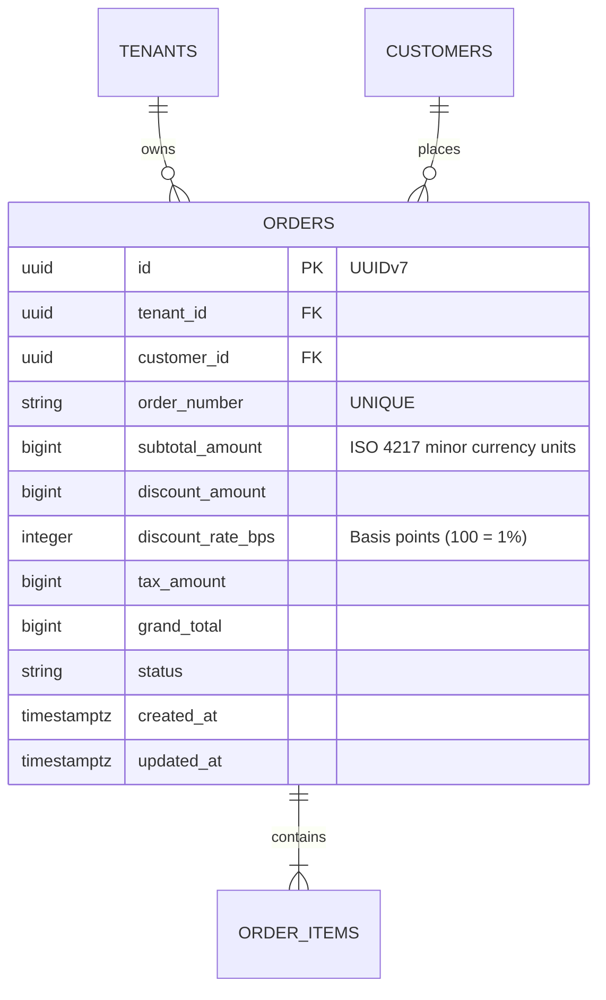

# ERD & API Contract Generator

Transforms validated Acceptance Criteria and functional requirements into concrete, implementation-ready database schemas and HTTP API contracts.

## 1. Entity Relationship Diagram (ERD) Standards
- Produce clear **Mermaid.js** `erDiagram` syntax.
- Include all primary keys (`id UUID PK` time-ordered UUIDv7), foreign keys (`tenant_id UUID FK`, etc.), data types, constraints (`UNIQUE`, `NOT NULL`), and column comments.
- Adhere to the project's PostgreSQL multi-tenant pattern (`tenant_id UUID NOT NULL` on tenant-scoped tables, standard timestamp columns `created_at`, `updated_at`, `deleted_at`).
- **Financial & Monetary Standards**:
  - Currency amounts: `BIGINT` representing ISO 4217 minor currency units (e.g. IDR Rupiah or Sen/cents; zero floating-point).
  - Percentages & rates: `INTEGER` basis points (`rate_bps`, e.g. 100 bps = 1.00%, 1000 bps = 10.00%).

### Example Mermaid ERD:


## 2. API Contract Standards
- Group endpoints by business domain (DDD Bounded Context: `oms`, `crm`, `wms`, `production`, `hrm`, `finance`) and entity lifecycle (e.g. `POST /api/v1/oms/orders`, `GET /api/v1/wms/fabric-rolls`).
- Specify HTTP Method, URL Path, Authentication/RBAC permission requirements.
- **Mandatory DTO Validation Tags**:
  - Every field in JSON Request Body must specify explicit `go-playground/validator` tags (`validate:"required,min=1,..."`).
  - **Custom Enum / OneOf Rule**: For fields with multiple options/enums, **DO NOT** use hardcoded `oneof=...`. You MUST use custom validator tags following domain enum constants: `validate:"required,{enum_name}_enum"` (e.g. `validate:"required,order_status_enum"` backed by `enums.OrderStatus.IsValid()`).
- Document Success (200/201) and Failure (400, 401, 403, 404, 409, 422, 500) JSON response payloads adhering to standard `ApiResponse<T>` wrapper (see `docs/architecture/rest_api_standards.md`):
```json
{
  "success": true,
  "message": "Resource created successfully",
  "data": { ... },
  "error": null,
  "meta": {
    "page": 1,
    "limit": 20,
    "total_items": 100,
    "total_pages": 5
  }
}
```
- For Error responses:
```json
{
  "success": false,
  "message": "Validation failed",
  "data": null,
  "error": {
    "code": "VALIDATION_FAILED",
    "details": [
      { "field": "quantity", "issue": "must be greater than 0" }
    ],
    "trace_id": "018f4a32-9b21-7000-8000-abcdef123456"
  }
}
```
- For Frontend integration: specify `@tanstack/solid-query` cache key query patterns and mutation invalidations.
