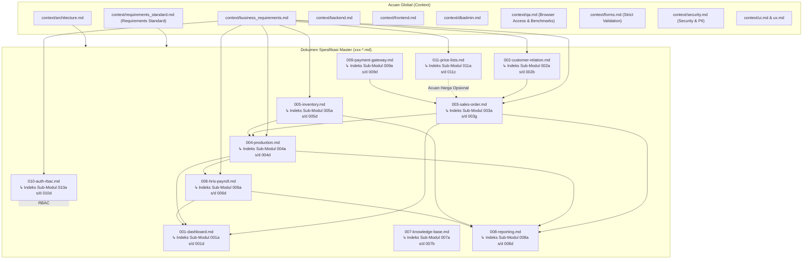

# Dokumentasi Resmi & Cetak Biru Sistem SewERP

Selamat datang di pusat dokumentasi resmi **SewERP** — sistem Enterprise Resource Planning (ERP) mutakhir yang dirancang khusus untuk operasional **Manufaktur Konveksi Baju, Apparel, dan Seragam**.

Dokumentasi ini disusun menjadi 2 tingkatan utama:
1. **Context**: Standar acuan rekayasa global, standar penggalian & penulisan requirement, arsitektur, panduan antarmuka, protokol pengujian browser QA, aturan database, persyaratan uji tolak ukur (*Zero Overhead, Zero Allocations & Zero Footprint*), serta operasional bisnis konveksi.
2. **Specs (Two-Tier Architecture)**:
   - **Tier 1 (Master Specification Hub - `xxx-{name}.md`)**: Dokumen induk arsitektur untuk setiap modul major yang memuat ringkasan proses bisnis, bounded context, aturan bisnis payung, dan indeks navigasi seluruh sub-spesifikasi.
   - **Tier 2 (Sub-Spesifikasi Detail - `xxxy-{name}.md`)**: Dokumen teknis granular (Gherkin 4-pilar, DDL, REST API, UI tokens) yang diindeks langsung di dalam dokumen Master masing-masing.

---

## 🗂️ 1. Dokumen Acuan Global (Context)

Dokumen standar yang wajib dipatuhi oleh seluruh peran pengembang (Backend, Frontend, Database Administrator, QA, DevOps, Security, dan Product/Requirements):

| Dokumen | Deskripsi Singkat & Fokus Utama | Rekomendasi Skills untuk Agent |
| :--- | :--- | :--- |
| 📋 **[Standar Penulisan Requirement](context/requirements_standard.md)** | Protokol penggalian requirement lengkap dari user, format modular `xxxy-{name}.md`, linking metadata wajib, dan skills matrix. | `intent-debugger`, `problem-statement`, `prd-development`, `user-story`, `erd-api-contract`, `spec-kit` |
| 🏛️ **[Arsitektur Sistem](context/architecture.md)** | Pola DDD Modular Monolith, Bounded Context, Multi-Tenancy (`tenant_id`), Zero Floating-Point. | `erd-api-contract`, `spec-kit`, `codegraph`, `autonomous-investigation` |
| ⚙️ **[Standar Rekayasa Backend](context/backend.md)** | Go 1.23+, Gin Gonic, `pgx/v5`, `sqlc`, River queue, benchmark **Zero Overhead & `0 allocs/op`**, validasi input ketat. | `erd-api-contract`, `spec-kit`, `codegraph`, `go-vulncheck` |
| 🖥️ **[Standar Rekayasa Frontend](context/frontend.md)** | SolidJS, **TypeScript Ultra-Strict**, Vite, Bun, UnoCSS, **Zero Virtual DOM Overhead**, pembersihan memori `onCleanup()`. | `ui-ux-pro-max`, `memory-leak-debugging`, `debug-optimize-lcp`, `generative_ui`, `a11y-debugging` |
| 🗄️ **[Standar Database & Administrasi](context/dbadmin.md)** | PostgreSQL 16, goose migrations, konvensi penamaan, UUIDv7, partial & compound index, soft delete. | `erd-api-contract`, `spec-kit`, `codegraph` |
| 🚀 **[Standar DevOps & Infrastruktur](context/devops.md)** | Docker multi-stage build, Docker Compose, Nginx, MinIO/S3 object storage, backup harian `pg_dump`. | `troubleshooting`, `autonomous-investigation`, `infosec` |
| 🧪 **[Standar QA & Akses Browser](context/qa.md)** | Piramida uji, Playwright & Chrome DevTools MCP, **benchmark zero allocs & zero memory footprint**, uji responsif tablet/HP. | `chrome-devtools`, `a11y-debugging`, `debug-optimize-lcp`, `memory-leak-debugging`, `troubleshooting` |
| 🎨 **[Standar Desain Antarmuka (UI)](context/ui.md)** | Modern Flat UI, palet Matcha Green (`#5B7E5F`) & Sakura Pink (`#E8A5B8`), zero blur, 1px border. | `ui-ux-pro-max`, `generative_ui`, `a11y-debugging` |
| 👆 **[Standar Pengalaman Pengguna (UX)](context/ux.md)** | Ergonomi lantai pabrik, touch target 48px, fast numeric input, barcode/QR scanner kamera. | `ui-ux-pro-max`, `customer-journey-map`, `customer-journey-mapping-workshop`, `jobs-to-be-done`, `a11y-debugging` |
| 📝 **[Standar Formulir & Validasi](context/forms.md)** | Validasi **Strict Zod (`.strict()`)** + Go Validator, matriks ukuran pakaian dinamis (S-XXL) bebas alokasi memori, masking IDR. | `ui-ux-pro-max`, `memory-leak-debugging`, `generative_ui` |
| 🛡️ **[Standar Keamanan & Perlindungan Data](context/security.md)** | Klasifikasi data 4 tingkat (Personal PII s/d Strict Pola CAD/DXF), enkripsi AES-256-GCM, UU PDP No. 27/2022, Presigned URL, watermarking, & PostgreSQL RLS. | `infosec`, `cookie-debugging`, `go-vulncheck`, `autonomous-investigation` |
| 📋 **[Kebutuhan Bisnis Konveksi](context/business_requirements.md)** | Alur 8 fase bisnis konveksi, aturan DP fleksibel, margin susut 3-5%, surcharge jumbo, kasbon penjahit. | `intent-debugger`, `jobs-to-be-done`, `customer-journey-map`, `prd-taskmaster`, `user-story` |
| 🔧 **[Kebutuhan Teknis Non-Fungsional](context/technical_requirements.md)** | SLO performa, ambang batas **`0 B/op` & zero leak**, cetak thermal 80mm / A6 untuk tiket bundel kerja, WhatsApp. | `debug-optimize-lcp`, `memory-leak-debugging`, `chrome-devtools`, `spec-kit` |

---

## 📦 2. Dokumen Spesifikasi Master (Specs: `xxx-{name}.md`)

Katalog 11 Modul Master SewERP. Setiap dokumen master bertindak sebagai *hub* arsitektur yang mengindeks dan menaungi sub-spesifikasi detail fitur masing-masing:

| Modul Master | Nama & Lingkup Sistem | Sub-Modul yang Dinaungi | Rekomendasi Skills |
| :--- | :--- | :--- | :--- |
| 📊 **[001-dashboard.md](specs/001-dashboard.md)** | **Dashboard Monitoring Konveksi Terpadu (Cockpit)** | Diindeks di dalam master (`001a`–`001d`) | `erd-api-contract`, `ui-ux-pro-max`, `debug-optimize-lcp` |
| 👥 **[002-customer-relation.md](specs/002-customer-relation.md)** | **Customer Relation & Leads Pipeline (CRM)** | Diindeks di dalam master (`002a`–`002b`) | `erd-api-contract`, `infosec`, `user-story` |
| 📄 **[003-sales-order.md](specs/003-sales-order.md)** | **Sales & Order Management System (OMS)** | Diindeks di dalam master (`003a`–`003g`) | `erd-api-contract`, `spec-kit`, `ui-ux-pro-max` |
| 🧵 **[004-production.md](specs/004-production.md)** | **Alur Produksi Konveksi & Makloon (MES)** | Diindeks di dalam master (`004a`–`004d`) | `ui-ux-pro-max`, `erd-api-contract`, `spec-kit` |
| 📦 **[005-inventory.md](specs/005-inventory.md)** | **Manajemen Inventaris Kain & Stok (WMS)** | Diindeks di dalam master (`005a`–`005d`) | `erd-api-contract`, `spec-kit` |
| 👥 **[006-hris-payroll.md](specs/006-hris-payroll.md)** | **HRIS & Upah Borongan Penjahit (Payroll)** | Diindeks di dalam master (`006a`–`006d`) | `erd-api-contract`, `spec-kit`, `infosec` |
| 💡 **[007-knowledge-base.md](specs/007-knowledge-base.md)** | **Knowledge Base, Pola CAD & Supplier (KMS)** | Diindeks di dalam master (`007a`–`007b`) | `infosec`, `autonomous-investigation` |
| 📈 **[008-reporting.md](specs/008-reporting.md)** | **Laporan & Analitik Operasional-Finansial** | Diindeks di dalam master (`008a`–`008d`) | `erd-api-contract`, `spec-kit`, `infosec` |
| 💳 **[009-payment-gateway.md](specs/009-payment-gateway.md)** | **Integrasi Payment Gateway Xendit & Bank** | Diindeks di dalam master (`009a`–`009d`) | `infosec`, `erd-api-contract` |
| 🔐 **[010-auth-rbac.md](specs/010-auth-rbac.md)** | **Autentikasi Google SSO & RBAC Granular (IAM)** | Diindeks di dalam master (`010a`–`010d`) | `infosec`, `cookie-debugging` |
| 📋 **[011-price-lists.md](specs/011-price-lists.md)** | **Configurable Price Lists (Matrix & Non-Matrix)** | Diindeks di dalam master (`011a`–`011c`) | `erd-api-contract`, `ui-ux-pro-max`, `spec-kit` |

> [!NOTE]
> **Akses Sub-Spesifikasi Detail**:
> Untuk membaca rincian implementasi teknis per fitur (skema DB/DDL, kontrak endpoint REST API, skenario Gherkin 4-pilar, validasi form, dan token UI), silakan buka dokumen **Modul Master** di atas. Setiap dokumen Master menyediakan tabel indeks lengkap menuju berkas sub-spesifikasi modular (`xxxy-{name}.md`).

---

## 🔄 3. Diagram Keterhubungan Antar-Dokumen

---

## 🤖 4. Tim Profil Agen, Shared Memory & CLI Executors

Pengembangan sistem SewERP digerakkan oleh **Tim Agen AI Terorkestrasi** yang bekerja secara paralel menggunakan antarmuka **Antigravity CLI (`agy`)** dan **OpenCode (`opencode`)**, didukung memori persisten di bawah `docs/memory/`.

### A. Katalog Profil Tim Agen (`docs/agent-profile/`)
Panduan peran lengkap, tolak ukur empiris **LiveBench 2.0**, panduan **SumoPod Pay-As-You-Go**, integrasi **Model Frontier China (DeepSeek, Qwen, GLM, Kimi)**, dan resep CLI tersedia di:
👉 **[Hub Profil Agen: docs/agent-profile/README.md](agent-profile/README.md)**

| Kode | Peran & Dokumen Profil | Tingkatan | Fokus Utama | Model Primary (Pay-As-You-Go Hemat) | Model Alternatif / Premium Fallback |
| :--- | :--- | :--- | :--- | :--- | :--- |
| **00** | 📊 **[00-project-manager.md](agent-profile/00-project-manager.md)** | Tier 1 (PM) | Roadmap, Sprint Milestone, Release Coordination | **DeepSeek-V3** ($0.14 In / $0.28 Out) | Gemini 2.0 Flash / GPT-4o |
| **01** | 🎯 **[01-lead-orchestrator.md](agent-profile/01-lead-orchestrator.md)** | Tier 1 (Orchestrator) | Atlas Task Graph, Quality Gate (DoR/DoD) | **DeepSeek-R1** ($0.55 In / $2.19 Out) | DeepSeek-V3 / o3-mini |
| **02** | 📋 **[02-lead-product-analyst.md](agent-profile/02-lead-product-analyst.md)** | Tier 2 (Product Lead) | Elicitation, PRD, User Story, Gherkin 4-Pilar | **DeepSeek-V3** / **GLM-4-Plus** | Gemini 2.0 Flash / Claude 3.7 Sonnet |
| **03** | 🏛️ **[03-lead-system-architect.md](agent-profile/03-lead-system-architect.md)** | Tier 2 (Architect) | DDD Modular Monolith, Multi-Tenancy, Contract-First | **DeepSeek-R1** ($0.55 In / $2.19 Out) | Qwen 2.5 Coder 32B / Claude 3.7 Sonnet |
| **04** | 🗄️ **[04-database-specialist.md](agent-profile/04-database-specialist.md)** | Tier 3 (DBA) | PostgreSQL 16, goose, sqlc, UUIDv7, BIGINT Zero-Float | **Qwen 2.5 Coder 32B** (~$0.18 / 1M) | DeepSeek-V3 / o3-mini |
| **05** | ⚙️ **[05-lead-backend-engineer.md](agent-profile/05-lead-backend-engineer.md)** | Tier 2 (Backend Lead) | Clean Architecture, Zero-Alloc Gatekeeper (`0 B/op`) | **DeepSeek-R1** ($0.55 In / $2.19 Out) | Qwen 2.5 Coder 32B / o3-mini |
| **06** | 🔧 **[06-backend-engineer.md](agent-profile/06-backend-engineer.md)** | Tier 3 (Backend Spec) | Go 1.23+, Gin, pgx/v5, Custom Enum Validator, River | **DeepSeek-V3** / **Qwen 2.5 Coder 32B** | DeepSeek-R1 / Claude 3.7 Sonnet |
| **07** | 🎨 **[07-lead-frontend-engineer.md](agent-profile/07-lead-frontend-engineer.md)** | Tier 2 (Frontend Lead) | SolidJS Architecture, Zero-Leak (`onCleanup`), Flat UI | **DeepSeek-V3** / **Qwen 2.5 Coder 32B** | DeepSeek-R1 / Claude 3.7 Sonnet |
| **08** | 🖥️ **[08-frontend-engineer.md](agent-profile/08-frontend-engineer.md)** | Tier 3 (Frontend Spec) | SolidJS Views, UnoCSS Flat UI, Kobalte, Zod `.strict()` | **DeepSeek-V3** / **Qwen 2.5 Coder 32B** | DeepSeek-R1 / GPT-4o |
| **09** | 🛡️ **[09-code-reviewer.md](agent-profile/09-code-reviewer.md)** | Tier 3 (Code Reviewer) | Maker-Checker: Audit Zero-Alloc, Zero-Leak, OWASP | **DeepSeek-R1** ($0.55 In / $2.19 Out) | Qwen 2.5 Coder 32B / Claude 3.7 Sonnet |
| **10** | 🧪 **[10-lead-qa-engineer.md](agent-profile/10-lead-qa-engineer.md)** | Tier 2 (QA Lead) | Piramida Tes, Playwright, Tablet 48px, Cetak Thermal 80mm | **DeepSeek-V3** / **GLM-4-Plus** | Gemini 2.0 Flash / Claude 3.7 Sonnet |
| **11** | 🚀 **[11-lead-devops-security.md](agent-profile/11-lead-devops-security.md)** | Tier 2 (DevOps Lead) | Distroless Docker (<30MB), Nginx SSL, MinIO, UU PDP | **DeepSeek-R1** ($0.55 In / $2.19 Out) | Qwen 2.5 72B / OpenAI o1 |

### B. Protokol Alur Memori 4-Tahap (`docs/memory/`)
Setiap pemanggilan agen wajib mengikuti siklus:
$$\text{Requirement} \longrightarrow \text{Context} \longrightarrow \text{Long Memory} \longrightarrow \text{Shareds}$$

- 🧠 **[docs/memory/long-memory/](memory/long-memory/)**: Menyimpan memori internal jangka panjang per sub-modul (`{xxxy}-{title of memory}.md`).
- 🤝 **[docs/memory/shareds/](memory/shareds/)**: Menyimpan artefak handoff antar-agen (`{agent from}-{xxxy}-{title of requirement}.md`) yang memungkinkan kerja paralel tanpa blocking.
- Panduan protokol lengkap: **[docs/memory/README.md](memory/README.md)**.

