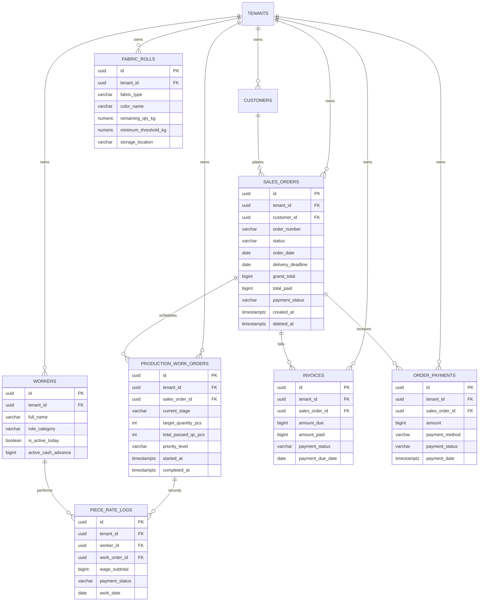

# Spesifikasi Master Modul: 001 - Dashboard Monitoring Konveksi Terpadu (Executive & Operational Cockpit)

Dokumen ini merupakan **Spesifikasi Master (Tier 1)** yang memuat arsitektur agregasi data, bounded context, visualisasi analitik eksekutif, serta katalog navigasi menuju seluruh sub-spesifikasi detail fitur Dashboard SewERP.

---

## 1. Metadata & Tautan Referensi Terkait

- **Kode Modul**: `SPEC-001`
- **Tingkatan Dokumen**: **Tier 1 (Master Specification Hub)**
- **Domain Bounded Context**: `analytics` / `dashboard`
- **Tautan Standar Acuan Global**:
  - 📋 [Standar Penulisan Requirement](../context/requirements_standard.md)
  - 🏛️ [Arsitektur Sistem & Presisi Finansial](../context/architecture.md)
  - ⚙️ [Standar Rekayasa Backend & Zero Alloc](../context/backend.md)
  - 🖥️ [Standar Frontend SolidJS Ultra-Strict](../context/frontend.md)
  - 🗄️ [Standar Database PostgreSQL & Indexing](../context/dbadmin.md)
  - 🎨 [Standar Desain Antarmuka Modern Flat UI](../context/ui.md)
  - 👆 [Prinsip UX Lapangan Pabrik](../context/ux.md)
  - 🛡️ [Standar Keamanan, PII & RLS](../context/security.md)
  - 📋 [Kebutuhan Bisnis Konveksi](../context/business_requirements.md)
  - 🧪 [Standar QA & Benchmark Testing](../context/qa.md)
- **Tautan Spesifikasi Master Terkait**:
  - 👥 [002 - Customer Relation & Master Price List (CRM)](./002-customer-relation.md)
  - 📄 [003 - Sales & Order Management System (OMS)](./003-sales-order.md)
  - 🧵 [004 - Alur Produksi & Makloon (MES)](./004-production.md)
  - 📦 [005 - Manajemen Inventaris Kain & Stok (WMS)](./005-inventory.md)
  - 👥 [006 - HRIS & Upah Borongan Penjahit (Payroll)](./006-hris-payroll.md)
  - 💡 [007 - Knowledge Base, Tech Pack & Supplier](./007-knowledge-base.md)
  - 📊 [008 - Laporan & Analitik Operasional (Reporting)](./008-reporting.md)
  - 💳 [009 - Payment Gateway & Metode Bayar](./009-payment-gateway.md)
  - 🔐 [010 - Autentikasi Google SSO & RBAC Granular](./010-auth-rbac.md)
  - 📋 [011 - Configurable Price Lists (Matrix & Non-Matrix)](./011-price-lists.md)

---

## 2. Indeks Sub-Modul Fungsional (Tier 2 Sub-Specifications)

Rincian implementasi teknis, skema DDL, kontrak API RESTful, skenario Gherkin 4-pilar, dan token UI dipecah menjadi sub-spesifikasi modular berikut:

| Berkas Sub-Spesifikasi | Lingkup Fungsional Utama | Ukuran & Fokus Teknis |
| :--- | :--- | :--- |
| 📊 **[001a-dashboard-overview-metrics.md](./001a-dashboard-overview-metrics.md)** | Quick counts seluruh modul, metrik finansial/operasional, endpoint `/metrics`. | DDL caching, query agregasi `0 allocs/op`. |
| 📈 **[001b-dashboard-sales-analytics.md](./001b-dashboard-sales-analytics.md)** | Grafik tren penjualan 6 bulan dual-axis & pipeline status pesanan funnel bar. | Visual Flat UI SVG, optimasi DOM. |
| 🚨 **[001c-dashboard-radar-alerts.md](./001c-dashboard-radar-alerts.md)** | Radar peringatan deadline kritis (< 3 hari) & peringatan stok menipis. | Query interval & filter deadline. |
| 🎛️ **[001d-dashboard-bento-rbac.md](./001d-dashboard-bento-rbac.md)** | Layout Bento-Grid Modern Flat UI & filter tampilan widget berbasis role. | SolidJS responsive grid & RBAC guard. |

---

## 3. Ringkasan Kebutuhan & Masalah Bisnis

### Masalah yang Dihadapi
Operasional pabrik konveksi dan garmen berskala kecil-menengah (UKM) sering menghadapi kendala fragmentasi informasi antar-divisi:
1. **Buta Status Arus Kas & Piutang Berjalan**: Owner sulit mengetahui posisi keuangan harian secara komprehensif — berapa total omset bulan berjalan, berapa sisa piutang yang tertahan di pelanggan (*unpaid invoices*), dan berapa estimasi kewajiban kasbon serta upah borongan penjahit yang harus dibayarkan akhir pekan.
2. **Ketiadaan Radar Visual Kemacetan Pesanan (Bottleneck)**: Pesanan pakaian menumpuk tanpa kejelasan stasiun kerja mana yang tersendat (apakah antrean meja potong, makloon sablon/bordir luar, jahit, atau penumpukan di QC/packing).
3. **Keterlambatan Pengiriman (Overdue Risk)**: Tenggat waktu (*deadline*) pengiriman terlewat karena tidak adanya sistem peringatan dini visual untuk pesanan dengan sisa waktu $< 3$ hari.
4. **Isolasi Data Antar-Modul**: Setiap bagian (Sales, Mandor Jahit, Gudang Bahan Baku, Kasir) bekerja dengan catatannya sendiri sehingga tidak ada satu layar sentral (*single source of truth*) yang menyajikan metrik penghitungan ringkas (*quick counts*) dari seluruh siklus hidup konveksi.
5. **Kebingungan Analisis Tren Penjualan**: Tanpa grafik visual yang terarah, pemilik usaha tidak dapat membaca tren musiman (apakah omset naik karena volume pcs bertambah atau karena rata-rata harga artikel lebih mahal).

### Solusi Terpadu: Executive & Operational Bento Cockpit
Dashboard SewERP dirancang dengan arsitektur **Bento-Grid Modern Flat UI** yang menyajikan 3 lapisan analitik utama:
1. **Layar Quick Counts Seluruh Modul**: Kartu metrik ringkas (*stat cards*) yang menghitung data operasional dari semua modul (CRM, Sales, Produksi, Gudang, Payroll, Knowledge Base, Payment).
2. **Visualisasi Grafik Sales Order Berorientasi Keputusan Bisnis**:
   - **Grafik Tren Penjualan Bulanan (Dual-Axis Monthly Revenue & Volume Chart)**: Menggabungkan *Bar Chart* (Volume Pcs pakaian) dan *Line Chart* (Omset Rupiah) untuk melihat tren pertumbuhan dan kapasitas beban kerja bengkel selama 6–12 bulan terakhir.
   - **Grafik Pipeline Siklus Pesanan (Order Lifecycle Stepped Bar)**: Memvisualisasikan pesanan yang berada di setiap tahapan status (`Quotation` $\to$ `Menunggu DP` $\to$ `Dalam Produksi` $\to$ `Siap Kirim` $\to$ `Selesai`) guna mendeteksi sumbatan kasbon/DP dan barang tertahan.
3. **Penyajian Adaptif Berbasis RBAC (Role-Based Views)**: Widget dan kartu metrik yang tampil secara otomatis menyesuaikan peran pengguna yang sedang login (Owner melihat metrik finansial & analitik, Manajer Produksi melihat stasiun kerja & bahan baku, Admin Sales melihat prospek & pipeline).

---

## 3. Matriks Penghitungan Cepat (Quick Counts) Antar-Modul

Dashboard mengagregasi indikator kinerja utama (KPI) yang ditarik dari seluruh spesifikasi fitur:

| Modul Asal | Indikator Metrik (Quick Count) | Tipe Nilai | Deskripsi & Tujuan Bisnis | Target Role |
| :--- | :--- | :--- | :--- | :--- |
| **002 - CRM** | **Total Pelanggan Aktif** | Count (`int`) | Jumlah pelanggan unik yang pernah bertransaksi. | Owner, Sales |
| **002 - CRM** | **Pelanggan Baru Bulan Ini** | Count (`int`) | Pelanggan pertama kali mendaftar/order bulan berjalan. | Owner, Sales |
| **002 - CRM** | **Prospek Masuk (Active Leads)** | Count (`int`) | Leads dalam status `new_lead`, `quoted`, `sample_sent`. | Admin Sales |
| **003 - Sales** | **Total SPK Aktif Berjalan** | Count (`int`) | Seluruh pesanan dalam status `in_production`. | Semua Role |
| **003 - Sales** | **Pesanan Menunggu DP** | Count (`int`) | Penawaran deal yang belum membayar uang muka. | Admin Sales, Kasir |
| **003 - Sales** | **Pesanan Siap Kirim** | Count (`int`) | Selesai QC/packing, menunggu surat jalan & pelunasan. | Sales, Gudang |
| **003 - Sales** | **Omset Resmi Bulan Berjalan** | IDR (`int64`) | Akumulasi `grand_total` SPK disetujui bulan ini. | Owner |
| **003 - Sales** | **Total Piutang Tertunggak** | IDR (`int64`) | Sisa tagihan belum lunas dari pesanan yang terbit. | Owner, Kasir |
| **004 - Produksi**| **Beban Stasiun Produksi** | Matrix (`int`) | Sebaran pcs & SPK di 6 stasiun (Cutting, Sablon, Jahit, QC).| Manajer, Mandor |
| **004 - Produksi**| **Radar Deadline Kritis (< 3 Hari)**| Count (`int`) | Pesanan dengan $H-3$ sebelum tenggat pengiriman. | Manajer, Owner |
| **004 - Produksi**| **Pesanan Terlambat (Overdue)** | Count (`int`) | SPK yang telah melewati tanggal janji kirim. | Manajer, Owner |
| **004 - Produksi**| **Rasio Tepat Waktu (OTD Rate)** | Percent (`bps`) | Persentase pesanan selesai tepat waktu (30 hari terakhir).| Owner, Manajer |
| **005 - Gudang** | **Peringatan Bahan Baku Rendah**| Count (`int`) | Item kain/aksesoris di bawah batas *safety stock*. | Manajer, Gudang |
| **005 - Gudang** | **Total Rol Kain Tersedia** | Count (`int`) | Jumlah rol kain utuh di gudang siap pakai. | Gudang, Manajer |
| **005 - Gudang** | **Retur Sisa Rol (Offcut Return)**| Kg / Rol (`int`) | Akumulasi sisa kain potongan yang kembali ke gudang. | Gudang, Owner |
| **006 - HRIS** | **Tenaga Kerja Aktif Hari Ini** | Count (`int`) | Penjahit & operator hadir pada shift kerja aktif. | Mandor, Kasir |
| **006 - HRIS** | **Estimasi Upah Borongan Berjalan**| IDR (`int64`) | Akumulasi kupon jahit belum dibayar minggu ini. | Owner, Kasir |
| **006 - HRIS** | **Total Kasbon Belum Terpotong** | IDR (`int64`) | Saldo pinjaman kasbon penjahit yang belum terpotong.| Kasir, Owner |
| **007 - KB** | **Pola & Master Tech Pack Aktif**| Count (`int`) | Berkas pola baju master terverifikasi di sistem. | Mandor, Sales |
| **009 - Payment**| **Kas Masuk Hari Ini** | IDR (`int64`) | Total setoran DP & pelunasan masuk hari ini (Semua metode).| Kasir, Owner |
| **009 - Payment**| **Transaksi Pending Settlement** | Count (`int`) | Pembayaran transfer/VA yang menunggu rekonsiliasi. | Kasir |

---

## 4. Spesifikasi Visualisasi Grafik Sales Order

### 4.1. Grafik 1: Tren Penjualan & Beban Kapasitas (Dual-Axis Revenue & Volume Trend)
- **Tujuan Analisis**: Memberikan evaluasi makro bagi Owner dan Kepala Pemasaran mengenai stabilitas bisnis konveksi dari bulan ke bulan.
- **Tipe Visual**: Kombinasi **Bar Chart** (Volume Output Pcs) dan **Line Chart** (Omset Rupiah IDR).
- **Sumbu & Dimensi**:
  - **Sumbu X**: Periode 6 Bulan Terakhir (format: `Mei 2026`, `Jun 2026`, ..., `Okt 2026`).
  - **Sumbu Y Kiri**: Nilai Omset (Rupiah IDR, dalam kelipatan Juta Rp, misal Rp 0 s/d Rp 250 Jt).
  - **Sumbu Y Kanan**: Volume Total Pcs Pakaian (misal 0 s/d 10.000 pcs).
- **Logika Data**:
  - Bar: $\sum (\text{order\_items.total\_pcs})$ dari SPK berstatus `approved`, `in_production`, atau `completed` pada bulan terkait.
  - Line: $\sum (\text{sales\_orders.grand\_total})$ dari SPK yang disetujui pada bulan terkait.
- **Interaktivitas**:
  - *Hover Tooltip*: Menampilkan rincian tanggal, total nominal IDR terformat, total pcs diproduksi, dan rata-rata harga per pcs (*Average Selling Price*).
  - *Filter Rentang*: Tombol pintas `6 Bulan Terakhir` (default) dan `12 Bulan Terakhir`.

### 4.2. Grafik 2: Pipeline Status Pesanan (Order Lifecycle Stepped Bar)
- **Tujuan Analisis**: Mendeteksi di mana titik kemacetan siklus pesanan dan potensi penundaan kas.
- **Tipe Visual**: **Horizontal Stepped Funnel Bar** atau Bar Bertumpuk Berkelanjutan.
- **Tahapan Status yang Dipetakan**:
  1. `Quotation / Penawaran`: Draft penawaran harga yang dikirim ke pelanggan.
  2. `Menunggu DP`: Penawaran yang disetujui pelanggan namun belum diverifikasi DP-nya.
  3. `Antrean Produksi`: SPK terbit, menunggu alokasi bahan kain di gudang potong.
  4. `Lantai Produksi (WIP)`: Sedang dipotong, disablon/bordir makloon, atau dijahit.
  5. `Siap Kirim (Staging)`: Selesai QC dan packing, menunggu pelunasan tagihan atau jadwal kurir.
  6. `Selesai (Completed)`: Barang telah diterima pelanggan dan pembayaran lunas.
- **Informasi per Batang**:
  - Jumlah order (`count`) dan persentase dari total order aktif.
  - Nilai nominal transaksi tertahan di tahap tersebut (`total_amount_idr`).
  - Warna indikator sesuai standar Flat UI (misal: Hijau Matcha untuk produksi berjalan, Amber untuk Menunggu DP, Biru Slate untuk Siap Kirim).

---

## 5. User Stories

- **US-01-01 [P1 - Owner]**: Sebagai *Owner Konveksi*, saya ingin melihat total omset bulan berjalan, sisa piutang pelanggan, dan grafik tren 6 bulan (omset vs volume pcs) di layar utama, agar saya memahami kesehatan finansial dan tren musiman pabrik secara instan.
- **US-01-02 [P1 - Manajer Produksi]**: Sebagai *Manajer Produksi*, saya ingin melihat beban pesanan di 6 stasiun kerja dan radar deadline kritis (< 3 hari), agar saya dapat memprioritaskan lembur di stasiun yang mengalami kemacetan (*bottleneck*).
- **US-01-03 [P1 - Admin Sales]**: Sebagai *Admin Sales*, saya ingin melihat kartu jumlah pesanan menunggu DP, jumlah prospek aktif, dan grafik status pipeline pesanan, agar saya segera menindaklanjuti calon pelanggan dan order yang siap dikirim.
- **US-01-04 [P1 - Kasir / Keuangan]**: Sebagai *Kasir*, saya ingin melihat total kas masuk hari ini, daftar pembayaran pending, dan estimasi akumulasi upah borongan yang harus dibayar akhir pekan, agar likuiditas kas operasional selalu siap.
- **US-01-05 [P2 - Mandor Gudang]**: Sebagai *Staf Gudang*, saya ingin melihat peringatan stok kain yang berada di bawah ambang batas minimal, agar pengadaan bahan kain dapat dilakukan sebelum lantai potong kehabisan stok.
- **US-01-06 [P2 - Semua Pengguna]**: Sebagai *Pengguna Terautentikasi*, saya ingin tampilan dashboard otomatis memuat widget yang sesuai dengan hak akses (RBAC) akun saya, agar antarmuka tetap bersih, relevan, dan informasi rahasia gaji/omset terlindungi.

---

## 6. Kriteria Penerimaan (Acceptance Criteria - Gherkin)

### Skenario 1: Menampilkan Dashboard Terpadu Lengkap untuk Akun Owner (Happy Path)
- **Given** Pengguna login sebagai `Owner` dengan `tenant_id` valid.
- **When** Pengguna membuka halaman `/dashboard`.
- **Then** Sistem menampilkan metrik lengkap:
  - Quick Counts Finansial: Omset Bulan Berjalan, Piutang Belum Lunas, Kas Masuk Hari Ini, Estimasi Liabilitas Upah.
  - Quick Counts Operasional: Total SPK Aktif, Deadline Kritis, Peringatan Stok Rendah, Tenaga Kerja Hadir.
  - Grafik Penjualan: Dual-Axis Tren Omset & Volume 6 Bulan, serta Pipeline Status Pesanan.
  - Tabel Radar Deadline Kritis (< 3 hari).
- **And** Waktu muat awal (*Initial Render*) dashboard tercapai dalam tempo $< 300\text{ ms}$.

### Skenario 2: Rendering Grafik Tren Omset & Volume 6 Bulan
- **Given** Terdapat data riwayat SPK yang disetujui selama periode Mei hingga Oktober 2026.
- **When** Widget Grafik Tren dimuat di browser.
- **Then** Sistem menampilkan 6 titik data sumbu X dengan batang biru/slate untuk volume pcs dan garis hijau matcha (`#5B7E5F`) untuk omset IDR.
- **And** Ketika kursor pengguna menyentuh (*hover*) batang bulan Oktober 2026, muncul popover tooltip yang menampilkan: "Bulan: Oktober 2026", "Omset: Rp 142.500.000", "Volume: 2.450 pcs", "Rata-rata: Rp 58.163 / pcs".

### Skenario 3: Penapisan Tampilan Berdasarkan Hak Akses Role (RBAC Filtering)
- **Given** Pengguna login dengan role `Production_Manager`.
- **When** Halaman Dashboard dimuat.
- **Then** Sistem TIDAK menampilkan kartu "Omset Bulan Berjalan", "Total Piutang", "Kas Masuk Hari Ini", maupun nominal rupiah pada grafik pipeline.
- **And** Sistem menampilkan widget fokus produksi: Sebaran Stasiun Kerja, Radar Deadline Kritis, Peringatan Stok Kain Rendah, dan Tingkat Kehadiran Penjahit.

### Skenario 4: Peringatan Deadline Kritis & Stok Menipis
- **Given** Terdapat SPK `PO-202610-0091` dengan deadline pengiriman tersisa 2 hari dan masih di stasiun `sewing`.
- **And** Stok kain `Combed 30s Hitam Reaktif` tersisa 8.5 kg (batas minimum: 20 kg).
- **When** Dashboard dimuat oleh Manajer Produksi.
- **Then** Kartu peringatan deadline menyorot SPK tersebut dengan badge merah `bg-rose-50 text-rose-700 border-rose-300` berkedip halus (*pulse*).
- **And** Kartu peringatan inventaris menampilkan badge peringatan kuning/oranye pada kain tersebut dengan tombol pintas "Pesan Kain".

---

## 7. Skema Relasi Data Agregasi (Mermaid ERD)

Dashboard bertindak sebagai mesin agregasi baca (*read-only aggregation engine*) yang menarik data lintas tabel transaksi menggunakan indeks gabungan:



### Indeks Database untuk Agregasi Berkecepatan Tinggi (< 50ms)
```sql
-- Indeks agregasi omset & status sales order per tenant
CREATE INDEX idx_sales_orders_dashboard_agg 
ON sales_orders (tenant_id, status, order_date) 
WHERE deleted_at IS NULL;

-- Indeks radar deadline terdekat dan stasiun produksi
CREATE INDEX idx_production_orders_deadline 
ON sales_orders (tenant_id, delivery_deadline) 
INCLUDE (order_number, grand_total)
WHERE status = 'in_production' AND deleted_at IS NULL;

-- Indeks peringatan stok kain di bawah ambang batas aman
CREATE INDEX idx_fabric_rolls_safety_stock 
ON fabric_rolls (tenant_id, remaining_qty_kg) 
WHERE remaining_qty_kg <= minimum_threshold_kg AND deleted_at IS NULL;

-- Indeks kas masuk harian per metode bayar
CREATE INDEX idx_order_payments_today 
ON order_payments (tenant_id, payment_date, payment_status) 
WHERE payment_status = 'settled' AND deleted_at IS NULL;
```

---

## 8. Kontrak API RESTful

### Endpoint Utama: `GET /api/v1/dashboard/metrics`

Endpoint terpadu yang menyajikan seluruh metrik counting, radar deadline, dan payload grafik yang telah disaring otomatis oleh backend sesuai hak akses role pengguna dalam token JWT.

- **Protokol**: `HTTP/1.1` / `HTTP/2`
- **Method**: `GET`
- **Headers Wajib**:
  - `Authorization: Bearer <JWT_TOKEN>`
  - `X-Tenant-ID: <UUIDv7>`
- **Query Parameters (Opsional)**:
  - `trend_months`: Jumlah bulan tren penjualan (`6` atau `12`, default: `6`).

#### Respons Sukses (HTTP 200 OK - Role Owner)
```json
{
  "status": "success",
  "data": {
    "user_role": "owner",
    "quick_counts": {
      "crm": {
        "total_active_customers": 142,
        "new_customers_this_month": 12,
        "active_leads": 8
      },
      "sales": {
        "active_spk_count": 18,
        "pending_dp_orders": 5,
        "ready_to_ship_orders": 3,
        "monthly_revenue": 142500000,
        "unpaid_receivables": 48200000
      },
      "production": {
        "wip_orders_count": 18,
        "urgent_deadlines_count": 2,
        "overdue_orders_count": 0,
        "on_time_delivery_rate_bps": 9450,
        "by_stage": {
          "cutting": 3,
          "screen_printing": 4,
          "sewing": 7,
          "qc_packing": 3,
          "ready_to_ship": 1
        }
      },
      "inventory": {
        "low_stock_items_count": 2,
        "total_available_rolls": 64,
        "roll_return_rate_bps": 420
      },
      "payroll": {
        "active_workers_today": 16,
        "estimated_weekly_wage_liability": 18450000,
        "total_unsettled_cash_advances": 3200000
      },
      "knowledge_base": {
        "active_tech_packs_count": 45,
        "verified_suppliers_count": 14
      },
      "payments": {
        "cash_in_today": 12500000,
        "pending_settlements_count": 1
      }
    },
    "sales_charts": {
      "monthly_trend": [
        { "period": "2026-05", "label": "Mei", "revenue_idr": 98000000, "volume_pcs": 1800 },
        { "period": "2026-06", "label": "Jun", "revenue_idr": 115000000, "volume_pcs": 2100 },
        { "period": "2026-07", "label": "Jul", "revenue_idr": 130000000, "volume_pcs": 2350 },
        { "period": "2026-08", "label": "Ags", "revenue_idr": 122000000, "volume_pcs": 2050 },
        { "period": "2026-09", "label": "Sep", "revenue_idr": 138000000, "volume_pcs": 2200 },
        { "period": "2026-10", "label": "Okt", "revenue_idr": 142500000, "volume_pcs": 2450 }
      ],
      "order_pipeline": [
        { "stage": "quotation", "label": "Penawaran (Draft)", "order_count": 6, "total_amount_idr": 34000000 },
        { "stage": "waiting_dp", "label": "Menunggu DP", "order_count": 5, "total_amount_idr": 42500000 },
        { "stage": "in_production", "label": "Dalam Produksi", "order_count": 18, "total_amount_idr": 142500000 },
        { "stage": "ready_to_ship", "label": "Siap Kirim", "order_count": 3, "total_amount_idr": 28000000 },
        { "stage": "completed", "label": "Selesai (Bulan Ini)", "order_count": 24, "total_amount_idr": 189000000 }
      ]
    },
    "urgent_deadlines": [
      {
        "order_id": "01925b6a-8451-7ef1-953e-51c045b0a701",
        "order_number": "PO-202610-0082",
        "customer_name": "SMA Nusantara 2026",
        "article_summary": "150 pcs Jaket Varsity Fleece Navy",
        "delivery_deadline": "2026-10-23",
        "days_remaining": 2,
        "current_stage": "sewing",
        "is_critical": true
      },
      {
        "order_id": "01925b6a-9921-72f3-a12b-34a011b0e994",
        "order_number": "PO-202610-0089",
        "customer_name": "PT Sumber Mineral Abadi",
        "article_summary": "80 pcs Kemeja PDL Drill Khaki",
        "delivery_deadline": "2026-10-24",
        "days_remaining": 3,
        "current_stage": "screen_printing",
        "is_critical": true
      }
    ],
    "inventory_alerts": [
      {
        "item_id": "01925b6a-6612-70b1-88fe-11c990a01234",
        "item_name": "Cotton Combed 30s Hitam Reaktif",
        "remaining_qty_kg": 8.5,
        "minimum_threshold_kg": 20.0,
        "unit": "kg",
        "severity": "high"
      }
    ]
  }
}
```

---

## 9. Desain Antarmuka Pengguna & Bento-Grid Layout

### 9.1. Filosofi Desain Modern Flat UI
Sesuai dengan standar [`context/ui.md`](../context/ui.md) dan [`context/ux.md`](../context/ux.md):
- **Palet Warna**:
  - Warna Utama: Matcha Green (`#5B7E5F`) untuk status aman, tombol aksi utama, dan garis omset.
  - Warna Aksen/Sorot: Sakura Pink (`#E8A5B8`) untuk elemen kontras dan highlight aktif.
  - Peringatan Bahaya: Rose Carmine (`#E11D48` / `bg-rose-50 text-rose-700`) untuk deadline $<3$ hari dan stok kritis.
  - Latar Belakang: Off-White / Pure Flat (`#FBFBFB` / `#FFFFFF`) dengan border tegas `1px solid #E5E7EB`.
- **Zero Blur & Zero Heavy Shadows**: Menghindari `backdrop-filter: blur` dan shadow berlebihan demi performa rendering super cepat di layar tablet/smartphone lantai kerja.

### 9.2. Struktur Tata Letak Bento-Grid Desktop (12 Kolom)
```
+---------------------------------------------------------------------------------------------------+
|  [Header Dashboard] Selamat Datang, Pak Budi (Owner)  |  Filter: [6 Bulan Terakhir v] | [Refresh] |
+---------------------------------------------------------------------------------------------------+
| [STAT 1: Omset Bulan Ini]   | [STAT 2: Piutang Tertunggak] | [STAT 3: Kas Hari Ini]  | [STAT 4: PO Aktif] |
| Rp 142.500.000 (+14%)       | Rp 48.200.000 (5 Pesanan)    | Rp 12.500.000           | 18 SPK (2.450 Pcs) |
+-----------------------------+------------------------------+-------------------------+--------------------+
|                                                            |                                              |
|  GRAFIK UTAMA (Kolom 1 - 7):                               |  GRAFIK PIPELINE (Kolom 8 - 12):             |
|  Tren Penjualan Bulanan (Dual-Axis)                        |  Pipeline Siklus Pesanan                     |
|  - Bar: Volume Pcs Pakaian                                 |  - Quotation (6)                             |
|  - Line: Omset IDR 6 Bulan Terakhir                        |  - Menunggu DP (5) [Alert Kasbon]            |
|                                                            |  - Produksi WIP (18)                         |
|                                                            |  - Siap Kirim (3) [Menunggu Lunas]           |
|                                                            |  - Selesai (24)                              |
+------------------------------------------------------------+----------------------------------------------+
|                                                            |                                              |
|  RADAR DEADLINE KRITIS (< 3 Hari) (Kolom 1 - 7):           |  QUICK COUNTS OPERASIONAL & PERINGATAN (8-12)|
|  - PO-0082 | SMA Nusantara | 2 Hari Lagi | Jahit [ALERT]  |  - CRM: 142 Pelanggan (12 Baru)              |
|  - PO-0089 | PT Sumber Min.| 3 Hari Lagi | Sablon [ALERT]  |  - Stok Rendah: Combed 30s Hitam (8.5 kg)    |
|  [Lihat Seluruh Jadwal Produksi ->]                        |  - Payroll: 16 Penjahit Hadir (Liabilitas Upah)|
+------------------------------------------------------------+----------------------------------------------+
```

### 9.3. Pemilihan Engine Chart Frontend
- Menggunakan library visualisasi berbasis SVG / Canvas ultra-ringan yang mendukung SolidJS tanpa Virtual DOM overhead (seperti **Unovis** atau **Chart.js** dengan canvas context native).
- Wajib menyertakan siklus pembersihan memori `onCleanup(() => chart.destroy())` sesuai standar [`context/frontend.md`](../context/frontend.md) untuk mencegah kebocoran memori saat pergantian rute tab.

---

## 10. Matriks Hak Akses & Personalisasi Widget (RBAC 010)

Setiap peran kerja hanya melihat widget yang relevan dengan tugas dan tingkat kerahasiaan datanya:

| Widget / Komponen Dashboard | Owner | Manajer Produksi | Admin Sales | Kasir / Keuangan | Mandor Bengkel / Gudang |
| :--- | :---: | :---: | :---: | :---: | :---: |
| **Kartu Omset & Piutang (Finansial)** | ✅ Penuh | ❌ Sembunyi | ❌ Sembunyi | ✅ Baca | ❌ Sembunyi |
| **Kartu Kas Masuk & Pending Payment** | ✅ Penuh | ❌ Sembunyi | ❌ Sembunyi | ✅ Penuh | ❌ Sembunyi |
| **Grafik Tren Penjualan 6 Bulan (Dual-Axis)** | ✅ Penuh | ⚠️ Volume Pcs saja | ⚠️ Volume Pcs saja| ❌ Sembunyi | ❌ Sembunyi |
| **Grafik Pipeline Status Order** | ✅ Lengkap | ⚠️ Status saja | ✅ Lengkap | ✅ Nilai DP/Lunas | ⚠️ Status WIP saja |
| **Radar Deadline Kritis Produksi** | ✅ Baca | ✅ Aksi Prioritas | ✅ Baca Status | ❌ Sembunyi | ✅ Aksi Produksi |
| **Beban Stasiun Kerja (Cutting-Jahit-QC)**| ✅ Ringkas | ✅ Detail Lengkap | ✅ Status Pelanggan| ❌ Sembunyi | ✅ Stasiun Sendiri |
| **Peringatan Stok Kain & Aksesoris Rendah**| ✅ Ringkas | ✅ Detail | ❌ Sembunyi | ❌ Sembunyi | ✅ Detail Gudang |
| **Liabilitas Upah Borongan & Kasbon** | ✅ Penuh | ❌ Sembunyi | ❌ Sembunyi | ✅ Penuh | ❌ Sembunyi |
| **Kehadiran Tenaga Kerja Hari Ini** | ✅ Ringkas | ✅ Lengkap | ❌ Sembunyi | ✅ Untuk Gaji | ✅ Mandor Jahit |

---

## 11. Kerangka Pemecahan Tugas (Dependency-Ordered Task Breakdown)

- [ ] **Fase 1: Lapisan Database & Optimasi Indeks Agregasi**
  - [ ] Task 1.1: Pembuatan migrasi skema PostgreSQL compound & partial indexes pada tabel `sales_orders`, `order_payments`, dan `fabric_rolls`.
  - [ ] Task 1.2: Penulisan kueri agregasi performa tinggi di file `backend/sqlc/dashboard.sql` dengan klausa `WHERE deleted_at IS NULL AND tenant_id = $1`.
  - [ ] Task 1.3: Eksekusi `sqlc generate` untuk menghasilkan Go repository boilerplate dengan zero memory allocation.
- [ ] **Fase 2: Domain Entities & Aggregation Repository**
  - [ ] Task 2.1: Definisi Go struct `DashboardMetrics`, `SalesTrendPoint`, `OrderPipelineStage`, dan `UrgentDeadlineItem` menggunakan tipe `int64` Rupiah.
  - [ ] Task 2.2: Implementasi `DashboardRepository` yang mengeksekusi kueri agregasi secara paralel via `errgroup.Group` untuk respons cepat $< 50\text{ ms}$.
- [ ] **Fase 3: Layanan Bisnis & RBAC Masking Engine**
  - [ ] Task 3.1: Implementasi `DashboardService` yang membaca peran pengguna (`user_role`) dari context sesi JWT.
  - [ ] Task 3.2: Penegakan aturan sensor/masking data finansial bagi role non-eksekutif sebelum payload diserahkan ke HTTP handler.
- [ ] **Fase 4: Delivery HTTP & Endpoint API**
  - [ ] Task 4.1: Registrasi rute Gin `GET /api/v1/dashboard/metrics` dengan middleware autentikasi dan tenant isolation.
  - [ ] Task 4.2: Pembuatan unit testing controller dengan mock repository mencakup seluruh skenario RBAC (Owner, Manager, Sales, Kasir).
- [ ] **Fase 5: Frontend SolidJS & Komponen Bento-Grid**
  - [ ] Task 5.1: Pembuatan layout Bento-Grid responsif di `frontend/src/routes/dashboard.tsx` dengan UnoCSS Flat UI tokens.
  - [ ] Task 5.2: Integrasi hook `@tanstack/solid-query` untuk polling metrik harian / refresh otomatis tanpa flicker.
  - [ ] Task 5.3: Implementasi komponen `SalesTrendChart` (Dual-Axis Bar & Line) dan `OrderPipelineBar` dengan siklus pembersihan `onCleanup()`.
  - [ ] Task 5.4: Pengkondisian widget adaptif berdasarkan sinyal `authStore.user.role`.
- [ ] **Fase 6: Pengujian QA, Benchmark & Aksesibilitas**
  - [ ] Task 6.1: Pengujian responsif tampilan di resolusi desktop (1920x1080), tablet mandor (768x1024), dan HP sales (375x812).
  - [ ] Task 6.2: Verifikasi benchmark nol kebocoran memori pada transisi navigasi halaman dashboard.
