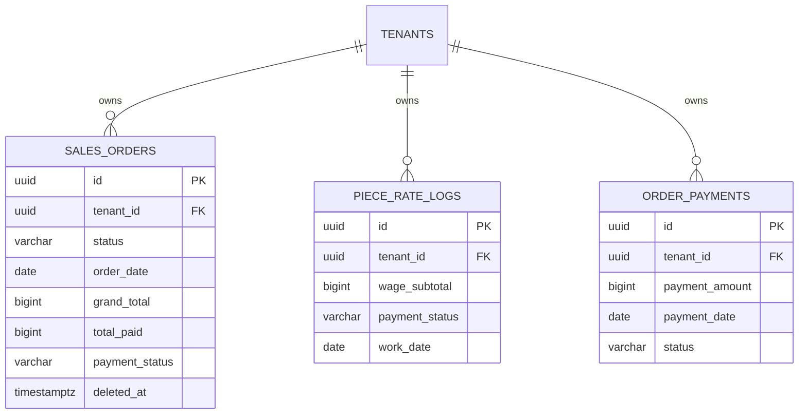

# Spesifikasi Sub-Modul: 001a - Dashboard Quick Counts & Metrik Agregasi

Dokumen ini memuat spesifikasi teknis untuk mesin agregasi performa tinggi yang menghitung indikator kinerja utama (KPI) lintas modul (CRM, OMS, MES, WMS, Payroll, dan Payment) secara instan dalam format kartu metrik (*Stat Cards*) dengan latensi $< 50\text{ ms}$.

---

## 1. Metadata & Tautan Referensi Terkait

- **Kode Modul**: `SPEC-001a`
- **Domain Bounded Context**: `analytics` / `dashboard`
- **Tautan Standar Acuan Global**:
  - 📋 [Standar Penulisan Requirement](../context/requirements_standard.md)
  - 🏛️ [Arsitektur Sistem & Presisi Finansial](../context/architecture.md)
  - ⚙️ [Standar Rekayasa Backend Go & Zero Alloc](../context/backend.md)
  - 🖥️ [Standar Frontend SolidJS Ultra-Strict](../context/frontend.md)
  - 🗄️ [Standar Database PostgreSQL & Indexing](../context/dbadmin.md)
  - 🎨 [Standar Desain Antarmuka Flat UI](../context/ui.md)
  - 👆 [Prinsip UX Lapangan Pabrik](../context/ux.md)
  - 🛡️ [Standar Keamanan, PII & RLS](../context/security.md)
  - 📋 [Kebutuhan Bisnis Konveksi](../context/business_requirements.md)
  - 🧪 [Standar QA & Benchmark Testing](../context/qa.md)
- **Tautan Spesifikasi Fitur Terkait**:
  - 📊 [001b - Visualisasi Analitik Penjualan & Pipeline](./001b-dashboard-sales-analytics.md)
  - ⚠️ [001c - Radar Deadline Kritis & Peringatan Stok](./001c-dashboard-radar-alerts.md)
  - 🎛️ [001d - Tata Letak Bento-Grid & RBAC Views](./001d-dashboard-bento-rbac.md)
  - 📄 [003a - Inti Sales & Order (OMS)](./003a-sales-order-core.md)
  - 👥 [006d - Rekap Gaji Mingguan & Slip](./006d-payroll-slip.md)
  - 💳 [009a - Pengaturan Metode Pembayaran](./009a-payment-settings.md)

---

## 2. Ringkasan Kebutuhan & Masalah Bisnis

### Masalah Lapangan
Owner dan manajer konveksi mengalami "kebutaan posisi harian" (*daily operational blindness*):
1. Tidak ada ringkasan omset resmi bulan berjalan dan total piutang yang masih tertahan di pembeli (*unpaid balance*).
2. Estimasi kewajiban kasbon dan upah borongan mingguan penjahit tidak terdeteksi sebelum hari Sabtu, sering memicu krisis likuiditas kas.
3. Kueri agregasi SQL manual di database operasional lambat dan membebani server transaksi.

### Solusi Fitur
Menyediakan kartu-kartu metrik (*stat cards*) terpadu yang ditarik via paralel goroutine (`errgroup`) membaca indeks compound PostgreSQL.

### Invariant & Aturan Bisnis
1. **Isolasi Tenant**: Seluruh perhitungan wajib terikat klausa `tenant_id = $1 AND deleted_at IS NULL`.
2. **Presisi Finansial**: Seluruh nilai rupiah menggunakan tipe data integer `BIGINT` (Rupiah murni tanpa desimal).
3. **Masking Finansial**: Role non-eksekutif (Mandor, Staf Gudang) tidak boleh menerima field finansial (disamarkan/`null`).

---

## 3. User Stories

- **US-001a-01 [P1 - Owner]**: Sebagai *Owner Konveksi*, saya ingin melihat total omset bulan berjalan, sisa piutang, dan kas masuk hari ini di kartu metrik utama, agar saya mengetahui posisi likuiditas pabrik dalam 3 detik pertama.
- **US-001a-02 [P1 - Kasir]**: Sebagai *Kasir*, saya ingin melihat total kewajiban upah borongan berjalan dan saldo kasbon yang belum terpotong, agar persiapan kas fisik pembagian upah hari Sabtu selalu akurat.
- **US-001a-03 [P2 - Manajer Produksi]**: Sebagai *Manajer Produksi*, saya ingin melihat jumlah total SPK aktif yang sedang berputar di lantai kerja, agar saya dapat mengukur kapasitas muat bengkel.

---

## 4. Kriteria Penerimaan (Acceptance Criteria - Gherkin)

### Skenario 1: Menampilkan Kartu Metrik Lengkap untuk Owner (Happy Path)
- **Given** Pengguna login sebagai `Owner` dengan `tenant_id` valid.
- **When** Mengakses endpoint `GET /api/v1/dashboard/metrics`.
- **Then** Sistem mengembalikan respons `200 OK` memuat data omset bulan berjalan, piutang, kas hari ini, SPK aktif, dan estimasi upah borongan.
- **And** Waktu eksekusi backend tercapai dalam tempo $< 50\text{ ms}$.

### Skenario 2: Masking Finansial untuk Role Produksi (RBAC Enforced)
- **Given** Pengguna login sebagai `Production_Manager`.
- **When** Mengakses endpoint `GET /api/v1/dashboard/metrics`.
- **Then** Sistem mengembalikan data operasional (SPK aktif, pekerja hadir, stok kritis).
- **And** Field `monthly_revenue_idr`, `total_unpaid_receivables_idr`, dan `cash_in_today_idr` bernilai `null` atau `0`.

### Skenario 3: Isolasi Data Multi-Tenant
- **Given** Terdapat Transaksi SPK di Tenant A dan Tenant B.
- **When** Pengguna Tenant A memuat kartu metrik.
- **Then** Angka agregasi hanya menghitung transaksi milik Tenant A.

---

## 5. Skema Relasi Data Granular (Mermaid ERD)



---

## 6. Kontrak API RESTful

### Endpoint: `GET /api/v1/dashboard/metrics`
- **Headers**: `Authorization: Bearer <token>` atau `Cookie: session_id=<id>`
- **Response Payload (HTTP 200 OK)**:
```json
{
  "status": "success",
  "data": {
    "financials": {
      "monthly_revenue_idr": 142500000,
      "total_unpaid_receivables_idr": 48200000,
      "cash_in_today_idr": 12500000,
      "pending_wage_liability_idr": 18450000,
      "unsettled_cash_advances_idr": 3200000
    },
    "operations": {
      "active_spk_count": 18,
      "waiting_dp_count": 5,
      "ready_to_ship_count": 3,
      "active_workers_today": 16,
      "low_stock_alerts_count": 2,
      "urgent_deadlines_count": 4
    }
  }
}
```

---

## 7. Desain Antarmuka Pengguna & Komponen UI
- **Tipe Komponen**: Grid 4-kolom kartu metrik Modern Flat UI dengan border `1px solid #E5E7EB`.
- **Warna Aksen**: Indikator tren positif berlatar hijau Matcha lembut (`bg-emerald-50 text-emerald-700`).
- **Touch Ergonomics**: Kartu dapat diklik untuk navigasi instan ke modul sumber (misal klik Piutang $\to$ menuju OMS terfilter belum lunas).

---

## 8. Persyaratan Keamanan & Non-Fungsional
- **Kinerja**: Kueri SQL agregasi memanfaatkan indeks parsial `idx_sales_orders_active (tenant_id, order_date) WHERE deleted_at IS NULL`.
- **Memori**: Zero allocation buffer pada pemindaian baris `sqlc` di Go backend.

---

## 9. Kerangka Pemecahan Tugas (Task Breakdown)
- [ ] **Fase 1**: Buat kueri agregasi di `backend/sqlc/dashboard.sql` dan indeks compound PostgreSQL.
- [ ] **Fase 2**: Implementasikan `DashboardMetrics` domain entity dengan integer `int64`.
- [ ] **Fase 3**: Usecase paralel goroutine `errgroup` untuk menghitung 6 metrik secara simultan.
- [ ] **Fase 4**: HTTP Handler `GET /api/v1/dashboard/metrics` dengan masking RBAC.
- [ ] **Fase 5**: SolidJS Stat Cards dengan UnoCSS Flat UI tokens.
- [ ] **Fase 6**: Uji benchmark respons time $< 50\text{ ms}$ di bawah 50 koneksi bersamaan.
