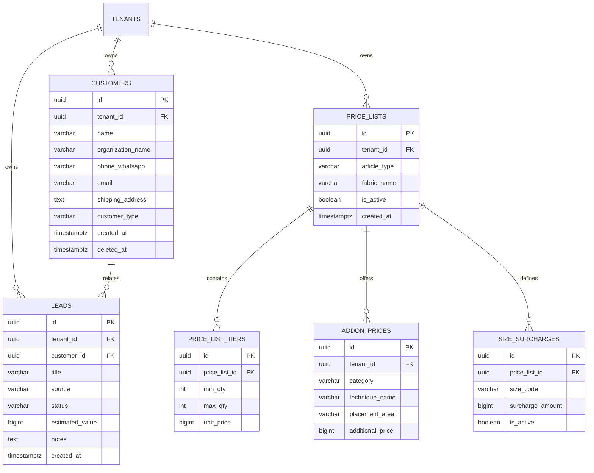

# Spesifikasi Master Modul: 002 - Customer Relation Management (CRM)

Dokumen ini merupakan **Spesifikasi Master (Tier 1)** yang memuat arsitektur pengelolaan relasi pelanggan, bounded context CRM, manajemen saluran prospek (*lead pipeline*), serta katalog navigasi menuju sub-spesifikasi detail fitur.

---

## 1. Metadata & Tautan Referensi Terkait

- **Kode Modul**: `SPEC-002`
- **Tingkatan Dokumen**: **Tier 1 (Master Specification Hub)**
- **Domain Bounded Context**: `crm`
- **Tautan Standar Acuan Global**:
  - 📋 [Standar Penulisan Requirement](../context/requirements_standard.md)
  - 📋 [Kebutuhan Bisnis Konveksi](../context/business_requirements.md)
  - 🛡️ [Standar Keamanan & Perlindungan PII (UU PDP)](../context/security.md)
  - 📝 [Standar Formulir & Validasi Input](../context/forms.md)
  - 🗄️ [Standar Database PostgreSQL](../context/dbadmin.md)
  - 🎨 [Standar UI Flat](../context/ui.md)
  - 🧪 [Standar QA & Pengujian Sistem](../context/qa.md)
- **Tautan Spesifikasi Master Terkait**:
  - 📊 [001 - Dashboard Monitoring](./001-dashboard.md)
  - 📄 [003 - Sales & Order (OMS)](./003-sales-order.md)
  - 💡 [007 - Knowledge Base & Supplier](./007-knowledge-base.md)
  - 📋 [011 - Configurable Price Lists (Matrix & Non-Matrix)](./011-price-lists.md)

---

## 2. Indeks Sub-Modul Fungsional (Tier 2 Sub-Specifications)

Rincian implementasi teknis, skema DDL, kontrak API RESTful, skenario Gherkin 4-pilar, dan validasi Zod dipecah menjadi sub-spesifikasi modular berikut:

| Berkas Sub-Spesifikasi | Lingkup Fungsional Utama | Ukuran & Fokus Teknis |
| :--- | :--- | :--- |
| 👥 **[002a-customer-management.md](./002a-customer-management.md)** | Master database pelanggan, validasi nomor WA unik, & alamat ekspedisi. | PII protection Level 3, isolasi multi-tenant. |
| 🎯 **[002b-lead-pipeline.md](./002b-lead-pipeline.md)** | Pelacakan prospek masuk (Leads Pipeline: new_lead, quoted, sample, deal/lost). | State machine prospek, audit konversi ke Quotation. |

---

## 3. Ringkasan Kebutuhan & Masalah Bisnis

### Masalah yang Dihadapi
1. **Pencatatan Pelanggan Tercecer**: Kontak pembeli (komunitas, panitia acara, reseller, kantor) hanya tersimpan di WhatsApp pribadi admin sales. Saat admin berganti, riwayat pesanan hilang.
2. **Kekeliruan Memberi Harga & Biaya Ukuran Jumbo**: Tidak adanya master harga yang kaku membuat admin kerap salah memberikan penawaran harga, lupa menghitung tambahan biaya (*surcharge*) ukuran jumbo (XXL ke atas yang memakan kain 20-40% lebih banyak), atau salah mengalikan diskon kuantiti besar.
3. **Prospek Menguap**: Permintaan harga yang masuk lewat chat tidak terpantau status tindak lanjutnya (*follow-up*).

### Solusi MVP
1. **Database Pelanggan Terpusat**: Menyimpan nama, institusi/brand, nomor WhatsApp terverifikasi, serta alamat pengiriman ekspedisi.
2. **Master Price List Bertingkat (Tiered Matrix)**:
   - Kombinasi jenis pola baju (Kaos Oblong, Polo Shirt, Kemeja, Hoodie).
   - Jenis bahan baku kain (Combed 30s/24s, Lacoste CVC, American Drill, Fleece Cotton).
   - Tiering kuantitas (24–49 pcs, 50–99 pcs, 100–499 pcs, 500+ pcs).
   - Add-on sablon (Plastisol, Rubber, DTF) & bordir komputer berdasarkan titik cetak (dada kiri, punggung, lengan).
3. **Matriks Biaya Tambahan Ukuran Jumbo (Size Surcharges)**:
   - Pengaturan tarif tambahan baku untuk ukuran di atas standar (misal: XXL +Rp 5.000, 3XL +Rp 10.000, 4XL +Rp 15.000).
4. **Pencatatan Prospek Masuk (Lead Pipeline)**: Melacak status calon pembeli dari `new_lead`, `quoted`, `sample_sent`, `negotiating`, hingga `deal` atau `lost`.

---

## 3. User Stories

- **US-02-01 [P1]**: Sebagai *Admin Sales*, saya ingin memilih jenis kain dan kuantiti pesanan, agar sistem otomatis menarik harga satuan yang sesuai tanpa perlu menghitung manual di kalkulator.
- **US-02-02 [P1]**: Sebagai *Admin Sales*, saya ingin biaya tambahan ukuran jumbo (XXL, 3XL, dst.) terhitung otomatis saat menginput rincian ukuran, agar tidak ada tagihan bahan kain yang terlewat.
- **US-02-03 [P1]**: Sebagai *Admin Sales*, saya ingin menyimpan data kontak pelanggan baru dan mengaitkannya ke riwayat penawaran, agar data komunikasi tersimpan rapi dan dapat dihubungi kembali.
- **US-02-04 [P2]**: Sebagai *Owner Konveksi*, saya ingin menetapkan harga dasar per bahan, biaya sablon/bordir, dan surcharge ukuran jumbo dalam master price list, agar semua staf sales memberikan penawaran seragam dan margin profit tetap aman.

---

## 4. Kriteria Penerimaan (Acceptance Criteria - Gherkin)

### Skenario 1: Penentuan Harga Otomatis Berdasarkan Tier Kuantitas & Ukuran Jumbo
- **Given** Terdapat master harga Kaos Combed 30s:
  - Tier 50–99 pcs: Rp 48.000 / pcs
  - Surcharge XXL: +Rp 5.000 / pcs
- **When** Admin membuat penawaran untuk 60 pcs ukuran L dan 10 pcs ukuran XXL (total 70 pcs).
- **Then** Sistem menetapkan harga dasar tier 50-99 pcs (Rp 48.000).
- **And** Menghitung harga 60 pcs L = Rp 2.880.000.
- **And** Menghitung harga 10 pcs XXL = $(48.000 + 5.000) \times 10 = \text{Rp } 530.000$.
- **And** Total estimasi pesanan adalah Rp 3.410.000.

### Skenario 2: Pencegahan Duplikasi Nomor WhatsApp Pelanggan dalam Satu Tenant
- **Given** Pelanggan dengan nomor WhatsApp `081234567890` sudah terdaftar.
- **When** Admin mendaftarkan pelanggan baru dengan nomor WhatsApp yang sama.
- **Then** Sistem menolak dengan pesan error `Nomor WhatsApp sudah terdaftar atas nama pelanggan lain`.

---

## 5. Skema Relasi Data (Mermaid ERD)



---

## 6. Kontrak API RESTful

### Endpoint: `POST /api/v1/crm/customers`
- **Request Body**:
```json
{
  "name": "Budi Santoso",
  "organization_name": "Komunitas Sepeda Bandung",
  "phone_whatsapp": "081298765432",
  "email": "budi@komunitassepeda.id",
  "shipping_address": "Jl. Ir. H. Juanda No. 120, Dago, Bandung",
  "customer_type": "community"
}
```

### Endpoint: `GET /api/v1/crm/price-lists/lookup`
- **Query Params**: `article_type=tshirt&fabric_name=Combed30s&qty=70&addon_ids=addon-01`
- **Respons Sukses (HTTP 200 OK)**:
```json
{
  "status": "success",
  "data": {
    "article_type": "tshirt",
    "fabric_name": "Combed30s",
    "matched_tier": {
      "min_qty": 50,
      "max_qty": 99,
      "base_price": 48000
    },
    "addons": [
      { "id": "addon-01", "name": "Sablon Plastisol Dada", "price": 5000 }
    ],
    "size_surcharges": [
      { "size_code": "XXL", "surcharge": 5000 },
      { "size_code": "3XL", "surcharge": 10000 },
      { "size_code": "4XL", "surcharge": 15000 }
    ],
    "base_unit_price": 53000
  }
}
```

---

## 7. Desain Antarmuka Pengguna (UI/UX)

- **Tampilan Daftar Pelanggan**: Tabel berdensitas tinggi dengan pencarian instan nama atau nomor telepon, badge tipe pelanggan, dan tombol langsung "Chat WhatsApp" (`https://wa.me/`).
- **Antarmuka Form Price List**: Tabel matriks interaktif untuk mengisi tarif dasar kuantiti, tab penambahan biaya sablon/bordir, serta panel pengaturan biaya ukuran jumbo (*Size Surcharge*), dilengkapi tombol pratinjau kalkulasi cepat (*Sandbox Calculator*).
