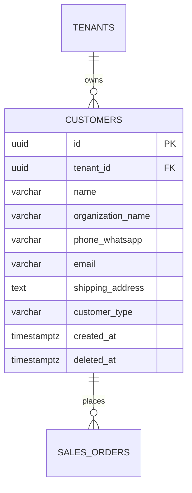

# Spesifikasi Sub-Modul: 002a - Manajemen Master Data Pelanggan (Customer Directory)

Dokumen ini memuat spesifikasi pengelolaan direktori pelanggan terpusat: profil kontak, validasi nomor WhatsApp unik, riwayat interaksi, dan integrasi alamat ekspedisi untuk SewERP.

---

## 1. Metadata & Tautan Referensi Terkait

- **Kode Modul**: `SPEC-002a`
- **Domain Bounded Context**: `crm`
- **Tautan Standar Acuan Global**:
  - 📋 [Standar Penulisan Requirement](../context/requirements_standard.md)
  - 🛡️ [Standar Keamanan & Perlindungan PII (UU PDP)](../context/security.md)
  - 📝 [Standar Formulir & Validasi Input](../context/forms.md)
  - 🗄️ [Standar Database PostgreSQL & Indexing](../context/dbadmin.md)
  - 🎨 [Standar UI Flat](../context/ui.md)
  - 👆 [Prinsip UX Lapangan Pabrik](../context/ux.md)
- **Tautan Spesifikasi Fitur Terkait**:
  - 📈 [002b - Pelacakan Prospek Masuk (Leads Pipeline)](./002b-lead-pipeline.md)
  - 📄 [003a - Inti Sales & Order (OMS)](./003a-sales-order-core.md)
  - 🚚 [003b - Surat Jalan Pengiriman](./003b-delivery-note.md)
  - 🏷️ [003e - Stiker Alamat Pengiriman](./003e-shipping-label.md)

---

## 2. Ringkasan Kebutuhan & Masalah Bisnis

### Masalah Lapangan
1. Kontak pemesan konveksi (panitia seragam, reseller, kantor, komunitas) hanya tersimpan di ponsel pribadi admin sales. Saat staf berganti, data pembeli dan histori repeat order hilang.
2. Sering terjadi duplikasi kontak akibat pencatatan berulang tanpa validasi nomor telepon.

### Solusi Fitur
Database pelanggan multi-tenant terpusat dengan:
1. Validasi keunikan nomor WhatsApp dalam lingkup tenant (`UNIQUE(tenant_id, phone_whatsapp)`).
2. Format penyimpanan alamat pengiriman terstruktur (nama jalan, kota, provinsi, kode pos, dan nama kontak penerima ekspedisi).
3. Tombol langsung "Chat WhatsApp" (`https://wa.me/62...`) di antarmuka web/mobile.

---

## 3. User Stories

- **US-002a-01 [P1 - Admin Sales]**: Sebagai *Admin Sales*, saya ingin menyimpan data kontak pelanggan baru (nama, instansi, nomor WA, alamat kirim), agar riwayat order dan penagihan tersimpan di sistem perusahaan.
- **US-002a-02 [P1 - Admin Sales]**: Sebagai *Admin Sales*, saya ingin sistem memblokir input jika nomor WhatsApp sudah terdaftar atas nama pelanggan lain dalam tenant yang sama, agar tidak terjadi duplikasi akun.
- **US-002a-03 [P2 - Admin Sales]**: Sebagai *Admin Sales*, saya ingin mengklik nomor telepon pelanggan untuk langsung membuka percakapan WhatsApp Web, agar komunikasi tindak lanjut cepat tanpa simpan kontak manual.

---

## 4. Kriteria Penerimaan (Acceptance Criteria - Gherkin)

### Skenario 1: Pendaftaran Pelanggan Baru (Happy Path)
- **Given** Admin memasukkan data valid: Nama "Budi Santoso", WA "081298765432", Tipe "community".
- **When** Menekan tombol "Simpan Pelanggan".
- **Then** Data tersimpan dengan UUIDv7 baru, dan nomor WA otomatis distandarisasi ke format internasional `6281298765432`.

### Skenario 2: Penolakan Duplikasi Nomor WhatsApp
- **Given** Nomor WA `6281298765432` sudah terdaftar pada pelanggan ID `CUST-001`.
- **When** Admin mencoba mendaftarkan pelanggan baru dengan nomor WA yang sama.
- **Then** Sistem menolak dengan HTTP 409 Conflict dan pesan error: "Nomor WhatsApp sudah terdaftar atas nama Budi Santoso".

---

## 5. Skema Relasi Data Granular (Mermaid ERD)



---

## 6. Kontrak API RESTful

### Endpoint: `POST /api/v1/crm/customers`
- **Request Payload**:
```json
{
  "name": "Budi Santoso",
  "organization_name": "Komunitas Sepeda Bandung",
  "phone_whatsapp": "081298765432",
  "email": "budi@komunitassepeda.id",
  "shipping_address": "Jl. Ir. H. Juanda No. 120, Dago, Coblong, Kota Bandung, 40135",
  "customer_type": "community"
}
```

### Endpoint: `GET /api/v1/crm/customers?search=Budi&limit=20`
- **Response Payload (HTTP 200 OK)**:
```json
{
  "status": "success",
  "data": {
    "items": [
      {
        "id": "01925b6a-8451-7ef1-953e-51c045b0a222",
        "name": "Budi Santoso",
        "organization_name": "Komunitas Sepeda Bandung",
        "phone_whatsapp": "6281298765432",
        "customer_type": "community",
        "total_completed_orders": 4,
        "total_revenue_idr": 48500000
      }
    ],
    "pagination": { "page": 1, "per_page": 20, "total_items": 1 }
  }
}
```

---

## 7. Desain Antarmuka & UX
- Tabel densitas tinggi dengan pencarian instan nama atau nomor telepon.
- Badge tipe pelanggan Flat UI (`Instansi`, `Komunitas`, `Reseller`, `Personal`).
- Tombol aksi cepat: "Buat Order", "Chat WA", "Edit Kontak".

---

## 8. Persyaratan Keamanan & Non-Fungsional
- **Privasi PII Level 3**: Masking 4 digit tengah nomor telepon pada tampilan daftar publik (`0812-****-5432`).
- **Audit Trail**: Pencatatan log setiap ada ekspor data pelanggan ke Excel/CSV.

---

## 9. Kerangka Pemecahan Tugas (Task Breakdown)
- [ ] **Fase 1**: Goose migration tabel `customers` & partial unique index `(tenant_id, phone_whatsapp) WHERE deleted_at IS NULL`.
- [ ] **Fase 2**: Domain Entity `Customer` & Repo Go dengan sqlc.
- [ ] **Fase 3**: Usecase standarisasi format E.164 untuk nomor telepon.
- [ ] **Fase 4**: Gin Handler `POST`, `GET`, `PUT`, `DELETE /api/v1/crm/customers`.
- [ ] **Fase 5**: Halaman SolidJS `CustomerDirectory` dengan modal formulir Zod.
- [ ] **Fase 6**: Uji validasi input nomor dan audit trail ekspor.
