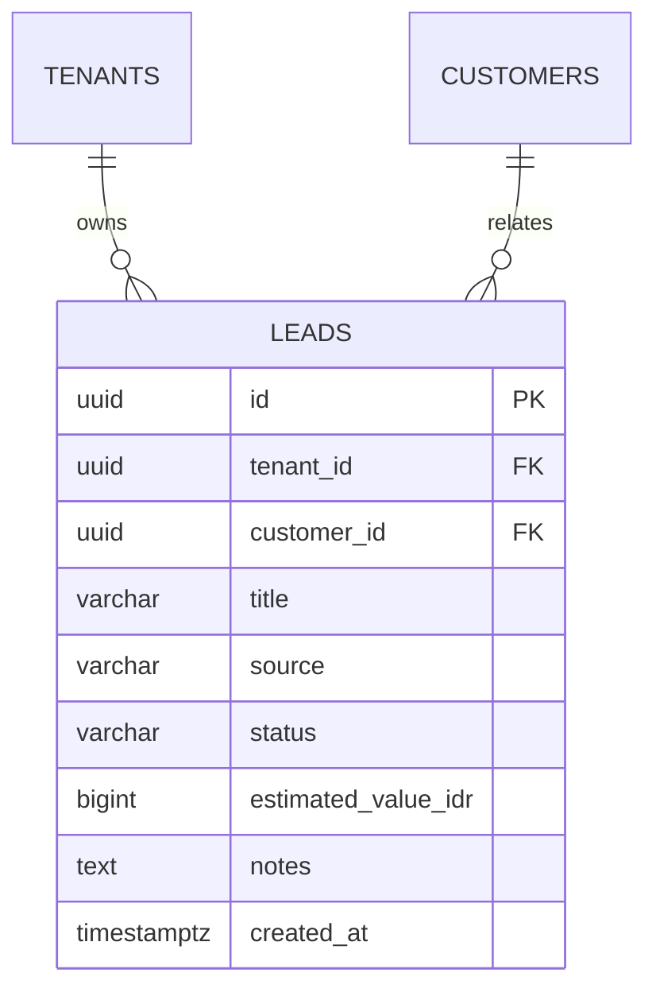

# Spesifikasi Sub-Modul: 002b - Pelacakan Prospek Masuk (Leads Pipeline)

Dokumen ini memuat spesifikasi alur pelacakan prospek masuk (*Leads Pipeline*), tahapan penawaran (*Quotation Status*), pencatatan catatan negosiasi, dan konversi prospek menjadi pesanan resmi.

---

## 1. Metadata & Tautan Referensi Terkait

- **Kode Modul**: `SPEC-002b`
- **Domain Bounded Context**: `crm`
- **Tautan Standar Acuan Global**:
  - 📋 [Standar Penulisan Requirement](../context/requirements_standard.md)
  - 📋 [Kebutuhan Bisnis Konveksi](../context/business_requirements.md)
  - 🎨 [Standar UI Flat](../context/ui.md)
  - 👆 [Prinsip UX Lapangan Pabrik](../context/ux.md)
- **Tautan Spesifikasi Fitur Terkait**:
  - 👥 [002a - Manajemen Master Data Pelanggan](./002a-customer-management.md)
  - 📄 [003a - Inti Sales & Order (OMS)](./003a-sales-order-core.md)
  - 📊 [001a - Quick Counts & Metrik Agregasi](./001a-dashboard-overview-metrics.md)

---

## 2. Ringkasan Kebutuhan & Masalah Bisnis

### Masalah Lapangan
Banyak permintaan penawaran harga kaos/seragam yang masuk lewat chat WhatsApp menguap tanpa tindak lanjut (*lost leads*). Staf sales lupa menghubungi kembali calon pembeli yang meminta contoh kain (*sample*) atau yang masih bernegosiasi harga.

### Solusi Fitur
Papan Kanban Prospek 5-Tahap:
1. `new_lead`: Permintaan harga baru masuk.
2. `quoted`: Surat penawaran harga (*quotation*) telah dikirim.
3. `sample_sent`: Sampel bahan kain atau size-chart dikirim ke pembeli.
4. `negotiating`: Diskusi revisi kuantiti atau harga.
5. `deal` (dikonversi menjadi Sales Order) atau `lost` (gagal dengan alasan penolakan).

---

## 3. User Stories

- **US-002b-01 [P1 - Admin Sales]**: Sebagai *Admin Sales*, saya ingin mencatat prospek baru beserta estimasi kuantiti dan nilai proyek, agar prospek tidak terlupakan.
- **US-002b-02 [P1 - Admin Sales]**: Sebagai *Admin Sales*, saya ingin menggeser kartu prospek ke kolom "Deal" untuk otomatis membuat draft Quotation/SPK baru, agar proses administrasi efisien.

---

## 4. Kriteria Penerimaan (Acceptance Criteria - Gherkin)

### Skenario 1: Konversi Prospek Menjadi Sales Order
- **Given** Prospek `LEAD-2026-0045` berstatus `negotiating` dengan estimasi 150 pcs kemeja.
- **When** Admin menekan tombol "Konversi ke Order".
- **Then** Sistem membuka form pembuatan SPK dengan data pelanggan dan artikel telah terisi otomatis.
- **And** Status prospek berubah menjadi `deal`.

---

## 5. Skema Relasi Data Granular (Mermaid ERD)



---

## 6. Kontrak API RESTful

### Endpoint: `POST /api/v1/crm/leads`
- **Request Payload**:
```json
{
  "customer_id": "01925b6a-8451-7ef1-953e-51c045b0a222",
  "title": "Seragam PDL PT Telkom (150 Pcs)",
  "source": "whatsapp",
  "status": "new_lead",
  "estimated_value_idr": 22500000,
  "notes": "Minta bahan American Drill warna Navy."
}
```

---

## 7. Kerangka Pemecahan Tugas (Task Breakdown)
- [ ] **Fase 1**: Goose migration tabel `leads` dengan enum status prospek.
- [ ] **Fase 2**: Domain Entity & Repo `LeadRepository`.
- [ ] **Fase 3**: Handler `GET /api/v1/crm/leads` & `PATCH /api/v1/crm/leads/{id}/stage`.
- [ ] **Fase 4**: SolidJS Kanban Board Prospek dengan drag-and-drop.
