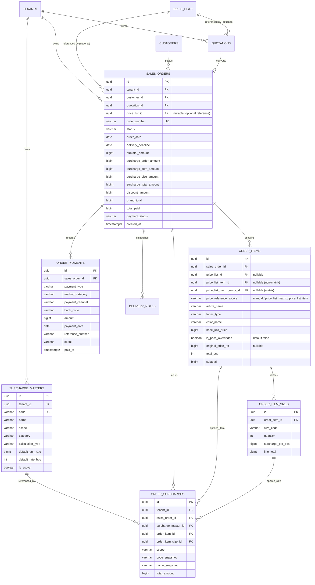

# Spesifikasi Master Modul: 003 - Sales & Order Management System (OMS)

Dokumen ini merupakan **Spesifikasi Master (Tier 1)** yang memuat arsitektur inti modul Sales & Order Management System (OMS) SewERP yang mengatur siklus hidup penawaran harga (*Quotation*), Surat Perintah Kerja resmi (*SPK / Sales Order*), matriks rincian ukuran (*size breakdown*), kalkulasi biaya ukuran jumbo (*size surcharge*), penerimaan DP fleksibel, integrasi metode bayar, serta katalog navigasi sub-dokumen cetak dan surcharges.

---

## 1. Metadata & Referensi Terkait

- **Kode Modul**: `SPEC-003`
- **Tingkatan Dokumen**: **Tier 1 (Master Specification Hub)**
- **Domain Bounded Context**: `oms`
- **Standar Acuan Global**:
  - 📋 [Standar Penulisan Requirement](../context/requirements_standard.md)
  - 📋 [Kebutuhan Bisnis Konveksi](../context/business_requirements.md)
  - 📝 [Standar Formulir & Matriks Input](../context/forms.md)
  - 🔧 [Standar Kebutuhan Teknis & Cetak](../context/technical_requirements.md)
  - 🗄️ [Standar Database PostgreSQL](../context/dbadmin.md)
- **Tautan Spesifikasi Master Terkait**:
  - 📊 [Dashboard Monitoring (001)](./001-dashboard.md)
  - 👥 [Customer Relation & CRM (002)](./002-customer-relation.md)
  - 🧵 [Alur Produksi & Makloon (004)](./004-production.md)
  - 💳 [Integrasi Payment Gateway & Rekening (009)](./009-payment-gateway.md)
  - 📋 [Configurable Price Lists Matrix & Non-Matrix (011)](./011-price-lists.md)

---

## 2. Indeks Sub-Modul Fungsional (Tier 2 Sub-Specifications)

Rincian implementasi teknis, skema DDL, kontrak API RESTful, skenario Gherkin 4-pilar, dan format dokumen cetak dipecah menjadi sub-spesifikasi modular berikut:

| Berkas Sub-Spesifikasi | Lingkup Fungsional Utama | Ukuran & Fokus Teknis |
| :--- | :--- | :--- |
| 📄 **[003a-sales-order-core.md](./003a-sales-order-core.md)** | Siklus Quotation-to-SPK, matriks input ukuran, DP fleksibel, 1 metode bayar. | State machine SPK, locking matriks saat in_production. |
| 🚚 **[003b-delivery-note.md](./003b-delivery-note.md)** | Cetak Surat Jalan (PDF A4 3 rangkap & Excel Packing List). | Layout cetak A4 3 rangkap, token unduh sementara. |
| 🧾 **[003c-sales-receipt.md](./003c-sales-receipt.md)** | Cetak Nota Penjualan kasir (PDF A5 Landscape & Thermal 80mm). | QR code verifikasi struk, riwayat cetak kasir. |
| 💳 **[003d-payment-log.md](./003d-payment-log.md)** | Cetak Log Pembayaran (PDF Audit Sheet & Mutasi Excel). | Audit append-only payment log, rekonsiliasi kas. |
| 🏷️ **[003e-shipping-label.md](./003e-shipping-label.md)** | Cetak Stiker Pengiriman koli pakaian (PDF Thermal A6 100x150mm). | Barcode SPK & koli index, format thermal label. |
| 📑 **[003f-billing-statement.md](./003f-billing-statement.md)** | Cetak Surat Tagihan Pelunasan / Proforma Invoice B2B (PDF A4 Formal). | Validasi rekening resmi tenant, rincian sisa piutang. |
| 💰 **[003g-sales-order-surcharges.md](./003g-sales-order-surcharges.md)** | Master biaya tambahan multi-level (Order/Item/Size) via `/oms/surcharges`. | Multi-level surcharge engine, zero floating-point int64. |

---

## 3. Alur Kerja Inti & State Machine SPK

```
[ Quotation (Draft) ]
         ↓ (Pelanggan Setuju)
[ Menunggu DP ] ─── (Input DP Fleksibel & Pilih 1 Metode Bayar)
         ↓ (Verifikasi Kasir / Webhook Xendit)
[ SPK Terbit (Approved) ] ─── (Kunci Matriks Ukuran & Kirim ke Produksi)
         ↓ (Proses MES 004 Selesai)
[ Siap Kirim (Ready to Ship) ] ─── (Cek Status Lunas / Verifikasi Tempo)
         ↓ (Terbitkan Surat Jalan 003b & Stiker 003e)
[ Dalam Pengiriman ] ─── (Barang Diterima Pelanggan)
         ↓
[ Selesai (Completed) ]
```

### Aturan Bisnis Utama
1. **Penerimaan DP Fleksibel**: Sistem tidak mewajibkan DP persis 50%. Kasir dapat memasukkan nominal bulat hasil kesepakatan (misal Rp 5.000.000 dari total Rp 11.250.000).
2. **Matriks Ukuran & Configurable Multi-Level Surcharges**: Biaya tambahan (Surcharges) dapat diterapkan pada 3 tingkatan (per *Order*, per *Item*, dan per *Size* jumbo). Dikonfigurasi melalui master katalog `/oms/surcharges` dan direferensikan pada SPK dengan snapshot tarif tanpa desimal (*zero floating-point*, tipe data `int64` Rupiah).
3. **Single Payment Method per Transaksi**: Setiap pencatatan transaksi (DP atau pelunasan) hanya memilih tepat 1 metode bayar berlogo resmi bank (Transfer Manual BI-Fast / VA Xendit / QRIS / Tunai).
4. **Gerbang Pengiriman (Dispatch Gate)**: Surat Jalan hanya dapat diterbitkan jika tagihan berstatus `LUNAS` atau telah disetujui persetujuan tempo kredit khusus oleh Admin.
5. **Referensi Acuan Price List Bersifat Opsional**: Pembuatan Quotation/SPK dapat mereferensikan master Price List (`011-price-lists.md`) baik tipe Matrix (paket kombinasi seragam) maupun Non-Matrix (katalog produk satuan langsung), atau diisi murni kustom manual tanpa price list (`price_list_id = NULL`). Jika mengacu pada price list, harga satuan terisi otomatis dengan opsi penyesuaian (*price override*) yang tercatat pada jejak audit (`original_price_ref`).

---

## 3. Katalog Sub-Modul Cetak Dokumen & Ekstensi Fitur

Seluruh spesifikasi tata letak fisik, format kertas, struktur kolom Excel, dokumen cetak, dan ekstensi fitur diekstraksi ke sub-spesifikasi mandiri demi efisiensi token:

| Kode Sub | Nama Dokumen / Fitur | Format Cetak / UI | Format Excel / Data | Spesifikasi Lengkap |
| :--- | :--- | :--- | :--- | :--- |
| **003a** | **Inti Sales Order** | Matriks Input & Kalkulator SPK | Ekspor Rekap Pesanan | 📄 [003a-sales-order-core.md](./003a-sales-order-core.md) |
| **003b** | **Surat Jalan** | A4 / Folio 3 Rangkap | Packing List Matrix | 📄 [003b-delivery-note.md](./003b-delivery-note.md) |
| **003c** | **Nota Penjualan** | A5 Landscape / Thermal 80mm | Rekap Transaksi Kasir | 📄 [003c-sales-receipt.md](./003c-sales-receipt.md) |
| **003d** | **Log Pembayaran** | A4 Audit Sheet | Grid Mutasi Rekening | 📄 [003d-payment-log.md](./003d-payment-log.md) |
| **003e** | **Stiker Alamat** | Thermal A6 (100x150mm) | Manifest Pengiriman Koli | 📄 [003e-shipping-label.md](./003e-shipping-label.md) |
| **003f** | **Surat Penagihan**| A4 Formal Invoice | Breakdown Tagihan B2B | 📄 [003f-billing-statement.md](./003f-billing-statement.md) |
| **003g** | **Master & Order Surcharges** | Menu `/oms/surcharges` & Picker SO | Snapshot Biaya Multi-Level | 📄 [003g-sales-order-surcharges.md](./003g-sales-order-surcharges.md) |

---

## 4. Skema Relasi Data Inti (ERD)



---

## 5. Kontrak REST API Inti

### A. Buat Penawaran Harga (*Quotation*) dengan Referensi Price List Opsional & Surcharges
```http
POST /api/v1/oms/quotations
```
```json
{
  "customer_id": "01925b6a-8451-7ef1-953e-51c045b0a111",
  "price_list_id": "01925b6a-9999-7ef1-953e-51c045b0a888",
  "items": [
    {
      "price_list_id": "01925b6a-9999-7ef1-953e-51c045b0a888",
      "price_list_matrix_entry_id": "01925b6a-1111-7ef1-953e-51c045b0a111",
      "price_reference_source": "price_list_matrix",
      "article_name": "Paket Seragam (Baju: Batik | Celana: Rok | Kerudung: Yes)",
      "fabric_type": "Katun Prima & TC",
      "color_name": "Batik Hijau Madrasah",
      "base_unit_price": 155000,
      "is_price_overridden": false,
      "original_price_ref": 155000,
      "sizes": [
        { "size_code": "M", "quantity": 40, "surcharge_per_pcs": 0 },
        { "size_code": "L", "quantity": 40, "surcharge_per_pcs": 0 },
        { "size_code": "XXL", "quantity": 20, "surcharge_per_pcs": 10000 }
      ],
      "surcharges": [
        {
          "surcharge_master_id": "01925b6a-8451-7ef1-953e-51c045b0a222",
          "notes": "Bordir logo sekolah dada kiri"
        }
      ]
    }
  ],
  "order_surcharges": [
    {
      "surcharge_master_id": "01925b6a-8451-7ef1-953e-51c045b0a111",
      "notes": "Rush order deadline 5 hari"
    }
  ]
}
```
> *Catatan Opsional*: Jika `price_list_id` tidak diisi (`null`), item pesanan bersifat kustom bebas (`price_reference_source = "manual"`, `price_list_matrix_entry_id = null`, `original_price_ref = null`).

### B. Konversi Quotation ke SPK Resmi via Pembayaran DP
```http
POST /api/v1/oms/quotations/{id}/convert-to-order
```
```json
{
  "delivery_deadline": "2026-11-20",
  "initial_payment": {
    "payment_type": "down_payment",
    "method_category": "manual_transfer",
    "bank_code": "BCA",
    "amount": 7000000,
    "reference_number": "TRF-BCA-98127391",
    "payment_date": "2026-10-22"
  }
}
```

### C. Ringkasan Detail Pesanan & Saldo Piutang
```http
GET /api/v1/oms/orders/{id}
```
Mengembalikan data lengkap SPK termasuk `price_list_id`, `subtotal_amount`, rincian `surcharge_order_amount`, `surcharge_item_amount`, `surcharge_size_amount`, `surcharge_total_amount`, `grand_total`, `total_paid`, `unpaid_balance`, `payment_status`, dan rincian koli barang.

---

## 6. Kriteria Penerimaan Inti (Acceptance Criteria - Gherkin)

### Skenario 1: Kalkulasi Multi-Level Surcharges Akurat
- **Given** Pemesan memesan kemeja dengan subtotal dasar Rp 15.000.000.
- **And** Terdapat Surcharge Order (Rush Order Rp 500.000), Surcharge Item (Treatment Rp 200.000), dan Surcharge Size (XXL 20 pcs x Rp 10.000 = Rp 200.000).
- **When** Sistem menghitung total SPK.
- **Then** `surcharge_order_amount` tercatat Rp 500.000, `surcharge_item_amount` Rp 200.000, `surcharge_size_amount` Rp 200.000, dan `surcharge_total_amount` tepat Rp 900.000.
- **And** `grand_total` tercatat tepat Rp 15.900.000 tanpa pembulatan desimal float.

### Skenario 2: Kunci Data Saat Berstatus Produksi
- **Given** SPK telah berstatus `in_production`.
- **When** Pengguna mencoba mengubah matriks ukuran, warna kain, atau biaya surcharge melalui API.
- **Then** Sistem menolak dengan HTTP 422: *"Matriks dan biaya pesanan tidak dapat diubah setelah SPK masuk jalur produksi"*.

### Skenario 3: Fleksibilitas Penggunaan Acuan Price List Opsional & Price Override
- **Given** Terdapat Master Price List `"Paket Seragam Madrasah 2026"` (SPEC-011).
- **When** Admin membuat penawaran dengan memilih Price List tersebut, sistem otomatis mengisi `base_unit_price` = Rp 155.000 dari data kombinasi matriks atribut.
- **And** Ketika admin memberikan harga khusus negosiasi Rp 150.000, sistem menetapkan `is_price_overridden = TRUE` dan menyimpan `original_price_ref = 155000`.
- **When** Admin lain membuat penawaran untuk pesanan kustom luar negeri tanpa memilih price list (`price_list_id = NULL`).
- **Then** Sistem mengizinkan input manual tanpa validasi terhadap master price list dengan `price_reference_source = "manual"`.
