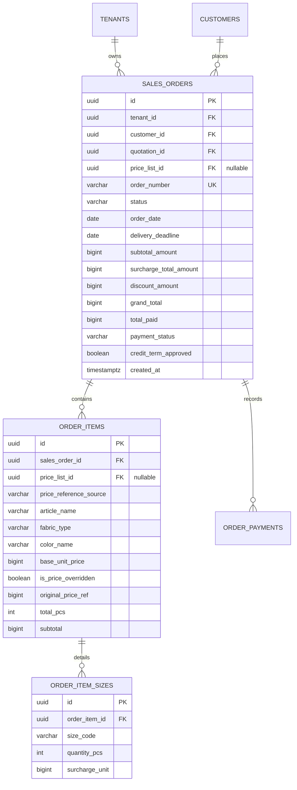

# Spesifikasi Sub-Modul: 003a - Inti Sales & Order Management System (Quotation to SPK)

Dokumen ini memuat spesifikasi inti modul Sales & Order Management System (OMS) SewERP yang mengatur siklus hidup penawaran harga (*Quotation*), Surat Perintah Kerja resmi (*SPK / Sales Order*), matriks rincian ukuran (*size breakdown*), penerimaan DP fleksibel, aturan 1 metode bayar per transaksi, dan integrasi acuan Price List opsional.

---

## 1. Metadata & Tautan Referensi Terkait

- **Kode Modul**: `SPEC-003a`
- **Domain Bounded Context**: `oms`
- **Tautan Standar Acuan Global**:
  - 📋 [Standar Penulisan Requirement](../context/requirements_standard.md)
  - 🏛️ [Arsitektur Sistem & Presisi Finansial Zero Float](../context/architecture.md)
  - 📝 [Standar Formulir & Matriks Input Ukuran](../context/forms.md)
  - 🗄️ [Standar Database PostgreSQL](../context/dbadmin.md)
  - 📋 [Kebutuhan Bisnis Konveksi](../context/business_requirements.md)
  - 🧪 [Standar QA & Benchmark Testing](../context/qa.md)
- **Tautan Spesifikasi Fitur Terkait**:
  - 🚚 [003b - Cetak Surat Jalan](./003b-delivery-note.md)
  - 🧾 [003c - Cetak Nota Penjualan Kasir](./003c-sales-receipt.md)
  - 💳 [003d - Cetak Log Pembayaran Transaksi](./003d-payment-log.md)
  - 🏷️ [003e - Cetak Stiker Pengiriman Koli](./003e-shipping-label.md)
  - 📑 [003f - Cetak Surat Penagihan Pelunasan](./003f-billing-statement.md)
  - 💰 [003g - Master & Order Multi-Level Surcharges](./003g-sales-order-surcharges.md)
  - 🧵 [004a - Papan Pelacakan 6 Stasiun Produksi](./004a-production-tracking.md)
  - 💳 [009a - Konfigurasi Metode Bayar](./009a-payment-settings.md)
  - 📋 [011a - Master Price List Matriks Dimensi](./011a-matrix-price-list.md)

---

## 2. Alur Kerja Inti & State Machine SPK

```
[ Quotation (Draft) ]
         ↓ (Pelanggan Menyetujui Penawaran)
[ Menunggu DP ] ─── (Input DP Fleksibel & Pilih Tepat 1 Metode Bayar)
         ↓ (Verifikasi Kasir / Webhook Xendit)
[ SPK Terbit (Approved) ] ─── (Kunci Matriks Ukuran & Kirim ke Produksi 004a)
         ↓ (Proses MES Selesai & Lolos QC)
[ Siap Kirim (Ready to Ship) ] ─── (Cek Status Lunas / Verifikasi Tempo)
         ↓ (Terbitkan Surat Jalan 003b & Stiker 003e)
[ Dalam Pengiriman ] ─── (Barang Tiba di Pelanggan)
         ↓
[ Selesai (Completed) ]
```

### Invariant & Aturan Bisnis Utama
1. **Penerimaan DP Fleksibel**: Sistem tidak mewajibkan DP kaku 50%. Kasir dapat memasukkan nominal bulat hasil kesepakatan langsung (misal DP Rp 5.000.000 dari total tagihan Rp 11.250.000).
2. **Kunci 1 Metode Pembayaran per Transaksi**: Setiap pencatatan transaksi (DP atau pelunasan) hanya memilih tepat 1 metode bayar berlogo resmi bank (Transfer Manual BI-Fast / VA Xendit / QRIS / Tunai).
3. **Gerbang Pengiriman (Dispatch Gate)**: Surat Jalan hanya dapat diterbitkan jika status pembayaran bernilai `LUNAS` atau telah disetujui izin tempo kredit khusus oleh Admin.
4. **Referensi Acuan Price List Opsional**: Quotation/SPK dapat mereferensikan master Price List (`011a-matrix-price-list.md` atau `011b-non-matrix-price-list.md`) atau diisi murni manual tanpa price list (`price_list_id = NULL`). Jika mengacu pada price list, harga terisi otomatis dengan opsi *price override* yang tercatat pada jejak audit (`original_price_ref`).
5. **Zero Floating-Point**: Seluruh nilai rupiah dihitung menggunakan tipe `BIGINT` tanpa pembulatan desimal.

---

## 3. User Stories

- **US-003a-01 [P1 - Admin Sales]**: Sebagai *Admin Sales*, saya ingin menginput rincian artikel, bahan kain, dan matriks ukuran baju (S, M, L, XL, XXL) saat membuat pesanan, agar rincian kuantiti tersusun rapi untuk bagian produksi.
- **US-003a-02 [P1 - Kasir]**: Sebagai *Kasir*, saya ingin mencatat penerimaan DP fleksibel dengan memilih tepat 1 metode pembayaran yang aktif di sistem, agar status pesanan otomatis berubah menjadi `approved` dan SPK resmi terbit.
- **US-003a-03 [P1 - Staf Gudang / Ekspedisi]**: Sebagai *Staf Ekspedisi*, saya ingin sistem memblokir penerbitan Surat Jalan jika pesanan belum lunas dan tidak memiliki izin tempo, agar tidak terjadi kebocoran piutang pabrik.

---

## 4. Kriteria Penerimaan (Acceptance Criteria - Gherkin)

### Skenario 1: Penerbitan SPK Melalui Penerimaan DP Fleksibel
- **Given** Quotation `QO-202610-0012` berstatus `waiting_dp` dengan total tagihan Rp 10.000.000.
- **When** Kasir mencatat pembayaran DP sebesar Rp 3.500.000 dengan metode bayar "BCA Virtual Account (Xendit)".
- **Then** Status pembayaran berubah menjadi `dp_paid` dan status order berubah menjadi `approved`.
- **And** Matriks ukuran baju terkunci dari pengubahan dan siap dialokasikan bahannya ke lantai potong.

### Skenario 2: Pencegahan Pemilihan Metode Bayar Ganda
- **Given** Form pembayaran SPK terbuka di layar kasir.
- **When** Kasir memilih metode "QRIS Dinamis Xendit".
- **Then** Pilihan metode "Transfer Manual BCA" otomatis tidak terpilih (*radio group behavior*).

### Skenario 3: Pemblokiran Dispatch Gate Tanpa Pelunasan
- **Given** SPK `SPK-0012` berada di status `ready_to_ship` dengan sisa piutang Rp 6.500.000 dan `credit_term_approved = false`.
- **When** Staf ekspedisi menekan tombol "Terbitkan Surat Jalan".
- **Then** Sistem memblokir aksi dan memunculkan notifikasi: *"Surat Jalan tidak dapat diterbitkan: Pesanan belum lunas (Sisa Rp 6.500.000). Ajukan izin tempo atau catat pelunasan"*.

---

## 5. Skema Relasi Data Granular (Mermaid ERD)



---

## 6. Kontrak API RESTful

### Endpoint: `POST /api/v1/oms/orders`
- **Request Payload**:
```json
{
  "customer_id": "01925b6a-8451-7ef1-953e-51c045b0a222",
  "order_date": "2026-10-21",
  "delivery_deadline": "2026-11-05",
  "price_list_id": null,
  "items": [
    {
      "article_name": "Polo Shirt Seragam Telkom",
      "fabric_type": "Lacoste CVC",
      "color_name": "Merah Maroon",
      "base_unit_price": 75000,
      "sizes": [
        { "size_code": "S", "quantity_pcs": 20, "surcharge_unit": 0 },
        { "size_code": "M", "quantity_pcs": 40, "surcharge_unit": 0 },
        { "size_code": "L", "quantity_pcs": 30, "surcharge_unit": 0 },
        { "size_code": "XXL", "quantity_pcs": 10, "surcharge_unit": 5000 }
      ]
    }
  ]
}
```

### Endpoint: `POST /api/v1/oms/orders/{id}/payments`
- **Request Payload**:
```json
{
  "payment_amount": 3500000,
  "payment_method_code": "xendit_va_bca",
  "payment_category": "dp",
  "notes": "Pembayaran DP via transfer Virtual Account BCA"
}
```

---

## 7. Desain Antarmuka Pengguna & Matriks Ukuran
- **Dynamic Size Matrix Form**: Matriks tabel ukuran cepat dengan keyboard navigation (`Tab` untuk pindah ukuran, `Enter` untuk tambah baris) tanpa virtual DOM delay.
- **Single Radio Payment Selector**: Pilihan metode pembayaran berbentuk kartu visual dengan logo resmi perbankan.

---

## 8. Persyaratan Keamanan & Non-Fungsional
- **Idempotensi**: Header `Idempotency-Key` wajib disertakan pada transaksi pencatatan pembayaran untuk mencegah double-payment.
- **Zero Alloc Calculation**: Kalkulasi subtotal, diskon, dan grand total dilakukan di domain layer Go dengan presisi integer mutlak tanpa alokasi heap berlebih.

---

## 9. Kerangka Pemecahan Tugas (Task Breakdown)
- [ ] **Fase 1**: Goose migrations tabel `sales_orders`, `order_items`, dan `order_item_sizes`.
- [ ] **Fase 2**: Domain Model Order dengan State Machine (`Draft` $\to$ `WaitingDP` $\to$ `Approved` $\to$ `ReadyToShip` $\to$ `Completed`).
- [ ] **Fase 3**: Service perhitungan matriks ukuran dan surcharge jumbo.
- [ ] **Fase 4**: Gin Handler `/api/v1/oms/orders` dan endpoint pembayaran.
- [ ] **Fase 5**: Komponen SolidJS `SizeMatrixInput` dan `OrderPaymentModal`.
- [ ] **Fase 6**: Uji skenario dispatch gate dan pencegahan multi-metode bayar.
