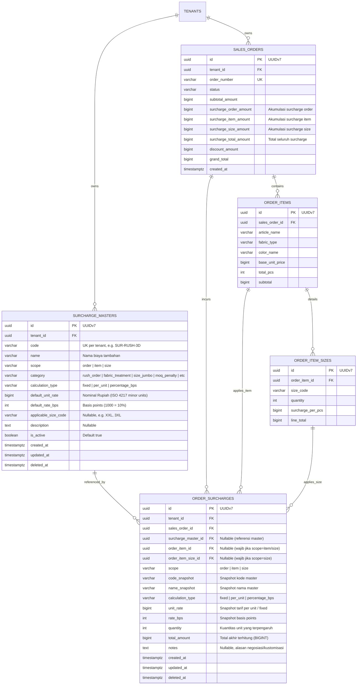

# Spesifikasi Sub-Modul: 003g - Master & Order Multi-Level Surcharges (OMS)

Dokumen ini memuat spesifikasi fungsional, arsitektur data, kontrak RESTful API, dan uraian tugas teknis untuk modul **Configurable Surcharges (Biaya Tambahan Terkonfigurasi)** yang terintegrasi langsung dengan siklus hidup **Sales Order (SPK / Quotation)** pada Bounded Context oms SewERP.

---

## 1. Metadata & Tautan Referensi Terkait

- **Kode Modul**: SPEC-003g
- **Domain Bounded Context**: oms
- **Tautan Standar Acuan Global**:
  - 📋 [Standar Penulisan Requirement](../context/requirements_standard.md)
  - 🏛️ [Arsitektur Sistem & Presisi Finansial Zero Float](../context/architecture.md)
  - ⚙️ [Standar Rekayasa Backend Go & Zero Alloc](../context/backend.md)
  - 🖥️ [Standar Frontend SolidJS Ultra-Strict](../context/frontend.md)
  - 🗄️ [Standar Database PostgreSQL & Indexing](../context/dbadmin.md)
  - 📝 [Standar Formulir & Validasi Input](../context/forms.md)
  - 🎨 [Standar UI Flat](../context/ui.md)
  - 👆 [Prinsip UX Lapangan Pabrik](../context/ux.md)
  - 🧪 [Standar QA & Benchmark Testing](../context/qa.md)
  - 📋 [Kebutuhan Bisnis Konveksi](../context/business_requirements.md)
- **Tautan Spesifikasi Fitur Terkait**:
  - 📄 [003a - Inti Sales & Order (OMS)](./003a-sales-order-core.md)
  - 🧾 [003c - Cetak Nota Penjualan Kasir](./003c-sales-receipt.md)
  - 📑 [003f - Cetak Surat Penagihan Pelunasan](./003f-billing-statement.md)
  - 📋 [011a - Master Price List Matriks Dimensi](./011a-matrix-price-list.md)

---

## 1. Ide Client & Context Summary

### Ringkasan Ide Klien
> *"Surcharges terhubung dengan sales order. Surcharges bisa per item, per size, per order. Surcharges ini configurable dan ada menunya sendiri, nanti SO akan referensi di list surcharges."*

### Konteks Bisnis Industri Konveksi
Dalam manufaktur pakaian jadi (konveksi, apparel, seragam), penetapan harga jual sering kali tidak hanya terdiri dari harga kain pokok dan add-on sablon/bordir dasar. Terdapat berbagai faktor penambah biaya (*surcharges*) yang muncul pada berbagai tingkatan:
1. **Tingkat Order (*Order-Level*)**: Biaya pengerjaan ekspres/kilat (*Rush Order*), biaya pembuatan sampel atau master pola cetak (*Sample / Pattern Setup Fee*), penalti kuantitas di bawah batas minimal (*MOQ Penalty*), atau pengemasan khusus per koli (*Special Packing/Box*).
2. **Tingkat Artikel/Item (*Item-Level*)**: Tambahan proses khusus pada varian garmen tertentu, seperti pencucian kain (*enzyme/bio-wash treatment*), sablon khusus (foil, discharge, high density), atau kerah rajut jacquard kustom.
3. **Tingkat Ukuran (*Size-Level*)**: Konsumsi bahan kain bertambah signifikan (20%–50%) untuk ukuran jumbo (XXL, 3XL, 4XL, 5XL) atau pesanan potong badan/lengan khusus (+5cm).

Tanpa sistem konfigurasi terpusat, staf sales sering lupa menagih biaya tambahan atau menetapkan tarif secara tidak konsisten. Fitur ini menghadirkan **Menu Dedicated Master Surcharges (`/oms/surcharges`)** untuk mendefinisikan katalog biaya tambahan, serta memungkinkan form **Sales Order (SPK)** mereferensikannya dengan jaminan **Price Snapshot Integrity** (nilai historis tidak berubah bila tarif master disesuaikan di masa depan).

---

## 2. Requirement Discovery & Intent Clarification

### Confirmed Assumptions
- **Dua Lapis Pengelolaan (Two-Tier Architecture)**:
  - **Katalog Master (`surcharge_masters`)**: Pengaturan tarif baku yang dapat ditambah, diedit, dan diaktifkan/dinonaktifkan oleh Admin/Owner melalui menu khusus.
  - **Transaksi Pesanan (`order_surcharges`)**: Instansiasi biaya tambahan yang terikat pada SPK tertentu, menyimpan snapshot tarif dan nilai kalkulasi final.
- **Tiga Ruang Lingkup (*Scope*)**:
  - `order`: Berlaku untuk keseluruhan pesanan (default quantity = 1).
  - `item`: Terikat pada satu baris artikel garmen (`order_items`). Kuantitas default sama dengan total pcs artikel tersebut atau ditentukan tersendiri.
  - `size`: Terikat pada sel matriks ukuran tertentu (`order_item_sizes`). Kuantitas otomatis mengikat kuantitas pcs ukuran tersebut.
- **Tiga Metode Perhitungan (*Calculation Type*)**:
  - `fixed`: Biaya bernilai nominal flat (misal: Rp 250.000 per pesanan).
  - `per_unit`: Tarif per pcs dikalikan jumlah unit yang terkena (misal: Rp 5.000 / pcs × 100 pcs).
  - `percentage_bps`: Persentase dari subtotal basis yang dihitung dalam *Basis Points* (100% = 10.000 bps, misal 10% = 1.000 bps).
- **Price Snapshot Integrity**: Saat master surcharge dipilih pada SPK, sistem menyalin kode, nama, tipe kalkulasi, dan tarif saat itu ke baris transaksi pesanan.
- **Penempatan Navigasi**: Menu navigasi ditempatkan pada grup menu **Sales & Orders (OMS)** ➔ Sub-menu **Katalog Surcharge** (`/oms/surcharges`).

### Identified Actors & Personas
- **Owner Konveksi / Manajer Penjualan**: Mengelola master katalog surcharge, menentukan tarif dasar per unit/persentase, serta mengaktifkan/menonaktifkan item surcharge.
- **Admin Penjualan (Sales Admin)**: Memilih surcharge dari katalog master saat membuat Quotation / SPK, serta memberikan catatan khusus negosiasi jika diperlukan.
- **Kasir & Bagian Keuangan (Finance)**: Memeriksa rincian biaya tambahan pada nota penjualan, rekapitulasi pelunasan, dan surat penagihan B2B.

### Unresolved Edge Cases & Nuances
- **Penonaktifan Master Surcharge**: Jika suatu master surcharge dinonaktifkan (`is_active = false`), ia tidak boleh muncul pada pilihan SPK baru, namun SPK lama yang mereferensikannya tetap valid dan tidak mengalami perubahan kalkulasi.
- **Custom Override Khusus**: Dalam kondisi negosiasi khusus, apakah admin sales boleh mengubah nominal surcharge dari tarif master? **Keputusan**: Diizinkan hanya jika user memiliki hak akses otorisasi diskon/biaya khusus (`oms:surcharge:override`), dengan kewajiban mengisi alasan pada kolom `notes`.
- **Penguncian Produksi (*Production Lock*)**: Penambahan, perubahan, atau penghapusan surcharge **dilarang keras** setelah status pesanan berubah menjadi `in_production`, `ready_to_ship`, `delivered`, atau `completed`.

### Boundary Conditions & Exclusions
- Surcharges tidak menggantikan alur diskon umum pesanan (`discount_amount`); diskon memiliki kalkulasi dan perlakuan akuntansi tersendiri.
- Pajak pertambahan nilai (PPN / `tax_bps`) dihitung setelah memperhitungkan subtotal dan seluruh surcharges dikurangi diskon.

---

## 3. Business Requirements

### Business Objectives & Value
- **Standardisasi Penetapan Harga**: Menghilangkan kekeliruan staf sales dalam menghitung biaya ukuran jumbo atau ongkos lembur.
- **Transparansi Tagihan Pelanggan**: Menyediakan rincian biaya yang jelas di setiap lembar penawaran (*Quotation*), Surat Jalan, Nota, dan Invoice penagihan.
- **Pencegahan Kebocoran Margin**: Memastikan penambahan konsumsi bahan kain (ukuran jumbo) dan proses makloon khusus (washing/sablon rumit) selalu tertagih ke pelanggan.

### Key Performance Indicators (KPIs)
- **100% Zero Floating-Point Precision**: Seluruh operasi kalkulasi nominal rupiah menggunakan integer 64-bit (`BIGINT`) tanpa selisih pembulatan desimal.
- **Zero Overhead on Hot Path**: Eksekusi kalkulasi pricing pesanan dengan surcharges wajib lulus benchmark testing dengan batas **`0 B/op` dan `0 allocs/op`**.
- **0% Data Drift on Master Updates**: Pembaruan tarif pada master surcharge tidak mengubah nilai total tagihan pada pesanan historis.

### Strict Business Rules
- **BR-SC-01 (Kewenangan Master)**: Hanya pengguna dengan peran `Owner`, `Super Admin`, atau `Sales Manager` yang berhak membuat, mengubah, atau menonaktifkan Master Surcharges (`oms:surcharge:manage`).
- **BR-SC-02 (Integritas Relasi Scope)**:
  - Surcharge dengan `scope = 'order'` wajib memiliki `order_item_id = NULL` dan `order_item_size_id = NULL`.
  - Surcharge dengan `scope = 'item'` wajib memiliki `order_item_id != NULL` dan `order_item_size_id = NULL`.
  - Surcharge dengan `scope = 'size'` wajib memiliki `order_item_id != NULL` dan `order_item_size_id != NULL`.
- **BR-SC-03 (Imutabilitas Produksi)**: Saat SPK berstatus $\ge$ `in_production`, endpoint manipulasi surcharge wajib menolak request dengan HTTP 422: *"Biaya pesanan terkunci dan tidak dapat diubah setelah SPK masuk jalur produksi"*.
- **BR-SC-04 (Formula Akumulasi Surcharge)**:
  $$\text{surcharge\_total\_amount} = \sum \text{surcharge\_order} + \sum \text{surcharge\_item} + \sum \text{surcharge\_size}$$
  $$\text{grand\_total} = \text{subtotal\_amount} + \text{surcharge\_total\_amount} - \text{discount\_amount} + \text{tax\_amount}$$

---

## 4. Product Requirements Document (PRD)

### Problem Statement
Proses pencatatan pesanan konveksi di lapangan sering kali menghadapi permintaan non-standar: pelanggan meminta pesanan selesai 3 hari (butuh lembur), meminta ukuran 3XL dan 4XL, serta meminta pencucian *enzyme wash*. Tanpa master konfigurasi biaya tambahan yang fleksibel, admin sales menghitung secara manual atau menuliskan keterangan di luar invoice resmi, menyebabkan potensi selisih kas dan sengketa harga dengan pembeli.

### Target Users & Workflows
1. **Pengaturan Master Surcharge (`/oms/surcharges`)**:
   - Owner mengakses menu **Sales & Orders ➔ Katalog Surcharge**.
   - Menekan tombol **"Tambah Surcharge"**, mengisi nama, scope (`order`/`item`/`size`), metode hitung (`fixed`/`per_unit`/`percentage_bps`), tarif dasar, dan status aktif.
   - Master data tersimpan dan langsung tersedia di picker form SPK.
2. **Penerapan pada SPK / Quotation**:
   - Saat membuat SPK, admin melihat panel biaya tambahan.
   - Pada tingkat order: Memilih "Rush Order 3 Hari" $\rightarrow$ otomatis menambah nominal Rp 500.000.
   - Pada baris artikel: Memilih "Washing Enzyme" $\rightarrow$ otomatis mengalikan Rp 3.500 $\times$ total pcs artikel.
   - Pada matriks ukuran: Saat kuantitas ukuran XXL diisi, sistem otomatis mengalikan Rp 10.000 $\times$ kuantitas XXL.
   - Total biaya terakumulasi seketika tanpa jeda render antarmuka.

### Core Functional Requirements
- **FR-SC-01 (Katalog Master CRUD)**: Menyediakan interface dan REST API penuh untuk membuat, membaca, memperbarui, dan menonaktifkan master surcharge per tenant.
- **FR-SC-02 (Lookup Master Berdasarkan Scope)**: Menyediakan endpoint lookup berkinerja tinggi untuk mengisi dropdown form dengan filter `scope` dan `is_active=true`.
- **FR-SC-03 (Penerapan Surcharge Multi-Level)**: Mendukung penambahan satu atau banyak surcharge pada tingkat Order, Item, dan Size.
- **FR-SC-04 (Kalkulasi Otomatis Zero-Float)**: Mengkalkulasi nilai rupiah dari formula flat, perkalian unit, maupun persentase basis points secara presisi.
- **FR-SC-05 (Snapshotting Transaksi)**: Mengunci kode, nama, dan tarif unit saat data disimpan ke database.
- **FR-SC-06 (Rincian Dokumen Cetak)**: Menampilkan rincian biaya tambahan secara terstruktur pada Surat Jalan (`003a`), Nota Penjualan (`003b`), dan Invoice Tagihan (`003e`).

### Non-Functional Requirements
- **Multi-Tenancy Isolation**: Seluruh kueri wajib menyertakan filter `WHERE tenant_id = $1`.
- **Zero Allocations & Zero Garbage Collection Thrashing**: Modul kalkulasi harga di layer domain wajib dirancang menggunakan native slice tanpa alokasi heap berlebih (`0 B/op`, `0 allocs/op`).
- **Audit Logging**: Setiap pembuatan, pengubahan, atau penghapusan master maupun transaksi surcharge wajib mencatat `created_by`, `updated_by`, dan `created_at`.

---

## 5. User Stories (Prioritized P1, P2, P3)

### US-SC-01 [P1] - Konfigurasi Katalog Master Surcharges
> **Sebagai** *Owner Konveksi*,  
> **Saya ingin** mengonfigurasi katalog biaya tambahan standar (nama, scope, jenis kalkulasi, dan tarif) pada menu `/oms/surcharges`,  
> **Agar** seluruh staf sales memiliki acuan tarif biaya tambahan seragam dan tidak terjadi kekeliruan perhitungan manual.

### US-SC-02 [P1] - Pemilihan Surcharge Tingkat Order, Item, dan Size pada SPK
> **Sebagai** *Admin Penjualan*,  
> **Saya ingin** memilih biaya tambahan dari daftar master surcharge saat menyusun Quotation atau SPK,  
> **Agar** biaya lembur pesanan, pencucian kain per artikel, dan surcharge ukuran jumbo terhitung otomatis secara transparan.

### US-SC-03 [P2] - Price Snapshotting & Perlindungan Nilai Historis
> **Sebagai** *Bagian Keuangan (Finance)*,  
> **Saya ingin** tarif surcharge pada SPK yang sudah terbit terkunci secara permanen meskipun master tarif diubah di kemudian hari,  
> **Agar** neraca keuangan dan piutang pesanan historis tidak berubah dan tetap dapat diaudit.

### US-SC-04 [P3] - Tampilan Rincian Surcharge pada Nota & Faktur Tagihan
> **Sebagai** *Pelanggan Konveksi*,  
> **Saya ingin** melihat perincian biaya tambahan secara jelas pada Nota Penjualan dan Surat Tagihan,  
> **Agar** saya memahami transparansi dasar penagihan biaya lembur, pengerjaan khusus, atau ukuran jumbo.

---

## 6. Acceptance Criteria (Gherkin Format)

### Skenario 1: Penambahan & Pengambilan Master Surcharge (Happy Path)
- **Given** Admin Penjualan memiliki hak akses `oms:surcharge:manage`.
- **When** Admin mengirim permintaan `POST /api/v1/oms/surcharge-masters` dengan payload:
  ```json
  {
    "code": "SUR-RUSH-3D",
    "name": "Layanan Kilat (Rush Order 3 Hari)",
    "scope": "order",
    "category": "rush_order",
    "calculation_type": "fixed",
    "default_unit_rate": 500000,
    "default_rate_bps": 0,
    "is_active": true
  }
  ```
- **Then** Sistem mengembalikan status HTTP `201 Created` dan data tersimpan dengan `tenant_id` yang sesuai.
- **And** Pada pemanggilan `GET /api/v1/oms/surcharge-masters?scope=order&is_active=true`, item `SUR-RUSH-3D` muncul dalam daftar.

### Skenario 2: Kalkulasi Multi-Level Surcharges pada Sales Order
- **Given** Terdapat master surcharge:
  - `SUR-RUSH-3D` (scope: `order`, fixed: Rp 500.000).
  - `SUR-WASH-ENZYME` (scope: `item`, per_unit: Rp 3.000).
  - `SUR-JUMBO-XXL` (scope: `size`, per_unit: Rp 10.000, size: `XXL`).
- **And** Sales Order dibuat dengan 1 item (100 pcs: 80 pcs L, 20 pcs XXL) dengan harga dasar Rp 50.000/pcs:
  - Subtotal dasar item = 100 × Rp 50.000 = Rp 5.000.000.
- **When** Admin menyematkan ketiga surcharge tersebut ke dalam SPK:
  - Order Surcharge: `SUR-RUSH-3D` = Rp 500.000.
  - Item Surcharge: `SUR-WASH-ENZYME` untuk item (100 pcs × Rp 3.000) = Rp 300.000.
  - Size Surcharge: `SUR-JUMBO-XXL` untuk ukuran XXL (20 pcs × Rp 10.000) = Rp 200.000.
- **Then** Sistem menghitung:
  - `surcharge_order_amount` = Rp 500.000.
  - `surcharge_item_amount` = Rp 300.000.
  - `surcharge_size_amount` = Rp 200.000.
  - `surcharge_total_amount` = Rp 1.000.000.
  - `grand_total` = Rp 6.000.000.
- **And** Seluruh nilai tersimpan presisi tanpa tipe desimal float.

### Skenario 3: Penolakan Manipulasi Saat SPK Berstatus Produksi (Edge Case)
- **Given** SPK `SPK-202610-0088` telah disetujui dan berstatus `in_production`.
- **When** Admin mencoba menambahkan atau menghapus surcharge via API `POST /api/v1/oms/orders/{id}/surcharges`.
- **Then** Sistem menolak dengan kode HTTP `422 Unprocessable Entity`.
- **And** Mengembalikan problem details RFC 7807 dengan pesan *"Biaya pesanan terkunci dan tidak dapat diubah setelah SPK masuk jalur produksi"*.

### Skenario 4: Integritas Snapshot Saat Master Tarif Diubah
- **Given** SPK `SPK-202610-0015` dibuat dengan surcharge `SUR-JUMBO-XXL` bernilai snapshot Rp 10.000/pcs.
- **When** Owner mengubah tarif master `SUR-JUMBO-XXL` di menu konfigurasi menjadi Rp 15.000/pcs.
- **Then** Nilai tarif dan total pada SPK `SPK-202610-0015` tetap tercatat Rp 10.000/pcs tanpa mengalami perubahan.

---

## 7. Entity Relationship Diagram (ERD)



### PostgreSQL DDL & Pengindeksan Berkinerja Tinggi
```sql
-- 1. Tabel Master Katalog Surcharge (Configurable)
CREATE TABLE surcharge_masters (
    id UUID PRIMARY KEY DEFAULT gen_random_uuid(),
    tenant_id UUID NOT NULL,
    code VARCHAR(32) NOT NULL,
    name VARCHAR(100) NOT NULL,
    scope VARCHAR(16) NOT NULL,
    category VARCHAR(32) NOT NULL,
    calculation_type VARCHAR(16) NOT NULL,
    default_unit_rate BIGINT NOT NULL DEFAULT 0,
    default_rate_bps INT NOT NULL DEFAULT 0,
    applicable_size_code VARCHAR(16) NULL,
    description TEXT NULL,
    is_active BOOLEAN NOT NULL DEFAULT true,
    created_at TIMESTAMPTZ NOT NULL DEFAULT CURRENT_TIMESTAMP,
    updated_at TIMESTAMPTZ NOT NULL DEFAULT CURRENT_TIMESTAMP,
    deleted_at TIMESTAMPTZ NULL
);

-- Indeks Unik Kode per Tenant
CREATE UNIQUE INDEX uq_surcharge_masters_tenant_code 
ON surcharge_masters (tenant_id, code) 
WHERE deleted_at IS NULL;

-- Indeks Pencarian Aktif per Scope
CREATE INDEX idx_surcharge_masters_scope_active 
ON surcharge_masters (tenant_id, scope, is_active) 
WHERE deleted_at IS NULL;

-- 2. Tabel Transaksi Surcharge per Sales Order
CREATE TABLE order_surcharges (
    id UUID PRIMARY KEY DEFAULT gen_random_uuid(),
    tenant_id UUID NOT NULL,
    sales_order_id UUID NOT NULL REFERENCES sales_orders(id) ON DELETE CASCADE,
    surcharge_master_id UUID NULL REFERENCES surcharge_masters(id) ON DELETE SET NULL,
    order_item_id UUID NULL REFERENCES order_items(id) ON DELETE CASCADE,
    order_item_size_id UUID NULL REFERENCES order_item_sizes(id) ON DELETE CASCADE,
    scope VARCHAR(16) NOT NULL,
    code_snapshot VARCHAR(32) NOT NULL,
    name_snapshot VARCHAR(100) NOT NULL,
    calculation_type VARCHAR(16) NOT NULL,
    unit_rate BIGINT NOT NULL DEFAULT 0,
    rate_bps INT NOT NULL DEFAULT 0,
    quantity INT NOT NULL DEFAULT 1,
    total_amount BIGINT NOT NULL DEFAULT 0,
    notes TEXT NULL,
    created_at TIMESTAMPTZ NOT NULL DEFAULT CURRENT_TIMESTAMP,
    updated_at TIMESTAMPTZ NOT NULL DEFAULT CURRENT_TIMESTAMP,
    deleted_at TIMESTAMPTZ NULL
);

-- Indeks Kueri Surcharge per Order
CREATE INDEX idx_order_surcharges_tenant_order 
ON order_surcharges (tenant_id, sales_order_id) 
WHERE deleted_at IS NULL;

-- Indeks Surcharge per Item
CREATE INDEX idx_order_surcharges_item 
ON order_surcharges (tenant_id, order_item_id) 
WHERE deleted_at IS NULL AND order_item_id IS NOT NULL;

-- Indeks Surcharge per Size
CREATE INDEX idx_order_surcharges_size 
ON order_surcharges (tenant_id, order_item_size_id) 
WHERE deleted_at IS NULL AND order_item_size_id IS NOT NULL;
```

---

## 8. API Contract Specifications

### A. Master Surcharges Endpoints (Dedicated Menu `/oms/surcharges`)

#### 1. Dapatkan Daftar Master Surcharge
- **Endpoint**: `GET /api/v1/oms/surcharge-masters`
- **Hak Akses**: `oms:surcharge:read` (Admin Sales, Finance, Owner)
- **Query Params**:
  - `scope` (optional): `order`, `item`, `size`
  - `is_active` (optional): `true`, `false`
  - `search` (optional): string pencarian nama/kode
  - `page` (default 1), `per_page` (default 20)
- **Response (HTTP 200 OK)**:
```json
{
  "success": true,
  "message": "Master surcharges retrieved successfully",
  "data": [
    {
      "id": "01925b6a-8451-7ef1-953e-51c045b0a111",
      "code": "SUR-RUSH-3D",
      "name": "Layanan Kilat (Rush Order 3 Hari)",
      "scope": "order",
      "category": "rush_order",
      "calculation_type": "fixed",
      "default_unit_rate": 500000,
      "default_rate_bps": 0,
      "applicable_size_code": null,
      "description": "Biaya lembur operator jahit dan potong untuk pengerjaan di bawah 4 hari kerja",
      "is_active": true,
      "created_at": "2026-10-22T08:00:00Z"
    },
    {
      "id": "01925b6a-8451-7ef1-953e-51c045b0a222",
      "code": "SUR-JUMBO-XXL",
      "name": "Surcharge Ukuran Jumbo XXL",
      "scope": "size",
      "category": "size_jumbo",
      "calculation_type": "per_unit",
      "default_unit_rate": 10000,
      "default_rate_bps": 0,
      "applicable_size_code": "XXL",
      "description": "Kompensasi konsumsi kain ekstra 25% pola badan XXL",
      "is_active": true,
      "created_at": "2026-10-22T08:00:00Z"
    }
  ],
  "meta": {
    "page": 1,
    "limit": 20,
    "total_items": 2,
    "total_pages": 1
  }
}
```

#### 2. Buat Master Surcharge Baru
- **Endpoint**: `POST /api/v1/oms/surcharge-masters`
- **Hak Akses**: `oms:surcharge:manage` (Sales Manager, Owner)
- **Request Body**:
```json
{
  "code": "SUR-WASH-ENZYME",
  "name": "Washing Bio-Enzyme Treatment",
  "scope": "item",
  "category": "fabric_treatment",
  "calculation_type": "per_unit",
  "default_unit_rate": 3500,
  "default_rate_bps": 0,
  "applicable_size_code": null,
  "description": "Biaya makloon laundry cuci enzyme kain combed per pcs",
  "is_active": true
}
```
*DTO Validasi Go*:
```go
type CreateSurchargeMasterRequest struct {
    Code               string  `json:"code" validate:"required,min=3,max=32"`
    Name               string  `json:"name" validate:"required,min=3,max=100"`
    Scope              string  `json:"scope" validate:"required,surcharge_scope_enum"`
    Category           string  `json:"category" validate:"required,surcharge_category_enum"`
    CalculationType    string  `json:"calculation_type" validate:"required,surcharge_calc_type_enum"`
    DefaultUnitRate    int64   `json:"default_unit_rate" validate:"min=0"`
    DefaultRateBps     int32   `json:"default_rate_bps" validate:"min=0,max=10000"`
    ApplicableSizeCode *string `json:"applicable_size_code,omitempty" validate:"omitempty,max=16"`
    Description        *string `json:"description,omitempty" validate:"omitempty,max=500"`
    IsActive           bool    `json:"is_active"`
}
```

---

### B. Sales Order Surcharges Endpoints

#### 1. Tambahkan Surcharge ke Sales Order
- **Endpoint**: `POST /api/v1/oms/orders/{id}/surcharges`
- **Hak Akses**: `oms:order:edit`
- **Request Body**:
```json
{
  "surcharge_master_id": "01925b6a-8451-7ef1-953e-51c045b0a111",
  "order_item_id": null,
  "order_item_size_id": null,
  "custom_unit_rate": null,
  "custom_quantity": 1,
  "notes": "Disetujui pengerjaan kilat 3 hari untuk seragam panitia"
}
```
*Aturan Validasi Request*:
- Jika `scope = 'order'`: `order_item_id` dan `order_item_size_id` wajib kosong (`null`).
- Jika `scope = 'item'`: `order_item_id` wajib diisi valid UUIDv7.
- Jika `scope = 'size'`: `order_item_id` dan `order_item_size_id` wajib diisi valid UUIDv7.

- **Response Sukses (HTTP 201 Created)**:
```json
{
  "success": true,
  "message": "Surcharge applied to order successfully",
  "data": {
    "id": "01925b6a-9999-7ef1-953e-51c045b0afff",
    "sales_order_id": "01925b6a-8451-7ef1-953e-51c045b0a000",
    "scope": "order",
    "code_snapshot": "SUR-RUSH-3D",
    "name_snapshot": "Layanan Kilat (Rush Order 3 Hari)",
    "calculation_type": "fixed",
    "unit_rate": 500000,
    "quantity": 1,
    "total_amount": 500000,
    "order_totals": {
      "subtotal_amount": 5000000,
      "surcharge_order_amount": 500000,
      "surcharge_item_amount": 300000,
      "surcharge_size_amount": 200000,
      "surcharge_total_amount": 1000000,
      "grand_total": 6000000
    }
  }
}
```

#### 2. Hapus Surcharge dari Sales Order
- **Endpoint**: `DELETE /api/v1/oms/orders/{id}/surcharges/{surcharge_id}`
- **Hak Akses**: `oms:order:edit`
- **Response Sukses (HTTP 200 OK)**:
```json
{
  "success": true,
  "message": "Surcharge removed and order totals recalculated",
  "data": {
    "removed_surcharge_id": "01925b6a-9999-7ef1-953e-51c045b0afff",
    "order_totals": {
      "subtotal_amount": 5000000,
      "surcharge_total_amount": 500000,
      "grand_total": 5500000
    }
  }
}
```

---

## 9. Dependency-Ordered Task Breakdown

Berikut adalah tahapan dekomposisi teknis berurutan (*dependency-ordered*) untuk eksekusi fitur:

```
[Phase 1: DB & Goose Migrations]
            ↓
[Phase 2: Domain Entities & Repositories]
            ↓
[Phase 3: Pricing Engine & Usecases (Zero Allocs Benchmark)]
            ↓
[Phase 4: Gin HTTP Controllers & Validation DTOs]
            ↓
[Phase 5: Frontend SolidJS Views & Surcharge Picker]
            ↓
[Phase 6: Quality Assurance & Integration Tests]
```

### Phase 1: Database & Migrations
- [ ] **Task 1.1**: Buat migration goose `20261022000002_create_surcharge_tables.sql` yang mendefinisikan tabel `surcharge_masters` dan `order_surcharges`, foreign keys, dan partial composite indexes.
- [ ] **Task 1.2**: Tambahkan kolom `surcharge_order_amount`, `surcharge_item_amount`, dan `surcharge_size_amount` pada tabel `sales_orders`.
- [ ] **Task 1.3**: Buat kueri `sqlc` di `backend/internal/oms/repository/queries/surcharges.sql` (CRUD Master, List Active by Scope, Insert Order Surcharge, Recalculate Totals) dan jalankan `sqlc generate`.

### Phase 2: Domain Entities & Repositories
- [ ] **Task 2.1**: Definisikan tipe domain dan custom enums di `backend/internal/oms/domain/surcharge.go`:
  - `SurchargeScope` (`order`, `item`, `size`)
  - `SurchargeCategory` (`rush_order`, `fabric_treatment`, `size_jumbo`, `sample_pattern`, dll.)
  - `SurchargeCalculationType` (`fixed`, `per_unit`, `percentage_bps`)
  - Domain structs `SurchargeMaster` dan `OrderSurcharge` dengan tipe uang murni `int64`.
- [ ] **Task 2.2**: Definisikan interface `SurchargeRepository` dan implementasikan pada layer `backend/internal/oms/repository/` menggunakan hasil kompilasi `sqlc` + `pgxpool`.

### Phase 3: Usecases & Pricing Engine
- [ ] **Task 3.1**: Implementasikan usecase Master CRUD: `CreateSurchargeMaster`, `UpdateSurchargeMaster`, `ListSurchargeMasters`, `DeleteSurchargeMaster`.
- [ ] **Task 3.2**: Implementasikan kalkulasi pricing engine di `backend/internal/oms/usecase/calculate_order_surcharges.go`:
  - Perhitungan flat, perkalian kuantitas, dan persentase BPS bebas float.
  - Snapshotting data master ke instansi transaksi.
  - Validasi batas status SPK (`in_production` lock check).
- [ ] **Task 3.3**: Buat berkas benchmark `calculate_order_surcharges_bench_test.go` dengan `b.ReportAllocs()` untuk memastikan hot path pricing memenuhi SLO **`0 B/op` dan `0 allocs/op`**.

### Phase 4: Delivery HTTP Handlers & DTO Validation
- [ ] **Task 4.1**: Registrasikan custom validator Go (`surcharge_scope_enum`, `surcharge_calc_type_enum`, `surcharge_category_enum`) ke engine validator Gin.
- [ ] **Task 4.2**: Implementasikan HTTP handler `SurchargeMasterHandler` dan `OrderSurchargeHandler` di `backend/internal/oms/delivery/http/`.
- [ ] **Task 4.3**: Daftarkan rute API di grup router Gin `v1/oms/surcharge-masters` dan `v1/oms/orders/:id/surcharges` lengkap dengan middleware JWT Tenant Auth.

### Phase 5: Frontend SolidJS & Flat UI Integration
- [ ] **Task 5.1**: Buat halaman manajemen master di `frontend/src/pages/oms/SurchargesPage.tsx` (tabel berdensitas tinggi, filter tab scope, badge status Matcha Green / Sakura Pink, modal form tambah/edit).
- [ ] **Task 5.2**: Tambahkan item menu navigasi **"Katalog Surcharge"** di sidebar bawah grup **Sales & Orders (OMS)** menuju rute `/oms/surcharges`.
- [ ] **Task 5.3**: Kembangkan komponen picker `SurchargeSelector.tsx` untuk disematkan pada form Quotation dan SPK:
  - Selector Surcharge Order di ringkasan footer biaya.
  - Multi-select Surcharge Item pada card varian artikel.
  - Auto-binding Surcharge Size pada matriks input ukuran dinamis (`order_item_sizes`).
- [ ] **Task 5.4**: Integrasikan `@tanstack/solid-query` hooks untuk kueri cache dan mutasi invalidation.

### Phase 6: QA Verification & Sub-Modul Cetak
- [ ] **Task 6.1**: Jalankan pengujian unit Go domain dan repositori untuk seluruh skenario kalkulasi nominal rupiah.
- [ ] **Task 6.2**: Perbarui template generator PDF/Excel pada Nota Penjualan (`003b`) dan Surat Penagihan (`003e`) agar memuat rincian subtotal biaya tambahan terkonfigurasi.
- [ ] **Task 6.3**: Jalankan benchmark dan escape analysis (`go build -gcflags="-m -m"`) untuk memverifikasi zero memory footprint.
