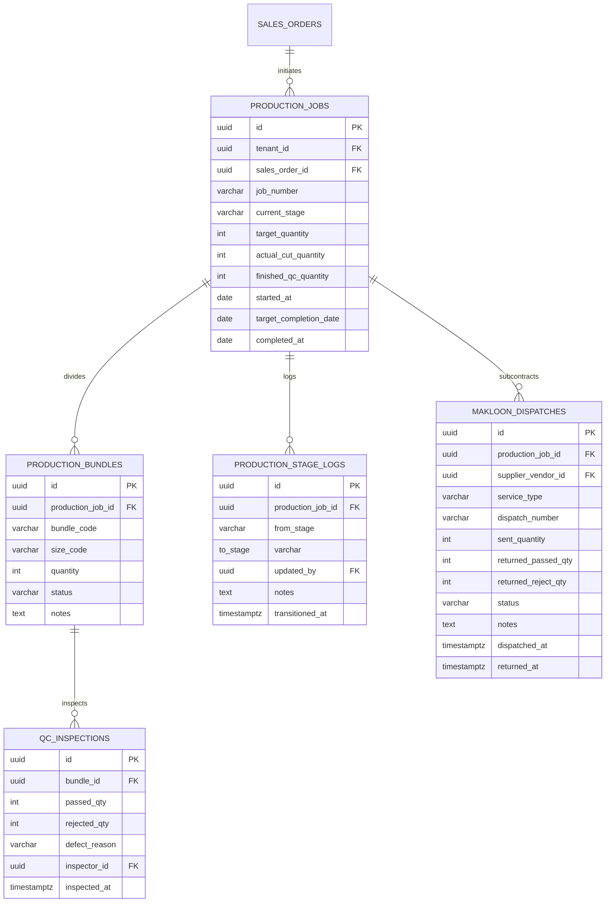

# Spesifikasi Master Modul: 004 - Alur Produksi Konveksi & Makloon (MES)

Dokumen ini merupakan **Spesifikasi Master (Tier 1)** yang memuat arsitektur alur kerja manufaktur konveksi (MES), pelacakan 6 stasiun kerja lantai pabrik, subkontrak makloon luar (sablon/bordir), tiket bundel fisik, serta katalog navigasi menuju sub-spesifikasi detail fitur.

---

## 1. Metadata & Tautan Referensi Terkait

- **Kode Modul**: `SPEC-004`
- **Tingkatan Dokumen**: **Tier 1 (Master Specification Hub)**
- **Domain Bounded Context**: `production` / `mes`
- **Tautan Standar Acuan Global**:
  - 📋 [Standar Penulisan Requirement](../context/requirements_standard.md)
  - 📋 [Kebutuhan Bisnis Konveksi](../context/business_requirements.md)
  - 👆 [Prinsip UX Lapangan & Sentuhan](../context/ux.md)
  - 🔧 [Standar Kebutuhan Teknis & Thermal Print](../context/technical_requirements.md)
  - 🧪 [Standar Pengujian QA & Browser Testing](../context/qa.md)
- **Tautan Spesifikasi Master Terkait**:
  - 📊 [001 - Dashboard Monitoring](./001-dashboard.md)
  - 📄 [003 - Sales & Order (OMS)](./003-sales-order.md)
  - 📦 [005 - Manajemen Inventaris Kain (WMS)](./005-inventory.md)
  - 👥 [006 - HRIS & Payroll Borongan](./006-hris-payroll.md)
  - 💡 [007 - Knowledge Base & Supplier/Makloon](./007-knowledge-base.md)

---

## 2. Indeks Sub-Modul Fungsional (Tier 2 Sub-Specifications)

Rincian implementasi teknis, skema DDL, kontrak API RESTful, skenario Gherkin 4-pilar, dan format tiket cetak dipecah menjadi sub-spesifikasi modular berikut:

| Berkas Sub-Spesifikasi | Lingkup Fungsional Utama | Ukuran & Fokus Teknis |
| :--- | :--- | :--- |
| 🧵 **[004a-production-tracking.md](./004a-production-tracking.md)** | Papan pelacakan 6 stasiun konveksi & Kanban board transisi lantai kerja. | State machine stasiun produksi, lock transisi. |
| 🪡 **[004b-makloon-subcontract.md](./004b-makloon-subcontract.md)** | Surat Jalan Makloon Luar (Sablon/Bordir), tracking selisih kirim/kembali. | Rekonsiliasi pcs kirim vs terima, klaim makloon. |
| 🏷️ **[004c-bundle-ticket.md](./004c-bundle-ticket.md)** | Cetak Tiket Bundel Kerja Fisik (Thermal 80mm / Stiker A6) barcode/QR. | Tata letak thermal 80mm, QR code validasi bundle ID. |
| 🔍 **[004d-qc-inspection.md](./004d-qc-inspection.md)** | Pemeriksaan kualitas QC, pencatatan alasan reject, & perintah Potong Tambal. | Klasifikasi cacat (reject kain/jahit), trigger alokasi kain. |

---

## 3. Ringkasan Kebutuhan & Masalah Bisnis

### Masalah yang Dihadapi
1. **Blind Spot Progres Jahitan**: Manajer pabrik tidak tahu pasti apakah pesanan yang sedang berjalan sudah selesai dipotong, sedang disablon di vendor makloon, atau sedang macet di meja penjahit tertentu.
2. **Kain Potong Tercecer di Vendor Makloon Luar**: Banyak konveksi menyablon atau membordir di pihak ketiga (*makloon rekanan*). Kain potong yang dikirim sering kembali kurang (misal kirim 200 pcs, kembali 196 pcs karena 4 pcs rusak sablon), tanpa ada pencatatan yang jelas siapa yang bertanggung jawab.
3. **Kain Potong Tertukar Antar Bundel**: Saat kain dipotong dalam jumlah banyak, bundel potongan lengan, badan depan, dan kerah sering tertukar tanpa adanya label fisik yang ditempel pada tumpukan kain.
4. **Data Cacat / Reject Terlambat Terdeteksi**: Cacat kain baru diketahui saat packing, menyebabkan kekurangan kuantiti baju saat jadwal pengiriman sudah mepet.

### Solusi MVP
1. **Papan Pelacakan 6 Stasiun Konveksi**:
   - `material_arrived`: Verifikasi bahan kain & aksesoris telah siap di workshop.
   - `cutting`: Pencatatan realisasi potongan kain per ukuran dan pembagian bundel.
   - `screen_printing`: Pelacakan proses sablon atau bordir (internal maupun vendor makloon).
   - `sewing`: Perakitan baju oleh operator penjahit borongan.
   - `qc_packing`: Pemeriksaan jahitan, buang benang (*finishing*), setrika uap, dan pengemasan ke dalam polybag.
   - `ready_to_ship`: Barang selesai dikemas dan disimpan di rak transit pengiriman.
2. **Surat Jalan Makloon Luar (Subcontracting Tracking)**: Mencatat pengiriman kain potong ke vendor makloon, jumlah pcs dikirim, verifikasi kuantiti saat kembali, serta peringatan "Potong Tambal" jika ada reject makloon.
3. **Cetak Tiket Bundel Fisik (Printable Thermal Work Order)**: Cetak label stiker A6 atau thermal 80mm berisi nomor SPK, barcode/QR, detail ukuran, dan checklist paraf stasiun untuk diikatkan pada tiap bundel kain.

---

## 3. User Stories

- **US-04-01 [P1]**: Sebagai *Mandor Potong*, saya ingin mencatat realisasi hasil potong per ukuran dan mencetak tiket bundel thermal, agar bundel potongan kain memiliki identitas jelas saat dibawa ke meja sablon atau jahit.
- **US-04-02 [P1]**: Sebagai *Manajer Produksi*, saya ingin menerbitkan Surat Jalan Makloon untuk potongan kain yang disubkontrakkan ke vendor sablon/bordir dan mencatat selisih pcs saat kembali, agar tidak terjadi kehilangan kain.
- **US-04-03 [P1]**: Sebagai *Manajer Produksi*, saya ingin melihat papan status (Kanban board) 6 stasiun kerja konveksi, agar saya dapat mengidentifikasi stasiun mana yang mengalami penumpukan (*bottleneck*).
- **US-04-04 [P1]**: Sebagai *Staf QC*, saya ingin mencatat jumlah pcs yang lolos QC dan jumlah yang reject beserta alasannya, agar hanya baju berkualitas prima yang dikemas dan data reject terekam untuk evaluasi penjahit.

---

## 4. Kriteria Penerimaan (Acceptance Criteria - Gherkin)

### Skenario 1: Penerbitan & Verifikasi Pengembalian Surat Jalan Makloon
- **Given** SPK `SPK-0012` selesai dipotong sebanyak 200 pcs dan diserahkan ke vendor makloon "Berkah Sablon".
- **When** Mandor membuat Surat Jalan Makloon dengan status `dispatched` (200 pcs).
- **And** Saat kain kembali, mandor memverifikasi: 196 pcs lolos, 4 pcs rusak tinta sablon.
- **Then** Sistem mencatat 196 pcs masuk ke stasiun `sewing` dan 4 pcs tercatat sebagai `makloon_reject`.
- **And** Menerbitkan peringatan otomatis ke meja potong: *"Kebutuhan Potong Tambal: 4 Pcs Size L"*.

### Skenario 2: Transisi Stasiun Kerja Berurutan
- **Given** SPK `SPK-202610-0012` berada di stasiun `cutting`.
- **When** Mandor potong menyelesaikan pemotongan 150 pcs dan menekan tombol "Kirim ke Sablon / Bordir".
- **Then** Status stasiun SPK berubah menjadi `screen_printing`.

---

## 5. Skema Relasi Data (Mermaid ERD)



---

## 6. Kontrak API RESTful

### Endpoint: `POST /api/v1/production/jobs/{id}/makloon-dispatches`
Menerbitkan Surat Jalan Makloon Luar (Sablon / Bordir):
```json
{
  "vendor_id": "01925b6a-8451-7ef1-953e-51c045b0a333",
  "service_type": "screen_printing",
  "sent_quantity": 200,
  "notes": "Sablon Plastisol 2 warna dada dan punggung. Estimasi selesai 3 hari."
}
```

### Endpoint: `PATCH /api/v1/production/makloon-dispatches/{dispatch_id}/receive`
Mencatat penerimaan kembali kain dari vendor makloon:
```json
{
  "returned_passed_qty": 196,
  "returned_reject_qty": 4,
  "defect_notes": "4 pcs ukuran L rusak sablon miring/luber.",
  "trigger_recut": true
}
```

---

## 7. Desain Antarmuka & Format Cetak Tiket Bundel

### A. Papan Kanban Produksi 6 Kolom (Desktop & Tablet)
- 6 Kolom: **Bahan Datang** ➔ **Potong** ➔ **Sablon/Bordir (Internal/Makloon)** ➔ **Jahit** ➔ **QC & Packing** ➔ **Siap Kirim**.
- Badge khusus `MAKLOON [Berkah Sablon]` pada kartu pesanan yang sedang berada di vendor luar.

### B. Format Tiket Bundel Thermal (80mm / A6 Sticker)
```text
========================================
           SEWERP PRODUCTION TAG
========================================
NO. SPK   : SPK-202610-0012
DEADLINE  : 10 Nov 2026 (URGENT)
PELANGGAN : PT Sumber Busana
ARTIKEL   : Polo Shirt Seragam Telkom
WARNA     : Merah Maroon
----------------------------------------
KODE BUNDEL : BND-0012-L-01
UKURAN      : L (Large)
ISI BUNDEL  : 24 Pcs
----------------------------------------
INSTRUKSI KHUSUS:
- Sablon Plastisol dada kiri & punggung
- Kancing warna senada kain (Maroon)
- Belahan samping bawah jahit bartack
----------------------------------------
CHECKLIST STASIUN:
[ ] Potong     : ............. (Paraf)
[ ] Makloon/Pr : ............. (Paraf)
[ ] Jahit      : ............. (Paraf)
[ ] QC & Pack  : ............. (Paraf)
========================================
[  BARCODE / QR CODE SPK-202610-0012-B1  ]
========================================
```
