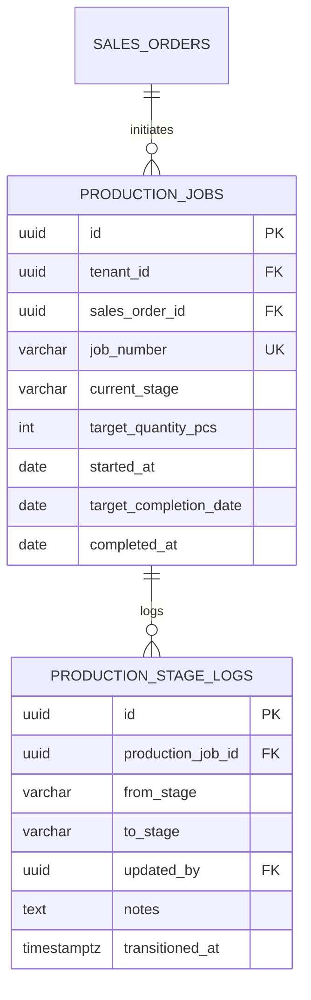

# Spesifikasi Sub-Modul: 004a - Papan Pelacakan 6 Stasiun Konveksi & Kanban (MES)

Dokumen ini memuat spesifikasi fungsional, arsitektur data, kontrak API, dan pedoman antarmuka papan Kanban interaktif untuk melacak alur kerja pesanan pakaian di 6 stasiun kerja konveksi SewERP.

---

## 1. Metadata & Tautan Referensi Terkait

- **Kode Modul**: `SPEC-004a`
- **Domain Bounded Context**: `production` / `mes`
- **Tautan Standar Acuan Global**:
  - 📋 [Standar Penulisan Requirement](../context/requirements_standard.md)
  - 📋 [Kebutuhan Bisnis Konveksi](../context/business_requirements.md)
  - 👆 [Prinsip UX Lapangan & Sentuhan 48px](../context/ux.md)
  - 🎨 [Standar UI Flat](../context/ui.md)
  - 🗄️ [Standar Database PostgreSQL](../context/dbadmin.md)
  - 🧪 [Standar Pengujian QA & Browser Testing](../context/qa.md)
- **Tautan Spesifikasi Fitur Terkait**:
  - 📄 [003a - Inti Sales & Order (OMS)](./003a-sales-order-core.md)
  - 🧵 [004b - Subkontrak Makloon Luar](./004b-makloon-subcontract.md)
  - 🏷️ [004c - Cetak Tiket Bundel Kerja](./004c-bundle-ticket.md)
  - 🔍 [004d - Inspeksi QC & Potong Tambal](./004d-qc-inspection.md)
  - 📊 [001c - Radar Deadline Kritis](./001c-dashboard-radar-alerts.md)

---

## 2. Ringkasan Kebutuhan & Masalah Bisnis

### Masalah Lapangan
Manajer pabrik mengalami *blind spot* progres: tidak tahu apakah pesanan seragam sudah selesai dipotong, sedang disablon di vendor makloon, atau menumpuk di meja penjahit tertentu, sehingga gagal mengantisipasi keterlambatan deadline.

### Solusi Fitur
Papan Kanban 6 Kolom Berurutan (*Strict Sequential Workstations*):
1. `material_arrived`: Verifikasi bahan kain & aksesoris telah dialokasikan gudang potong.
2. `cutting`: Pemotongan kain per pola dan pembagian ke dalam bundel kerja.
3. `screen_printing`: Pengerjaan sablon/bordir (internal maupun vendor makloon rekanan).
4. `sewing`: Perakitan baju oleh operator penjahit borongan.
5. `qc_packing`: Pemeriksaan jahitan, buang benang (*finishing*), setrika uap, dan packing polybag.
6. `ready_to_ship`: Selesai dikemas dan siap diserahkan ke kurir/ekspedisi.

---

## 3. User Stories

- **US-004a-01 [P1 - Manajer Produksi]**: Sebagai *Manajer Produksi*, saya ingin melihat papan Kanban 6 stasiun kerja konveksi secara real-time, agar saya dapat mendeteksi stasiun mana yang mengalami penumpukan pesanan (*bottleneck*).
- **US-004a-02 [P1 - Mandor Jahit/Potong]**: Sebagai *Mandor*, saya ingin menekan tombol transisi stasiun kerja dari tablet lantai pabrik, agar status SPK otomatis berpindah ke stasiun berikutnya tanpa perlu mengetik ulang data.

---

## 4. Kriteria Penerimaan (Acceptance Criteria - Gherkin)

### Skenario 1: Transisi Stasiun Kerja Berurutan (Happy Path)
- **Given** SPK `SPK-202610-0012` berada di stasiun `cutting`.
- **When** Mandor potong menekan tombol "Kirim ke Sablon / Bordir".
- **Then** Status stasiun SPK berubah menjadi `screen_printing` dan tercatat log transisi `production_stage_logs`.

### Skenario 2: Pencegahan Lompat Stasiun Kerja (Invariant Check)
- **Given** SPK berada di stasiun `material_arrived`.
- **When** Mandor mencoba langsung memindahkannya ke stasiun `sewing`.
- **Then** Sistem menolak dengan HTTP 422 Unprocessable Entity: *"Urutan stasiun tidak valid. Kain harus melalui proses pemotongan (cutting) terlebih dahulu"*.

---

## 5. Skema Relasi Data Granular (Mermaid ERD)



---

## 6. Kontrak API RESTful

### Endpoint: `PATCH /api/v1/production/jobs/{id}/transition`
- **Request Payload**:
```json
{
  "to_stage": "screen_printing",
  "notes": "Potong selesai 200 pcs (S:50, M:50, L:70, XL:30). Dikirim ke makloon sablon."
}
```

### Endpoint: `GET /api/v1/production/kanban`
- **Response Payload (HTTP 200 OK)**:
```json
{
  "status": "success",
  "data": {
    "stages": {
      "material_arrived": [ ... ],
      "cutting": [ ... ],
      "screen_printing": [ ... ],
      "sewing": [ ... ],
      "qc_packing": [ ... ],
      "ready_to_ship": [ ... ]
    }
  }
}
```

---

## 7. Desain Antarmuka & UX Sentuhan
- 6 Kolom Kanban responsif horizontal dengan scroll halus.
- Kartu pesanan memuat nomor SPK, nama pemesan, deadline hari, badge warna kain, dan indikator keterlambatan.
- Touch target tombol aksi minimal 48x48px untuk kemudahan klik staf bersarung tangan di lantai pabrik.

---

## 8. Persyaratan Keamanan & Non-Fungsional
- **RLS & Multi-Tenant**: Kueri kanban wajib terfilter `tenant_id`.
- **WebSocket / Polling Ringan**: Pembaruan status kanban tanpa reload seluruh halaman.

---

## 9. Kerangka Pemecahan Tugas (Task Breakdown)
- [ ] **Fase 1**: Goose migration tabel `production_jobs` dan `production_stage_logs`.
- [ ] **Fase 2**: State machine Go di domain layer memvalidasi urutan stasiun.
- [ ] **Fase 3**: Handler route `GET /api/v1/production/kanban` dan `PATCH /transition`.
- [ ] **Fase 4**: SolidJS Kanban Board View dengan status badge UnoCSS.
