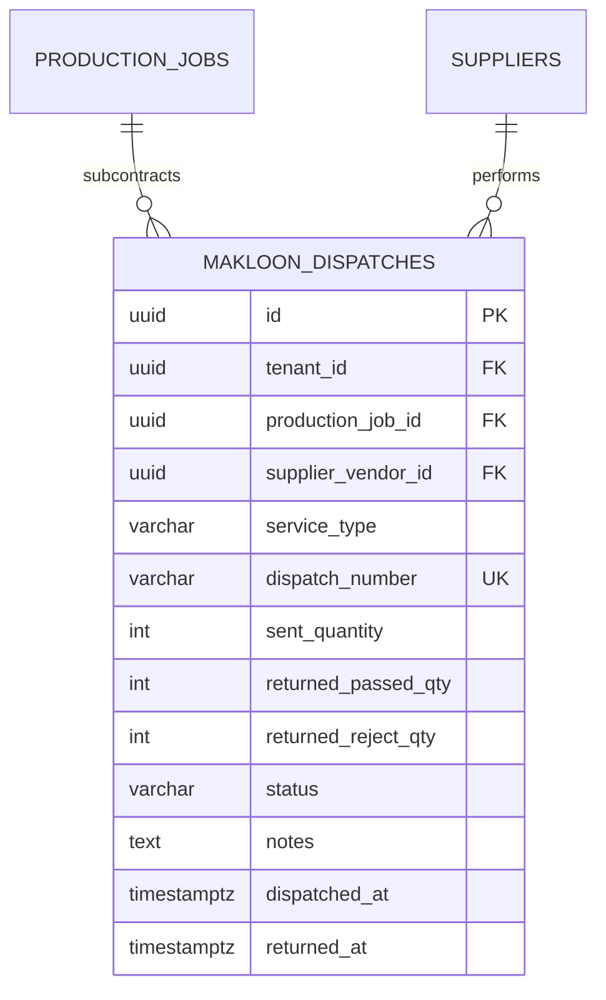

# Spesifikasi Sub-Modul: 004b - Subkontrak Makloon Luar Sablon & Bordir (MES)

Dokumen ini memuat spesifikasi fungsional, arsitektur data, kontrak API, dan alur verifikasi penerbitan Surat Jalan Makloon Luar (*Subcontracting*) ke vendor sablon/bordir rekanan beserta pencatatan selisih barang kembali.

---

## 1. Metadata & Tautan Referensi Terkait

- **Kode Modul**: `SPEC-004b`
- **Domain Bounded Context**: `production` / `mes`
- **Tautan Standar Acuan Global**:
  - 📋 [Standar Penulisan Requirement](../context/requirements_standard.md)
  - 📋 [Kebutuhan Bisnis Konveksi](../context/business_requirements.md)
  - 🗄️ [Standar Database PostgreSQL](../context/dbadmin.md)
  - 🧪 [Standar Pengujian QA & Browser Testing](../context/qa.md)
- **Tautan Spesifikasi Fitur Terkait**:
  - 🧵 [004a - Papan Pelacakan 6 Stasiun Produksi](./004a-production-tracking.md)
  - 🔍 [004d - Inspeksi QC & Potong Tambal](./004d-qc-inspection.md)
  - 💡 [007b - Direktori Master Supplier & Mitra Makloon](./007b-supplier-directory.md)

---

## 2. Ringkasan Kebutuhan & Masalah Bisnis

### Masalah Lapangan
Banyak konveksi mensubkontrakkan sablon atau bordir ke pihak ketiga (*makloon luar*). Potongan kain yang dikirim sering kali kembali kurang (misal kirim 200 pcs, kembali 196 pcs karena 4 pcs rusak tinta atau terbakar mesin bordir) tanpa pencatatan pertanggungjawaban yang jelas.

### Solusi Fitur
1. **Surat Jalan Makloon Resmi**: Mencatat pengiriman kain potong, vendor makloon tujuan, kuantiti pcs, teknik cetak, dan estimasi waktu kembali.
2. **Pencatatan Selisih & Rekonsiliasi**: Memverifikasi kuantiti yang kembali lolos vs kuantiti reject makloon.
3. **Pemicu Otomatis Potong Tambal**: Jika ada reject makloon, sistem otomatis menerbitkan peringatan ke meja potong untuk memotong kain pengganti.

---

## 3. User Stories

- **US-004b-01 [P1 - Mandor Produksi]**: Sebagai *Mandor Produksi*, saya ingin menerbitkan Surat Jalan Makloon untuk potongan kain yang dikirim ke vendor sablon/bordir luar, agar ada bukti tertulis serah terima barang.
- **US-004b-02 [P1 - Mandor Produksi]**: Sebagai *Mandor Produksi*, saya ingin mencatat hasil verifikasi saat kain kembali dari vendor makloon (jumlah lolos vs reject), agar selisih kain hilang atau rusak tercatat secara akuntabel.

---

## 4. Kriteria Penerimaan (Acceptance Criteria - Gherkin)

### Skenario 1: Penerimaan Kembali Kain Makloon dengan Reject (Potong Tambal Triggered)
- **Given** SPK `SPK-0012` mengirim 200 pcs kain potong ke vendor "Berkah Sablon".
- **When** Mandor memverifikasi kain kembali: 196 pcs lolos dan 4 pcs reject tinta luber.
- **Then** Sistem mencatat 196 pcs masuk ke stasiun `sewing` dan 4 pcs tercatat sebagai `makloon_reject`.
- **And** Menerbitkan peringatan otomatis ke meja potong: *"Kebutuhan Potong Tambal: 4 Pcs Size L - SPK-0012"*.

---

## 5. Skema Relasi Data Granular (Mermaid ERD)



---

## 6. Kontrak API RESTful

### Endpoint: `POST /api/v1/production/jobs/{id}/makloon-dispatches`
- **Request Payload**:
```json
{
  "vendor_id": "01925b6a-8451-7ef1-953e-51c045b0a333",
  "service_type": "screen_printing",
  "sent_quantity": 200,
  "notes": "Sablon Plastisol 2 warna dada dan punggung. Estimasi selesai 3 hari."
}
```

### Endpoint: `PATCH /api/v1/production/makloon-dispatches/{dispatch_id}/receive`
- **Request Payload**:
```json
{
  "returned_passed_qty": 196,
  "returned_reject_qty": 4,
  "defect_notes": "4 pcs ukuran L rusak sablon miring/luber.",
  "trigger_recut": true
}
```

---

## 7. Kerangka Pemecahan Tugas (Task Breakdown)
- [ ] **Fase 1**: Goose migration tabel `makloon_dispatches`.
- [ ] **Fase 2**: Domain Entity `MakloonDispatch` dan kalkulasi selisih.
- [ ] **Fase 3**: Handler route penerbitan dan penerimaan makloon.
- [ ] **Fase 4**: Dialog modal input verifikasi pengembalian makloon di SolidJS.
