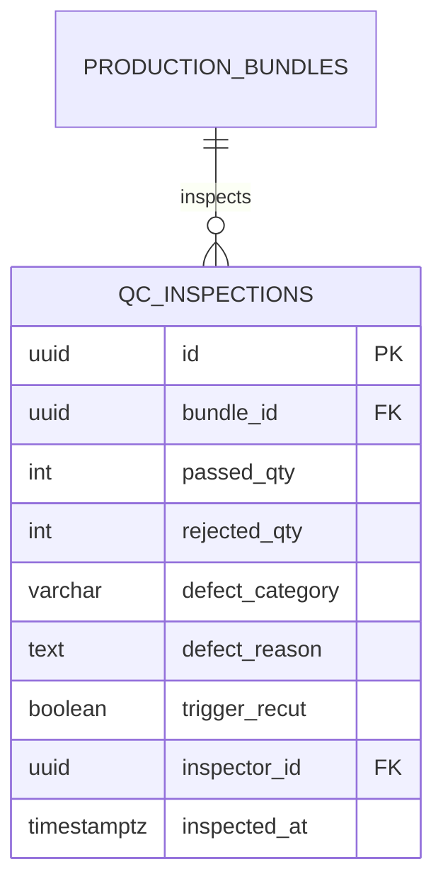

# Spesifikasi Sub-Modul: 004d - Inspeksi Kualitas QC & Potong Tambal (MES)

Dokumen ini memuat spesifikasi fungsional, arsitektur data, kontrak API, dan pedoman antarmuka untuk stasiun Quality Control (QC), pencatatan cacat produk (*defect rate*), serta penerbitan perintah kerja potong tambal (*recut work order*).

---

## 1. Metadata & Tautan Referensi Terkait

- **Kode Modul**: `SPEC-004d`
- **Domain Bounded Context**: `production` / `mes`
- **Tautan Standar Acuan Global**:
  - 📋 [Standar Penulisan Requirement](../context/requirements_standard.md)
  - 📋 [Kebutuhan Bisnis Konveksi](../context/business_requirements.md)
  - 👆 [Prinsip UX Lapangan Pabrik](../context/ux.md)
  - 🧪 [Standar Pengujian QA & Benchmark Testing](../context/qa.md)
- **Tautan Spesifikasi Fitur Terkait**:
  - 🧵 [004a - Papan Pelacakan 6 Stasiun Produksi](./004a-production-tracking.md)
  - 🧵 [004b - Subkontrak Makloon Luar](./004b-makloon-subcontract.md)
  - 📦 [005b - Alokasi Bahan Baku & Margin Susut](./005b-stock-allocation-wastage.md)
  - 📊 [008b - Laporan Kinerja & Cacat Produksi](./008b-production-defect-report.md)

---

## 2. Ringkasan Kebutuhan & Masalah Bisnis

### Masalah Lapangan
Cacat pakaian (jahitan loncat, noda minyak mesin, sablon pecah, bolong jarum) sering baru diketahui saat barang hendak dikirim, menyebabkan kekurangan jumlah seragam yang diserahkan ke pelanggan dan sengketa penalti keterlambatan.

### Solusi Fitur
1. **Pemeriksaan QC per Bundel**: Staf QC memeriksa jahitan dan memisahkan jumlah pcs yang `passed` vs `rejected`.
2. **Kategori Alasan Cacat (*Defect Categorization*)**: Mencatat jenis cacat (Cacat Jahit, Cacat Sablon/Bordir, Cacat Kain/Noda).
3. **Penerbitan Potong Tambal Instan**: Jika ada reject yang tidak bisa diperbaiki, sistem otomatis membuat tiket "Potong Tambal" untuk meja potong.

---

## 3. User Stories

- **US-004d-01 [P1 - Staf QC]**: Sebagai *Staf QC*, saya ingin mencatat jumlah pcs lolos dan jumlah reject beserta alasan kerusakannya, agar hanya pakaian berkualitas baik yang dikemas ke polybag.
- **US-004d-02 [P1 - Mandor Potong]**: Sebagai *Mandor Potong*, saya ingin melihat antrean kebutuhan potong tambal akibat reject QC, agar potongan pengganti segera dipotong tanpa menunda pengiriman.

---

## 4. Kriteria Penerimaan (Acceptance Criteria - Gherkin)

### Skenario 1: Pencatatan Hasil Inspeksi QC Bundel
- **Given** Bundel `BND-0012-L-01` berisi 24 pcs kemeja di stasiun QC.
- **When** Staf QC menginput: 22 pcs lolos, 2 pcs reject noda oli mesin.
- **Then** Sistem mencatat 22 pcs siap ke stasiun packing dan 2 pcs masuk status reject.
- **And** Menerbitkan perintah potong tambal 2 pcs ukuran L ke meja potong.

---

## 5. Skema Relasi Data Granular (Mermaid ERD)



---

## 6. Kontrak API RESTful

### Endpoint: `POST /api/v1/production/bundles/{id}/qc-inspections`
- **Request Payload**:
```json
{
  "passed_qty": 22,
  "rejected_qty": 2,
  "defect_category": "oil_stain",
  "defect_reason": "Noda oli mesin jahit di bagian dada kiri tidak bisa hilang dicuci",
  "trigger_recut": true
}
```

---

## 7. Kerangka Pemecahan Tugas (Task Breakdown)
- [ ] **Fase 1**: Goose migration tabel `qc_inspections`.
- [ ] **Fase 2**: Service pencatatan inspeksi dan auto-create recut order.
- [ ] **Fase 3**: Handler route `POST /api/v1/production/bundles/{id}/qc-inspections`.
- [ ] **Fase 4**: Antarmuka layar sentuh tablet QC di SolidJS.
