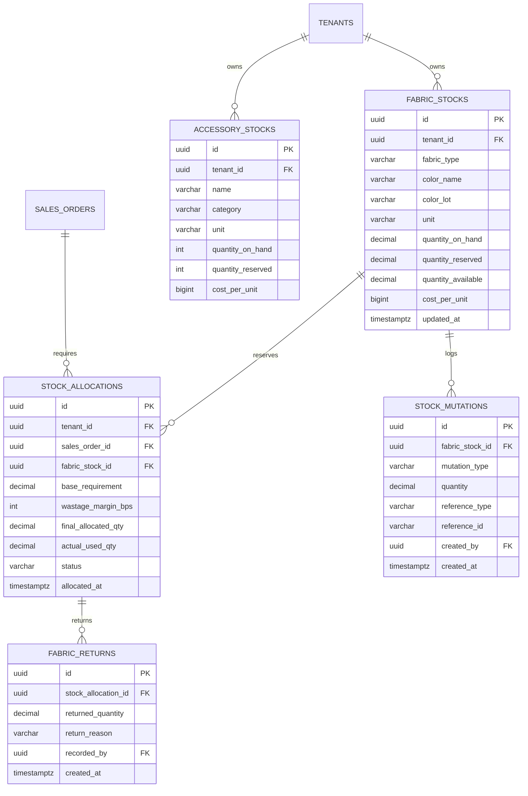

# Spesifikasi Master Modul: 005 - Manajemen Inventaris Kain, Aksesoris & Retur Rol (WMS)

Dokumen ini merupakan **Spesifikasi Master (Tier 1)** yang memuat arsitektur pergudangan tekstil (WMS), alokasi stok kain dan aksesoris per SPK, formula penyusutan kain (*wastage margin* 3%–5%), penimbangan retur sisa rol kain, serta katalog navigasi menuju sub-spesifikasi detail fitur.

---

## 1. Metadata & Tautan Referensi Terkait

- **Kode Modul**: `SPEC-005`
- **Tingkatan Dokumen**: **Tier 1 (Master Specification Hub)**
- **Domain Bounded Context**: `inventory` / `wms`
- **Tautan Standar Acuan Global**:
  - 📋 [Standar Penulisan Requirement](../context/requirements_standard.md)
  - 📋 [Kebutuhan Bisnis Konveksi & Wastage](../context/business_requirements.md)
  - 🗄️ [Standar Database PostgreSQL](../context/dbadmin.md)
  - 🧪 [Standar Pengujian QA & Race Conditions](../context/qa.md)
  - 🏛️ [Standar Arsitektur Sistem](../context/architecture.md)
- **Tautan Spesifikasi Master Terkait**:
  - 📊 [001 - Dashboard Monitoring](./001-dashboard.md)
  - 📄 [003 - Sales & Order (OMS)](./003-sales-order.md)
  - 🧵 [004 - Alur Produksi Konveksi (MES)](./004-production.md)
  - 💡 [007 - Knowledge Base & Supplier Kain](./007-knowledge-base.md)

---

## 2. Indeks Sub-Modul Fungsional (Tier 2 Sub-Specifications)

Rincian implementasi teknis, skema DDL, kontrak API RESTful, skenario Gherkin 4-pilar, dan kalkulasi alokasi stok dipecah menjadi sub-spesifikasi modular berikut:

| Berkas Sub-Spesifikasi | Lingkup Fungsional Utama | Ukuran & Fokus Teknis |
| :--- | :--- | :--- |
| 📦 **[005a-fabric-inventory.md](./005a-fabric-inventory.md)** | Stok bahan baku kain (Roll, Yard, Kg), lot warna (*color lot*), & mutasi gudang. | Multi-satuan konversi kain, isolasi lot warna. |
| 📐 **[005b-stock-allocation-wastage.md](./005b-stock-allocation-wastage.md)** | Reservasi kain per SPK & formula toleransi penyusutan (*Wastage Margin 3%–5%*). | Formula alokasi otomatis, pencegahan *stock out*. |
| ⚖️ **[005c-roll-return.md](./005c-roll-return.md)** | Penimbangan & pengembalian sisa rol kain pasca-potong (*Roll Return*). | Rekonsiliasi timbangan berat kain, re-entry stok. |
| 🔘 **[005d-accessory-inventory.md](./005d-accessory-inventory.md)** | Inventaris aksesoris garmen (kancing, resleting, rib kerah, karet, label, polybag). | Multi-satuan aksesoris (lusin, gross, pcs). |

---

## 3. Ringkasan Kebutuhan & Masalah Bisnis

### Masalah yang Dihadapi
1. **Kekurangan Bahan di Tengah Proses Potong**: Mandor potong sering mendapati kain habis saat baru memotong 80% dari target pesanan. Hal ini terjadi karena admin hanya menghitung kebutuhan kain teoritis tanpa memperhitungkan penyusutan kain (*shrinkage*) dan cacat potong di pinggir gulungan.
2. **Kain Sisa Potong (Offcut / Sisa Rol) Tercecer Tanpa Status**: Setelah memotong 150 pcs dari rol kain seberat 25 kg, tersisa 4 kg kain di ujung rol. Sisa kain ini sering tercecer di bawah meja potong atau hilang tanpa tercatat kembali ke stok gudang, padahal bisa dipakai untuk pesanan rib kerah atau pesanan kuantiti kecil.
3. **Ketiadaan Reservasi Stok**: Kain yang ada di gudang sering dipakai oleh pesanan lain yang datang belakangan, sehingga pesanan utama yang sudah jatuh tempo justru tertunda produksinya.
4. **Stok Aksesoris Terabaikan**: Ketiadaan kancing warna khusus atau resleting jaket baru disadari saat baju sudah di stasiun jahit, menyebabkan penjahit menganggur berhari-hari menunggu supplier.

### Solusi MVP
1. **Pencatatan Spesifik Karakteristik Kain**: Mencatat jenis rajut/tenun, lot warna (*color lot*), gramasi kain, dan satuan (Roll, Yard, Kilogram).
2. **Alokasi Bahan Baku Terpadu per SPK**: Begitu SPK terbit, stok kain di gudang langsung di-reservasi (*soft-locked*) sehingga tidak dapat digunakan oleh pesanan lain.
3. **Penerapan Otomatis Toleransi Penyusutan (Wastage Margin)**: Sistem otomatis menambahkan margin 3% hingga 5% (default: 4%) ke formula kebutuhan bahan mentah saat membuat SPK.
4. **Alur Pengembalian Sisa Kain Rol (Roll Return to Warehouse)**: Menimbang dan mencatat sisa rol kain pasca-potong untuk dimasukkan kembali ke stok aktif atau kategori *kain sisa rol*.
5. **Pencatatan Aksesoris Utama**: Pelacakan stok kancing, resleting, rib kerah, karet elastis, label woven, dan polybag.

---

## 3. User Stories

- **US-05-01 [P1]**: Sebagai *Staf Gudang*, saya ingin mencatat penerimaan kain yang baru dibeli dari supplier (jumlah roll, berat total kg/yard, dan lot warna), agar stok gudang selalu akurat dengan fisik.
- **US-05-02 [P1]**: Sebagai *Manajer Produksi*, saya ingin sistem otomatis mengalokasikan stok kain beserta toleransi penyusutan 4% saat SPK terbit, agar bagian potong tidak kekurangan kain di tengah jalan.
- **US-05-03 [P1]**: Sebagai *Mandor Potong*, saya ingin mencatat pengembalian sisa kain rol yang belum habis setelah pemotongan selesai, agar sisa kain masuk kembali ke inventaris dan dapat digunakan kembali.
- **US-05-04 [P2]**: Sebagai *Staf Gudang*, saya ingin mencatat pengeluaran kain saat kain diserahkan ke meja potong, agar sisa stok bebas (*available stock*) berkurang secara real-time.

---

## 4. Kriteria Penerimaan (Acceptance Criteria - Gherkin)

### Skenario 1: Kalkulasi Alokasi Bahan dengan Wastage Margin 4%
- **Given** Pembuatan 100 pcs Kaos Combed 30s membutuhkan kain bersih 25 kg (asumsi 1 kg = 4 kaos).
- **And** Margin toleransi penyusutan diatur pada 4% (400 bps).
- **When** Sistem membuat alokasi bahan baku untuk SPK tersebut.
- **Then** Sistem menghitung kebutuhan alokasi sebesar:
  $$\text{Kebutuhan Alokasi} = 25\text{ kg} \times 1.04 = 26\text{ kg}$$
- **And** Status alokasi menjadi `reserved` jika stok fisik gudang $\ge 26$ kg.

### Skenario 2: Pengembalian Sisa Kain Rol Pasca-Potong
- **Given** Mandor potong mengambil 1 roll kain seberat 25.0 kg untuk SPK `SPK-0012`.
- **And** Pemotongan kain selesai dan menggunakan 21.5 kg kain.
- **When** Mandor menimbang sisa rol kain (3.5 kg) dan menekan tombol "Kembalikan Sisa Rol ke Gudang".
- **Then** Sistem mencatat transaksi mutasi `roll_return` sebesar 3.5 kg ke stok kain gudang.
- **And** Total pemakaian kain riil untuk SPK `SPK-0012` terekam bersih 21.5 kg.

---

## 5. Skema Relasi Data (Mermaid ERD)



---

## 6. Kontrak API RESTful

### Endpoint: `POST /api/v1/inventory/fabrics`
Mencatat penerimaan stok kain baru dari supplier:
```json
{
  "fabric_type": "Cotton Combed 30s",
  "color_name": "Hitam Reaktif",
  "color_lot": "LOT-2026-X8",
  "unit": "kg",
  "quantity_received": 120.5,
  "cost_per_unit": 115000,
  "supplier_id": "01925b6a-8451-7ef1-953e-51c045b0a333",
  "invoice_reference": "INV-SUP-9812"
}
```

### Endpoint: `POST /api/v1/inventory/allocations/{id}/return-roll`
Mencatat pengembalian sisa kain rol pasca potong ke gudang:
```json
{
  "returned_quantity": 3.5,
  "notes": "Sisa ujung rol kain combed 30s hitam reaktif pasca potong SPK-0012, kondisi bersih rapi terikat plastik."
}
```

---

## 7. Desain Antarmuka Pengguna (UI/UX)

- **Tampilan Gudang Kain (Bento Stock Card)**: Kartu visual yang menampilkan nama kain, warna, swatch visual kain, jumlah roll fisik, stok yang sedang teralokasi di SPK aktif, dan sisa stok bebas yang siap pakai.
- **Formulir Cepat Timbang Retur Rol (Tablet Meja Potong)**: Desain dialog satu layar dengan kolom input berat timbangan sisa rol dan tombol konfirmasi besar untuk mempermudah mandor potong tanpa mengetik bertele-tele.
- **Peringatan Bahan Kritis (*Low Stock Alert*)**: Penandaan kuning/merah jika stok kain mendekati ambang batas minimum pemesanan ulang (*reorder point*).
