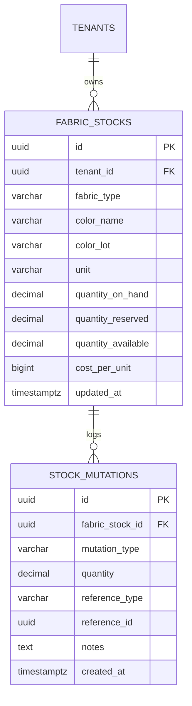

# Spesifikasi Sub-Modul: 005a - Manajemen Inventaris Bahan Baku Kain & Lot Warna (WMS)

Dokumen ini memuat spesifikasi fungsional, arsitektur data, kontrak API, dan manajemen inventaris bahan baku kain konveksi (satuan Roll, Yard, Kilogram) dengan pelacakan nomor lot celupan (*Color Lot*) untuk SewERP.

---

## 1. Metadata & Tautan Referensi Terkait

- **Kode Modul**: `SPEC-005a`
- **Domain Bounded Context**: `inventory` / `wms`
- **Tautan Standar Acuan Global**:
  - 📋 [Standar Penulisan Requirement](../context/requirements_standard.md)
  - 📋 [Kebutuhan Bisnis Konveksi](../context/business_requirements.md)
  - 🗄️ [Standar Database PostgreSQL & Indexing](../context/dbadmin.md)
  - 🧪 [Standar Pengujian QA & Race Conditions](../context/qa.md)
  - 🏛️ [Standar Arsitektur Sistem](../context/architecture.md)
- **Tautan Spesifikasi Fitur Terkait**:
  - 📦 [005b - Alokasi Bahan Baku & Toleransi Susut](./005b-stock-allocation-wastage.md)
  - 📦 [005c - Pengembalian Sisa Rol Kain](./005c-roll-return.md)
  - 📦 [005d - Manajemen Stok Aksesoris](./005d-accessory-inventory.md)
  - 💡 [007b - Direktori Supplier Bahan Baku](./007b-supplier-directory.md)

---

## 2. Ringkasan Kebutuhan & Masalah Bisnis

### Masalah Lapangan
1. Kain rajut (Combed, Carded, Lacoste) dan tenun (Drill, Twill) dibeli dalam satuan beragam (Roll, Kg, atau Yard). Pencatatan manual di buku sering salah konversi satuan.
2. Warna kain memiliki variasi celupan antar-pabrik (*shade/lot difference*). Menggabungkan potongan kain dari lot berbeda dalam satu SPK kemeja/kaos menghasilkan belang warna yang memicu penolakan pemesan.

### Solusi Fitur
1. **Master Stok Bahan Baku Multi-Satuan**: Pencatatan jenis kain, gramasi, warna, nomor rol fisik, dan konversi satuan otomatis.
2. **Pelacakan Ketat Lot Celupan (*Color Lot Tracking*)**: Setiap rol kain mencatat kode lot celupan supplier untuk mencegah pencampuran rol beda lot pada satu SPK.
3. **Kartu Mutasi Gudang**: Seluruh aliran masuk (pembelian), alokasi (SPK), dan keluar tercatat dalam `stock_mutations`.

---

## 3. User Stories

- **US-005a-01 [P1 - Staf Gudang]**: Sebagai *Staf Gudang*, saya ingin mencatat penerimaan kain yang baru dibeli (berat kg, panjang yard, warna, dan kode lot celupan), agar persediaan fisik selalu cocok dengan sistem.
- **US-005a-02 [P1 - Mandor Potong]**: Sebagai *Mandor Potong*, saya ingin menyaring rol kain berdasarkan nomor lot celupan yang sama saat mengambil kain untuk SPK besar, agar badan baju tidak belang warna.

---

## 4. Kriteria Penerimaan (Acceptance Criteria - Gherkin)

### Skenario 1: Penerimaan Rol Kain Baru dengan Lot Celupan
- **Given** Staf gudang menerima 4 roll kain `Combed 30s Hitam Reaktif` dari Toko Surya Textil dengan kode lot `LOT-2026-H04`.
- **When** Staf menginput data rol dan berat masing-masing (25.2 kg, 24.8 kg, 25.0 kg, 25.5 kg).
- **Then** Sistem mencatat 4 record rol kain baru dan menambahkan total 100.5 kg ke stok aktif.

---

## 5. Skema Relasi Data Granular (Mermaid ERD)



---

## 6. Kontrak API RESTful

### Endpoint: `POST /api/v1/wms/fabrics`
- **Request Payload**:
```json
{
  "fabric_type": "Combed 30s",
  "color_name": "Hitam Reaktif",
  "color_lot": "LOT-2026-H04",
  "unit": "kg",
  "quantity": 100.5,
  "cost_per_unit": 115000,
  "supplier_id": "01925b6a-8451-7ef1-953e-51c045b0a333"
}
```

---

## 7. Kerangka Pemecahan Tugas (Task Breakdown)
- [ ] **Fase 1**: Goose migration tabel `fabric_stocks` dan `stock_mutations`.
- [ ] **Fase 2**: Domain Entity & Repo fabric stock dengan atomic lock `FOR UPDATE`.
- [ ] **Fase 3**: Handler route penerimaan kain dan penyesuaian stok.
- [ ] **Fase 4**: Halaman katalog inventaris kain di SolidJS.
