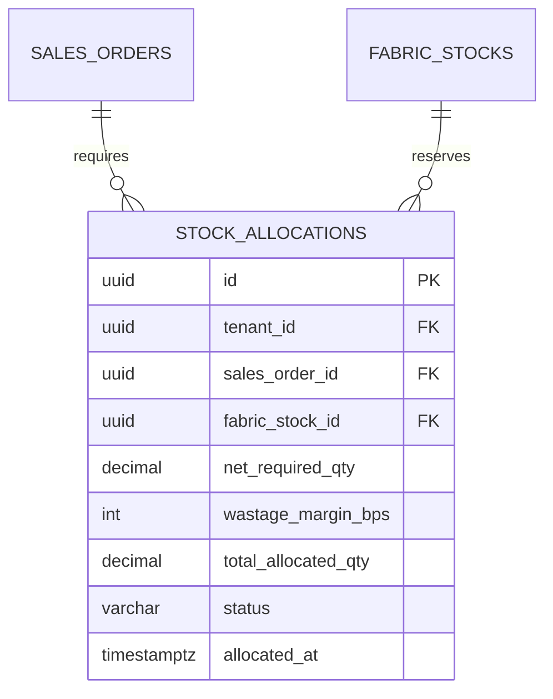

# Spesifikasi Sub-Modul: 005b - Alokasi Bahan Baku SPK & Margin Penyusutan 3%-5% (WMS)

Dokumen ini memuat spesifikasi logika reservasi bahan baku (*Stock Soft-Locking*) per SPK serta integrasi formula otomatis toleransi penyusutan kain (*Wastage Margin 3% - 5%*) untuk SewERP.

---

## 1. Metadata & Tautan Referensi Terkait

- **Kode Modul**: `SPEC-005b`
- **Domain Bounded Context**: `inventory` / `wms`
- **Tautan Standar Acuan Global**:
  - 📋 [Standar Penulisan Requirement](../context/requirements_standard.md)
  - 📋 [Kebutuhan Bisnis Konveksi & Susut Kain](../context/business_requirements.md)
  - 🏛️ [Presisi Finansial & Zero Float](../context/architecture.md)
  - 🗄️ [Standar Database PostgreSQL & Concurrency](../context/dbadmin.md)
- **Tautan Spesifikasi Fitur Terkait**:
  - 📦 [005a - Inventaris Bahan Baku Kain & Lot](./005a-fabric-inventory.md)
  - 📦 [005c - Pengembalian Sisa Rol Kain](./005c-roll-return.md)
  - 📄 [003a - Inti Sales & Order (OMS)](./003a-sales-order-core.md)
  - 🧵 [004a - Papan Pelacakan 6 Stasiun Produksi](./004a-production-tracking.md)

---

## 2. Ringkasan Kebutuhan & Masalah Bisnis

### Masalah Lapangan
1. Meja potong sering kehabisan kain di tengah jalan karena perhitungan kebutuhan kain hanya menghitung ukuran netto pola tanpa toleransi susut kain (*shrinkage*) dan cacat ujung rol.
2. Kain di gudang sering dipakai oleh pesanan lain yang datang belakangan tanpa reservasi resmi, sehingga pesanan lama yang sudah jatuh tempo tertunda produksinya.

### Solusi Fitur
1. **Formula Margin Penyusutan Baku (Wastage Margin 3%–5%)**: Sistem otomatis menambahkan buffer 4% (default: 400 basis poin) pada kebutuhan kain teoritis:
   $$\text{Kebutuhan Alokasi} = \text{Konsumsi Netto} \times \left(1 + \frac{\text{wastage\_bps}}{10000}\right)$$
2. **Reservasi Stok Otomatis (*Soft Locking*)**: Begitu SPK berstatus `approved`, stok `quantity_available` langsung dipotong dan dimasukkan ke `quantity_reserved`.

---

## 3. User Stories

- **US-005b-01 [P1 - Manajer Produksi]**: Sebagai *Manajer Produksi*, saya ingin sistem otomatis menambahkan margin susut 4% saat menghitung kebutuhan kain SPK, agar meja potong tidak kekurangan bahan.
- **US-005b-02 [P1 - Mandor Potong]**: Sebagai *Mandor Potong*, saya ingin stok kain yang sudah di-reservasi untuk SPK saya tidak dapat diambil oleh SPK lain, agar jadwal potong saya terjamin.

---

## 4. Kriteria Penerimaan (Acceptance Criteria - Gherkin)

### Skenario 1: Kalkulasi Alokasi Bahan dengan Wastage Margin 4%
- **Given** Pembuatan 100 pcs Kaos Combed 30s membutuhkan kain bersih 25.0 kg.
- **And** Parameter toleransi susut kain diatur sebesar 400 bps (4%).
- **When** Sistem membuat alokasi bahan untuk SPK tersebut.
- **Then** Kebutuhan alokasi dihitung sebesar $25.0 \times 1.04 = 26.0\text{ kg}$.
- **And** Nilai `quantity_reserved` pada stok kain bertambah 26.0 kg.

---

## 5. Skema Relasi Data Granular (Mermaid ERD)



---

## 6. Kontrak API RESTful

### Endpoint: `POST /api/v1/wms/allocations/calculate`
- **Request Payload**:
```json
{
  "sales_order_id": "01925b6a-8451-7ef1-953e-51c045b0a555",
  "fabric_stock_id": "01925b6a-8451-7ef1-953e-51c045b0a111",
  "net_required_kg": 25.0,
  "wastage_bps": 400
}
```
- **Response Payload (HTTP 200 OK)**:
```json
{
  "status": "success",
  "data": {
    "net_required_kg": 25.0,
    "wastage_kg": 1.0,
    "total_allocated_kg": 26.0,
    "stock_sufficient": true,
    "current_available_kg": 75.5
  }
}
```

---

## 7. Kerangka Pemecahan Tugas (Task Breakdown)
- [ ] **Fase 1**: Goose migration tabel `stock_allocations`.
- [ ] **Fase 2**: Engine kalkulasi alokasi bahan di Go domain layer.
- [ ] **Fase 3**: Handler route reservasi bahan saat SPK disetujui.
- [ ] **Fase 4**: Dialog pratinjau alokasi bahan pada wizard SPK SolidJS.
