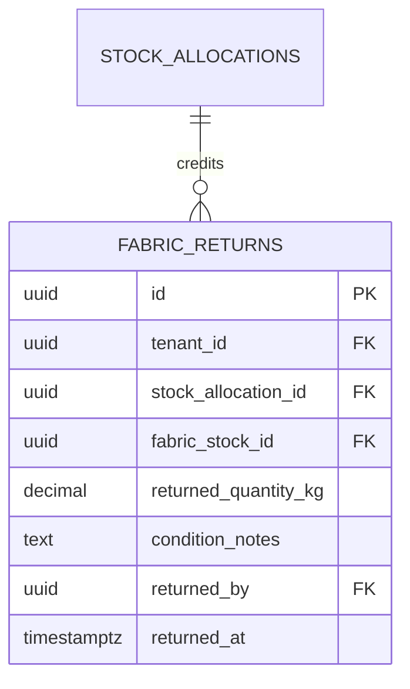

# Spesifikasi Sub-Modul: 005c - Pengembalian Sisa Kain Rol ke Gudang (Roll Return WMS)

Dokumen ini memuat spesifikasi fungsional, alur timbang fisik, dan pencatatan mutasi **Pengembalian Sisa Kain Rol (*Roll Return to Warehouse*)** setelah proses pemotongan kain selesai.

---

## 1. Metadata & Tautan Referensi Terkait

- **Kode Modul**: `SPEC-005c`
- **Domain Bounded Context**: `inventory` / `wms`
- **Tautan Standar Acuan Global**:
  - 📋 [Standar Penulisan Requirement](../context/requirements_standard.md)
  - 📋 [Kebutuhan Bisnis Konveksi & Efisiensi Bahan](../context/business_requirements.md)
  - 🗄️ [Standar Database PostgreSQL](../context/dbadmin.md)
  - 🧪 [Standar Pengujian QA & Race Conditions](../context/qa.md)
- **Tautan Spesifikasi Fitur Terkait**:
  - 📦 [005a - Inventaris Bahan Baku Kain & Lot](./005a-fabric-inventory.md)
  - 📦 [005b - Alokasi Bahan Baku & Toleransi Susut](./005b-stock-allocation-wastage.md)
  - 🧵 [004a - Papan Pelacakan 6 Stasiun Produksi](./004a-production-tracking.md)
  - 📊 [008c - Laporan Pemakaian Bahan Baku & Yield](./008c-fabric-yield-report.md)

---

## 2. Ringkasan Kebutuhan & Masalah Bisnis

### Masalah Lapangan
Setelah memotong 150 pcs pakaian dari rol kain seberat 25 kg, sering tersisa 3–5 kg kain di ujung rol (*offcut*). Sisa kain ini sering tercecer di bawah meja potong atau hilang tanpa tercatat kembali ke sistem gudang, padahal dapat dipakai untuk artikel pesanan kecil, rib kerah, atau pesanan kombinasi warna.

### Solusi Fitur
1. **Pencatatan Penimbangan Sisa Rol**: Mandor potong menimbang sisa rol kain dan memasukkan berat riil ke form pengembalian.
2. **Kredit Stok Otomatis**: Sistem menambahkan kembali sisa berat kain ke stok gudang dan menghitung konsumsi kain netto aktual untuk SPK terkait:
   $$\text{Konsumsi Netto SPK} = \text{Berat Awal Diambil} - \text{Berat Sisa Rol Dikembalikan}$$

---

## 3. User Stories

- **US-005c-01 [P1 - Mandor Potong]**: Sebagai *Mandor Potong*, saya ingin menimbang dan mencatat sisa rol kain pasca-potong, agar sisa kain resmi tercatat kembali ke stok gudang dan tidak dianggap hilang.
- **US-005c-02 [P1 - Manajer Produksi]**: Sebagai *Manajer Produksi*, saya ingin melihat perbandingan kain yang dialokasikan vs kain riil yang terpakai setelah retur rol, agar efisiensi meja potong dapat dievaluasi.

---

## 4. Kriteria Penerimaan (Acceptance Criteria - Gherkin)

### Skenario 1: Pengembalian Sisa Kain Rol Pasca-Potong
- **Given** Mandor potong mengambil 1 roll kain seberat 25.0 kg untuk SPK `SPK-0012`.
- **And** Pemotongan kain menggunakan 21.5 kg kain dan menyisakan 3.5 kg.
- **When** Mandor menekan tombol "Kembalikan Sisa Rol" dan memasukkan 3.5 kg.
- **Then** Mutasi stok bertipe `roll_return` sebesar 3.5 kg tercatat masuk ke gudang.
- **And** Total konsumsi kain aktual SPK `SPK-0012` terekam bersih 21.5 kg.

---

## 5. Skema Relasi Data Granular (Mermaid ERD)



---

## 6. Kontrak API RESTful

### Endpoint: `POST /api/v1/wms/allocations/{id}/roll-returns`
- **Request Payload**:
```json
{
  "returned_quantity_kg": 3.5,
  "condition_notes": "Sisa ujung rol utuh bersih, cocok untuk kombinasi lengan atau rib",
  "storage_bin": "RAK-SISA-02"
}
```

---

## 7. Kerangka Pemecahan Tugas (Task Breakdown)
- [ ] **Fase 1**: Goose migration tabel `fabric_returns`.
- [ ] **Fase 2**: Service transaksi atomic mengembalikan stok dan mencatat mutasi.
- [ ] **Fase 3**: Handler route `POST /api/v1/wms/allocations/{id}/roll-returns`.
- [ ] **Fase 4**: Dialog modal retur sisa rol pada layar tablet meja potong.
