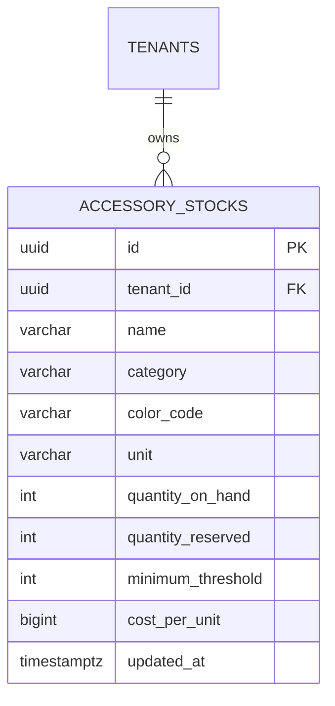

# Spesifikasi Sub-Modul: 005d - Manajemen Inventaris Aksesoris Garmen (WMS)

Dokumen ini memuat spesifikasi fungsional, arsitektur data, dan pelacakan inventaris aksesoris garmen (kancing, resleting, benang jahit, rib kerah rajut, karet elastis, label woven, dan kantong polybag) untuk SewERP.

---

## 1. Metadata & Tautan Referensi Terkait

- **Kode Modul**: `SPEC-005d`
- **Domain Bounded Context**: `inventory` / `wms`
- **Tautan Standar Acuan Global**:
  - 📋 [Standar Penulisan Requirement](../context/requirements_standard.md)
  - 📋 [Kebutuhan Bisnis Konveksi](../context/business_requirements.md)
  - 🗄️ [Standar Database PostgreSQL](../context/dbadmin.md)
  - 🧪 [Standar QA & Benchmark Testing](../context/qa.md)
- **Tautan Spesifikasi Fitur Terkait**:
  - 📦 [005a - Inventaris Bahan Baku Kain & Lot](./005a-fabric-inventory.md)
  - 📦 [005b - Alokasi Bahan Baku & Toleransi Susut](./005b-stock-allocation-wastage.md)
  - 🧵 [004a - Papan Pelacakan 6 Stasiun Produksi](./004a-production-tracking.md)

---

## 2. Ringkasan Kebutuhan & Masalah Bisnis

### Masalah Lapangan
Pekerjaan menjahit sering kali terhenti berhari-hari saat baju sudah dipotong hanya karena kancing warna khusus (misal merah marun) atau resleting jaket habis tanpa disadari sebelumnya oleh staf gudang.

### Solusi Fitur
1. **Pencatatan Master Aksesoris**: Pelacakan stok kancing (gross/pcs), resleting (lusin/pcs), benang (cones), rib kerah (kg/pcs), dan polybag (pack).
2. **Ambang Batas Minimum (*Safety Stock Alert*)**: Peringatan otomatis di dashboard ketika stok aksesoris berada di bawah ambang batas aman.

---

## 3. User Stories

- **US-005d-01 [P1 - Staf Gudang]**: Sebagai *Staf Gudang*, saya ingin mencatat stok aksesoris masuk dan keluar, agar ketersediaan aksesoris selalu terpantau.
- **US-005d-02 [P1 - Mandor Jahit]**: Sebagai *Mandor Jahit*, saya ingin sistem memberi peringatan jika stok kancing/resleting tidak mencukupi kebutuhan SPK yang akan dijahit, agar pengadaan dapat segera dilakukan.

---

## 4. Kriteria Penerimaan (Acceptance Criteria - Gherkin)

### Skenario 1: Peringatan Stok Aksesoris di Bawah Batas Aman
- **Given** Kancing Kemeja Putih tersisa 2 gross (batas minimum: 5 gross).
- **When** Staf gudang membuka menu aksesoris atau halaman dashboard.
- **Then** Muncul badge peringatan kuning/oranye "Stok Kritis: Sisa 2 Gross" dengan tombol pintas hubungi supplier.

---

## 5. Skema Relasi Data Granular (Mermaid ERD)



---

## 6. Kontrak API RESTful

### Endpoint: `POST /api/v1/wms/accessories`
- **Request Payload**:
```json
{
  "name": "Kancing Kemeja Lubang 4 (18L)",
  "category": "button",
  "color_code": "Navy Blue",
  "unit": "gross",
  "quantity_on_hand": 20,
  "minimum_threshold": 5,
  "cost_per_unit": 18000
}
```

---

## 7. Kerangka Pemecahan Tugas (Task Breakdown)
- [ ] **Fase 1**: Goose migration tabel `accessory_stocks`.
- [ ] **Fase 2**: Domain Entity & Repo `AccessoryRepository`.
- [ ] **Fase 3**: Handler route CRUD dan mutasi aksesoris.
- [ ] **Fase 4**: Antarmuka katalog aksesoris di SolidJS.
