# Spesifikasi Master Modul: 006 - HRIS & Upah Borongan Penjahit (Payroll)

Dokumen ini merupakan **Spesifikasi Master (Tier 1)** yang memuat arsitektur manajemen SDM konveksi (HRIS), sistem tarif upah borongan (*piece-rate*), pencatatan hasil kerja anti-overclaim, manajemen pinjaman kasbon penjahit, serta katalog navigasi menuju sub-spesifikasi detail fitur.

---

## 1. Metadata & Tautan Referensi Terkait

- **Kode Modul**: `SPEC-006`
- **Tingkatan Dokumen**: **Tier 1 (Master Specification Hub)**
- **Domain Bounded Context**: `payroll` / `hris`
- **Tautan Standar Acuan Global**:
  - 📋 [Standar Penulisan Requirement](../context/requirements_standard.md)
  - 📋 [Kebutuhan Bisnis Konveksi & Borongan](../context/business_requirements.md)
  - 🛡️ [Standar Keamanan Privasi Kasbon & Anti-Overclaim](../context/security.md)
  - 👆 [Prinsip UX Lapangan & Mobile Operator](../context/ux.md)
  - 🧪 [Standar Pengujian QA & Kasbon](../context/qa.md)
  - 🏛️ [Presisi Finansial Zero Floating-Point](../context/architecture.md)
- **Tautan Spesifikasi Master Terkait**:
  - 📊 [001 - Dashboard Monitoring](./001-dashboard.md)
  - 📄 [003 - Sales & Order (OMS)](./003-sales-order.md)
  - 🧵 [004 - Alur Produksi Konveksi (MES)](./004-production.md)
  - 📈 [008 - Laporan & Analitik Operasional](./008-reporting.md)

---

## 2. Indeks Sub-Modul Fungsional (Tier 2 Sub-Specifications)

Rincian implementasi teknis, skema DDL, kontrak API RESTful, skenario Gherkin 4-pilar, dan format slip upah dipecah menjadi sub-spesifikasi modular berikut:

| Berkas Sub-Spesifikasi | Lingkup Fungsional Utama | Ukuran & Fokus Teknis |
| :--- | :--- | :--- |
| 👷 **[006a-worker-roster-tariffs.md](./006a-worker-roster-tariffs.md)** | Roster tenaga kerja konveksi & master tarif upah borongan per operasi jahit. | Isolasi data pekerja, tarif int64 Rupiah. |
| ⏱️ **[006b-piece-rate-logging.md](./006b-piece-rate-logging.md)** | Input harian hasil jahit mobile & validasi keras anti-overclaim kuantiti potong. | Locking database `FOR UPDATE`, anti-race condition. |
| 💵 **[006c-cash-advance.md](./006c-cash-advance.md)** | Pencatatan pinjaman uang muka kerja (kasbon) & pemotongan otomatis slip gaji. | Audit log saldo kasbon, isolasi privasi keuangan. |
| 🧾 **[006d-payroll-slip.md](./006d-payroll-slip.md)** | Rekapitulasi penggajian mingguan otomatis & cetak slip gaji thermal 80mm / WA. | Cetak thermal 80mm, template ringkasan WA. |

---

## 3. Ringkasan Kebutuhan & Masalah Bisnis

### Masalah yang Dihadapi
1. **Pencatatan Nota Sobek (Kupon Borongan) Hilang**: Di banyak konveksi tradisional, penjahit mengumpulkan sobekan kupon kertas kecil dari bundel kain untuk diserahkan ke kasir di akhir pekan. Kupon sering hilang, terselip, atau terkena air cucian.
2. **Kelebihan Klaim (Overclaim Upah)**: Tanpa validasi sistem, jumlah baju yang diklaim oleh seluruh penjahit sering kali melebihi jumlah baju yang sebenarnya dipotong (misal: potong 100 pcs, tetapi klaim upah yang masuk berjumlah 115 pcs).
3. **Pencatatan Kasbon Tercecer di Buku Kasir**: Penjahit sering meminjam uang muka kerja (kasbon) di tengah minggu (misal hari Rabu minta Rp 100.000). Saat pembagian upah hari Sabtu, kasir sering lupa memotong kasbon atau terjadi perdebatan nominal pinjaman.
4. **Rekap Gaji Mingguan Memakan Waktu Berhari-hari**: Kasir/HRD harus menghitung tumpukan ribuan kupon secara manual setiap hari Sabtu sore, menimbulkan antrean panjang dan potensi salah hitung upah.

### Solusi MVP
1. **Roster Tenaga Kerja Konveksi**: Master data penjahit, tim potong, tim sablon, dan tim QC (nama, nomor kontak, jenis pembayaran: Borongan Pcs atau Harian Tetap).
2. **Master Tarif Borongan per Operasi**: Menetapkan tarif jahit per artikel (misal: Kaos Oblong Rp 3.500/pcs, Kemeja Pria Rp 14.000/pcs, Pasang Kerah Polo Rp 1.500/pcs).
3. **Pencatatan & Pemotongan Kasbon Otomatis**: Mencatat pinjaman uang muka kerja dan otomatis memotongnya dari total upah kotor saat slip gaji mingguan dicetak.
4. **Form Input Harian Ramah Smartphone (Mobile-Friendly)**: Mandor atau staf pencatat cukup memilih nomor SPK/Bundel, memilih nama penjahit, dan memasukkan jumlah pcs yang diselesaikan hari ini.
5. **Validasi Keras Anti-Overclaim**: Sistem otomatis menolak klaim jika total akumulasi output jahit melebihi kuantiti riil hasil potong SPK.
6. **Cetak Slip Gaji Borongan Otomatis**: Rekapitulasi upah mingguan sekali klik siap cetak ke printer thermal 80mm atau dibagikan via WhatsApp.

---

## 3. User Stories

- **US-06-01 [P1]**: Sebagai *Mandor Jahit*, saya ingin menginput hasil jahit harian penjahit langsung dari HP/tablet di lantai jahit, agar data langsung tersimpan ke sistem tanpa perlu menulis di buku catatan manual.
- **US-06-02 [P1]**: Sebagai *Kasir / HRD*, saya ingin mencatat pengeluaran kasbon penjahit dan sistem otomatis memotongnya saat rekap gaji mingguan, agar tidak ada kasbon yang lupa tertagih.
- **US-06-03 [P1]**: Sebagai *Kasir / HRD*, saya ingin sistem otomatis mengalikan jumlah pcs output jahit dengan tarif master borongan, agar rekap upah mingguan selesai dalam hitungan detik.
- **US-06-04 [P1]**: Sebagai *Owner Konveksi*, saya ingin sistem memblokir klaim output jika melebihi kuantiti potong SPK, agar pabrik tidak membayar upah fiktif.
- **US-06-05 [P2]**: Sebagai *Penjahit*, saya ingin menerima rincian slip upah mingguan transparan yang memuat nomor SPK, total pcs, dan rincian potongan kasbon, agar saya merasa tenang dan percaya pada perhitungan pabrik.

---

## 4. Kriteria Penerimaan (Acceptance Criteria - Gherkin)

### Skenario 1: Perhitungan Upah Bersih dengan Pemotongan Kasbon Otomatis
- **Given** Penjahit "Ahmad" menyelesaikan 50 pcs jahit kemeja (tarif Rp 12.000/pcs = kotor Rp 600.000).
- **And** Ahmad tercatat mengambil kasbon Rp 150.000 pada hari Rabu.
- **When** Kasir men-generate slip gaji mingguan untuk Ahmad.
- **Then** Sistem menghitung upah kotor Rp 600.000, potongan kasbon Rp 150.000, dan upah bersih Rp 450.000.
- **And** Status kasbon Ahmad berubah menjadi `deducted` (lunas terpotong).

### Skenario 2: Penolakan Klaim Overclaim
- **Given** SPK `SPK-0012` dengan total 100 pcs sudah diklaim 85 pcs oleh penjahit lain.
- **When** Mandor mencoba menginput klaim baru untuk Penjahit "Budi" sebanyak 20 pcs (total klaim menjadi 105 pcs).
- **Then** Sistem menolak transaksi dan memunculkan error: *"Klaim ditolak: Sisa jahit yang tersedia hanya 15 pcs, tidak mencukupi untuk klaim 20 pcs"*.

---

## 5. Skema Relasi Data (Mermaid ERD)

```mermaid
erDiagram
    TENANTS ||--o{ WORKERS : employs
    TENANTS ||--o{ PIECE_RATE_TARIFFS : defines
    WORKERS ||--o{ DAILY_WORK_LOGS : performs
    WORKERS ||--o{ WORKER_CASH_ADVANCES : takes
    PRODUCTION_JOBS ||--o{ DAILY_WORK_LOGS : belongs_to
    TENANTS ||--o{ PAYROLL_PERIODS : manages
    PAYROLL_PERIODS ||--o{ PAYROLL_SLIPS : generates
    WORKERS ||--o{ PAYROLL_SLIPS : receives

    WORKERS {
        uuid id PK
        uuid tenant_id FK
        varchar name
        varchar role_category
        varchar phone_number
        varchar payment_type
        boolean is_active
        timestamptz created_at
    }

    PIECE_RATE_TARIFFS {
        uuid id PK
        uuid tenant_id FK
        varchar article_type
        varchar operation_name
        bigint rate_per_pcs
        boolean is_active
    }

    DAILY_WORK_LOGS {
        uuid id PK
        uuid tenant_id FK
        uuid worker_id FK
        uuid production_job_id FK
        uuid tariff_id FK
        date log_date
        int completed_qty
        bigint calculated_wage
        uuid verified_by FK
        varchar status
        timestamptz created_at
    }

    WORKER_CASH_ADVANCES {
        uuid id PK
        uuid tenant_id FK
        uuid worker_id FK
        bigint amount
        date advance_date
        text notes
        varchar status
        uuid approved_by FK
        timestamptz created_at
    }

    PAYROLL_PERIODS {
        uuid id PK
        uuid tenant_id FK
        varchar period_name
        date start_date
        date end_date
        bigint total_payout
        varchar status
    }

    PAYROLL_SLIPS {
        uuid id PK
        uuid payroll_period_id FK
        uuid worker_id FK
        int total_pcs
        bigint gross_wage
        bigint cash_advance_deduction
        bigint net_wage
        varchar payment_status
    }
```



---

## 6. Kontrak API RESTful

### Endpoint: `POST /api/v1/payroll/cash-advances`
Mencatat pinjaman kasbon penjahit:
```json
{
  "worker_id": "01925b6a-8451-7ef1-953e-51c045b0a111",
  "amount": 150000,
  "advance_date": "2026-10-21",
  "notes": "Pinjaman darurat beli obat anak."
}
```

### Endpoint: `POST /api/v1/payroll/daily-logs`
Mencatat setoran output harian:
```json
{
  "worker_id": "01925b6a-8451-7ef1-953e-51c045b0a111",
  "production_job_id": "01925b6a-8451-7ef1-953e-51c045b0a777",
  "operation_tariff_id": "01925b6a-8451-7ef1-953e-51c045b0a444",
  "log_date": "2026-10-22",
  "completed_qty": 35
}
```

---

## 7. Desain Antarmuka Mobile Mandor (UI/UX)

- **Target Sentuh Lebar (Touch-Target 48px)**: Desain antarmuka ponsel yang ramah untuk satu tangan:
  - Tombol pilihan nama penjahit berbentuk kartu sentuh besar.
  - Dropdown SPK aktif yang dilengkapi filter pencarian cepat nama artikel atau nomor SPK.
  - Number pad sentuh bawaan antarmuka untuk memasukkan angka kuantiti cepat (`10`, `20`, `50`).
- **Slip Gaji Thermal Ringkas (80mm)**: Format struk kasir yang mencantumkan nama penjahit, rincian SPK yang dikerjakan selama seminggu, upah kotor, potongan kasbon, dan upah bersih tunai yang diterima.
