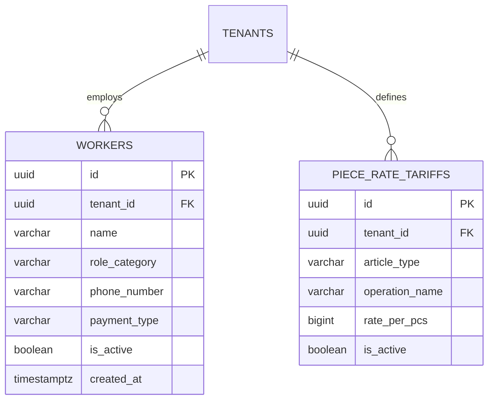

# Spesifikasi Sub-Modul: 006a - Roster Tenaga Kerja & Master Tarif Borongan (HRIS)

Dokumen ini memuat spesifikasi direktori tenaga kerja konveksi (penjahit, tukang potong, operator sablon, staf QC) serta master tarif upah borongan (*Piece-Rate Tariffs*) per operasi jahit untuk SewERP.

---

## 1. Metadata & Tautan Referensi Terkait

- **Kode Modul**: `SPEC-006a`
- **Domain Bounded Context**: `payroll` / `hris`
- **Tautan Standar Acuan Global**:
  - 📋 [Standar Penulisan Requirement](../context/requirements_standard.md)
  - 📋 [Kebutuhan Bisnis Konveksi & Upah Borongan](../context/business_requirements.md)
  - 🏛️ [Presisi Finansial Zero Float](../context/architecture.md)
  - 🗄️ [Standar Database PostgreSQL](../context/dbadmin.md)
  - 🛡️ [Standar Keamanan & Perlindungan Data](../context/security.md)
- **Tautan Spesifikasi Fitur Terkait**:
  - 🧵 [006b - Input Harian Output Jahit & Anti-Overclaim](./006b-piece-rate-logging.md)
  - 💵 [006c - Pengelolaan Kasbon Penjahit](./006c-cash-advance.md)
  - 🧾 [006d - Rekap Gaji Mingguan & Slip](./006d-payroll-slip.md)

---

## 2. Ringkasan Kebutuhan & Masalah Bisnis

### Masalah Lapangan
1. Data tenaga kerja konveksi (terutama penjahit borongan lepas) sering tidak tercatat rapi, nomor telepon tercecer, dan tipe pembayarannya rancu (apakah borongan murni per pcs atau harian tetap).
2. Tarif upah borongan per operasi jahit (misal: pasang kerah polo, jahit badan, pasang manset kemeja) berubah-ubah tanpa standar acuan, memicu kecemburuan antar-penjahit dan pembengkakan HPP produksi.

### Solusi Fitur
1. **Roster Tenaga Kerja Terpusat**: Nama pekerja, nomor HP WhatsApp, keahlian utama (*skill tag*), status aktif, dan tipe kompensasi (`piece_rate` / `daily_fixed`).
2. **Master Tarif Borongan per Operasi**: Menetapkan tarif rupiah baku per pcs per operasi untuk setiap model pakaian (Kaos Oblong, Kemeja Pria, Jaket Hoodie, Polo Shirt).

---

## 3. User Stories

- **US-006a-01 [P1 - Kasir / HRD]**: Sebagai *Kasir/HRD*, saya ingin mendaftarkan data pekerja konveksi beserta tipe upahnya, agar pembagian tugas dan penggajian tersistem.
- **US-006a-02 [P1 - Owner Konveksi]**: Sebagai *Owner Konveksi*, saya ingin menetapkan master tarif jahit per artikel dan operasi, agar biaya tenaga kerja langsung terkontrol dan seragam.

---

## 4. Kriteria Penerimaan (Acceptance Criteria - Gherkin)

### Skenario 1: Penambahan Tarif Borongan Baru
- **Given** Owner menambahkan tarif jahit untuk artikel "Polo Shirt", operasi "Pasang Kerah & Plaket".
- **When** Menetapkan tarif sebesar Rp 2.500 per pcs.
- **Then** Tarif tersimpan dengan tipe data `BIGINT` dan otomatis menjadi acuan saat pencatatan hasil jahit harian.

---

## 5. Skema Relasi Data Granular (Mermaid ERD)



---

## 6. Kontrak API RESTful

### Endpoint: `POST /api/v1/payroll/tariffs`
- **Request Payload**:
```json
{
  "article_type": "polo_shirt",
  "operation_name": "Pasang Kerah & Plaket",
  "rate_per_pcs": 2500,
  "is_active": true
}
```

---

## 7. Kerangka Pemecahan Tugas (Task Breakdown)
- [ ] **Fase 1**: Goose migration tabel `workers` dan `piece_rate_tariffs`.
- [ ] **Fase 2**: Domain Entity Worker & Tariff di Go layer.
- [ ] **Fase 3**: Handler route CRUD pekerja dan master tarif.
- [ ] **Fase 4**: Halaman pengaturan roster pekerja dan matriks tarif di SolidJS.
