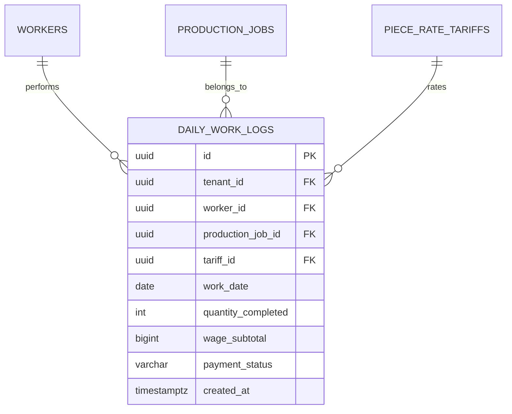

# Spesifikasi Sub-Modul: 006b - Pencatatan Output Jahit Harian & Validasi Anti-Overclaim (HRIS)

Dokumen ini memuat spesifikasi antarmuka input mobile mandor jahit, kalkulasi otomatis upah kotor, dan validasi keras anti kelebihan klaim (*anti-overclaim*) untuk SewERP.

---

## 1. Metadata & Tautan Referensi Terkait

- **Kode Modul**: `SPEC-006b`
- **Domain Bounded Context**: `payroll` / `hris`
- **Tautan Standar Acuan Global**:
  - 📋 [Standar Penulisan Requirement](../context/requirements_standard.md)
  - 📋 [Kebutuhan Bisnis Konveksi & Anti-Overclaim](../context/business_requirements.md)
  - 👆 [Prinsip UX Lapangan & Mobile Operator](../context/ux.md)
  - 🧪 [Standar Pengujian QA & Race Conditions](../context/qa.md)
- **Tautan Spesifikasi Fitur Terkait**:
  - 👥 [006a - Roster Tenaga Kerja & Master Tarif](./006a-worker-roster-tariffs.md)
  - 💵 [006c - Pengelolaan Kasbon Penjahit](./006c-cash-advance.md)
  - 🧾 [006d - Rekap Gaji Mingguan & Slip](./006d-payroll-slip.md)
  - 🏷️ [004c - Tiket Bundel Kerja & Barcode](./004c-bundle-ticket.md)

---

## 2. Ringkasan Kebutuhan & Masalah Bisnis

### Masalah Lapangan
1. Di banyak konveksi, penjahit mengumpulkan sobekan kupon kertas kecil dari bundel kain untuk diserahkan ke kasir di akhir pekan. Kupon sering hilang atau terselip.
2. **Kelebihan Klaim (Overclaim Upah)**: Jumlah pakaian yang diklaim oleh seluruh penjahit sering kali melebihi kuantiti riil yang dipotong oleh meja potong (misal potong 100 pcs, klaim terkumpul 115 pcs).

### Solusi Fitur
1. **Form Mobile Input Hasil Jahit Harian**: Mandor cukup memilih SPK/Bundel, memilih nama penjahit, dan memasukkan jumlah pcs yang diselesaikan hari ini.
2. **Validasi Keras Anti-Overclaim**: Sistem otomatis menolak transaksi jika total akumulasi klaim melebihi kuantiti hasil potong SPK:
   $$\sum \text{logged\_quantity} + \text{new\_claim\_qty} \le \text{production\_jobs.actual\_cut\_quantity}$$

---

## 3. User Stories

- **US-006b-01 [P1 - Mandor Jahit]**: Sebagai *Mandor Jahit*, saya ingin menginput hasil jahit harian penjahit langsung dari HP/tablet, agar tidak ada kupon kertas yang tercecer.
- **US-006b-02 [P1 - Owner Konveksi]**: Sebagai *Owner Konveksi*, saya ingin sistem memblokir klaim output jika melebihi kuantiti potong SPK, agar pabrik tidak membayar upah fiktif.

---

## 4. Kriteria Penerimaan (Acceptance Criteria - Gherkin)

### Skenario 1: Penolakan Klaim Overclaim (Invariant Violation)
- **Given** SPK `SPK-0012` dengan kuantiti potong 100 pcs sudah diklaim 85 pcs oleh penjahit lain.
- **When** Mandor mencoba menginput klaim baru untuk Penjahit "Budi" sebanyak 20 pcs (total menjadi 105 pcs).
- **Then** Sistem menolak dengan HTTP 422 Unprocessable Entity dan memunculkan error: *"Klaim ditolak: Sisa jahit yang tersedia hanya 15 pcs, tidak mencukupi untuk klaim 20 pcs"*.

---

## 5. Skema Relasi Data Granular (Mermaid ERD)



---

## 6. Kontrak API RESTful

### Endpoint: `POST /api/v1/payroll/daily-logs`
- **Request Payload**:
```json
{
  "worker_id": "01925b6a-8451-7ef1-953e-51c045b0a888",
  "production_job_id": "01925b6a-8451-7ef1-953e-51c045b0a777",
  "tariff_id": "01925b6a-8451-7ef1-953e-51c045b0a666",
  "work_date": "2026-10-21",
  "quantity_completed": 25
}
```

---

## 7. Kerangka Pemecahan Tugas (Task Breakdown)
- [ ] **Fase 1**: Goose migration tabel `daily_work_logs` & atomic constraint check.
- [ ] **Fase 2**: Service validasi anti-overclaim dengan row-level lock `SELECT actual_cut_quantity ... FOR UPDATE`.
- [ ] **Fase 3**: Handler route pencatatan log harian.
- [ ] **Fase 4**: Antarmuka mobile-first input hasil jahit di SolidJS.
