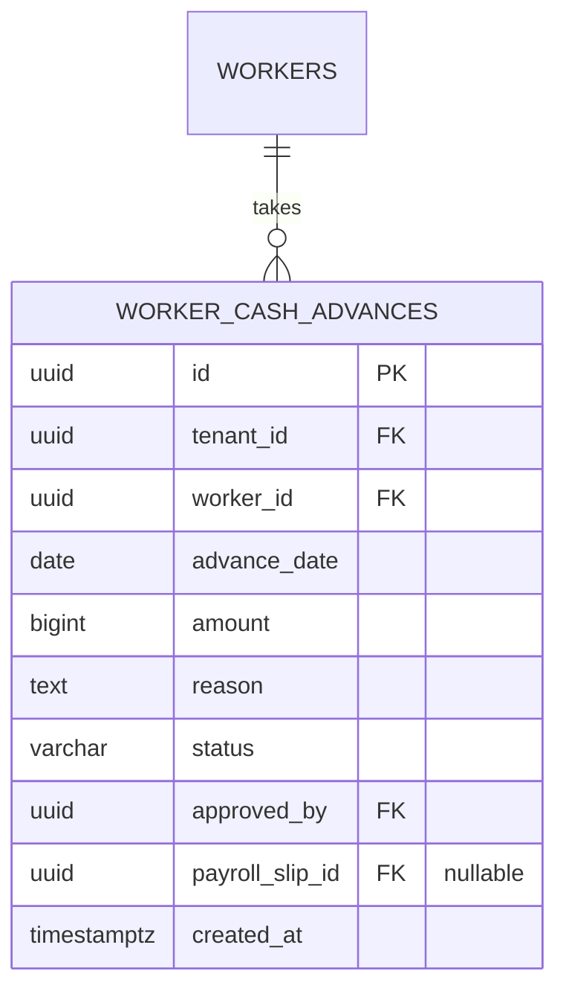

# Spesifikasi Sub-Modul: 006c - Pengelolaan Pinjaman Kasbon Penjahit (HRIS)

Dokumen ini memuat spesifikasi pencatatan pinjaman uang muka kerja (*Cash Advance / Kasbon*), otorisasi pengeluaran kas, serta integrasi pemotongan otomatis pada slip gaji mingguan untuk SewERP.

---

## 1. Metadata & Tautan Referensi Terkait

- **Kode Modul**: `SPEC-006c`
- **Domain Bounded Context**: `payroll` / `hris`
- **Tautan Standar Acuan Global**:
  - 📋 [Standar Penulisan Requirement](../context/requirements_standard.md)
  - 📋 [Kebutuhan Bisnis Konveksi & Kasbon](../context/business_requirements.md)
  - 🛡️ [Standar Keamanan Privasi Kasbon & PII](../context/security.md)
  - 🏛️ [Presisi Finansial Zero Float](../context/architecture.md)
  - 🗄️ [Standar Database PostgreSQL](../context/dbadmin.md)
- **Tautan Spesifikasi Fitur Terkait**:
  - 👥 [006a - Roster Tenaga Kerja & Master Tarif](./006a-worker-roster-tariffs.md)
  - 🧵 [006b - Input Harian Output Jahit & Anti-Overclaim](./006b-piece-rate-logging.md)
  - 🧾 [006d - Rekap Gaji Mingguan & Slip](./006d-payroll-slip.md)

---

## 2. Ringkasan Kebutuhan & Masalah Bisnis

### Masalah Lapangan
Penjahit konveksi sering meminjam uang muka (kasbon) di tengah minggu (misal hari Rabu minta Rp 100.000 untuk keperluan mendesak). Saat pembagian upah hari Sabtu, kasir sering lupa memotong kasbon atau terjadi perdebatan nominal karena catatan di buku kasir hilang atau tidak terbaca.

### Solusi Fitur
1. **Pencatatan Kasbon Terverifikasi**: Mencatat tanggal, nama pekerja, nominal pinjaman, dan alasan kasbon dengan status persetujuan.
2. **Pemotongan Otomatis pada Slip Upah**: Sistem otomatis mendeteksi kasbon aktif yang berstatus `approved` dan langsung memotongnya dari total upah kotor pada periode penggajian minggu berjalan.

---

## 3. User Stories

- **US-006c-01 [P1 - Kasir]**: Sebagai *Kasir*, saya ingin mencatat pengeluaran kasbon penjahit ke sistem, agar tercatat secara resmi pada buku kas operasional.
- **US-006c-02 [P1 - Kasir]**: Sebagai *Kasir*, saya ingin kasbon yang belum lunas otomatis terpotong saat membuat rekap slip gaji mingguan, agar tidak ada kasbon yang terlewat ditagih.

---

## 4. Kriteria Penerimaan (Acceptance Criteria - Gherkin)

### Skenario 1: Pencatatan Kasbon Baru & Otorisasi
- **Given** Penjahit "Ahmad" mengajukan pinjaman kasbon Rp 150.000 pada hari Rabu.
- **When** Kasir menginput kasbon dan Owner menyetujuinya.
- **Then** Status kasbon berubah menjadi `approved` dan saldo kasbon aktif Ahmad bertambah Rp 150.000.

---

## 5. Skema Relasi Data Granular (Mermaid ERD)



---

## 6. Kontrak API RESTful

### Endpoint: `POST /api/v1/payroll/cash-advances`
- **Request Payload**:
```json
{
  "worker_id": "01925b6a-8451-7ef1-953e-51c045b0a888",
  "advance_date": "2026-10-21",
  "amount": 150000,
  "reason": "Keperluan beli susu anak"
}
```

---

## 7. Kerangka Pemecahan Tugas (Task Breakdown)
- [ ] **Fase 1**: Goose migration tabel `worker_cash_advances`.
- [ ] **Fase 2**: Service pencatatan kasbon dan validasi limit pinjaman.
- [ ] **Fase 3**: Handler route CRUD dan approval kasbon.
- [ ] **Fase 4**: Antarmuka buku kasbon pekerja di SolidJS kasir.
