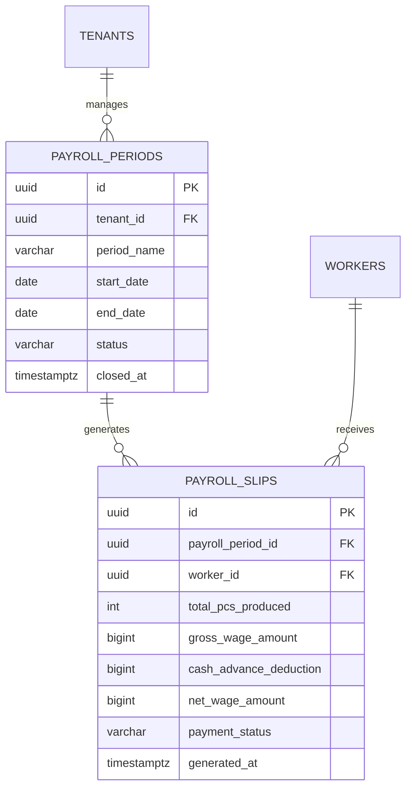

# Spesifikasi Sub-Modul: 006d - Rekap Penggajian Mingguan & Cetak Slip Gaji (HRIS)

Dokumen ini memuat spesifikasi kalkulasi rekapitulasi upah mingguan otomatis, pemotongan pinjaman kasbon, pembuatan slip gaji (*Payroll Slip*), serta format cetak printer thermal 80mm dan ekspor PDF/WhatsApp untuk SewERP.

---

## 1. Metadata & Tautan Referensi Terkait

- **Kode Modul**: `SPEC-006d`
- **Domain Bounded Context**: `payroll` / `hris`
- **Tautan Standar Acuan Global**:
  - 📋 [Standar Penulisan Requirement](../context/requirements_standard.md)
  - 📋 [Kebutuhan Bisnis Konveksi & Upah Borongan](../context/business_requirements.md)
  - 🔧 [Standar Kebutuhan Teknis & Cetak Thermal](../context/technical_requirements.md)
  - 🏛️ [Presisi Finansial Zero Float](../context/architecture.md)
  - 🧪 [Standar QA & Benchmark Testing](../context/qa.md)
- **Tautan Spesifikasi Fitur Terkait**:
  - 👥 [006a - Roster Tenaga Kerja & Master Tarif](./006a-worker-roster-tariffs.md)
  - 🧵 [006b - Input Harian Output Jahit & Anti-Overclaim](./006b-piece-rate-logging.md)
  - 💵 [006c - Pengelolaan Kasbon Penjahit](./006c-cash-advance.md)
  - 📊 [008d - Laporan Rekapitulasi Upah Borongan](./008d-payroll-recap-report.md)

---

## 2. Ringkasan Kebutuhan & Masalah Bisnis

### Masalah Lapangan
Setiap hari Sabtu sore, kasir dan HRD menghabiskan waktu berjam-jam menghitung tumpukan ribuan kupon jahit manual dengan kalkulator tangan, menimbulkan antrean panjang penjahit yang lelah menunggu pembagian amplop gaji, serta rawan salah hitung potongan kasbon.

### Solusi Fitur
1. **Rekapitulasi Gaji Sekali Klik (*One-Click Weekly Payroll*)**: Sistem secara otomatis mengagregasi seluruh output jahit yang tercatat dalam periode minggu berjalan, mengalikan dengan tarif master, dan memotong kasbon aktif.
2. **Cetak Slip Upah Thermal 80mm**: Menghasilkan struk rincian kerja transparan siap cetak di kasir atau dibagikan sebagai tautan/PDF privat via WhatsApp.

---

## 3. User Stories

- **US-006d-01 [P1 - Kasir]**: Sebagai *Kasir*, saya ingin men-generate rekap upah seluruh penjahit untuk periode minggu berjalan dalam satu klik, agar perhitungan selesai dalam hitungan detik.
- **US-006d-02 [P1 - Penjahit]**: Sebagai *Penjahit*, saya ingin menerima struk rincian slip upah mingguan yang memuat detail SPK yang saya jahit dan potongan kasbon saya, agar saya yakin perhitungan pabrik adil dan transparan.

---

## 4. Kriteria Penerimaan (Acceptance Criteria - Gherkin)

### Skenario 1: Kalkulasi Upah Bersih dengan Pemotongan Kasbon Otomatis
- **Given** Penjahit "Ahmad" menyelesaikan 50 pcs jahit kemeja (tarif Rp 12.000 = Rp 600.000).
- **And** Ahmad tercatat mengambil kasbon Rp 150.000 pada hari Rabu.
- **When** Kasir men-generate slip gaji periode minggu tersebut.
- **Then** Upah kotor dihitung Rp 600.000, potongan kasbon Rp 150.000, dan upah bersih dibayarkan Rp 450.000.
- **And** Status kasbon Ahmad berubah menjadi `deducted` (lunas terpotong).

---

## 5. Skema Relasi Data Granular (Mermaid ERD)



---

## 6. Format Cetak Struk Slip Gaji Thermal (80mm)

```text
========================================
         SLIP GAJI BORONGAN PENJAHIT
            CV SUMBER BUSANA KONVEKSI
========================================
PERIODE   : Minggu ke-42 (15 - 21 Okt 2026)
NAMA      : Ahmad Subarjo
JABATAN   : Operator Jahit (Borongan)
----------------------------------------
RINCIAN HASIL JAHIT:
- SPK-0012 (Kemeja) : 30 Pcs x Rp 12.000 = Rp 360.000
- SPK-0015 (Polo)   : 20 Pcs x Rp 12.000 = Rp 240.000
----------------------------------------
TOTAL OUTPUT PCS    : 50 Pcs
TOTAL UPAH KOTOR    : Rp 600.000
POTONGAN KASBON     : (Rp 150.000)
----------------------------------------
TOTAL UPAH DITERIMA : Rp 450.000
(EMPAT RATUS LIMA PULUH RIBU RUPIAH)
========================================
Tgl Cetak: 21 Okt 2026 17:30 | Kasir: Siti
========================================
```

---

## 7. Kerangka Pemecahan Tugas (Task Breakdown)
- [ ] **Fase 1**: Goose migration tabel `payroll_periods` dan `payroll_slips`.
- [ ] **Fase 2**: Engine kalkulasi penggajian mingguan otomatis di Go backend.
- [ ] **Fase 3**: Generator struk thermal 80mm dan endpoint ekspor.
- [ ] **Fase 4**: Antarmuka review penggajian dan tombol bayar di SolidJS.
