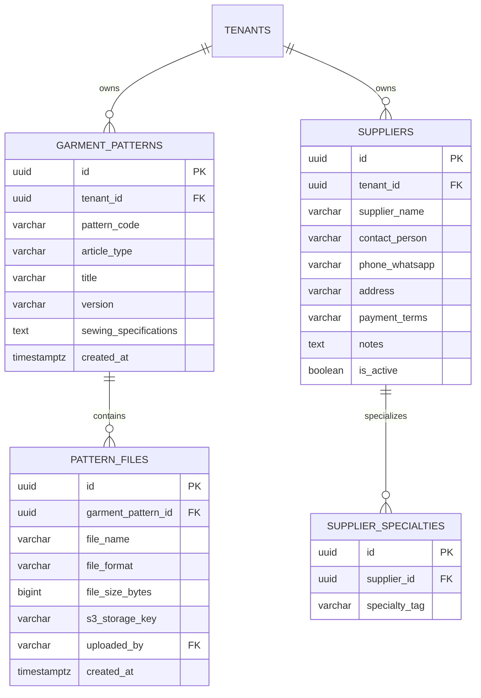

# Spesifikasi Master Modul: 007 - Knowledge Base, Pola CAD & Supplier (KMS)

Dokumen ini merupakan **Spesifikasi Master (Tier 1)** yang memuat arsitektur manajemen pengetahuan tekstil (KMS), pustaka master pola pakaian CAD/DXF/PDF, lembar spesifikasi jahitan (*Tech Pack*), direktori supplier garmen, serta katalog navigasi menuju sub-spesifikasi detail fitur.

---

## 1. Metadata & Tautan Referensi Terkait

- **Kode Modul**: `SPEC-007`
- **Tingkatan Dokumen**: **Tier 1 (Master Specification Hub)**
- **Domain Bounded Context**: `kms` / `knowledge`
- **Tautan Standar Acuan Global**:
  - 📋 [Standar Penulisan Requirement](../context/requirements_standard.md)
  - 🏛️ [Arsitektur Sistem & Object Storage](../context/architecture.md)
  - 🛡️ [Standar Keamanan & Perlindungan Pola CAD/DXF](../context/security.md)
  - 🚀 [Standar DevOps & S3 Bucket](../context/devops.md)
  - 🗄️ [Standar Database PostgreSQL](../context/dbadmin.md)
- **Tautan Spesifikasi Master Terkait**:
  - 👥 [002 - Customer Relation & Price List](./002-customer-relation.md)
  - 📄 [003 - Sales & Order (OMS)](./003-sales-order.md)
  - 🧵 [004 - Alur Produksi Konveksi (MES)](./004-production.md)
  - 📦 [005 - Manajemen Inventaris Kain (WMS)](./005-inventory.md)

---

## 2. Indeks Sub-Modul Fungsional (Tier 2 Sub-Specifications)

Rincian implementasi teknis, skema DDL, kontrak API RESTful, skenario Gherkin 4-pilar, dan keamanan presigned S3 URL dipecah menjadi sub-spesifikasi modular berikut:

| Berkas Sub-Spesifikasi | Lingkup Fungsional Utama | Ukuran & Fokus Teknis |
| :--- | :--- | :--- |
| 📐 **[007a-pattern-techpack.md](./007a-pattern-techpack.md)** | Pustaka pola pakaian (PDF 1:1, CAD/DXF) & spesifikasi jahitan (*Tech Pack*). | Keamanan Level 4, Presigned URL 15 mnt, watermarking. |
| 🏭 **[007b-supplier-directory.md](./007b-supplier-directory.md)** | Direktori toko kain grosir, toko aksesoris, & vendor makloon rekanan. | Filter spesialisasi vendor, jejak audit multi-tenant. |

---

## 3. Ringkasan Kebutuhan & Masalah Bisnis

### Masalah yang Dihadapi
1. **File Pola & Desain Hilang / Tertumpuk di Komputer Desainer**: File master pola baju (`.pdf`, `.dxf`, `.cdr`, `.ai`) sering hilang atau salah versi saat tukang potong ingin mencetak ulang pola karton, menyebabkan bentuk kerah atau potongan lengan berbeda dari pesanan sebelumnya (*repeat order*).
2. **Kontak Toko Kain & Makloon Tercecer**: Nomor kontak supplier kain kiloan di pasar grosir (misal: Pasar Tanah Abang, Pasar Baru Bandung, Otista) hanya tersimpan di ponsel staf pengadaan tertentu. Saat staf sakit atau cuti, bagian produksi kebingungan mencari bahan pengganti.

### Solusi MVP
1. **Pustaka Pola Baju & Tech Pack Terpusat**:
   - Menyimpan berkas master pola baju (PDF skala 1:1, DXF, CDR) yang ditautkan ke jenis artikel pakaian.
   - Lembar spesifikasi jahitan (*Tech Pack*): detail toleransi ukuran lingkar dada, panjang badan, jenis jahitan pundak (rantai/stick), dan overdeck leher.
2. **Direktori Master Supplier & Mitra Makloon**:
   - Database toko kain, supplier benang, toko kancing, serta vendor sablon/bordir rekanan.
   - Menyimpan nama toko, kontak PIC, nomor WhatsApp, alamat fisik, spesialisasi bahan (misal: "Spesialis Combed Reaktif", "Spesialis Bordir Komputer 12 Kepala"), serta syarat pembayaran (Cash / Tempo 30 Hari).

---

## 3. User Stories

- **US-07-01 [P1]**: Sebagai *Tukang Potong / Mandor*, saya ingin mengunduh berkas pola resmi dari sistem saat menerima SPK repeat order, agar bentuk potongan pakaian 100% konsisten dengan pesanan pertama.
- **US-07-02 [P1]**: Sebagai *Bagian Pengadaan (Purchasing)*, saya ingin mencari kontak supplier kain berdasarkan jenis bahan spesifik, agar saya dapat menghubungi toko yang tepat dengan cepat saat stok gudang menipis.
- **US-07-03 [P2]**: Sebagai *Desainer / Admin*, saya ingin mengunggah lembar spesifikasi jahitan (Tech Pack) dan gambar mockup penempatan logo, agar tim sablon dan jahit memiliki acuan visual yang jelas.

---

## 4. Kriteria Penerimaan (Acceptance Criteria - Gherkin)

### Skenario 1: Mengunggah dan Mengaitkan Pola ke Artikel
- **Given** Desainer memiliki file pola baju `Pola_Kaos_Reguler_V2.pdf` berukuran 12 MB.
- **When** Desainer mengunggah file ke modul Knowledge Base dan memilih kategori `Kaos Oblong`.
- **Then** File tersimpan aman di Object Storage S3/MinIO dan tautan unduhan privat (*presigned URL*) terhubung ke master artikel Kaos.

### Skenario 2: Pencarian Cepat Supplier Berdasarkan Spesialisasi Bahan
- **Given** Terdapat 15 kontak supplier di database.
- **When** Staf pengadaan mengetikkan kata kunci pencarian `fleece` atau `bordir`.
- **Then** Sistem menampilkan daftar toko kain yang memiliki tag spesialisasi tersebut lengkap dengan tombol langsung "Hubungi WhatsApp".

---

## 5. Skema Relasi Data (Mermaid ERD)



---

## 6. Kontrak API RESTful

### Endpoint: `POST /api/v1/knowledge/patterns`
Mendaftarkan pola baju baru:
```json
{
  "pattern_code": "POLA-TSHIRT-REG-01",
  "article_type": "tshirt",
  "title": "Pola Kaos Dewasa Unisex Regular Fit",
  "version": "v1.2",
  "sewing_specifications": "Jahit rantai pada pundak, overdeck 3 jarum pada kelim lengan dan bawah badan."
}
```

### Endpoint: `POST /api/v1/knowledge/suppliers`
Menyimpan data supplier baru:
```json
{
  "supplier_name": "Toko Kain Dunia Sandang",
  "contact_person": "Ko Steven",
  "phone_whatsapp": "081122334455",
  "address": "Jl. Terusan Pasirkoja No. 88, Bandung",
  "payment_terms": "Tempo 14 Hari",
  "specialties": ["Cotton Combed", "Cotton Bamboo", "Fleece Cotton"]
}
```

---

## 7. Desain Antarmuka Pengguna (UI/UX)

- **Tampilan Galeri Pola**: Desain kartu visual (*pattern cards*) yang menampilkan pratinjau thumbnail mockup baju, kode pola, versi revisi, daftar ukuran yang didukung (XS - 4XL), dan tombol unduh instan berkas PDF/DXF.
- **Buku Kontak Supplier (Supplier Rolodex)**: Daftar kontak berbentuk kartu kontak modern dengan tag spesialisasi warna-warni, catatan tempo pembayaran, dan tombol aksi cepat untuk membuka obrolan WhatsApp langsung.
