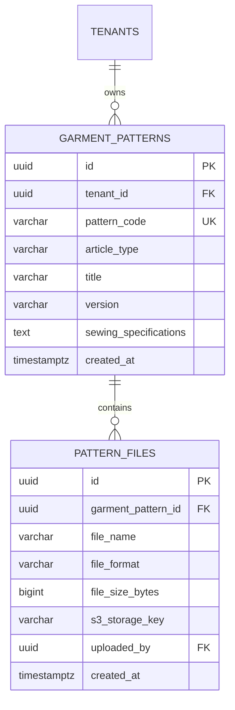

# Spesifikasi Sub-Modul: 007a - Pustaka Master Pola Baju & Tech Pack (KMS)

Dokumen ini memuat spesifikasi fungsional, arsitektur penyimpanan berkas CAD/DXF/PDF skala 1:1 di Object Storage S3/MinIO, lembar spesifikasi jahitan (*Tech Pack*), dan kontrol versi pola untuk SewERP.

---

## 1. Metadata & Tautan Referensi Terkait

- **Kode Modul**: `SPEC-007a`
- **Domain Bounded Context**: `kms` / `knowledge`
- **Tautan Standar Acuan Global**:
  - 📋 [Standar Penulisan Requirement](../context/requirements_standard.md)
  - 🏛️ [Arsitektur Sistem & Object Storage](../context/architecture.md)
  - 🛡️ [Standar Keamanan & Perlindungan Aset Pola](../context/security.md)
  - 🚀 [Standar DevOps & S3 Bucket](../context/devops.md)
  - 🗄️ [Standar Database PostgreSQL](../context/dbadmin.md)
- **Tautan Spesifikasi Fitur Terkait**:
  - 💡 [007b - Direktori Supplier & Vendor Makloon](./007b-supplier-directory.md)
  - 🧵 [004a - Papan Pelacakan 6 Stasiun Produksi](./004a-production-tracking.md)
  - 📄 [003a - Inti Sales & Order (OMS)](./003a-sales-order-core.md)

---

## 2. Ringkasan Kebutuhan & Masalah Bisnis

### Masalah Lapangan
Berkas master pola baju (`.pdf`, `.dxf`, `.cdr`, `.ai`) sering hilang atau salah versi saat tukang potong hendak mencetak ulang pola karton untuk pesanan berulang (*repeat order*). Akibatnya, bentuk kerah, panjang badan, atau lengkungan ketiak berbeda dari pesanan pertama, memicu komplain pemesan.

### Solusi Fitur
1. **Pustaka Berkas Pola Terpusat**: Menyimpan file pola master yang ditautkan ke jenis artikel pakaian dengan kontrol versi (v1, v2).
2. **Lembar Spesifikasi Jahitan (*Tech Pack*)**: Rincian ukuran lingkar dada, panjang badan, toleransi susut jahitan ($\pm 1\text{ cm}$), jenis jahitan pundak rantai, dan instruksi obras.
3. **Penyimpanan Aman MinIO/S3**: Menggunakan tautan privat sementara (*Presigned URL* dengan masa kedaluwarsa 15 menit) dan watermarking nama konveksi untuk melindungi rahasia dagang pola pakaian.

---

## 3. User Stories

- **US-007a-01 [P1 - Tukang Potong / Mandor]**: Sebagai *Tukang Potong*, saya ingin mengunduh berkas pola resmi skala 1:1 saat menerima SPK repeat order, agar bentuk potongan pakaian 100% konsisten dengan pesanan pertama.
- **US-007a-02 [P1 - Desainer / Admin]**: Sebagai *Desainer*, saya ingin mengunggah lembar spesifikasi Tech Pack dan gambar panduan letak sablon/bordir, agar tim lantai kerja memiliki acuan visual yang jelas.

---

## 4. Kriteria Penerimaan (Acceptance Criteria - Gherkin)

### Skenario 1: Mengunduh Berkas Pola dengan Presigned URL Aman
- **Given** Desainer telah mengunggah pola `Pola_Kaos_Reguler_V2.pdf`.
- **When** Mandor potong menekan tombol "Unduh Pola".
- **Then** Sistem menghasilkan Presigned URL S3 berdurasi 15 menit dengan header watermark tenant.
- **And** Akses langsung publik tanpa autentikasi ditolak dengan HTTP 403 Forbidden.

---

## 5. Skema Relasi Data Granular (Mermaid ERD)



---

## 6. Kontrak API RESTful

### Endpoint: `GET /api/v1/kms/patterns/{id}/download`
- **Response Payload (HTTP 200 OK)**:
```json
{
  "status": "success",
  "data": {
    "file_name": "Pola_Kaos_Reguler_V2.pdf",
    "download_url": "https://s3.sewerp.local/patterns/tenant-01/pola-v2.pdf?X-Amz-Signature=...",
    "expires_in_seconds": 900
  }
}
```

---

## 7. Kerangka Pemecahan Tugas (Task Breakdown)
- [ ] **Fase 1**: Goose migration tabel `garment_patterns` dan `pattern_files`.
- [ ] **Fase 2**: Integrasi S3 / MinIO client di Go dengan generator presigned URL.
- [ ] **Fase 3**: Handler route upload dan download file pola.
- [ ] **Fase 4**: Antarmuka katalog pustaka pola dan viewer PDF di SolidJS.
