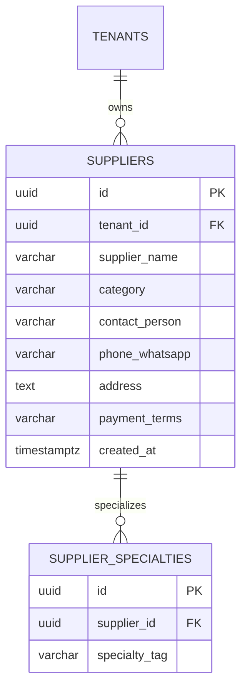

# Spesifikasi Sub-Modul: 007b - Direktori Master Supplier Bahan & Mitra Makloon (KMS)

Dokumen ini memuat spesifikasi direktori master toko bahan baku kain grosir, supplier aksesoris, dan vendor makloon rekanan dengan tag spesialisasi dan integrasi kontak WhatsApp cepat.

---

## 1. Metadata & Tautan Referensi Terkait

- **Kode Modul**: `SPEC-007b`
- **Domain Bounded Context**: `kms` / `knowledge`
- **Tautan Standar Acuan Global**:
  - 📋 [Standar Penulisan Requirement](../context/requirements_standard.md)
  - 📋 [Kebutuhan Bisnis Konveksi](../context/business_requirements.md)
  - 🗄️ [Standar Database PostgreSQL](../context/dbadmin.md)
  - 🎨 [Standar UI Flat](../context/ui.md)
- **Tautan Spesifikasi Fitur Terkait**:
  - 💡 [007a - Pustaka Master Pola Baju & Tech Pack](./007a-pattern-techpack.md)
  - 📦 [005a - Inventaris Bahan Baku Kain & Lot](./005a-fabric-inventory.md)
  - 🧵 [004b - Subkontrak Makloon Luar](./004b-makloon-subcontract.md)

---

## 2. Ringkasan Kebutuhan & Masalah Bisnis

### Masalah Lapangan
Kontak toko kain grosir di pasar tekstil (Tanah Abang, Pasar Baru Bandung, Otista) dan vendor sablon/bordir rekanan hanya tersimpan di ponsel pribadi staf pengadaan. Saat staf cuti atau sakit, proses produksi terhambat karena bagian bengkel tidak tahu harus mencari kain pengganti atau vendor sablon ke mana.

### Solusi Fitur
1. **Buku Direktori Supplier Terpusat**: Nama toko, kontak PIC, nomor WhatsApp, alamat fisik, dan syarat pembayaran (Tunai di Toko / Tempo 30 Hari).
2. **Pemberian Tag Spesialisasi (*Specialty Tags*)**: Memudahkan pencarian vendor berdasarkan keahlian (contoh: "Spesialis Fleece Cotton", "Spesialis Sablon Discharge", "Bordir Komputer 12 Kepala").
3. **Pencarian Cepat & Tombol WhatsApp**: Tombol satu-klik untuk langsung menghubungi WhatsApp toko kain atau vendor makloon.

---

## 3. User Stories

- **US-007b-01 [P1 - Bagian Pengadaan (Purchasing)]**: Sebagai *Staf Purchasing*, saya ingin mencari kontak supplier berdasarkan tag spesialisasi bahan (misal "fleece" atau "bordir"), agar saya dapat memesan bahan ke toko yang tepat dengan cepat.
- **US-007b-02 [P1 - Mandor Produksi]**: Sebagai *Mandor Produksi*, saya ingin melihat alamat dan kontak vendor makloon rekanan saat menerbitkan surat jalan makloon luar, agar kurir tahu tujuan pengiriman.

---

## 4. Kriteria Penerimaan (Acceptance Criteria - Gherkin)

### Skenario 1: Pencarian Cepat Supplier Berdasarkan Tag
- **Given** Terdapat 20 kontak toko kain di database.
- **When** Staf pengadaan mengetikkan kata kunci `fleece`.
- **Then** Sistem menampilkan daftar toko yang memiliki tag "Spesialis Fleece Cotton" lengkap dengan tombol langsung "Chat WhatsApp".

---

## 5. Skema Relasi Data Granular (Mermaid ERD)



---

## 6. Kontrak API RESTful

### Endpoint: `GET /api/v1/kms/suppliers?search={keyword}&tag={tag}`
- **Response Payload (HTTP 200 OK)**:
```json
{
  "status": "success",
  "data": {
    "items": [
      {
        "id": "01925b6a-8451-7ef1-953e-51c045b0a333",
        "supplier_name": "Toko Surya Textil Bandung",
        "category": "fabric",
        "contact_person": "Ko David",
        "phone_whatsapp": "6281122334455",
        "payment_terms": "Tempo 14 Hari",
        "specialties": ["Combed Reaktif", "Fleece Cotton", "Lacoste CVC"]
      }
    ]
  }
}
```

---

## 7. Kerangka Pemecahan Tugas (Task Breakdown)
- [ ] **Fase 1**: Goose migration tabel `suppliers` dan `supplier_specialties`.
- [ ] **Fase 2**: Domain Entity Supplier & Repo pencarian teks penuh (*full-text search*).
- [ ] **Fase 3**: Handler route CRUD direktori supplier.
- [ ] **Fase 4**: Antarmuka direktori supplier dengan kartu Modern Flat UI di SolidJS.
