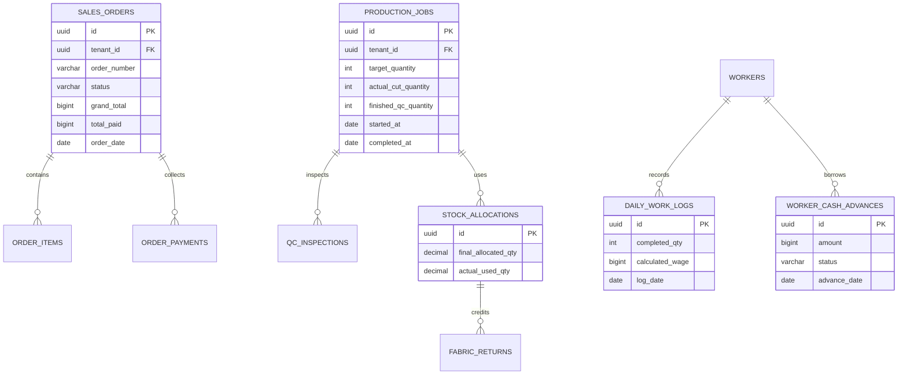

# Spesifikasi Master Modul: 008 - Laporan & Analitik Operasional (Reporting)

Dokumen ini merupakan **Spesifikasi Master (Tier 1)** yang memuat arsitektur analitik operasional dan finansial konveksi, agregasi omset penjualan, rasio cacat produksi, efisiensi bahan kain (*yield*), rekapitulasi penggajian, serta katalog navigasi menuju sub-spesifikasi detail fitur.

---

## 1. Metadata & Tautan Referensi Terkait

- **Kode Modul**: `SPEC-008`
- **Tingkatan Dokumen**: **Tier 1 (Master Specification Hub)**
- **Domain Bounded Context**: `analytics` / `reporting`
- **Tautan Standar Acuan Global**:
  - 📋 [Standar Penulisan Requirement](../context/requirements_standard.md)
  - 🏛️ [Arsitektur Sistem & Presisi Finansial](../context/architecture.md)
  - ⚙️ [Standar Rekayasa Backend & Zero Alloc](../context/backend.md)
  - 🖥️ [Standar Frontend & TypeScript Ultra-Strict](../context/frontend.md)
  - 🗄️ [Standar Database PostgreSQL & Indexing](../context/dbadmin.md)
  - 🧪 [Standar QA & Benchmark Testing](../context/qa.md)
  - 📋 [Kebutuhan Bisnis Konveksi](../context/business_requirements.md)
- **Tautan Spesifikasi Master Terkait**:
  - 📊 [001 - Dashboard Monitoring](./001-dashboard.md)
  - 📄 [003 - Sales & Order (OMS)](./003-sales-order.md)
  - 🧵 [004 - Alur Produksi Konveksi (MES)](./004-production.md)
  - 📦 [005 - Manajemen Inventaris Kain (WMS)](./005-inventory.md)
  - 👥 [006 - HRIS & Payroll Borongan](./006-hris-payroll.md)

---

## 2. Indeks Sub-Modul Fungsional (Tier 2 Sub-Specifications)

Rincian implementasi teknis, skema DDL, kontrak API RESTful, skenario Gherkin 4-pilar, dan format ekspor CSV/Excel dipecah menjadi sub-spesifikasi modular berikut:

| Berkas Sub-Spesifikasi | Lingkup Fungsional Utama | Ukuran & Fokus Teknis |
| :--- | :--- | :--- |
| 📊 **[008a-sales-receivables-report.md](./008a-sales-receivables-report.md)** | Laporan omset penjualan, kas masuk, & sisa piutang tertunggak. | Agregasi finansial zero-float, aging piutang. |
| 📉 **[008b-production-defect-report.md](./008b-production-defect-report.md)** | Laporan kinerja stasiun, durasi pengerjaan (*lead time*), & tingkat cacat. | Analitik stasiun bottleneck, rasio reject per operasi. |
| 🧵 **[008c-fabric-yield-report.md](./008c-fabric-yield-report.md)** | Laporan efisiensi pemakaian kain, rasio hasil potong (*yield*), & limbah. | Rasio konsumsi bahan vs pola, audit perca. |
| 💼 **[008d-payroll-recap-report.md](./008d-payroll-recap-report.md)** | Rekapitulasi penggajian mingguan, potongan kasbon, & ekspor CSV/Excel. | Rate limiting ekspor laporan, RBAC Finance/Owner. |

---

## 3. Ringkasan Kebutuhan & Masalah Bisnis

### Masalah yang Dihadapi
1. **Laporan Keuangan & Piutang Tidak Akurat**: Kasir kesulitan merekapitulasi total uang muka (DP) yang sudah diterima vs piutang pelanggan yang belum dibayar di akhir bulan, sehingga arus kas pabrik rawan defisit.
2. **Ketiadaan Evaluasi Kinerja Produksi & Lead Time**: Manajer pabrik tidak memiliki data statistik mengenai rata-rata waktu pengerjaan pesanan (*production lead time*) dan di stasiun kerja mana pesanan paling sering tersendat (*bottleneck*).
3. **Analisis Pemborosan Kain (Yield & Wastage) Buta**: Owner tidak dapat mengevaluasi apakah toleransi susut kain (3%–5%) sudah realistis atau justru ada kain yang terbuang percuma akibat kesalahan pola tukang potong.
4. **Rekap Gaji Penjahit Lambat Diekspor**: Kasir membutuhkan laporan rekapitulasi penggajian mingguan yang dapat diekspor ke format Excel/CSV atau dicetak ke kertas format laporan resmi A4 untuk arsip pembukuan fisik.

### Solusi MVP
Menyediakan 4 jenis laporan analitik operasional terpadu yang dapat difilter berdasarkan rentang tanggal fleksibel:
1. **Laporan Penjualan & Piutang (Sales & Receivables Report)**:
   - Rekap omset kotor, total diskon, total PPN, total kas masuk (DP + Pelunasan), dan sisa piutang tertunggak per pelanggan.
2. **Laporan Kinerja & Cacat Produksi (Production Output & Defect Report)**:
   - Total pcs dipotong, total pcs lolos QC, rata-rata durasi pengerjaan per artikel, dan tingkat cacat (*defect rate*) terpilah (cacat potong, makloon sablon, atau jahit).
3. **Laporan Pemakaian Bahan Baku & Efisiensi Kain (Fabric Yield Report)**:
   - Perbandingan antara estimasi kebutuhan kain teoritis vs pemakaian kain riil vs sisa rol yang dikembalikan (*roll return*).
4. **Laporan Rekapitulasi Upah Borongan & Kasbon (Payroll & Cash Advance Report)**:
   - Rincian akumulasi output pcs per penjahit, total upah kotor, total potongan pinjaman kasbon, dan total upah bersih yang dibayarkan.
5. **Ekspor Data Universal**: Mendukung ekspor instan satu-klik ke format **CSV** dan **Excel (.xlsx)** serta pratinjau cetak A4 lanskap (*print layout*).

---

## 3. User Stories

- **US-08-01 [P1]**: Sebagai *Owner Konveksi*, saya ingin melihat laporan penjualan dan sisa piutang tertunggak per pelanggan dalam rentang tanggal tertentu, agar saya dapat menagih pelunasan secara terarah.
- **US-08-02 [P1]**: Sebagai *Manajer Produksi*, saya ingin melihat laporan tingkat cacat (defect rate) dan efisiensi kain, agar saya dapat mengevaluasi kinerja meja potong dan vendor makloon sablon.
- **US-08-03 [P1]**: Sebagai *Kasir / HRD*, saya ingin mengekspor rekapitulasi upah borongan mingguan beserta potongan kasbon ke file Excel, agar saya dapat mengarsipkannya untuk pembukuan kas bulanan.
- **US-08-04 [P2]**: Sebagai *Admin Sales*, saya ingin melihat laporan artikel pakaian yang paling laris dipesan (Kaos, Polo, Kemeja, Hoodie), agar strategi promosi penjualan lebih tepat sasaran.

---

## 4. Kriteria Penerimaan (Acceptance Criteria - Gherkin)

### Skenario 1: Menghasilkan Laporan Penjualan dengan Filter Rentang Tanggal
- **Given** Terdapat 15 transaksi pesanan pada bulan Oktober 2026.
- **When** User memilih rentang tanggal `2026-10-01` s/d `2026-10-31` pada Laporan Penjualan.
- **Then** Sistem menghitung agregasi total pesanan, total omset, total kas diterima, dan total piutang tertunggak.
- **And** Seluruh kalkulasi nominal dihitung menggunakan tipe data integer `BIGINT` tanpa selisih pembulatan sen/rupiah.

### Skenario 2: Ekspor Rekapitulasi Upah Borongan ke CSV
- **Given** Periode penggajian mingguan `2026-W42` telah ditutup.
- **When** Kasir menekan tombol "Ekspor CSV".
- **Then** Sistem menghasilkan berkas CSV dalam waktu < 500ms yang memuat kolom: ID Pekerja, Nama Penjahit, Total Pcs Jahit, Upah Kotor, Potongan Kasbon, dan Upah Bersih.

### Skenario 3: Laporan Efisiensi Pemakaian Kain
- **Given** SPK `SPK-0012` dialokasikan 26.0 kg kain (termasuk 4% margin).
- **And** Realisasi pemotongan menggunakan 22.0 kg kain dan mengembalikan 3.5 kg sisa rol ke gudang.
- **When** Laporan efisiensi bahan dimuat untuk SPK tersebut.
- **Then** Sistem menampilkan: Konsumsi Riil = 22.0 kg, Retur Sisa Rol = 3.5 kg, Limbah/Perca = 0.5 kg (1.92% limbah aktual).

---

## 5. Skema Relasi Data untuk Agregasi (Mermaid ERD)

Modul pelaporan membaca data transaksional terisolasi per tenant dengan memanfaatkan indeks compound:



---

## 6. Kontrak API RESTful

### Endpoint: `GET /api/v1/reporting/sales-summary`
- **Query Params**: `start_date=2026-10-01&end_date=2026-10-31&payment_status=all`
- **Headers**:
  - `Authorization: Bearer <token>`
  - `X-Tenant-ID: <uuid>`

#### Respons Sukses (HTTP 200 OK):
```json
{
  "status": "success",
  "data": {
    "period": {
      "start_date": "2026-10-01",
      "end_date": "2026-10-31"
    },
    "summary": {
      "total_orders": 24,
      "total_gross_revenue": 165000000,
      "total_discounts": 5000000,
      "total_net_revenue": 160000000,
      "total_collected_cash": 115000000,
      "total_unpaid_receivables": 45000000
    },
    "orders": [
      {
        "order_number": "SPK-202610-0012",
        "customer_name": "PT Sumber Busana",
        "order_date": "2026-10-05",
        "total_amount": 18500000,
        "paid_amount": 18500000,
        "unpaid_amount": 0,
        "payment_status": "fully_paid"
      }
    ]
  }
}
```

### Endpoint: `GET /api/v1/reporting/payroll-summary`
- **Query Params**: `start_date=2026-10-14&end_date=2026-10-20`
#### Respons Sukses (HTTP 200 OK):
```json
{
  "status": "success",
  "data": {
    "total_workers": 12,
    "total_pcs_produced": 1850,
    "total_gross_wages": 7400000,
    "total_cash_advances_deducted": 1200000,
    "total_net_payout": 6200000,
    "worker_breakdowns": [
      {
        "worker_id": "01925b6a-8451-7ef1-953e-51c045b0a111",
        "worker_name": "Ahmad Subarjo",
        "role_category": "sewing",
        "total_pcs": 160,
        "gross_wage": 640000,
        "cash_advance_deduction": 150000,
        "net_wage": 490000
      }
    ]
  }
}
```

### Endpoint: `GET /api/v1/reporting/export/csv`
- **Query Params**: `report_type=payroll&start_date=2026-10-14&end_date=2026-10-20`
- **Response**: File stream `text/csv` dengan header `Content-Disposition: attachment; filename="payroll-recap-2026-w42.csv"`.

---

## 7. Desain Antarmuka Pengguna & Fitur Ekspor (UI/UX)

- **Filter Bar Terpadu**: Komponen pemilih rentang tanggal cepat (*Presets*: Hari Ini, Minggu Ini, Bulan Ini, Bulan Lalu, Kustom) dengan indikator pemuatan instan.
- **Kartu Ringkasan Metrik (KPI Bento Mini)**: 4 kartu metrik di bagian atas laporan yang menampilkan total ringkasan secara mencolok.
- **Tabel Data Berdensitas Tinggi**:
  - Kolom dapat disortir (*sortable columns*).
  - Teks angka mata uang rata kanan (*tabular-nums align-right*) untuk kemudahan membaca perbandingan nilai rupiah.
- **Toolbar Aksi Cepat**:
  - Tombol "Unduh Excel (.xlsx)" dan "Unduh CSV".
  - Tombol "Cetak Laporan (A4)" yang membuka dialog print browser dengan styling stylesheet `@media print` terkonfigurasi rapi (header tabel berulang di tiap halaman, kop surat resmi konveksi).

---

## 8. Persyaratan Teknis & Standar Performa

1. **Efisiensi Query Database**:
   - Seluruh kueri agregasi laporan wajib memanfaatkan indeks komposit `(tenant_id, created_at)` dan `(tenant_id, order_date)`.
   - Menggunakan klausa `GROUP BY` PostgreSQL murni tanpa operasi agregasi manual di memori backend.
2. **Zero Allocation Streaming CSV**:
   - Endpoint ekspor CSV wajib menggunakan streaming langsung ke `http.ResponseWriter` melalui buffer `csv.Writer` dengan alokasi memori minimal (`0 memory leak`), mencegah lonjakan pemakaian RAM server saat mengekspor puluhan ribu baris riwayat pesanan.
3. **TypeScript Strict Type Compliance**:
   - Seluruh payload laporan diikat secara eksplisit oleh interface TypeScript tanpa tipe `any`:
     ```typescript
     export interface SalesReportSummary {
       readonly totalOrders: number;
       readonly totalGrossRevenue: number;
       readonly totalDiscounts: number;
       readonly totalNetRevenue: number;
       readonly totalCollectedCash: number;
       readonly totalUnpaidReceivables: number;
     }
     ```
