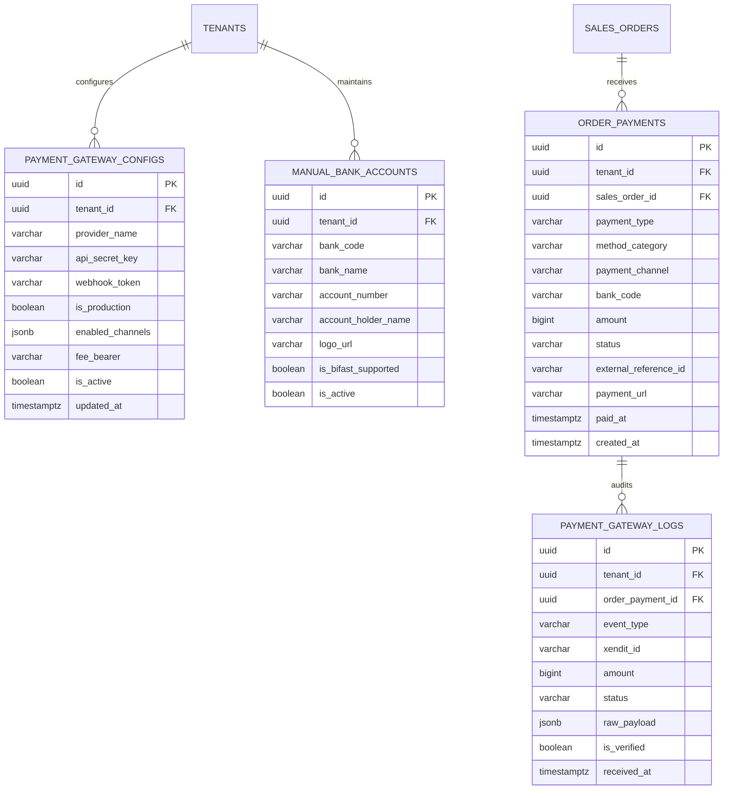

# Spesifikasi Master Modul: 009 - Integrasi Payment Gateway & Rekening (Payments)

Dokumen ini merupakan **Spesifikasi Master (Tier 1)** yang memuat arsitektur pemrosesan pembayaran konveksi, integrasi payment gateway Xendit, penerimaan transfer manual bank resmi & kas tunai kasir, verifikasi webhook signature, serta katalog navigasi menuju sub-spesifikasi detail fitur.

---

## 1. Metadata & Tautan Referensi Terkait

- **Kode Modul**: `SPEC-009`
- **Tingkatan Dokumen**: **Tier 1 (Master Specification Hub)**
- **Domain Bounded Context**: `oms` / `payment`
- **Tautan Standar Acuan Global**:
  - 📋 [Standar Penulisan Requirement](../context/requirements_standard.md)
  - 🏛️ [Arsitektur Sistem & Presisi Finansial Zero Float](../context/architecture.md)
  - 🛡️ [Standar Keamanan Kredensial & Webhook Signature](../context/security.md)
  - ⚙️ [Standar Rekayasa Backend Go & Idempotensi](../context/backend.md)
  - 🖥️ [Standar Frontend SolidJS & TypeScript Strict](../context/frontend.md)
  - 🗄️ [Standar Database PostgreSQL & Audit Trail](../context/dbadmin.md)
  - 🧪 [Standar QA & Akses Browser](../context/qa.md)
  - 🔧 [Standar Kebutuhan Teknis Non-Fungsional](../context/technical_requirements.md)
- **Tautan Spesifikasi Master Terkait**:
  - 📊 [001 - Dashboard Monitoring](./001-dashboard.md)
  - 📄 [003 - Sales & Order (OMS)](./003-sales-order.md)
  - 📈 [008 - Laporan & Analitik Finansial](./008-reporting.md)

---

## 2. Indeks Sub-Modul Fungsional (Tier 2 Sub-Specifications)

Rincian implementasi teknis, skema DDL, kontrak API RESTful, skenario Gherkin 4-pilar, dan proteksi HMAC SHA-256 dipecah menjadi sub-spesifikasi modular berikut:

| Berkas Sub-Spesifikasi | Lingkup Fungsional Utama | Ukuran & Fokus Teknis |
| :--- | :--- | :--- |
| ⚙️ **[009a-payment-settings.md](./009a-payment-settings.md)** | Menu `/settings/payments` (kredensial Xendit, VA, QRIS, & rekening bank). | Enkripsi AES-256-GCM kredensial, masking UI. |
| ⚡ **[009b-xendit-gateway.md](./009b-xendit-gateway.md)** | Pembuatan tagihan VA (BCA, Mandiri, BRI, BNI, BSI) & QRIS Xendit. | Dynamic VA generation, modal QRIS refresh interval. |
| 🔔 **[009c-payment-webhook.md](./009c-payment-webhook.md)** | Callback webhook Xendit, verifikasi token signature, & idempotensi. | Idempotency lock, webhook signature HMAC SHA-256. |
| 💵 **[009d-manual-cash-payment.md](./009d-manual-cash-payment.md)** | Pencatatan transfer bank manual (BI-Fast) dengan logo bank & tunai. | Validasi upload bukti transfer, kuitansi kasir. |

---

## 3. Ringkasan Kebutuhan & Masalah Bisnis

### Masalah yang Dihadapi
1. **Verifikasi Bukti Transfer Palsu**: Admin sales sering kali menerima tangkapan layar m-Banking palsu (*fake receipt*) dari pemesan untuk mengklaim bahwa DP sudah dibayar, sehingga pemotongan kain terlanjur dilakukan sebelum uang benar-benar masuk.
2. **Keterbatasan Pilihan Pembayaran Pelanggan**: Pelanggan instansi atau komunitas besar memiliki preferensi pembayaran yang beragam (Virtual Account antar-bank, QRIS untuk nominal kecil, atau transfer manual rekening giro kantor).
3. **Pencatatan Pembayaran Tunai & Kasbon Kasir Tercecer**: Pembayaran DP tunai di kantor konveksi sering kali tidak memiliki nomor referensi dan bukti kuitansi fisik resmi.
4. **Log Webhook Hilang Saat Troubleshooting**: Saat terjadi gangguan jaringan antara penyedia payment gateway dan server konveksi, kasir tidak dapat menelusuri riwayat callback payload untuk mengonfirmasi status transaksi.

### Solusi MVP
1. **Integrasi Resmi Xendit Gateway**:
   - Mendukung Virtual Account otomatis (BCA, Mandiri, BRI, BNI, Permata, BSI), QRIS interaktif, dan E-Wallet.
   - Verifikasi callback otomatis via webhook dengan verifikasi token (*Signature Verification*) dan idempotensi.
2. **Metode Pembayaran Statis Terkonfigurasi**:
   - **Transfer Bank Manual (BI-Fast / Realtime Online)**: Rekening bank konveksi (BCA, Mandiri, BNI, BRI, BSI, CIMB Niaga, Permata, Danamon) dapat diaktifkan/dinonaktifkan secara fleksibel di menu Settings lengkap dengan nomor rekening, nama pemilik, dan logo bank resmi.
   - **Pembayaran Tunai (Cash / Uang Kertas)**: Diterima langsung di kasir konveksi dengan cetak kuitansi thermal 80mm otomatis.
3. **Konfigurabilitas Penuh di Pengaturan (Settings)**:
   - Admin dapat memilih kanal Xendit apa saja yang aktif dan rekening bank statis mana saja yang tampil.
   - Pilihan metode pembayaran pada formulir pesanan (*Sales Order*) secara dinamis mengikuti konfigurasi yang diaktifkan di menu Settings.
4. **Aturan 1 Metode Pembayaran per Transaksi**:
   - Untuk setiap transaksi pembayaran (pembayaran DP atau pelunasan), pelanggan/admin **hanya dapat memilih 1 jenis metode pembayaran**.
5. **Tampilan Visual Kaya Logo**:
   - Daftar metode pembayaran menampilkan logo resmi bank atau logo gateway secara tajam dan profesional.
6. **Buku Log Pembayaran Lengkap (Payment & Webhook Audit Logs)**:
   - Mencatat seluruh jejak payload webhook Xendit, status transisi, nomor referensi, dan timestamp secara abadi.

---

## 3. Konfigurasi Metode Pembayaran di Menu Pengaturan (Settings)

Sistem menyediakan antarmuka konfigurasi terpusat di `/settings/payments` yang terisolasi per tenant:

```text
┌────────────────────────────────────────────────────────────────────────┐
│ PENGATURAN METODE PEMBAYARAN KONVEKSI                                  │
├────────────────────────────────────────────────────────────────────────┤
│ [A] KREDENSIAL XENDIT GATEWAY                                          │
│ API Secret Key      : [ xnd_production_**************** ]              │
│ Webhook Token       : [ wht_*************************** ]              │
│ Mode Operasional    : ( ) Sandbox / Testing  (•) Production Live       │
│                                                                        │
│ [B] KANAL PEMBAYARAN OTOMATIS XENDIT                                   │
│ [✓] BCA Virtual Account         [✓] Mandiri Virtual Account            │
│ [✓] BRI Virtual Account         [✓] BNI Virtual Account                │
│ [✓] BSI Virtual Account         [✓] QRIS (Dana/OVO/GoPay/ShopeePay)    │
│ [ ] Kartu Kredit (MDR 2.9%)     [ ] Gerai Alfamart / Indomaret         │
│                                                                        │
│ [C] REKENING TRANSFER BANK MANUAL (BI-FAST / ONLINE)                   │
│ [✓] Bank BCA     - No: 139-082-9912 - A/N: CV Sumber Busana Konveksi   │
│ [✓] Bank Mandiri - No: 120-001-8821 - A/N: CV Sumber Busana Konveksi   │
│ [✓] Bank BNI     - No: 088-239-1120 - A/N: CV Sumber Busana Konveksi   │
│ [✓] Bank BSI     - No: 712-998-3310 - A/N: CV Sumber Busana Konveksi   │
│                                                                        │
│ [D] PEMBAYARAN TUNAI (CASH)                                            │
│ [✓] Aktifkan Pembayaran Tunai di Kantor/Workshop                       │
└────────────────────────────────────────────────────────────────────────┘
```

---

## 4. User Stories

- **US-09-01 [P1]**: Sebagai *Kasir / Admin*, saya ingin memilih salah satu metode pembayaran (Transfer BCA, QRIS Xendit, atau Tunai) yang telah diaktifkan di Settings, agar tagihan memiliki instruksi bayar yang jelas bagi pelanggan.
- **US-09-02 [P1]**: Sebagai *Admin Sales*, saya ingin sistem otomatis mengubah status pembayaran SPK menjadi `dp_paid` saat webhook Xendit menyatakan transaksi berhasil, agar proses potong kain dapat segera dimulai tanpa menunggu cek mutasi manual.
- **US-09-03 [P1]**: Sebagai *Kasir*, saya ingin melihat riwayat log pembayaran (*Payment Logs*) lengkap dengan status, nomor referensi bank, dan payload webhook Xendit, agar mudah melakukan penelusuran jika pelanggan mengklaim sudah bayar.
- **US-09-04 [P2]**: Sebagai *Owner Konveksi*, saya ingin mengaktifkan atau menonaktifkan kanal bank tertentu dari menu Settings tanpa mengubah kode program, agar rekening yang tampil selalu sesuai dengan rekening aktif perusahaan.

---

## 5. Kriteria Penerimaan (Acceptance Criteria - Gherkin)

### Skenario 1: Batasan Pemilihan Hanya 1 Metode Pembayaran (Single Selection)
- **Given** Admin membuka modal pembayaran untuk SPK `SPK-202610-0012`.
- **When** Admin memilih metode pembayaran "BCA Virtual Account (Xendit)".
- **Then** Opsi metode pembayaran lain otomatis tidak terpilih (*radio selection behavior*).
- **And** Form hanya memproses 1 metode pembayaran untuk transaksi tersebut.

### Skenario 2: Pemrosesan Webhook Xendit & Idempotensi Log
- **Given** Xendit mengirimkan webhook callback `invoice.paid` untuk tagihan DP SPK `SPK-202610-0012` sebesar Rp 6.000.000.
- **When** Server menerima webhook pada endpoint `/api/v1/oms/payments/xendit/webhook`.
- **Then** Server memvalidasi header `x-callback-token` sesuai token di database.
- **And** Mencatat payload webhook ke tabel `payment_gateway_logs`.
- **And** Mengubah status pembayaran order menjadi `dp_paid` secara transaksional.
- **And** Jika Xendit mengirimkan callback ulang dengan `payment_id` yang sama, sistem merespons HTTP 200 OK tanpa memproses mutasi saldo ganda (*idempotent execution*).

### Skenario 3: Pembayaran Tunai di Kasir dengan Kuitansi Cetak
- **Given** Pelanggan membayar uang muka tunai Rp 5.000.000 di kantor workshop.
- **When** Kasir memilih metode "Tunai (Uang Kertas)", menginput nominal, dan menekan "Konfirmasi Bayar".
- **Then** Status pembayaran tercatat `paid` dan sistem langsung memicu dialog cetak kuitansi thermal 80mm resmi berstempel lunas.

---

## 6. Skema Relasi Data (Mermaid ERD)



---

## 7. Kontrak API RESTful

### Endpoint: `POST /api/v1/oms/orders/{id}/payments/initiate`
Membuat sesi pembayaran baru (hanya memilih 1 metode pembayaran):
```json
{
  "payment_type": "down_payment",
  "amount": 6000000,
  "method_category": "xendit",
  "payment_channel": "BCA_VA"
}
```
#### Respons Sukses (HTTP 201 Created):
```json
{
  "status": "success",
  "data": {
    "payment_id": "01925b6a-8451-7ef1-953e-51c045b0a555",
    "order_number": "SPK-202610-0012",
    "method_category": "xendit",
    "payment_channel": "BCA_VA",
    "amount": 6000000,
    "payment_details": {
      "va_number": "88082987123912",
      "bank_name": "BCA",
      "expiry_time": "2026-10-23T22:00:00Z",
      "qr_code_url": null
    },
    "bank_logo_url": "/assets/banks/bca.svg"
  }
}
```

### Endpoint: `POST /api/v1/oms/payments/xendit/webhook`
Webhook penerima callback resmi dari Xendit:
- **Headers Wajib**: `x-callback-token: <secret_webhook_token>`
- **Request Payload**:
```json
{
  "id": "67169f44a9912001e3b12345",
  "external_id": "PAY-01925b6a-8451-7ef1-953e-51c045b0a555",
  "status": "PAID",
  "amount": 6000000,
  "paid_amount": 6000000,
  "bank_code": "BCA",
  "paid_at": "2026-10-22T08:15:30.000Z",
  "payment_channel": "VIRTUAL_ACCOUNT"
}
```
- **Respons Backend**: HTTP `200 OK` `{ "status": "acknowledged" }`

---

## 8. Desain Antarmuka Pemilihan Metode Pembayaran & Log

### A. Modal Pemilihan Metode Pembayaran (Single-Selection dengan Logo)
- **Desain Modern Flat UI**:
  - Dikelompokkan rapi menjadi 3 tab/seksi: **Xendit Otomatis**, **Transfer Bank Manual**, dan **Tunai**.
  - Setiap kartu pilihan metode memiliki tinggi 64px dengan logo bank SVG resmi (lebar 48px), nama rekening/kanal, dan indikator lingkaran *radio button* yang hanya mengizinkan 1 pilihan aktif.
  - Logo bank yang didukung penuh: **BCA**, **Mandiri**, **BNI**, **BRI**, **BSI**, **CIMB Niaga**, **Permata**, **Danamon**, serta logo **QRIS** dan **Xendit**.

### B. Tab Log Pembayaran pada Rincian Pesanan (Sales Order Detail)
Menampilkan tabel riwayat pembayaran komprehensif:
- Kolom: Waktu Pembayaran, Jenis (DP/Pelunasan), Metode (Logo + Nama Kanal), Nominal (Rp), Referensi Transaksi, Status Badge (`SUCCESS` hijau, `PENDING` kuning, `EXPIRED` merah), dan Tombol "Lihat Log Webhook / Cetak Bukti".
- Menekan tombol "Lihat Log Webhook" membuka drawer samping yang menampilkan payload JSON mentah Xendit untuk keperluan audit teknis.
