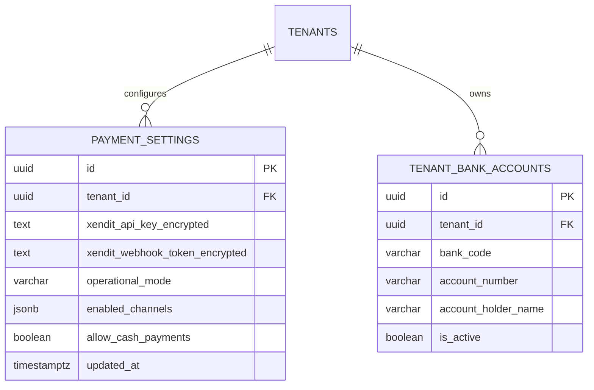

# Spesifikasi Sub-Modul: 009a - Konfigurasi Metode Pembayaran & Rekening Bank (Settings)

Dokumen ini memuat spesifikasi antarmuka konfigurasi terpusat di `/settings/payments` untuk mengelola kredensial payment gateway Xendit, mengaktifkan/menonaktifkan kanal Virtual Account / QRIS, serta mendaftarkan rekening transfer bank statis (BI-Fast) lengkap dengan logo resmi bank untuk SewERP.

---

## 1. Metadata & Tautan Referensi Terkait

- **Kode Modul**: `SPEC-009a`
- **Domain Bounded Context**: `oms` / `payment`
- **Tautan Standar Acuan Global**:
  - 📋 [Standar Penulisan Requirement](../context/requirements_standard.md)
  - 🛡️ [Standar Keamanan Kredensial & Secrets](../context/security.md)
  - 🏛️ [Arsitektur Sistem & Multi-Tenancy](../context/architecture.md)
  - 🗄️ [Standar Database PostgreSQL](../context/dbadmin.md)
  - 🎨 [Standar UI Flat](../context/ui.md)
- **Tautan Spesifikasi Fitur Terkait**:
  - 💳 [009b - Gateway Pembayaran Xendit (VA & QRIS)](./009b-xendit-gateway.md)
  - 🔔 [009c - Callback Webhook & Signature Token](./009c-payment-webhook.md)
  - 🏦 [009d - Pembayaran Manual & Kasir](./009d-manual-cash-payment.md)
  - 📄 [003a - Inti Sales & Order (OMS)](./003a-sales-order-core.md)

---

## 2. Ringkasan Kebutuhan & Masalah Bisnis

### Masalah Lapangan
1. Setiap pabrik konveksi memiliki rekening bank operasional yang berbeda-beda (BCA, Mandiri, BNI, BRI, BSI). Ketika nomor rekening perusahaan berganti, staf sering harus menghubungi developer untuk mengubah kode program (*hardcoded*).
2. Pilihan kanal pembayaran yang tampil di formulir order kasir tidak dapat disesuaikan dengan kebutuhan tenant konveksi tertentu.

### Solusi Fitur
Antarmuka Pengaturan Mandiri `/settings/payments`:
1. **Kredensial Xendit**: Penyimpanan aman API Secret Key dan Webhook Verification Token (Terenkripsi AES-256-GCM).
2. **Kanal Otomatis Xendit**: Checkbox toggle untuk mengaktifkan Virtual Account (BCA, Mandiri, BRI, BNI, BSI) dan QRIS interaktif.
3. **Rekening Transfer Bank Manual (BI-Fast / Online)**: CRUD rekening bank konveksi lengkap dengan nama bank, nomor rekening, nama pemilik rekening (*beneficiary name*), dan logo bank resmi.
4. **Pembayaran Tunai**: Toggle aktivasi penerimaan kas tunai di kantor workshop.

---

## 3. User Stories

- **US-009a-01 [P1 - Owner Konveksi]**: Sebagai *Owner Konveksi*, saya ingin mengaktifkan atau menonaktifkan kanal bank tertentu dari menu Settings tanpa campur tangan programmer, agar rekening yang tampil selalu akurat.
- **US-009a-02 [P1 - Kasir]**: Sebagai *Kasir*, saya ingin opsi metode pembayaran pada formulir pesanan otomatis menyesuaikan dengan metode yang sedang aktif di Settings, agar instruksi bayar ke pelanggan selalu valid.

---

## 4. Kriteria Penerimaan (Acceptance Criteria - Gherkin)

### Skenario 1: Penambahan Rekening Bank Statis Baru
- **Given** Owner membuka menu `/settings/payments`.
- **When** Menambahkan rekening Bank BCA: No. `139-082-9912`, A/N `CV Sumber Busana Konveksi`.
- **Then** Rekening tersimpan dan langsung muncul sebagai opsi pilihan di formulir pembayaran Sales Order.

---

## 5. Skema Relasi Data Granular (Mermaid ERD)



---

## 6. Kontrak API RESTful

### Endpoint: `GET /api/v1/settings/payments`
- **Response Payload (HTTP 200 OK)**:
```json
{
  "status": "success",
  "data": {
    "is_xendit_configured": true,
    "operational_mode": "production",
    "enabled_channels": ["bca_va", "mandiri_va", "bri_va", "qris"],
    "bank_accounts": [
      {
        "id": "01925b6a-8451-7ef1-953e-51c045b0a999",
        "bank_code": "BCA",
        "account_number": "139-082-9912",
        "account_holder_name": "CV Sumber Busana Konveksi",
        "is_active": true
      }
    ],
    "allow_cash_payments": true
  }
}
```

---

## 7. Kerangka Pemecahan Tugas (Task Breakdown)
- [ ] **Fase 1**: Goose migration tabel `payment_settings` dan `tenant_bank_accounts`.
- [ ] **Fase 2**: Service enkripsi/dekripsi AES-256 kredensial gateway.
- [ ] **Fase 3**: Handler route `GET` dan `PUT /api/v1/settings/payments`.
- [ ] **Fase 4**: Halaman pengaturan metode pembayaran di SolidJS.
