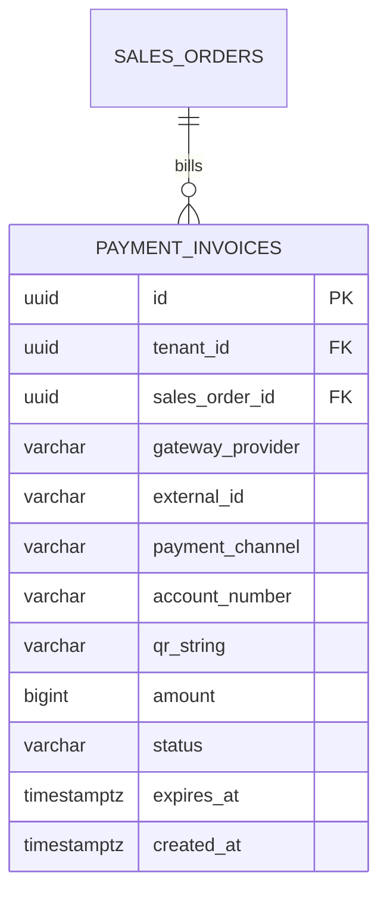

# Spesifikasi Sub-Modul: 009b - Integrasi Payment Gateway Xendit VA & QRIS (Payment)

Dokumen ini memuat spesifikasi integrasi payment gateway Xendit: penerbitan nomor Virtual Account (BCA, Mandiri, BRI, BNI, Permata, BSI), pembuatan QRIS dinamis interaktif, dan pemantauan siklus kedaluwarsa tagihan untuk SewERP.

---

## 1. Metadata & Tautan Referensi Terkait

- **Kode Modul**: `SPEC-009b`
- **Domain Bounded Context**: `oms` / `payment`
- **Tautan Standar Acuan Global**:
  - 📋 [Standar Penulisan Requirement](../context/requirements_standard.md)
  - 🏛️ [Arsitektur Sistem & Presisi Finansial Zero Float](../context/architecture.md)
  - ⚙️ [Standar Rekayasa Backend Go](../context/backend.md)
  - 🛡️ [Standar Keamanan Kredensial & Secrets](../context/security.md)
  - 🧪 [Standar QA & Benchmark Testing](../context/qa.md)
- **Tautan Spesifikasi Fitur Terkait**:
  - ⚙️ [009a - Konfigurasi Metode Pembayaran](./009a-payment-settings.md)
  - 🔔 [009c - Callback Webhook & Signature Token](./009c-payment-webhook.md)
  - 🏦 [009d - Pembayaran Manual & Kasir](./009d-manual-cash-payment.md)
  - 📄 [003a - Inti Sales & Order (OMS)](./003a-sales-order-core.md)

---

## 2. Ringkasan Kebutuhan & Masalah Bisnis

### Masalah Lapangan
Pelanggan instansi atau komunitas besar memiliki preferensi pembayaran yang beragam. Transfer rekening manual sering memerlukan waktu verifikasi lama karena kasir harus login ke internet banking bank berkali-kali untuk mengecek apakah mutasi sudah masuk sebelum kain boleh dipotong.

### Solusi Fitur
1. **Virtual Account Otomatis Xendit**: Pembuatan nomor VA instan per transaksi SPK (BCA, Mandiri, BRI, BNI, Permata, BSI).
2. **QRIS Interaktif**: Pembuatan QR Code dinamis berbasis standar QRIS Nasional (NMID) untuk pembayaran cepat nominal kecil via mobile banking / e-wallet (GoPay, OVO, ShopeePay, Dana).
3. **Masa Berlaku Tagihan (*Expiry Window*)**: Tagihan VA/QRIS memiliki batas waktu berlaku (default: 24 jam) untuk menjaga ketersediaan slot antrean pesanan.

---

## 3. User Stories

- **US-009b-01 [P1 - Kasir / Admin Sales]**: Sebagai *Admin Sales*, saya ingin membuat instruksi bayar Virtual Account Xendit untuk pesanan yang disetujui, agar pelanggan dapat membayar langsung dari m-Banking mereka dengan verifikasi otomatis.
- **US-009b-02 [P1 - Pelanggan]**: Sebagai *Pelanggan*, saya ingin memindai kode QRIS di lembar penawaran untuk membayar DP, agar transaksi selesai dalam beberapa detik dari aplikasi bank saya.

---

## 4. Kriteria Penerimaan (Acceptance Criteria - Gherkin)

### Skenario 1: Pembuatan Tagihan Virtual Account Xendit
- **Given** SPK `SPK-202610-0012` disetujui dengan tagihan DP Rp 5.000.000.
- **When** Admin memilih metode "BCA Virtual Account (Xendit)".
- **Then** Sistem memanggil API Xendit dan menerima nomor VA unik (misal: `88081234567890`).
- **And** Menyajikan petunjuk transfer resmi BCA ke layar kasir dan invoice digital pelanggan.

---

## 5. Skema Relasi Data Granular (Mermaid ERD)



---

## 6. Kontrak API RESTful

### Endpoint: `POST /api/v1/oms/orders/{id}/payments/charge-xendit`
- **Request Payload**:
```json
{
  "channel_code": "BCA",
  "payment_category": "down_payment",
  "amount": 5000000,
  "expires_in_hours": 24
}
```
- **Response Payload (HTTP 201 Created)**:
```json
{
  "status": "success",
  "data": {
    "invoice_id": "01925b6a-8451-7ef1-953e-51c045b0a123",
    "external_id": "SPK-0012-DP-1729548000",
    "payment_channel": "BCA_VA",
    "account_number": "88081234567890",
    "amount": 5000000,
    "expires_at": "2026-10-22T23:50:00Z"
  }
}
```

---

## 7. Kerangka Pemecahan Tugas (Task Breakdown)
- [ ] **Fase 1**: Goose migration tabel `payment_invoices`.
- [ ] **Fase 2**: HTTP Client adapter Xendit Go SDK dengan timeout dan retry.
- [ ] **Fase 3**: Handler route pembuatan charge Virtual Account dan QRIS.
- [ ] **Fase 4**: Modal instruksi bayar VA & QR Code canvas di SolidJS.
