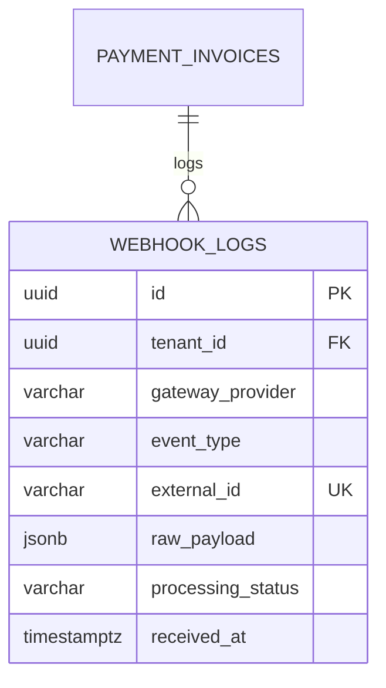

# Spesifikasi Sub-Modul: 009c - Callback Webhook Xendit, Token Signature & Idempotensi (Payment)

Dokumen ini memuat spesifikasi endpoint penerima callback webhook Xendit, validasi token signature (*HMAC/Token Verification*), penegakan jaminan idempotensi transaksi, dan pembaruan otomatis status pembayaran pesanan untuk SewERP.

---

## 1. Metadata & Tautan Referensi Terkait

- **Kode Modul**: `SPEC-009c`
- **Domain Bounded Context**: `oms` / `payment`
- **Tautan Standar Acuan Global**:
  - 📋 [Standar Penulisan Requirement](../context/requirements_standard.md)
  - 🛡️ [Standar Keamanan Kredensial & Webhook Signature](../context/security.md)
  - ⚙️ [Standar Rekayasa Backend Go & Idempotensi](../context/backend.md)
  - 🗄️ [Standar Database PostgreSQL & Audit Trail](../context/dbadmin.md)
  - 🧪 [Standar QA & Benchmark Testing](../context/qa.md)
- **Tautan Spesifikasi Fitur Terkait**:
  - ⚙️ [009a - Konfigurasi Metode Pembayaran](./009a-payment-settings.md)
  - 💳 [009b - Gateway Pembayaran Xendit (VA & QRIS)](./009b-xendit-gateway.md)
  - 📄 [003a - Inti Sales & Order (OMS)](./003a-sales-order-core.md)
  - 💳 [003d - Cetak Log Pembayaran Transaksi](./003d-payment-log.md)

---

## 2. Ringkasan Kebutuhan & Masalah Bisnis

### Masalah Lapangan
1. **Risiko Pemalsuan Callback (*Spoofing*)**: Tanpa verifikasi token signature, pihak luar dapat mengirimkan request palsu ke server konveksi untuk mengklaim bahwa tagihan telah dibayar.
2. **Kirim Ulang Webhook Ganda (*Network Retry Duplication*)**: Xendit secara otomatis mengirim ulang webhook jika terjadi timeout jaringan. Tanpa idempotensi, saldo pembayaran pesanan bisa terakumulasi ganda (misal bayar 5 juta tercatat 10 juta).

### Solusi Fitur
1. **Verifikasi Webhook Token**: Memeriksa kesesuaian header `x-callback-token` dengan token rahasia tenant.
2. **Jaminan Idempotensi Mutlak**: Mencatat `external_id` transaksi pada tabel log dengan constraint unik. Jika callback dengan ID yang sama diterima kembali, sistem langsung merespons `200 OK` tanpa memproses saldo ulang.
3. **Pembaruan Status SPK Real-time**: Mengubah status pembayaran pesanan menjadi `dp_paid` atau `paid_in_full` dan mengizinkan transisi SPK ke produksi.

---

## 3. User Stories

- **US-009c-01 [P1 - Sistem / Kasir]**: Sebagai *Kasir*, saya ingin sistem otomatis memperbarui status pembayaran SPK begitu pelanggan mentransfer ke VA Xendit, agar proses potong kain segera dimulai tanpa perlu cek mutasi manual.
- **US-009c-02 [P1 - Keamanan Sistem]**: Sebagai *Owner Konveksi*, saya ingin server menolak callback webhook yang tidak memiliki signature token valid, agar sistem aman dari manipulasi data pihak luar.

---

## 4. Kriteria Penerimaan (Acceptance Criteria - Gherkin)

### Skenario 1: Penerimaan Webhook Sukses & Transisi Order (Happy Path)
- **Given** SPK `SPK-0012` menunggu pembayaran DP sebesar Rp 5.000.000.
- **When** Xendit mengirim POST callback dengan header `x-callback-token` yang cocok dan status `PAID`.
- **Then** Sistem mencatat transaksi masuk di `order_payments`, mengubah status pembayaran menjadi `dp_paid`, dan status pesanan menjadi `approved`.
- **And** Mengembalikan HTTP 200 OK ke server Xendit dalam waktu $< 50\text{ ms}$.

### Skenario 2: Pencegahan Pemrosesan Webhook Berulang (Idempotency)
- **Given** Webhook dengan ID transaksi `TRX-998877` telah sukses diproses.
- **When** Xendit mengirim ulang webhook dengan ID transaksi yang sama.
- **Then** Sistem mendeteksi ID duplikat dan langsung mengembalikan HTTP 200 OK tanpa menambah saldo pembayaran.

### Skenario 3: Penolakan Token Callback Palsu (Security Denial)
- **Given** Penyerang mengirimkan request webhook dengan token salah.
- **When** Request diterima oleh endpoint.
- **Then** Sistem menolak dengan HTTP 401 Unauthorized dan mencatat peringatan keamanan ke audit log.

---

## 5. Skema Relasi Data Granular (Mermaid ERD)



---

## 6. Kontrak API RESTful

### Endpoint: `POST /api/v1/webhooks/xendit`
- **Headers**: `x-callback-token: {secret_token}`
- **Request Payload**:
```json
{
  "id": "64f9b8c0a1b2c3d4e5f6a7b8",
  "event": "va.payment",
  "external_id": "SPK-0012-DP-1729548000",
  "amount": 5000000,
  "payment_method": "VIRTUAL_ACCOUNT",
  "bank_code": "BCA",
  "paid_at": "2026-10-21T16:45:00.000Z",
  "status": "COMPLETED"
}
```
- **Response**: `HTTP 200 OK` (Plain Text: `OK`).

---

## 7. Kerangka Pemecahan Tugas (Task Breakdown)
- [ ] **Fase 1**: Goose migration tabel `webhook_logs` dengan unique index pada `external_id`.
- [ ] **Fase 2**: Middleware verifikasi `x-callback-token` tenant di Go Gin.
- [ ] **Fase 3**: Service transaksi database pembaruan status pesanan dan saldo.
- [ ] **Fase 4**: Uji coba pengujian simulasi webhook idempotent di test suite.
