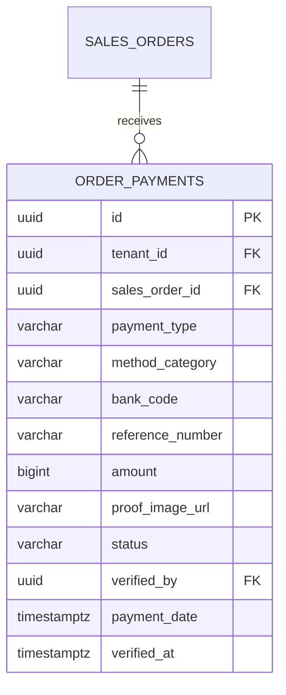

# Spesifikasi Sub-Modul: 009d - Pencatatan Pembayaran Transfer Manual & Tunai Kasir (Payment)

Dokumen ini memuat spesifikasi alur pencatatan pembayaran manual: transfer bank manual (BI-Fast / Realtime Online) dengan logo resmi bank, setoran tunai kasir (*cash on counter*), verifikasi bukti transfer, dan pencetakan kuitansi penerimaan untuk SewERP.

---

## 1. Metadata & Tautan Referensi Terkait

- **Kode Modul**: `SPEC-009d`
- **Domain Bounded Context**: `oms` / `payment`
- **Tautan Standar Acuan Global**:
  - 📋 [Standar Penulisan Requirement](../context/requirements_standard.md)
  - 🏛️ [Arsitektur Sistem & Presisi Finansial Zero Float](../context/architecture.md)
  - 🗄️ [Standar Database PostgreSQL](../context/dbadmin.md)
  - 🎨 [Standar UI Flat](../context/ui.md)
  - 👆 [Prinsip UX Lapangan Pabrik](../context/ux.md)
- **Tautan Spesifikasi Fitur Terkait**:
  - ⚙️ [009a - Konfigurasi Metode Pembayaran](./009a-payment-settings.md)
  - 📄 [003a - Inti Sales & Order (OMS)](./003a-sales-order-core.md)
  - 🧾 [003c - Cetak Nota Penjualan Kasir](./003c-sales-receipt.md)
  - 💳 [003d - Cetak Log Pembayaran Transaksi](./003d-payment-log.md)

---

## 2. Ringkasan Kebutuhan & Masalah Bisnis

### Masalah Lapangan
1. **Bukti Transfer Palsu (*Fake Screenshots*)**: Admin sales sering menerima tangkapan layar m-Banking palsu yang diedit pemesan. Tanpa verifikasi rekening mutasi oleh kasir, pesanan terlanjur dipotong kainnya.
2. **Setoran Tunai Tanpa Bukti Fisik**: Pelanggan yang datang langsung ke workshop konveksi dan membayar uang muka secara tunai sering tidak menerima kuitansi resmi, menimbulkan potensi perselisihan saat pelunasan barang.

### Solusi Fitur
1. **Form Input Bayar Manual & Tunai**: Memilih rekening bank tujuan transfer atau memilih Kas Tunai Kasir.
2. **Unggah Bukti Transfer & Validasi Kasir**: Staf sales mengunggah foto bukti mutasi, dan staf finance/kasir memverifikasi kecocokan dana di mutasi rekening bank sebelum mengubah status pembayaran.
3. **Cetak Kuitansi Kasir Seketika**: Dukungan cetak kuitansi thermal 80mm atau PDF bukti setor tunai.

---

## 3. User Stories

- **US-009d-01 [P1 - Kasir / Finance]**: Sebagai *Kasir*, saya ingin memverifikasi bukti transfer pelanggan terhadap mutasi rekening bank resmi, agar uang muka dipastikan sudah masuk sebelum SPK diproduksi.
- **US-009d-02 [P1 - Kasir]**: Sebagai *Kasir*, saya ingin mencatat setoran uang tunai dari pelanggan dan mencetak kuitansi tanda terima, agar transaksi tercatat di arus kas harian workshop.

---

## 4. Kriteria Penerimaan (Acceptance Criteria - Gherkin)

### Skenario 1: Verifikasi Pembayaran Transfer Bank Manual
- **Given** SPK `SPK-0012` memiliki pengajuan pembayaran transfer manual BCA sebesar Rp 4.000.000 dengan status `PENDING`.
- **When** Kasir memverifikasi dana masuk di rekening dan menekan tombol "Verifikasi Pembayaran".
- **Then** Status transaksi berubah menjadi `PAID`, nama kasir pencatat terekam di `verified_by`, dan sisa piutang SPK berkurang Rp 4.000.000.

---

## 5. Skema Relasi Data Granular (Mermaid ERD)



---

## 6. Kontrak API RESTful

### Endpoint: `POST /api/v1/oms/orders/{id}/payments/manual`
- **Request Payload**:
```json
{
  "method_category": "manual_transfer",
  "bank_code": "BCA",
  "account_id": "01925b6a-8451-7ef1-953e-51c045b0a999",
  "amount": 4000000,
  "reference_number": "TRF-BCA-882190",
  "proof_image_key": "payment_proofs/tenant-01/spk-0012-proof.jpg",
  "notes": "Transfer dari Rekening BCA PT Sumber Min"
}
```

---

## 7. Kerangka Pemecahan Tugas (Task Breakdown)
- [ ] **Fase 1**: Goose migration kolom verifikasi di tabel `order_payments`.
- [ ] **Fase 2**: Service verifikasi pembayaran manual dan update status order.
- [ ] **Fase 3**: Handler route pencatatan dan verifikasi kasir.
- [ ] **Fase 4**: Antarmuka modal bayar manual dengan logo bank resmi di SolidJS.
