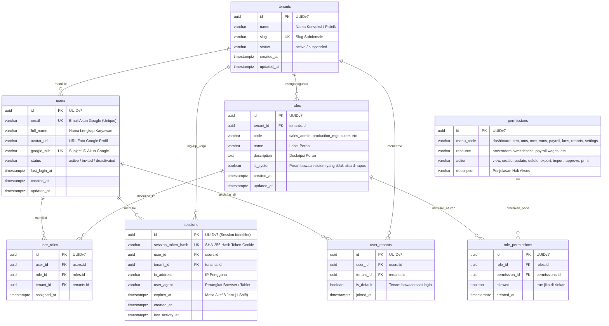

# Spesifikasi Master Modul: 010 - Autentikasi Google SSO & RBAC Granular (IAM)

Dokumen ini merupakan **Spesifikasi Master (Tier 1)** yang memuat arsitektur keamanan identitas, autentikasi Google SSO/OAuth2, manajemen sesi aman HttpOnly, otorisasi matriks RBAC berbutir halus (*granular*), isolasi multi-tenant, serta katalog navigasi menuju sub-spesifikasi detail fitur.

---

## 1. Metadata & Tautan Referensi Terkait

- **Kode Modul**: `SPEC-010`
- **Tingkatan Dokumen**: **Tier 1 (Master Specification Hub)**
- **Domain Bounded Context**: `iam` (Identity & Access Management) / `auth`
- **Tautan Standar Acuan Global**:
  - 📋 [Standar Penulisan Requirement](../context/requirements_standard.md)
  - 🏛️ [Arsitektur Sistem & Multi-Tenancy](../context/architecture.md)
  - ⚙️ [Standar Rekayasa Backend Go & Zero Allocations](../context/backend.md)
  - 🖥️ [Standar Rekayasa Frontend SolidJS & TypeScript Strict](../context/frontend.md)
  - 🗄️ [Standar Database PostgreSQL & Audit Trail](../context/dbadmin.md)
  - 🧪 [Standar QA & Akses Browser](../context/qa.md)
  - 📝 [Standar Formulir & Validasi Ketat](../context/forms.md)
  - 📋 [Kebutuhan Bisnis Konveksi & Matriks RBAC Global](../context/business_requirements.md)
  - 🔧 [Standar Kebutuhan Teknis Non-Fungsional](../context/technical_requirements.md)
- **Tautan Spesifikasi Master Terkait**:
  - 📊 [001 - Dashboard Monitoring](./001-dashboard.md)
  - 👥 [002 - Customer Relation (CRM)](./002-customer-relation.md)
  - 📄 [003 - Sales & Order (OMS)](./003-sales-order.md)
  - 🧵 [004 - Alur Produksi & Makloon (MES)](./004-production.md)
  - 📦 [005 - Inventaris Kain & Stok (WMS)](./005-inventory.md)
  - 👥 [006 - HRIS & Payroll Borongan](./006-hris-payroll.md)
  - 📚 [007 - Knowledge Base & Supplier](./007-knowledge-base.md)
  - 📈 [008 - Laporan & Analitik Finansial](./008-reporting.md)
  - 💳 [009 - Payment Gateway Xendit](./009-payment-gateway.md)
  - 📋 [011 - Configurable Price Lists](./011-price-lists.md)

---

## 2. Indeks Sub-Modul Fungsional (Tier 2 Sub-Specifications)

Rincian implementasi teknis, skema DDL, kontrak API RESTful, skenario Gherkin 4-pilar, dan middleware security dipecah menjadi sub-spesifikasi modular berikut:

| Berkas Sub-Spesifikasi | Lingkup Fungsional Utama | Ukuran & Fokus Teknis |
| :--- | :--- | :--- |
| 🔑 **[010a-google-sso.md](./010a-google-sso.md)** | Autentikasi Google OAuth2 / OIDC & mekanisme whitelist invitation email. | OAuth2 handshake, CSRF token validation. |
| 🛡️ **[010b-session-management.md](./010b-session-management.md)** | Manajemen sesi HttpOnly cookie aman (8 jam) & revokasi multi-device. | Session store memory/redis, refresh rotation. |
| 👮 **[010c-granular-rbac.md](./010c-granular-rbac.md)** | Matriks hak akses berbutir halus 6 aksi (View, Create, Update, Delete, Export, Import). | Gin authorization middleware, bitmask permission. |
| 🏢 **[010d-tenant-switching.md](./010d-tenant-switching.md)** | Konteks multi-tenancy (`tenant_id`), isolasi database, & switcher tenant aktif. | PostgreSQL RLS header parsing, tenant switch audit. |

---

## 3. Ringkasan Kebutuhan & Masalah Bisnis

### Masalah yang Dihadapi
1. **Kelelahan & Kebocoran Kata Sandi di Lantai Pabrik**: Banyak karyawan konveksi (staf gudang, kasir, admin) saling meminjam akun atau menggunakan password lemah ("123456"), sehingga integritas data produksi dan pencatatan kas rawan disalahgunakan tanpa akuntabilitas.
2. **Pencurian Token Kredensial via XSS**: Penyimpanan token JWT di `localStorage` peramban web rentan dicuri oleh skrip berbahaya pihak ketiga jika terjadi celah keamanan.
3. **Akses Menu yang Terlalu Luwes Tanpa Pembatasan Aksi**: Staf penjualan sering kali bisa melihat data penggajian penjahit, atau staf gudang tidak sengaja menghapus draft SPK pesanan karena tidak adanya pemisahan izin granular per menu dan per aksi (*View, Create, Update, Delete, Export, Import*).
4. **Perangkat Bersama (Shared Devices) Rawan Terbuka**: Tablet operasional di meja potong (*cutting*) atau stasiun sablon sering kali ditinggal tanpa *logout*, sehingga pengguna lain dapat melakukan manipulasi data di luar shift kerjanya.
5. **Kebingungan Pengguna Multi-Cabang**: Pemilik konveksi atau manajer keuangan yang mengawasi lebih dari 1 workshop konveksi kesulitan berpindah konteks pabrik secara aman tanpa *logout-login* berulang kali.

### Solusi MVP
1. **Autentikasi Eksklusif Google Single Sign-On (SSO)**:
   - Login 100% menggunakan Google OAuth2 / OIDC tanpa formulir kata sandi lokal, mengurangi beban operasional *reset password*.
   - **Whitelisted Invitation Only**: Tidak ada pendaftaran mandiri (*no self-signup*). Akun Google hanya bisa masuk jika emailnya telah didaftarkan dan diundang oleh Owner/Admin ke salah satu pabrik (`tenant_id`).
2. **Sesi Backend Aman (Secure HttpOnly Session Cookie)**:
   - Kredensial sesi disimpan di database PostgreSQL (tabel `sessions`) dan dikirimkan ke peramban menggunakan cookie terenkripsi bertipe `HttpOnly; Secure; SameSite=Lax`.
   - **Masa Aktif 1 Shift Kerja (8 Jam)**: Sesi otomatis kedaluwarsa setelah 8 jam sesuai jam kerja standar pabrik konveksi.
   - **Revokasi Sesi Instan**: Dukungan *Force Logout* per sesi atau seluruh perangkat karyawan yang hilang.
3. **RBAC Granular 6 Aksi + Akses Menu**:
   - **Akses Menu**: Mengatur menu sidebar dan halaman yang dapat diakses (Dashboard, CRM, OMS, MES, WMS, Payroll, Knowledge Base, Reports, Settings).
   - **Akses Aksi Granular**: Mengatur 6 aksi inti pada setiap menu/fitur:
     1. **`view`**: Hak melihat daftar dan rincian data.
     2. **`create`**: Hak membuat data baru.
     3. **`update`**: Hak mengubah data yang sudah ada.
     4. **`delete`**: Hak menghapus data (soft-delete).
     5. **`export`**: Hak mengunduh data ke Excel/CSV/PDF.
     6. **`import`**: Hak mengunggah dan mengimpor data massal dari Excel/CSV.
   - Hak aksi khusus bisnis (*special business actions*): `approve` (persetujuan SPK/kasbon) dan `print` (cetak tiket thermal 80mm/surat jalan).
4. **Penegakan Berlapis (*Defense-in-Depth*)**:
   - **Middleware Backend (Gin)**: Benteng mutlak (`RequireAuth()` dan `RequirePermission(resource, action)`).
   - **Frontend UI (SolidJS)**: Route Guard ketat (redirect ke `/403-forbidden` jika mencoba tembus via URL bar) dan komponen deklaratif `<Can>` yang me-*unmount* tombol dari DOM (selaras dengan *Zero Footprint Memory*).
5. **Pemilihan & Pergantian Tenant Terintegrasi**:
   - Pilihan tenant disajikan saat login jika email memiliki lebih dari 1 konveksi.
   - Pengalihan tenant aktif (*Tenant Switcher*) dapat dilakukan kapan saja melalui menu **Pengaturan** (`/settings/tenant`).

---

## 3. Matriks Hak Akses & Konfigurasi Menu di Pengaturan

Sistem menyediakan antarmuka konfigurasi visual di menu `/settings/roles` yang terisolasi per tenant:

```text
┌────────────────────────────────────────────────────────────────────────────────────────┐
│ PENGATURAN PERAN & MATRIKS HAK AKSES (RBAC)                                            │
├────────────────────────────────────────────────────────────────────────────────────────┤
│ Nama Peran : [ Admin Penjualan ]    Kode: [ sales_admin ]   Status: [ Aktif ]          │
│ Deskripsi  : [ Staf pengelola pesanan, katalog harga, dan interaksi pelanggan ]        │
├────────────────────────────────────────────────────────────────────────────────────────┤
│ MATRIKS HAK AKSES FITUR & AKSI                                                         │
├───────────────────────┬────────┬────────┬────────┬────────┬────────┬────────┬──────────┤
│ Modul / Menu          │ Akses  │  View  │ Create │ Update │ Delete │ Export │  Import  │
│                       │  Menu  │        │        │        │        │ (XLS)  │  (CSV)   │
├───────────────────────┼────────┼────────┼────────┼────────┼────────┼────────┼──────────┤
│ 001 - Dashboard       │  [✓]   │  [✓]   │  [ ]   │  [ ]   │  [ ]   │  [✓]   │   [ ]    │
│ 002 - CRM & Pelanggan │  [✓]   │  [✓]   │  [✓]   │  [✓]   │  [ ]   │  [✓]   │   [✓]    │
│ 003 - Sales Order/SPK │  [✓]   │  [✓]   │  [✓]   │  [✓]   │  [ ]   │  [✓]   │   [ ]    │
│ 004 - Produksi (MES)  │  [✓]   │  [✓]   │  [ ]   │  [ ]   │  [ ]   │  [ ]   │   [ ]    │
│ 005 - Gudang (WMS)    │  [✓]   │  [✓]   │  [ ]   │  [ ]   │  [ ]   │  [ ]   │   [ ]    │
│ 006 - Upah & Payroll  │  [ ]   │  [ ]   │  [ ]   │  [ ]   │  [ ]   │  [ ]   │   [ ]    │
│ 007 - Knowledge Base  │  [✓]   │  [✓]   │  [ ]   │  [ ]   │  [ ]   │  [ ]   │   [ ]    │
│ 008 - Laporan         │  [✓]   │  [✓]   │  [ ]   │  [ ]   │  [ ]   │  [✓]   │   [ ]    │
│ 009 - Payment Settings│  [ ]   │  [ ]   │  [ ]   │  [ ]   │  [ ]   │  [ ]   │   [ ]    │
│ 010 - Pengguna & Role │  [ ]   │  [ ]   │  [ ]   │  [ ]   │  [ ]   │  [ ]   │   [ ]    │
└───────────────────────┴────────┴────────┴────────┴────────┴────────┴────────┴──────────┘
[ Batal ]                                                    [ Simpan Konfigurasi Peran ]
```

---

## 4. User Stories

- **US-10-01 [P1]**: Sebagai *Karyawan Konveksi*, saya ingin masuk ke SewERP menggunakan tombol "Sign in with Google" dengan 1 kali klik, agar saya tidak perlu mengingat password rumit saat memulai shift kerja.
- **US-10-02 [P1]**: Sebagai *Owner Konveksi*, saya ingin mengundang staf baru hanya dengan mendaftarkan alamat email Google mereka dan menetapkan perannya, agar akun di luar organisasi konveksi saya tidak dapat mengakses data pabrik.
- **US-10-03 [P1]**: Sebagai *Owner Konveksi*, saya ingin mencentang izin spesifik (`view`, `create`, `update`, `delete`, `export`, `import`) per menu untuk setiap peran, agar staf penjualan tidak bisa menghapus SPK atau mengekspor daftar gaji penjahit.
- **US-10-04 [P1]**: Sebagai *Sistem Backend*, saya ingin memverifikasi setiap request API melalui middleware autentikasi dan otorisasi dengan pengecekan izin zero-allocation, agar request liar tanpa hak akses langsung ditolak dengan HTTP 403 Forbidden.
- **US-10-05 [P1]**: Sebagai *Pengguna Frontend*, saya ingin navigasi menu dan tombol aksi (seperti tombol "Tambah", "Hapus", "Ekspor Excel") otomatis disembunyikan/dihapus jika peran saya tidak memiliki izin, serta dialihkan ke halaman peringatan jika mencoba membuka URL langsung.
- **US-10-06 [P2]**: Sebagai *Owner Multi-Cabang*, saya ingin memilih pabrik yang ingin saya kelola saat login atau menggantinya melalui menu Pengaturan, agar data operasional antar-pabrik tidak bercampur aduk.
- **US-10-07 [P2]**: Sebagai *Administrator*, saya ingin melihat daftar sesi login aktif dan dapat melakukan *Force Logout* pada perangkat yang tertinggal atau dicurigai, agar keamanan data tetap terjaga saat pergantian shift.

---

## 5. Kriteria Penerimaan (Acceptance Criteria - Gherkin Format)

### Skenario 1: Login Berhasil via Google SSO & Penerbitan Cookie Sesi 8 Jam
- **Given** Pengguna terdaftar dengan email `sales@sumberbusana.com` pada tenant CV Sumber Busana (`tenant_id: 01925b6a-...`).
- **When** Pengguna mengklik "Sign in with Google" dan menyelesaikan otentikasi di akun Google miliknya.
- **Then** Google mengalihkan ke endpoint `/api/v1/auth/google/callback` dengan `code` dan `state` yang valid.
- **And** Backend memverifikasi ID Token Google, membuat record pada tabel `sessions` dengan masa aktif 8 jam (`expires_at = NOW() + INTERVAL '8 hours'`).
- **And** Backend mengembalikan response `Set-Cookie` dengan atribut `HttpOnly; Secure; SameSite=Lax; Max-Age=28800`.
- **And** Frontend mengarahkan pengguna langsung ke `/dashboard`.

### Skenario 2: Login Ditolak untuk Akun Google Tidak Terdaftar (Whitelist Only)
- **Given** Pengguna login menggunakan akun Google pribadi `orangluar@gmail.com`.
- **When** Akun tersebut menyelesaikan consent Google dan dialihkan ke backend SewERP.
- **Then** Backend mencari email tersebut di tabel `users` dan tidak menemukan asosiasi ke `tenant_id` manapun.
- **And** Backend mengembalikan status HTTP `403 Forbidden` dengan payload RFC 7807: `"detail": "Akun Google Anda (orangluar@gmail.com) belum terdaftar di sistem konveksi manapun. Silakan hubungi Administrator pabrik."`.
- **And** Tidak ada cookie sesi yang diterbitkan.

### Skenario 3: Penolakan Akses API pada Middleware (Granular Action Permission)
- **Given** Pengguna login sebagai `Staf Gudang` yang memiliki peran dengan izin `wms:fabric:view = true`, tetapi `wms:fabric:delete = false`.
- **When** Pengguna mengirimkan request HTTP `DELETE /api/v1/wms/fabrics/01925b6a-8451-7ef1-953e-51c045b0a701`.
- **Then** Middleware `RequirePermission("wms:fabric", "delete")` mendeteksi ketidaksesuaian izin.
- **And** Request dibatalkan sebelum menyentuh use case / handler database.
- **And** Backend mengembalikan response HTTP `403 Forbidden` dengan pesan `"Akses ditolak: Anda tidak memiliki izin untuk menghapus data pada modul gudang."`.

### Skenario 4: Penegakan Strict Route Guard & Komponen Declarative di Frontend SolidJS
- **Given** Pengguna dengan peran `Operator Jahit` hanya memiliki akses menu `MES / Produksi`.
- **When** Pengguna mencoba mengetikkan URL `https://app.sewerp.id/payroll` langsung di browser address bar.
- **Then** Route guard `@solidjs/router` memverifikasi token dan metadata route `meta: { menu: "payroll" }`.
- **And** Route guard membatalkan navigasi dan me-redirect pengguna ke halaman `/403` dengan pesan peringatan flat UI bernuansa Sakura Pink.
- **And** Pada halaman produksi, tombol "Ekspor Laporan Excel" sama sekali tidak dirender di DOM (*unmounted via `<Can>`*) karena izin `mes:production:export = false`.

### Skenario 5: Pergantian Tenant Aktif dari Pengaturan (Tenant Switcher)
- **Given** Pengguna berstatus Owner yang terdaftar pada 2 tenant: `Workshop Bandung` dan `Workshop Solo`.
- **When** Pengguna membuka menu `/settings/tenant` dan memilih `Workshop Solo` lalu mengklik "Ganti Pabrik Aktif".
- **Then** Frontend memanggil API `POST /api/v1/auth/switch-tenant` dengan payload `{ "tenant_id": "01925b6a-solo-..." }`.
- **And** Backend memvalidasi hak akses pengguna ke tenant baru, memperbarui `active_tenant_id` pada tabel `sessions`, dan menerbitkan cookie sesi baru.
- **And** Seluruh cache TanStack Solid Query di-*invalidate* dan halaman di-refresh otomatis memuat data Workshop Solo.

### Skenario 6: Kedaluwarsa Sesi Setelah 1 Shift Kerja (8 Jam)
- **Given** Tablet di stasiun jahit ditinggalkan dalam kondisi login selama lebih dari 8 jam.
- **When** Operator shift berikutnya mencoba mengklik tombol "Update Status Jahit".
- **Then** Middleware backend mendeteksi `expires_at < NOW()`.
- **And** Backend menghapus sesi dari tabel `sessions` dan mengembalikan response HTTP `401 Unauthorized`.
- **And** Frontend mendeteksi status 401, membersihkan state memori, dan mengarahkan tampilan ke layar Login Google SSO.

---

## 6. Entity Relationship Diagram (ERD)



### Detail Indeks & Integritas Skema
- **Indeks Compound Multi-Tenant**:
  - `CREATE UNIQUE INDEX idx_user_tenants ON user_tenants (user_id, tenant_id);`
  - `CREATE UNIQUE INDEX idx_role_permissions_unique ON role_permissions (role_id, permission_id);`
  - `CREATE INDEX idx_sessions_lookup ON sessions (session_token_hash, expires_at);`
  - `CREATE INDEX idx_sessions_user_tenant ON sessions (user_id, tenant_id);`
  - `CREATE UNIQUE INDEX idx_roles_tenant_code ON roles (tenant_id, code);`
- **Pembersihan Sesi Otomatis**:
  - Job berkala River queue menjalankan penghapusan sesi kedaluwarsa (`DELETE FROM sessions WHERE expires_at < NOW() - INTERVAL '1 day';`) setiap jam 00:00.

---

## 7. Katalog Standar Permission Matrix (Resource & Actions)

Tabel berikut mendefinisikan seluruh pasangan sumber daya (*resource*) dan aksi (*action*) standar sistem SewERP:

| Menu Sidebar | Kode Resource | Aksi Standar yang Tersedia | Aksi Khusus Bisnis |
| :--- | :--- | :--- | :--- |
| **001 - Dashboard** | `dashboard:overview` | `view`, `export` | - |
| **002 - CRM** | `crm:customers`<br>`crm:price_lists` | `view`, `create`, `update`, `delete`, `export`, `import` | - |
| **003 - OMS (Pesanan)** | `oms:orders`<br>`oms:quotations` | `view`, `create`, `update`, `delete`, `export`, `import` | `approve`, `print` |
| **004 - MES (Produksi)** | `mes:production`<br>`mes:work_orders` | `view`, `create`, `update`, `delete`, `export`, `import` | `approve`, `print` |
| **005 - WMS (Gudang)** | `wms:fabrics`<br>`wms:accessories` | `view`, `create`, `update`, `delete`, `export`, `import` | `approve` |
| **006 - HRIS & Upah** | `payroll:workers`<br>`payroll:wages`<br>`payroll:cash_advance` | `view`, `create`, `update`, `delete`, `export`, `import` | `approve`, `print` |
| **007 - Knowledge Base**| `kms:tech_packs`<br>`kms:patterns` | `view`, `create`, `update`, `delete`, `export`, `import` | - |
| **008 - Laporan** | `reporting:financial`<br>`reporting:production` | `view`, `export` | `print` |
| **009 - Pengaturan** | `settings:tenant`<br>`settings:payments`<br>`settings:roles`<br>`settings:users` | `view`, `create`, `update`, `delete` | - |

---

## 8. Kontrak REST API (API Specifications)

### 1. Inisiasi Login Google SSO
- **Endpoint**: `GET /api/v1/auth/google/login`
- **Deskripsi**: Menghasilkan URL otorisasi Google OAuth2 dengan parameter `state` terenkripsi (proteksi CSRF).
- **Permissions**: Publik (Tanpa Autentikasi).
- **Response**: Mengalihkan (*HTTP 302 Redirect*) pengguna langsung ke `https://accounts.google.com/o/oauth2/v2/auth?...`.

---

### 2. Callback Google SSO & Pembuatan Sesi
- **Endpoint**: `GET /api/v1/auth/google/callback`
- **Deskripsi**: Menerima `code` dan `state` dari Google, menukarkan token, memverifikasi profil, mengecek whitelist tenant, membuat sesi 8 jam, dan menyuntikkan cookie `HttpOnly`.
- **Permissions**: Publik.
- **Query Parameters**:
  - `code` (string, required)
  - `state` (string, required)
- **Response Header**:
  ```http
  Set-Cookie: sewerp_session=01925b6a84517ef1953e51c045b0a701...; Path=/; Max-Age=28800; HttpOnly; Secure; SameSite=Lax
  ```
- **Response Body (`ApiResponse<AuthLoginResponse>`)**:
```json
{
  "status": "success",
  "data": {
    "user": {
      "id": "01925b6a-8451-7ef1-953e-51c045b0a701",
      "email": "budi.santoso@sumberbusana.com",
      "full_name": "Budi Santoso",
      "avatar_url": "https://lh3.googleusercontent.com/a/ACg8oc...",
      "role": "sales_admin"
    },
    "tenant": {
      "id": "01925b6a-1111-7ef1-953e-51c045b0a111",
      "name": "CV Sumber Busana Konveksi",
      "slug": "sumber-busana"
    },
    "available_tenants": [
      {
        "id": "01925b6a-1111-7ef1-953e-51c045b0a111",
        "name": "CV Sumber Busana Konveksi (Pusat)",
        "slug": "sumber-busana"
      }
    ],
    "expires_at": "2026-10-22T07:00:00Z"
  }
}
```

---

### 3. Informasi Profil & Izin Pengguna Aktif (`Me`)
- **Endpoint**: `GET /api/v1/auth/me`
- **Deskripsi**: Mengambil profil pengguna yang sedang login beserta seluruh daftar hak akses izin granular dan akses menu untuk kebutuhan sinkronisasi state frontend.
- **Permissions**: Terautentikasi (Sesi Valid).
- **Response Body (`ApiResponse<AuthMeResponse>`)**:
```json
{
  "status": "success",
  "data": {
    "user_id": "01925b6a-8451-7ef1-953e-51c045b0a701",
    "email": "budi.santoso@sumberbusana.com",
    "full_name": "Budi Santoso",
    "avatar_url": "https://lh3.googleusercontent.com/a/ACg8oc...",
    "tenant_id": "01925b6a-1111-7ef1-953e-51c045b0a111",
    "tenant_name": "CV Sumber Busana Konveksi",
    "role": {
      "code": "sales_admin",
      "name": "Admin Penjualan"
    },
    "menus": [
      "dashboard",
      "crm",
      "oms",
      "mes",
      "wms",
      "kms",
      "reports"
    ],
    "permissions": [
      "dashboard:overview:view",
      "dashboard:overview:export",
      "crm:customers:view",
      "crm:customers:create",
      "crm:customers:update",
      "crm:customers:export",
      "crm:customers:import",
      "oms:orders:view",
      "oms:orders:create",
      "oms:orders:update",
      "oms:orders:export",
      "oms:orders:print"
    ]
  }
}
```

---

### 4. Pergantian Tenant Aktif (*Tenant Switcher*)
- **Endpoint**: `POST /api/v1/auth/switch-tenant`
- **Deskripsi**: Mengubah tenant aktif pada sesi pengguna saat ini.
- **Permissions**: Terautentikasi.
- **Request Body (`SwitchTenantRequest`)**:
```json
{
  "tenant_id": "01925b6a-2222-7ef1-953e-51c045b0a222"
}
```
- **Response Body**:
```json
{
  "status": "success",
  "data": {
    "message": "Tenant aktif berhasil diubah ke Workshop Solo",
    "tenant_id": "01925b6a-2222-7ef1-953e-51c045b0a222",
    "tenant_name": "CV Sumber Busana Konveksi - Cabang Solo"
  }
}
```

---

### 5. Logout & Revokasi Sesi
- **Endpoint**: `POST /api/v1/auth/logout`
- **Deskripsi**: Menghapus data sesi dari PostgreSQL dan menghapus cookie di peramban.
- **Permissions**: Terautentikasi.
- **Response Header**:
  ```http
  Set-Cookie: sewerp_session=; Path=/; Max-Age=0; HttpOnly; Secure; SameSite=Lax
  ```
- **Response Body**:
```json
{
  "status": "success",
  "data": {
    "message": "Sesi Anda telah berhasil diakhiri."
  }
}
```

---

### 6. Kelola Matriks Hak Akses Peran (RBAC Role Management)
- **Endpoint**: `POST /api/v1/iam/roles`
- **Deskripsi**: Membuat atau memperbarui peran baru beserta konfigurasi centang izin granular.
- **Permissions**: `settings:roles:create` atau `settings:roles:update`.
- **Request Body (`UpsertRoleRequest`)**:
```json
{
  "code": "inventory_staff",
  "name": "Staf Pengelola Kain",
  "description": "Petugas pencatatan kain datang, potong kain, dan stok aksesoris",
  "permissions": [
    { "resource": "wms:fabrics", "action": "view" },
    { "resource": "wms:fabrics", "action": "create" },
    { "resource": "wms:fabrics", "action": "update" },
    { "resource": "wms:fabrics", "action": "export" },
    { "resource": "wms:fabrics", "action": "import" },
    { "resource": "mes:production", "action": "view" }
  ]
}
```
- **Tag Validasi DTO Go**:
```go
type UpsertRoleRequest struct {
    Code        string                `json:"code" binding:"required,min=3,max=50,alphanum_underscore"`
    Name        string                `json:"name" binding:"required,min=3,max=100"`
    Description string                `json:"description" binding:"max=255"`
    Permissions []RolePermissionItem  `json:"permissions" binding:"required,dive"`
}

type RolePermissionItem struct {
    Resource string `json:"resource" binding:"required,resource_code_enum"`
    Action   string `json:"action" binding:"required,action_code_enum"`
}
```
- **Response Body (`ApiResponse<RoleDetailResponse>`)**:
```json
{
  "status": "success",
  "data": {
    "id": "01925b6a-9999-7ef1-953e-51c045b0a999",
    "code": "inventory_staff",
    "name": "Staf Pengelola Kain",
    "total_permissions": 6,
    "created_at": "2026-10-21T23:30:00Z"
  }
}
```

---

### 7. Respon Error Standar (RFC 7807 Problem Details)
Contoh saat akses ditolak:
```json
{
  "type": "https://api.sewerp.id/errors/forbidden-access",
  "title": "Akses Ditolak",
  "status": 403,
  "detail": "Peran Anda (inventory_staff) tidak memiliki izin 'delete' pada sumber daya 'wms:fabrics'.",
  "instance": "/api/v1/wms/fabrics/01925b6a-8451-7ef1-953e-51c045b0a701",
  "invalid_params": []
}
```

---

## 9. Dependency-Ordered Task Breakdown

Rincian pemecahan tugas pengembangan berurutan berdasarkan dependensi arsitektural:

- [ ] **Phase 1: Database & Migrations**
  - [ ] Task 1.1: Pembuatan migrasi Goose PostgreSQL (`backend/migrations/20261022_001_auth_rbac_schema.sql`) meliputi tabel `users`, `user_tenants`, `roles`, `permissions`, `role_permissions`, `user_roles`, dan `sessions` menggunakan `UUIDv7`.
  - [ ] Task 1.2: Penulisan query SQL sqlc (`backend/internal/iam/repository/queries/auth.sql`, `rbac.sql`, `session.sql`) dan kompilasi generator `sqlc generate`.
  - [ ] Task 1.3: Seeding data master katalog permission default untuk seluruh modul `SPEC-001` hingga `SPEC-009`.

- [ ] **Phase 2: Domain Entities & Repository Layer**
  - [ ] Task 2.1: Definisi domain model murni (`User`, `Role`, `Permission`, `Session`) dan repository interfaces di `backend/internal/iam/domain/`.
  - [ ] Task 2.2: Implementasi repository sqlc pgxpool dengan pemisahan isolasi `tenant_id` dan penanganan error domain.

- [ ] **Phase 3: Usecases & Security Engine**
  - [ ] Task 3.1: Implementasi Google OAuth2 Client Service (penukaran authorization code, parsing JWT ID Token, validasi email whitelist).
  - [ ] Task 3.2: Implementasi `SessionManager` usecase (pembuatan token SHA-256 terenkripsi, penetapan TTL 8 jam, revokasi sesi, dan pembersihan sesi kedaluwarsa).
  - [ ] Task 3.3: Implementasi River Queue Background Worker untuk *cron job* pembersihan sesi hang/expired harian.

- [ ] **Phase 4: API Deliveries & HTTP Middleware**
  - [ ] Task 4.1: Pembuatan `SessionAuthMiddleware` Gin untuk parsing cookie `sewerp_session`, verifikasi status aktif di database, dan injeksi identitas pengguna (`user_id`, `tenant_id`) ke dalam `context.Context`.
  - [ ] Task 4.2: Pembuatan `RequirePermission(resource, action string)` middleware dengan pengecekan O(1) in-memory hash set / bitmask tanpa alokasi memori berulang (*zero allocation rule*).
  - [ ] Task 4.3: Implementasi HTTP Handlers login Google, callback, logout, `me`, switch tenant, dan manajemen CRUD matriks roles di `backend/internal/iam/delivery/http/`.
  - [ ] Task 4.4: Registrasi validator custom `resource_code_enum` dan `action_code_enum` pada runtime `go-playground/validator`.

- [ ] **Phase 5: Frontend Integration & Route Guards (SolidJS)**
  - [ ] Task 5.1: Pembuatan State Toko Autentikasi (`useAuthStore`) menggunakan `@tanstack/solid-query` yang terhubung ke endpoint `/api/v1/auth/me`.
  - [ ] Task 5.2: Implementasi Router Guard pada `@solidjs/router` yang mengecek status sesi dan hak akses menu sebelum me-render halaman, me-redirect ke `/login` atau `/403` jika tidak berhak.
  - [ ] Task 5.3: Pembuatan komponen deklaratif `<Can resource="..." action="...">` dan `<CanNot>` yang me-*unmount* elemen UI yang tidak memiliki izin (Zero Footprint DOM).
  - [ ] Task 5.4: Desain antarmuka Login Google SSO dan halaman manajemen matriks perizinan di `/settings/roles` dengan Flat UI Matcha Green & Sakura Pink.

- [ ] **Phase 6: Quality Assurance & Verification**
  - [ ] Task 6.1: Unit testing Go untuk validasi middleware izin (lulus dengan `0 B/op` dan `0 allocs/op`).
  - [ ] Task 6.2: End-to-end integration test untuk alur login Google SSO simulasi callback dan verifikasi cookie `HttpOnly`.
  - [ ] Task 6.3: Automated browser test (Playwright) untuk memastikan user tanpa hak akses tidak dapat melihat tombol aksi dan terblokir saat mengetik URL langsung di address bar.
