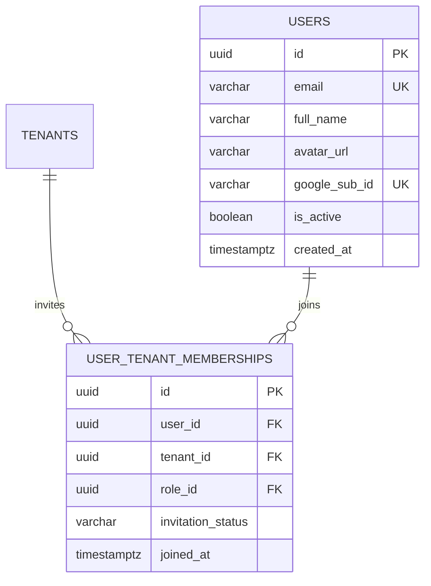

# Spesifikasi Sub-Modul: 010a - Autentikasi Google SSO & Undangan Whitelist (IAM)

Dokumen ini memuat spesifikasi login eksklusif Single Sign-On (SSO) berbasis Google OAuth2 / OpenID Connect (OIDC), larangan registrasi mandiri publik (*No Self-Signup*), serta mekanisme undangan berbasis daftar putih (*Whitelist Invitation*) untuk SewERP.

---

## 1. Metadata & Tautan Referensi Terkait

- **Kode Modul**: `SPEC-010a`
- **Domain Bounded Context**: `iam` / `auth`
- **Tautan Standar Acuan Global**:
  - 📋 [Standar Penulisan Requirement](../context/requirements_standard.md)
  - 🛡️ [Standar Keamanan, Kredensial & UU PDP](../context/security.md)
  - 🏛️ [Arsitektur Sistem & Multi-Tenancy](../context/architecture.md)
  - ⚙️ [Standar Rekayasa Backend Go & Zero Alloc](../context/backend.md)
  - 🗄️ [Standar Database PostgreSQL](../context/dbadmin.md)
  - 🧪 [Standar QA & Akses Browser](../context/qa.md)
- **Tautan Spesifikasi Fitur Terkait**:
  - 🔐 [010b - Manajemen Sesi HttpOnly 8-Jam](./010b-session-management.md)
  - 🔐 [010c - Matriks Hak Akses Granular RBAC](./010c-granular-rbac.md)
  - 🏢 [010d - Konteks Multi-Tenancy & Tenant Switcher](./010d-tenant-switching.md)

---

## 2. Ringkasan Kebutuhan & Masalah Bisnis

### Masalah Lapangan
1. **Kelelahan & Kebocoran Password**: Karyawan pabrik konveksi (staf gudang, kasir, mandor) sering menggunakan kata sandi lemah ("123456") atau saling meminjam akun, membahayakan integritas data produksi dan pencatatan kas.
2. **Beban Reset Password**: Pemilik usaha sering direpotkan oleh permintaan reset kata sandi staf yang lupa password.

### Solusi Fitur
1. **Login Eksklusif Google SSO**: Seluruh autentikasi wajib melalui Google OAuth2 / OIDC (`accounts.google.com`). Sistem tidak menyediakan formulir registrasi atau login dengan password lokal.
2. **Sistem Undangan Whitelist Tertutup**: Email pengguna hanya dapat masuk jika sebelumnya telah diundang (*whitelisted*) oleh Owner/Admin ke salah satu pabrik konveksi (`tenant_id`). Jika email tidak terdaftar, sistem menolak login seketika.

---

## 3. User Stories

- **US-010a-01 [P1 - Semua Karyawan]**: Sebagai *Karyawan Konveksi*, saya ingin masuk ke aplikasi hanya dengan satu klik tombol "Masuk dengan Google", agar proses masuk cepat tanpa perlu menghafal kata sandi terpisah.
- **US-010a-02 [P1 - Owner Konveksi]**: Sebagai *Owner Konveksi*, saya ingin mengundang staf baru dengan mendaftarkan alamat email Google mereka ke sistem, agar hanya staf terdaftar yang dapat mengakses data perusahaan.

---

## 4. Kriteria Penerimaan (Acceptance Criteria - Gherkin)

### Skenario 1: Login Berhasil dengan Email Terdaftar (Happy Path)
- **Given** Email `ahmad@gmail.com` telah didaftarkan oleh Owner ke Tenant `CV Sumber Busana`.
- **When** Ahmad menekan tombol "Masuk dengan Google" dan menyelesaikan otentikasi Google.
- **Then** Sistem memverifikasi ID Token Google, membuat sesi kerja aktif, dan mengarahkan ke dashboard utama.

### Skenario 2: Penolakan Email yang Tidak Terdaftar di Whitelist
- **Given** Email `stranger@gmail.com` tidak terdaftar pada tenant manapun.
- **When** Pengguna mencoba masuk melalui Google SSO.
- **Then** Sistem menolak dengan HTTP 403 Forbidden dan menampilkan pesan: *"Akun Google Anda belum terdaftar di sistem SewERP. Hubungi pemilik konveksi untuk mendapatkan undangan"*.

---

## 5. Skema Relasi Data Granular (Mermaid ERD)

---

## 6. Kontrak API RESTful

### Endpoint: `GET /api/v1/auth/google/login`
- Mengarahkan peramban ke halaman OAuth2 consent screen Google dengan parameter `client_id`, `redirect_uri`, `scope=openid email profile`, dan `state`.

### Endpoint: `GET /api/v1/auth/google/callback?code={code}&state={state}`
- Menukar authorization code Google dengan ID Token, memverifikasi whitelist, dan mengembalikan Set-Cookie sesi.

---

## 7. Kerangka Pemecahan Tugas (Task Breakdown)
- [ ] **Fase 1**: Goose migration tabel `users` dan `user_tenant_memberships`.
- [ ] **Fase 2**: Adapter Google OIDC validator di Go menggunakan `coreos/go-oidc`.
- [ ] **Fase 3**: Handler route login & callback Google SSO.
- [ ] **Fase 4**: Halaman login modern Flat UI dengan tombol Google resmi di SolidJS.
