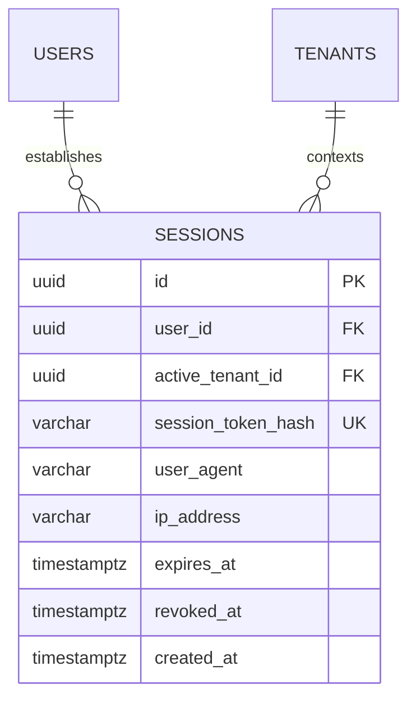

# Spesifikasi Sub-Modul: 010b - Manajemen Sesi HttpOnly 8-Jam & Revokasi Multi-Device (IAM)

Dokumen ini memuat spesifikasi arsitektur manajemen sesi backend: penyimpanan sesi di PostgreSQL, pengamanan cookie `HttpOnly; Secure; SameSite=Lax`, masa berlaku 1 shift kerja (8 jam), serta revokasi instan per perangkat (*Force Logout*) untuk SewERP.

---

## 1. Metadata & Tautan Referensi Terkait

- **Kode Modul**: `SPEC-010b`
- **Domain Bounded Context**: `iam` / `auth`
- **Tautan Standar Acuan Global**:
  - 📋 [Standar Penulisan Requirement](../context/requirements_standard.md)
  - 🛡️ [Standar Keamanan, Kredensial & Secrets](../context/security.md)
  - 🖥️ [Standar Frontend SolidJS Ultra-Strict](../context/frontend.md)
  - 🗄️ [Standar Database PostgreSQL](../context/dbadmin.md)
  - 🧪 [Standar QA & Akses Browser](../context/qa.md)
- **Tautan Spesifikasi Fitur Terkait**:
  - 🔐 [010a - Autentikasi Google SSO & Whitelist](./010a-google-sso.md)
  - 🔐 [010c - Matriks Hak Akses Granular RBAC](./010c-granular-rbac.md)
  - 🏢 [010d - Konteks Multi-Tenancy & Tenant Switcher](./010d-tenant-switching.md)

---

## 2. Ringkasan Kebutuhan & Masalah Bisnis

### Masalah Lapangan
1. **Pencurian Token via XSS**: Menyimpan token JWT di `localStorage` peramban web rentan dicuri oleh skrip berbahaya pihak ketiga jika ada celah XSS.
2. **Perangkat Bersama (Shared Devices) Pabrik**: Tablet operasional di meja potong atau jahit sering kali digunakan bergantian antar-shift. Jika sesi tidak memiliki batas waktu atau tidak bisa di-logout paksa, staf shift baru dapat memakai akun shift sebelumnya secara ilegal.

### Solusi Fitur
1. **Cookie Sesi Bertipe HttpOnly**: Token sesi diacak dengan kriptografi (SHA-256 hash) dan disimpan di database `sessions`. Peramban web hanya menerima cookie bertipe `HttpOnly; Secure; SameSite=Lax` sehingga 100% kebal dari akses JavaScript (`document.cookie`).
2. **Masa Berlaku 1 Shift Kerja (8 Jam)**: Sesi otomatis hangus setelah 8 jam sesuai durasi jam kerja standar pabrik garmen.
3. **Revokasi Multi-Perangkat (*Session Revocation*)**: Staf atau admin dapat melihat daftar perangkat aktif yang login dan melakukan *Force Logout* pada perangkat yang hilang atau tertinggal di pabrik.

---

## 3. User Stories

- **US-010b-01 [P1 - Semua Pengguna]**: Sebagai *Pengguna Aplikasi*, saya ingin sesi kerja saya otomatis habis setelah 8 jam tidak aktif, agar akun saya tidak disalahgunakan orang lain jika komputer kantor ditinggal menyala.
- **US-010b-02 [P1 - Owner Konveksi]**: Sebagai *Owner Konveksi*, saya ingin mencabut sesi login (*Force Logout*) dari ponsel staf yang resign, agar akses data pabrik langsung terputus seketika.

---

## 4. Kriteria Penerimaan (Acceptance Criteria - Gherkin)

### Skenario 1: Penerbitan Cookie Sesi HttpOnly saat Login Sukses
- **Given** Pengguna berhasil menyelesaikan autentikasi Google SSO.
- **When** Server mengembalikan respons HTTP.
- **Then** Header memuat `Set-Cookie: session_id=...; HttpOnly; Secure; SameSite=Lax; Max-Age=28800; Path=/`.
- **And** JavaScript di peramban tidak dapat membaca cookie tersebut.

### Skenario 2: Revokasi Sesi Paksa (Force Logout)
- **Given** Pengguna memiliki sesi aktif di Tablet Pabrik.
- **When** Pengguna menekan tombol "Cabut Akses Sesi" dari menu profil di ponselnya.
- **Then** Sesi di database ditandai `revoked_at = NOW()`.
- **And** Request berikutnya dari Tablet Pabrik ditolak dengan HTTP 401 Unauthorized dan diarahkan ke halaman login.

---

## 5. Skema Relasi Data Granular (Mermaid ERD)



---

## 6. Kontrak API RESTful

### Endpoint: `GET /api/v1/auth/sessions`
- **Response Payload (HTTP 200 OK)**:
```json
{
  "status": "success",
  "data": {
    "active_sessions": [
      {
        "id": "01925b6a-8451-7ef1-953e-51c045b0a111",
        "device_info": "Chrome on Linux (Ubuntu)",
        "ip_address": "180.252.12.45",
        "is_current": true,
        "created_at": "2026-10-21T08:00:00Z",
        "expires_at": "2026-10-21T16:00:00Z"
      }
    ]
  }
}
```

### Endpoint: `POST /api/v1/auth/logout`
- Menghapus cookie sesi dan menandai record sesi di database sebagai revoked.

---

## 7. Kerangka Pemecahan Tugas (Task Breakdown)
- [ ] **Fase 1**: Goose migration tabel `sessions` dengan indeks hash token.
- [ ] **Fase 2**: Middleware Gin `RequireAuth()` membaca cookie dan query session cache.
- [ ] **Fase 3**: Handler route list sessions dan force revoke.
- [ ] **Fase 4**: Halaman pengaturan keamanan perangkat aktif di SolidJS.
