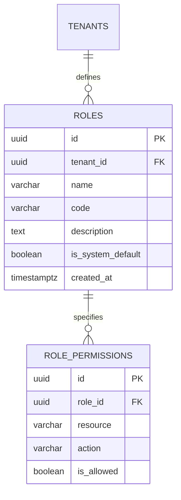

# Spesifikasi Sub-Modul: 010c - Matriks Hak Akses Granular 6 Aksi (RBAC)

Dokumen ini memuat spesifikasi matriks hak akses (*Role-Based Access Control* / RBAC) berbutir halus: 6 aksi inti (`view`, `create`, `update`, `delete`, `export`, `import`), izin khusus bisnis (`approve`, `print`), middleware Gin di Go, dan route guard deklaratif `<Can>` di SolidJS untuk SewERP.

---

## 1. Metadata & Tautan Referensi Terkait

- **Kode Modul**: `SPEC-010c`
- **Domain Bounded Context**: `iam` / `auth`
- **Tautan Standar Acuan Global**:
  - 📋 [Standar Penulisan Requirement](../context/requirements_standard.md)
  - 🛡️ [Standar Keamanan, PII & RLS](../context/security.md)
  - ⚙️ [Standar Rekayasa Backend Go & Zero Alloc](../context/backend.md)
  - 🖥️ [Standar Frontend SolidJS Ultra-Strict](../context/frontend.md)
  - 🗄️ [Standar Database PostgreSQL](../context/dbadmin.md)
  - 📋 [Kebutuhan Bisnis Konveksi](../context/business_requirements.md)
- **Tautan Spesifikasi Fitur Terkait**:
  - 🔐 [010a - Autentikasi Google SSO & Whitelist](./010a-google-sso.md)
  - 🔐 [010b - Manajemen Sesi HttpOnly 8-Jam](./010b-session-management.md)
  - 🏢 [010d - Konteks Multi-Tenancy & Tenant Switcher](./010d-tenant-switching.md)
  - 📊 [001d - Tata Letak Bento-Grid & RBAC Views](./001d-dashboard-bento-rbac.md)

---

## 2. Ringkasan Kebutuhan & Masalah Bisnis

### Masalah Lapangan
1. **Akses Menu Terlalu Luwes Tanpa Batasan Aksi**: Staf penjualan sering dapat melihat rekap penggajian penjahit, atau staf gudang tidak sengaja menghapus draft pesanan karena tidak adanya pemisahan izin granular per menu dan per aksi (*View, Create, Update, Delete, Export, Import*).
2. **Ketiadaan Pembatasan Ekspor Data**: Karyawan yang berniat keluar dapat mengunduh seluruh database pelanggan dan nomor telepon ke Excel tanpa izin.

### Solusi Fitur
1. **Matriks 6 Aksi Inti**:
   - `view`: Hak melihat daftar dan rincian data.
   - `create`: Hak membuat data baru.
   - `update`: Hak mengubah data yang ada.
   - `delete`: Hak menghapus data (soft delete).
   - `export`: Hak mengunduh data ke file Excel/CSV/PDF.
   - `import`: Hak mengunggah file massal ke database.
2. **Aksi Khusus Bisnis**: `approve` (persetujuan SPK / kasbon) dan `print` (cetak tiket thermal/surat jalan).
3. **Penegakan Berlapis (*Defense-in-Depth*)**:
   - Backend: Gin Middleware `RequirePermission(resource, action)`.
   - Frontend: Komponen deklaratif SolidJS `<Can resource="..." action="...">` yang me-*unmount* tombol dari DOM (selaras dengan prinsip *Zero Memory Footprint*).

---

## 3. Matriks Konfigurasi Peran di Pengaturan (`/settings/roles`)

```text
┌────────────────────────────────────────────────────────────────────────────────────────┐
│ PENGATURAN PERAN & MATRIKS HAK AKSES (RBAC)                                            │
├────────────────────────────────────────────────────────────────────────────────────────┤
│ Modul / Menu          │ Akses  │  View  │ Create │ Update │ Delete │ Export │  Import  │
├───────────────────────┼────────┼────────┼────────┼────────┼────────┼────────┼──────────┤
│ 001 - Dashboard       │  [✓]   │  [✓]   │  [ ]   │  [ ]   │  [ ]   │  [✓]   │   [ ]    │
│ 002 - CRM & Pelanggan │  [✓]   │  [✓]   │  [✓]   │  [✓]   │  [ ]   │  [✓]   │   [✓]    │
│ 003 - Sales Order/SPK │  [✓]   │  [✓]   │  [✓]   │  [✓]   │  [ ]   │  [✓]   │   [ ]    │
│ 004 - Produksi (MES)  │  [✓]   │  [✓]   │  [ ]   │  [ ]   │  [ ]   │  [ ]   │   [ ]    │
│ 005 - Gudang (WMS)    │  [✓]   │  [✓]   │  [ ]   │  [ ]   │  [ ]   │  [ ]   │   [ ]    │
│ 006 - Upah & Payroll  │  [ ]   │  [ ]   │  [ ]   │  [ ]   │  [ ]   │  [ ]   │   [ ]    │
│ 007 - Knowledge Base  │  [✓]   │  [✓]   │  [ ]   │  [ ]   │  [ ]   │  [ ]   │   [ ]    │
│ 008 - Laporan         │  [✓]   │  [✓]   │  [ ]   │  [ ]   │  [ ]   │  [✓]   │   [ ]    │
│ 009 - Payment Settings│  [ ]   │  [ ]   │  [ ]   │  [ ]   │  [ ]   │  [ ]   │   [ ]    │
│ 010 - Pengguna & Role │  [ ]   │  [ ]   │  [ ]   │  [ ]   │  [ ]   │  [ ]   │   [ ]    │
└───────────────────────┴────────┴────────┴────────┴────────┴────────┴────────┴──────────┘
```

---

## 4. User Stories

- **US-010c-01 [P1 - Owner Konveksi]**: Sebagai *Owner Konveksi*, saya ingin membatasi staf sales agar tidak dapat mengekspor kontak pelanggan ke Excel atau melihat modul payroll, agar kerahasiaan data perusahaan terjaga.
- **US-010c-02 [P1 - Semua Staf]**: Sebagai *Staf Operasional*, saya ingin antarmuka hanya menampilkan tombol aksi yang diizinkan untuk peran saya, agar tampilan bersih dan bebas kesalahan klik.

---

## 5. Kriteria Penerimaan (Acceptance Criteria - Gherkin)

### Skenario 1: Penolakan Akses Aksi Terlarang di Backend
- **Given** Pengguna login dengan role `Sales_Admin` yang tidak memiliki izin `export` pada modul CRM.
- **When** Pengguna mencoba memanggil endpoint `GET /api/v1/crm/customers/export`.
- **Then** Middleware Gin mencegat request dan mengembalikan HTTP 403 Forbidden dengan kode error RFC 7807 `INSUFFICIENT_PERMISSIONS`.

### Skenario 2: Unmounting Komponen Tombol di Frontend
- **Given** Pengguna tidak memiliki hak `delete` pada pesanan SPK.
- **When** Halaman rincian pesanan dimuat di SolidJS.
- **Then** Tombol "Hapus Pesanan" tidak di-render ke dalam DOM.

---

## 6. Skema Relasi Data Granular (Mermaid ERD)



---

## 7. Kontrak API RESTful

### Endpoint: `GET /api/v1/settings/roles`
- **Response Payload (HTTP 200 OK)**:
```json
{
  "status": "success",
  "data": {
    "roles": [
      {
        "id": "01925b6a-8451-7ef1-953e-51c045b0a333",
        "name": "Admin Penjualan",
        "code": "sales_admin",
        "permissions": [
          { "resource": "crm", "action": "view", "is_allowed": true },
          { "resource": "crm", "action": "export", "is_allowed": false },
          { "resource": "oms", "action": "create", "is_allowed": true }
        ]
      }
    ]
  }
}
```

---

## 8. Kerangka Pemecahan Tugas (Task Breakdown)
- [ ] **Fase 1**: Goose migration tabel `roles` dan `role_permissions`.
- [ ] **Fase 2**: Middleware Gin `RequirePermission(resource, action)`.
- [ ] **Fase 3**: Handler route CRUD peran dan matriks izin di `/settings/roles`.
- [ ] **Fase 4**: Komponen `<Can>` di SolidJS dan integrasi route guards.
