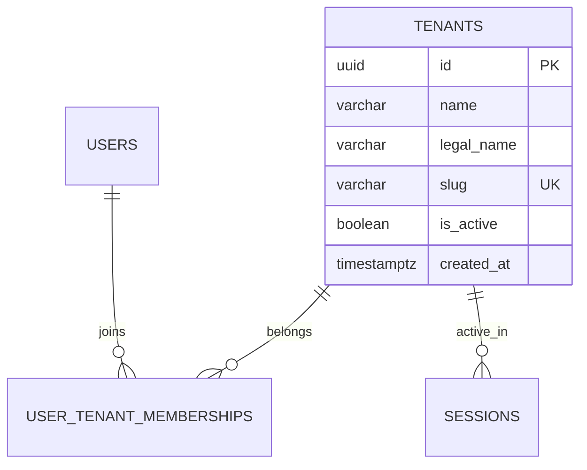

# Spesifikasi Sub-Modul: 010d - Konteks Multi-Tenancy & Pengalihan Pabrik (IAM)

Dokumen ini memuat spesifikasi arsitektur isolasi multi-tenancy (`tenant_id`), penegakan isolasi database (Row-Level Security & WHERE clause mutlak), serta antarmuka pengalihan konteks pabrik aktif (*Tenant Switcher*) di `/settings/tenant` untuk SewERP.

---

## 1. Metadata & Tautan Referensi Terkait

- **Kode Modul**: `SPEC-010d`
- **Domain Bounded Context**: `iam` / `auth`
- **Tautan Standar Acuan Global**:
  - 📋 [Standar Penulisan Requirement](../context/requirements_standard.md)
  - 🏛️ [Arsitektur Sistem & Multi-Tenancy](../context/architecture.md)
  - 🛡️ [Standar Keamanan, PII & RLS](../context/security.md)
  - 🗄️ [Standar Database PostgreSQL & Indexing](../context/dbadmin.md)
- **Tautan Spesifikasi Fitur Terkait**:
  - 🔐 [010a - Autentikasi Google SSO & Whitelist](./010a-google-sso.md)
  - 🔐 [010b - Manajemen Sesi HttpOnly 8-Jam](./010b-session-management.md)
  - 🔐 [010c - Matriks Hak Akses Granular RBAC](./010c-granular-rbac.md)

---

## 2. Ringkasan Kebutuhan & Masalah Bisnis

### Masalah Lapangan
Banyak pemilik konveksi menaungi lebih dari satu unit usaha/workshop (misal: Unit Konveksi Seragam dan Unit Sablon Makloon Khusus). Staf akuntansi atau manajer sering harus mengawasi operasional kedua cabang tanpa ingin melakukan logout-login berulang kali yang rawan salah input data antar-cabang.

### Solusi Fitur
1. **Multi-Tenancy Shared Database**: Seluruh tabel transaksional memiliki kolom `tenant_id NOT NULL` dengan proteksi RLS di PostgreSQL dan middleware tenant di Go.
2. **Modal Pemilihan Tenant saat Login**: Jika akun email terdaftar di lebih dari 1 tenant, sistem menyajikan layar pemilihan konveksi setelah login Google.
3. **Tenant Switcher Cepat**: Pengguna dapat berpindah pabrik aktif kapan saja melalui dropdown navigasi atas atau menu `/settings/tenant`.

---

## 3. User Stories

- **US-010d-01 [P1 - Owner Multi-Cabang]**: Sebagai *Owner Konveksi*, saya ingin beralih antar-cabang pabrik saya melalui satu klik dropdown di navbar, agar saya dapat mengecek operasional cabang lain tanpa harus login ulang.
- **US-010d-02 [P1 - Sistem Keamanan]**: Sebagai *Sistem Arsitektur*, saya ingin kueri database selalu menyaring `tenant_id` aktif sesi, agar tidak ada kebocoran data antar-pabrik konveksi.

---

## 4. Kriteria Penerimaan (Acceptance Criteria - Gherkin)

### Skenario 1: Pengalihan Tenant Aktif (Happy Path)
- **Given** Pengguna terdaftar pada Tenant A ("CV Sumber Busana") dan Tenant B ("Berkah Sablon").
- **When** Pengguna memilih Tenant B pada menu Tenant Switcher.
- **Then** Server memperbarui `active_tenant_id` pada sesi pengguna.
- **And** Seluruh halaman dashboard dan order otomatis menampilkan data milik Tenant B.

### Skenario 2: Pencegahan Akses Lintas Tenant Ilegal
- **Given** Pengguna login di Tenant A.
- **When** Pengguna mencoba memanggil endpoint order dengan UUID milik Tenant B secara manual.
- **Then** Sistem mengembalikan HTTP 404 Not Found karena kueri terisolasi klausa `WHERE id = $1 AND tenant_id = 'tenant-a'`.

---

## 5. Skema Relasi Data Granular (Mermaid ERD)



---

## 6. Kontrak API RESTful

### Endpoint: `POST /api/v1/auth/switch-tenant`
- **Request Payload**:
```json
{
  "target_tenant_id": "01925b6a-8451-7ef1-953e-51c045b0a999"
}
```
- **Response Payload (HTTP 200 OK)**:
```json
{
  "status": "success",
  "data": {
    "active_tenant_id": "01925b6a-8451-7ef1-953e-51c045b0a999",
    "tenant_name": "CV Sumber Busana Workshop 2",
    "assigned_role": "owner"
  }
}
```

---

## 7. Kerangka Pemecahan Tugas (Task Breakdown)
- [ ] **Fase 1**: Goose migration tabel `tenants` dan indeks `tenant_id` pada seluruh tabel.
- [ ] **Fase 2**: Middleware Gin `TenantContext()` menetapkan `tenant_id` ke context request.
- [ ] **Fase 3**: Handler route `POST /api/v1/auth/switch-tenant`.
- [ ] **Fase 4**: Komponen dropdown Tenant Switcher di SolidJS Header.
