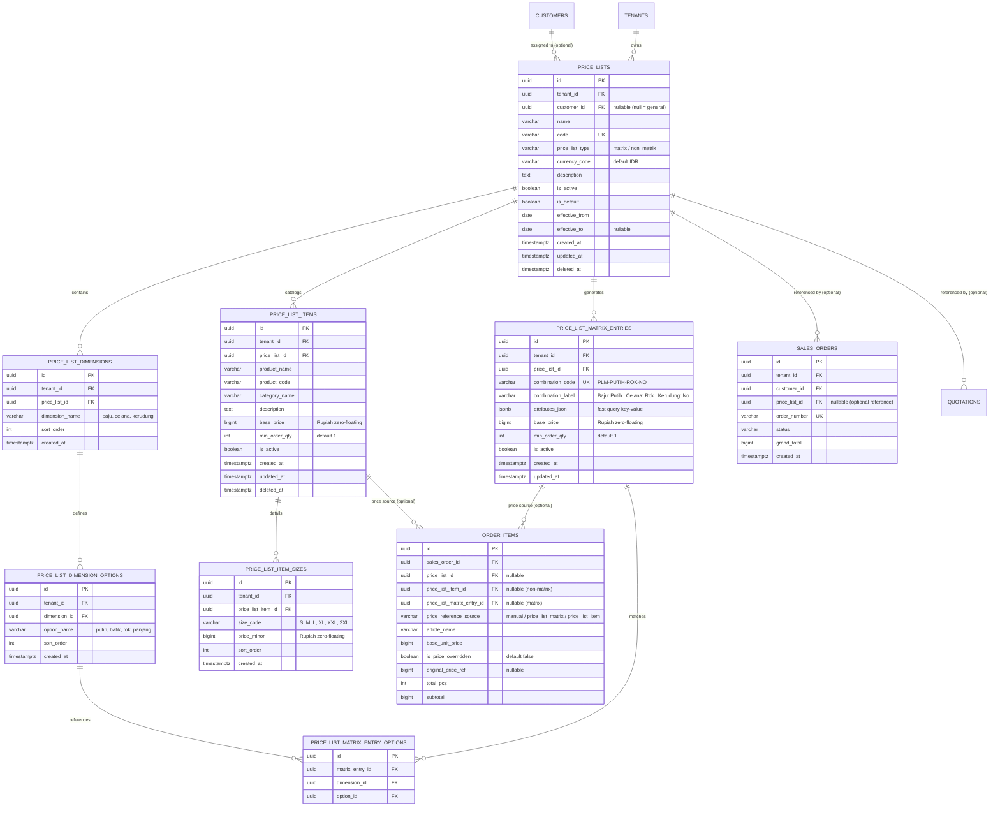

# Spesifikasi Master Modul: 011 - Configurable Price Lists (Matrix & Non-Matrix)

Dokumen ini merupakan **Spesifikasi Master (Tier 1)** yang memuat arsitektur penetapan harga acuan fleksibel SewERP, baik bertipe **Matrix** (kombinasi atribut/dimensi seragam majemuk) maupun **Non-Matrix** (produk satuan langsung), integrasi acuan opsional ke Sales Order, serta katalog navigasi menuju sub-spesifikasi detail fitur.

---

## 1. Metadata & Tautan Referensi Terkait

- **Kode Modul**: `SPEC-011`
- **Tingkatan Dokumen**: **Tier 1 (Master Specification Hub)**
- **Domain Bounded Context**: `oms` (Order Management System)
- **Tautan Standar Acuan Global**:
  - 📋 [Standar Penulisan Requirement](../context/requirements_standard.md)
  - 🏛️ [Arsitektur Sistem & Multi-Tenancy](../context/architecture.md)
  - ⚙️ [Standar Rekayasa Backend Go & Zero Allocations](../context/backend.md)
  - 🖥️ [Standar Rekayasa Frontend SolidJS & TypeScript Strict](../context/frontend.md)
  - 🗄️ [Standar Database PostgreSQL & Audit Trail](../context/dbadmin.md)
  - 📝 [Standar Formulir & Validasi Ketat](../context/forms.md)
  - 🎨 [Standar UI Flat](../context/ui.md)
  - 👆 [Standar Pengalaman Pengguna (UX)](../context/ux.md)
  - 🧪 [Standar QA & Akses Browser](../context/qa.md)
  - 📋 [Kebutuhan Bisnis Konveksi Garmen](../context/business_requirements.md)
- **Tautan Spesifikasi Master Terkait**:
  - 📄 [003 - Sales & Order (OMS Inti)](./003-sales-order.md)
  - 👥 [002 - Customer Relation (CRM)](./002-customer-relation.md)
  - 🧵 [004 - Alur Produksi & Makloon (MES)](./004-production.md)
  - 📊 [001 - Dashboard Monitoring](./001-dashboard.md)
  - 🔐 [010 - Autentikasi Google SSO & RBAC Granular](./010-auth-rbac.md)

---

## 2. Indeks Sub-Modul Fungsional (Tier 2 Sub-Specifications)

Rincian implementasi teknis, skema DDL, kontrak API RESTful, skenario Gherkin 4-pilar, dan algoritma resolusi matriks dipecah menjadi sub-spesifikasi modular berikut:

| Berkas Sub-Spesifikasi | Lingkup Fungsional Utama | Ukuran & Fokus Teknis |
| :--- | :--- | :--- |
| 🗂️ **[011a-matrix-price-list.md](./011a-matrix-price-list.md)** | Master daftar harga tipe Matrix (N-dimensi atribut seragam garmen majemuk). | Skema dynamic matrix combination, JSONB attributes. |
| 🏷️ **[011b-non-matrix-price-list.md](./011b-non-matrix-price-list.md)** | Master daftar harga tipe Non-Matrix (katalog langsung produk satuan pakaian). | Katalog produk satuan, tiering volume diskon. |
| 🔍 **[011c-order-price-resolution.md](./011c-order-price-resolution.md)** | Resolusi acuan harga opsional di Sales Order, pelacakan sumber, & audit override. | Mesin pencocokan harga, jejak audit `original_price_ref`. |

---

## 3. Ringkasan Kebutuhan & Masalah Bisnis

### Masalah yang Dihadapi
1. **Paket Seragam Multi-Atribut Rumit**: Industri konveksi sering kali melayani pesanan paket seragam sekolah/institusi yang terdiri atas kombinasi atribut garmen majemuk. Sebagai contoh, seragam siswa memiliki dimensi:
   - **Baju**: `Putih`, `Batik`
   - **Celana**: `Rok`, `Celana Panjang`
   - **Kerudung**: `No`, `Yes`
   Kombinasi ini menghasilkan 8 variasi produk paket yang masing-masing memiliki harga modal dan harga jual berbeda. Tanpa price list berbasis matriks dimensi yang dapat dikonfigurasi, staf sales harus menghitung kombinasi tersebut secara manual di kertas/kalkulator, menimbulkan rawan selisih tagihan dan keterlambatan penerbitan penawaran (*quotation*).
2. **Kebutuhan Produk Satuan Langsung (Non-Matrix)**: Di sisi lain, konveksi juga sering memproduksi pesanan satuan atau *custom single product* seperti "Kaos Polos Combed 30s", "Kemeja Tactical PDL", atau "Jaket Almamater" yang tidak memerlukan matriks multi-atribut. Sistem daftar harga yang kaku memaksa pengguna mengisi struktur yang tidak relevan.
3. **Kekakuan Alur Sales Order**: Pada sistem ERP tradisional, pesanan penjualan sering kali mewajibkan pemilihan dari master katalog produk yang kaku. Pada industri konveksi, banyak pesanan bersifat kustom bebas (*bespoke* / *made-to-order* dari pola baru) sehingga Sales Order harus tetap dapat dibuat tanpa keterikatan price list (*pure manual*), sementara jika price list tersedia, sistem harus dapat menarik acuan harga secara cepat namun tetap fleksibel (*price override with audit*).

### Solusi MVP
1. **Configurable Price List Engine**:
   - Mendukung pembuatan daftar harga dengan masa berlaku, mata uang, dan status aktif.
   - Bersifat umum untuk semua pelanggan (*general price list*) atau dikhususkan untuk mitra/klien institusi tertentu (*customer-specific price list*).
2. **Tipe 1: Matrix Price List (Multi-Dimensional Configuration)**:
   - Pengguna bebas mendefinisikan *N-Dimensi Atribut* (contoh: Dimensi 1 = Baju, Dimensi 2 = Celana, Dimensi 3 = Kerudung).
   - Pengguna memasukkan opsi nilai untuk masing-masing dimensi.
   - Sistem menghasilkan sel-sel kombinasi matriks (*cartesian product*) dan menyediakan antarmuka tabel spreadsheet interaktif untuk memasukkan harga satuan acuan (`base_price` dalam `BIGINT` Rupiah) dan kuantiti minimal.
3. **Tipe 2: Non-Matrix Price List (Direct Product Definition)**:
   - Pengguna langsung mendefinisikan daftar produk satuan pakaian beserta kode, kategori, deskripsi, harga acuan dasar, dan rincian harga per ukuran pakaian (S, M, L, XL, XXL).
4. **Referensi Harga Opsional di Sales Order (OMS)**:
   - Pemilihan `price_list_id` pada Sales Order dan Quotation bersifat **opsional**.
   - Jika **tidak dipilih**: Admin sales memasukkan item pesanan secara kustom manual (*freeform*).
   - Jika **dipilih**: Antarmuka pesanan mengaktifkan pemilih cerdas (dropdown dimensi untuk Matrix atau katalog pencarian cepat untuk Non-Matrix). Mengisi harga dasar secara otomatis, menjaga jejak sumber acuan (*reference source*), serta mencatat riwayat selisih jika kasir/sales melakukan penyesuaian harga khusus (*price override*).

---

## 3. Kebutuhan Bisnis & Aturan Validasi

### BR-PL-01: Isolasi Multi-Tenant Mutlak
Setiap master daftar harga, dimensi matriks, opsi, kombinasi harga, dan item produk terikat wajib pada `tenant_id`. Tidak ada kebocoran data harga antar-pabrik konveksi.

### BR-PL-02: Presisi Finansial Zero Floating-Point
Seluruh nilai nominal harga satuan (`base_price`, `unit_price`, `price_minor`, `original_price_ref`) disimpan dalam bilangan bulat `BIGINT` Rupiah tanpa desimal.

### BR-PL-03: Kustomisasi Dimensi Matriks Dinamis
- Pada price list tipe `matrix`, jumlah dimensi atribut yang dapat dibuat minimal 1 dan maksimal 5 dimensi per price list untuk menjaga ergonomi antarmuka dan performa memori.
- Setiap dimensi wajib memiliki minimal 2 opsi nilai (contoh: `Putih`, `Batik`).
- Kombinasi nilai atribut disimpan secara terstruktur dan ter-indeks untuk pencarian instan $O(1)$ di Sales Order.

### BR-PL-04: Referensi Opsional di Sales Order
- Kolom `price_list_id` pada `quotations` dan `sales_orders` bernilai `NULLABLE`.
- Setiap baris `order_items` mencatat asal usul harga melalui kolom `price_reference_source`:
  - `'manual'`: Harga dimasukkan murni manual tanpa price list.
  - `'price_list_matrix'`: Harga ditarik dari kombinasi matriks dimensi (`price_list_matrix_entry_id`).
  - `'price_list_item'`: Harga ditarik dari produk non-matrix (`price_list_item_id`).

### BR-PL-05: Kebijakan Price Override & Jejak Audit
Jika operator penjualan mengubah nominal harga yang ditarik dari price list:
- Sistem menandai baris item pesanan dengan `is_price_overridden = TRUE`.
- Nilai harga acuan asli disimpan di `original_price_ref`.
- Perubahan ini dicatat pada riwayat audit order untuk evaluasi integritas margin profit oleh Owner/Manajer Penjualan.

---

## 4. User Stories

| Kode | Prioritas | Sebagai | Saya Ingin | Agar |
| :--- | :---: | :--- | :--- | :--- |
| **US-11-01** | **P1** | Owner / Manajer Penjualan | Membuat daftar harga tipe **Matrix** dengan dimensi dinamis (misal: Baju, Celana, Kerudung) dan opsi nilainya | Dapat menetapkan tarif paket seragam sekolah/kantor secara terstruktur tanpa repot membuat puluhan SKU manual. |
| **US-11-02** | **P1** | Owner / Manajer Penjualan | Membuat daftar harga tipe **Non-Matrix** dengan input langsung nama produk, kategori, dan harga per ukuran | Memiliki acuan harga standar untuk artikel pakaian reguler konveksi (Kaos, Polo, Jaket, Kemeja). |
| **US-11-03** | **P1** | Admin Penjualan | Memilih Price List acuan saat membuat Quotation / Sales Order, lalu memilih kombinasi atribut atau produk dengan harga terisi otomatis | Proses input pesanan cepat, akurat, dan terhindar dari salah kutip harga. |
| **US-11-04** | **P1** | Admin Penjualan | Membuat Quotation / Sales Order kustom tanpa memilih Price List apapun | Tetap dapat melayani pesanan jahit kustom bebas (*custom order / sample*) dengan fleksibilitas 100%. |
| **US-11-05** | **P2** | Admin Penjualan | Melakukan penyesuaian (*price override*) pada item pesanan yang mengacu pada price list jika ada negosiasi khusus | Dapat memberikan diskon atau penyesuaian khusus kesepakatan pelanggan tanpa terhalang sistem. |
| **US-11-06** | **P2** | Manajer Penjualan | Mengaitkan daftar harga tertentu ke pelanggan khusus (*customer-specific price list*) | Pelanggan langganan korporat otomatis mendapatkan tarif kontrak harga mereka saat admin memilih nama pelanggan tersebut di formulir pesanan. |

---

## 5. Kriteria Penerimaan (Acceptance Criteria - Gherkin)

### Skenario 1: Pembuatan Price List Tipe Matrix Berdimensi Majemuk (Baju, Celana, Kerudung)
- **Given** Manajer Penjualan membuat Price List baru dengan nama `"Paket Seragam Madrasah 2026"` bertipe `matrix`.
- **And** Mengonfigurasi 3 dimensi atribut:
  - Dimensi 1: `"Baju"` dengan opsi `["Putih", "Batik"]`
  - Dimensi 2: `"Celana"` dengan opsi `["Rok", "Celana Panjang"]`
  - Dimensi 3: `"Kerudung"` dengan opsi `["No", "Yes"]`
- **When** Sistem me-generate matriks kartesian kombinasi.
- **Then** Terbentuk $2 \times 2 \times 2 = 8$ sel kombinasi matriks.
- **And** Pengguna memasukkan harga kombinasi:
  - `Baju: Putih | Celana: Rok | Kerudung: No` $\rightarrow$ Rp 120.000
  - `Baju: Batik | Celana: Rok | Kerudung: Yes` $\rightarrow$ Rp 155.000
- **And** Data tersimpan dengan status `active` dan validasi presisi `BIGINT`.

### Skenario 2: Pembuatan Price List Tipe Non-Matrix Produk Langsung
- **Given** Manajer Penjualan membuat Price List bertipe `non_matrix` bernama `"Katalog Kaos & Polo Standar 2026"`.
- **When** Menambahkan item produk:
  - Nama: `"Kaos Polos Cotton Combed 30s"`
  - Kategori: `"T-Shirt"`
  - Harga Dasar: Rp 45.000
  - Harga Ukuran: S=45.000, M=45.000, L=45.000, XL=48.000, XXL=53.000
- **Then** Item produk tersimpan beserta rincian harga ukuran dan terikat pada master price list.

### Skenario 3: Penarikan Harga Otomatis di Sales Order Menggunakan Price List Matrix (Opsional Digunakan)
- **Given** Terdapat master Price List Matrix `"Paket Seragam Madrasah 2026"`.
- **When** Admin membuat Sales Order dan memilih Price List `"Paket Seragam Madrasah 2026"`.
- **And** Memilih kombinasi: Baju=`Batik`, Celana=`Rok`, Kerudung=`Yes`.
- **Then** Sistem otomatis mengisi `base_unit_price` = Rp 155.000 pada baris order item.
- **And** Menyimpan `price_reference_source` = `'price_list_matrix'`.
- **And** Mengaitkan `price_list_matrix_entry_id` pada item pesanan.

### Skenario 4: Pembuatan Sales Order Bebas Tanpa Price List (Opsional Diabaikan)
- **Given** Pelanggan memesan kemeja seragam kustom dengan bahan khusus dari luar negeri.
- **When** Admin membuat Sales Order baru tanpa memilih Price List (`price_list_id = NULL`).
- **And** Mengetikkan manual artikel `"Kemeja Kustom Sutra Bordir Emas"`, bahan `"Sutra Dobby"`, dan harga satuan Rp 350.000.
- **Then** Sistem berhasil menerbitkan Sales Order tanpa error validasi.
- **And** Baris order item tersimpan dengan `price_reference_source` = `'manual'` dan `original_price_ref` = `NULL`.

### Skenario 5: Penyesuaian Harga (Price Override) pada Item Ber-referensi Price List
- **Given** Admin memilih item dari Price List dengan harga acuan Rp 155.000.
- **When** Admin mengubah harga satuan di baris pesanan menjadi Rp 148.000 atas kesepakatan negosiasi.
- **Then** Sistem menerima input dan menandai `is_price_overridden` = `TRUE`.
- **And** Menyimpan `base_unit_price` = Rp 148.000 dan `original_price_ref` = Rp 155.000.

---

## 6. Skema Relasi Data (Mermaid ERD)



### Detail Indeks Performa & Integritas Skema
```sql
-- 1. Partial Index untuk pencarian price list aktif per tenant
CREATE INDEX idx_price_lists_tenant_active 
ON price_lists (tenant_id, is_active) 
WHERE deleted_at IS NULL;

-- 2. Compound Index untuk pencarian kode unik price list per tenant
CREATE UNIQUE INDEX uq_price_lists_tenant_code 
ON price_lists (tenant_id, code) 
WHERE deleted_at IS NULL;

-- 3. GIN Index pada JSONB atribut kombinasi matriks untuk lookup dinamis cepat sub-10ms
CREATE INDEX idx_price_list_matrix_attrs_gin 
ON price_list_matrix_entries USING gin (attributes_json);

-- 4. Compound Index untuk relasi item pesanan ke price list acuan
CREATE INDEX idx_order_items_price_source 
ON order_items (sales_order_id, price_reference_source);
```

---

## 7. Kontrak RESTful API

Seluruh route berada di bawah namespace `/api/v1/oms/price-lists`.

### 1. Buat Header Master Price List
- **Endpoint**: `POST /api/v1/oms/price-lists`
- **Permissions**: `oms:price_lists:create`
- **Request DTO Go Validator**:
```go
type CreatePriceListRequest struct {
    CustomerID    *string `json:"customer_id" binding:"omitempty,uuid_v7"`
    Name          string  `json:"name" binding:"required,min=3,max=120"`
    Code          string  `json:"code" binding:"required,alphanum,min=2,max=32"`
    PriceListType string  `json:"price_list_type" binding:"required,price_list_type_enum"` // matrix / non_matrix
    CurrencyCode  string  `json:"currency_code" binding:"required,len=3"`                  // IDR
    Description   string  `json:"description" binding:"omitempty,max=500"`
    IsActive      bool    `json:"is_active"`
    IsDefault     bool    `json:"is_default"`
    EffectiveFrom string  `json:"effective_from" binding:"required,datetime=2006-01-02"`
    EffectiveTo   *string `json:"effective_to" binding:"omitempty,datetime=2006-01-02"`
}
```
- **Response Success (HTTP 201 Created)**:
```json
{
  "status": "success",
  "data": {
    "id": "01925b6a-9999-7ef1-953e-51c045b0a888",
    "name": "Paket Seragam Madrasah 2026",
    "code": "PL-MADRASAH-2026",
    "price_list_type": "matrix",
    "currency_code": "IDR",
    "is_active": true,
    "effective_from": "2026-01-01"
  }
}
```

### 2. Konfigurasi Dimensi & Opsi Matriks (Tipe Matrix)
- **Endpoint**: `POST /api/v1/oms/price-lists/{id}/matrix-dimensions`
- **Request Body (JSON)**:
```json
{
  "dimensions": [
    {
      "dimension_name": "Baju",
      "sort_order": 1,
      "options": ["Putih", "Batik"]
    },
    {
      "dimension_name": "Celana",
      "sort_order": 2,
      "options": ["Rok", "Celana Panjang"]
    },
    {
      "dimension_name": "Kerudung",
      "sort_order": 3,
      "options": ["No", "Yes"]
    }
  ]
}
```

### 3. Simpan Tarif Sel Matriks Kombinasi (Bulk Matrix Setup)
- **Endpoint**: `PUT /api/v1/oms/price-lists/{id}/matrix-entries`
- **Request Body (JSON)**:
```json
{
  "entries": [
    {
      "combination_code": "PLM-PUTIH-ROK-NO",
      "combination_label": "Baju: Putih | Celana: Rok | Kerudung: No",
      "attributes": {
        "baju": "Putih",
        "celana": "Rok",
        "kerudung": "No"
      },
      "base_price": 120000,
      "min_order_qty": 24
    },
    {
      "combination_code": "PLM-BATIK-ROK-YES",
      "combination_label": "Baju: Batik | Celana: Rok | Kerudung: Yes",
      "attributes": {
        "baju": "Batik",
        "celana": "Rok",
        "kerudung": "Yes"
      },
      "base_price": 155000,
      "min_order_qty": 24
    }
  ]
}
```

### 4. Tambah Item Produk Satuan (Tipe Non-Matrix)
- **Endpoint**: `POST /api/v1/oms/price-lists/{id}/items`
- **Request Body (JSON)**:
```json
{
  "product_name": "Kaos Polos Cotton Combed 30s",
  "product_code": "PROD-TSHIRT-C30S",
  "category_name": "T-Shirt",
  "description": "Bahan katun reaktif 100% gramasi 145-150 gsm",
  "base_price": 45000,
  "min_order_qty": 12,
  "size_prices": [
    { "size_code": "S", "price_minor": 45000, "sort_order": 1 },
    { "size_code": "M", "price_minor": 45000, "sort_order": 2 },
    { "size_code": "L", "price_minor": 45000, "sort_order": 3 },
    { "size_code": "XL", "price_minor": 48000, "sort_order": 4 },
    { "size_code": "XXL", "price_minor": 53000, "sort_order": 5 }
  ]
}
```

### 5. Dropdown Selects Price List Acuan (Untuk Form Order OMS)
- **Endpoint**: `GET /api/v1/oms/price-lists/selects`
- **Query Params**:
  - `customer_id` (opsional): UUIDv7 pelanggan. Menghasilkan daftar harga umum ditambah daftar harga khusus pelanggan tersebut.
  - `search` (opsional): kata kunci pencarian.
- **Response Format**:
```json
{
  "status": "success",
  "data": [
    {
      "id": "01925b6a-9999-7ef1-953e-51c045b0a888",
      "name": "Paket Seragam Madrasah 2026",
      "code": "PL-MADRASAH-2026",
      "price_list_type": "matrix",
      "currency_code": "IDR",
      "is_default": true
    },
    {
      "id": "01925b6a-9999-7ef1-953e-51c045b0a889",
      "name": "Katalog Kaos & Polo Standar 2026",
      "code": "PL-REGULER-2026",
      "price_list_type": "non_matrix",
      "currency_code": "IDR",
      "is_default": false
    }
  ]
}
```

### 6. Lookup Harga Otomatis Berdasarkan Pilihan Order
- **Endpoint**: `POST /api/v1/oms/price-lists/{id}/lookup`
- **A. Kasus Matrix Request**:
```json
{
  "type": "matrix",
  "attributes": {
    "baju": "Batik",
    "celana": "Rok",
    "kerudung": "Yes"
  }
}
```
- **Matrix Response (HTTP 200 OK)**:
```json
{
  "status": "success",
  "data": {
    "entry_id": "01925b6a-1111-7ef1-953e-51c045b0a111",
    "combination_code": "PLM-BATIK-ROK-YES",
    "combination_label": "Baju: Batik | Celana: Rok | Kerudung: Yes",
    "base_price": 155000,
    "currency_code": "IDR"
  }
}
```
- **B. Kasus Non-Matrix Request**:
```json
{
  "type": "non_matrix",
  "product_id": "01925b6a-2222-7ef1-953e-51c045b0a222",
  "size_code": "XXL"
}
```
- **Non-Matrix Response (HTTP 200 OK)**:
```json
{
  "status": "success",
  "data": {
    "item_id": "01925b6a-2222-7ef1-953e-51c045b0a222",
    "product_name": "Kaos Polos Cotton Combed 30s",
    "size_code": "XXL",
    "unit_price": 53000,
    "currency_code": "IDR"
  }
}
```

---

## 8. Desain Antarmuka Pengguna (SolidJS Flat UI)

Sesuai standar antarmuka SewERP:
- **Tema Desain**: Modern Flat UI, Matcha Green (`#5B7E5F`), Sakura Pink accent (`#E8A5B8`), border 1px solid, zero blur shadow.
- **Arsitektur Komponen**: Batas maksimal 250 baris per file `.tsx`.

### 1. Halaman Index Price List (`/oms/price-lists`)
- Bento Card statistik: *Total Price List Aktif*, *Matrix Packages*, *Direct Product Catalog*.
- Filter segment: *Semua*, *Tipe Matrix*, *Tipe Non-Matrix*.
- Tabel daftar harga lengkap dengan badge tipe (`Matrix` warna Matcha Green, `Non-Matrix` warna Slate Neutral).

### 2. Halaman Form Builder Matriks (`/oms/price-lists/new-matrix`)
- **Step 1: Setup Dimensi**: Tag input dinamis untuk menambahkan nama dimensi dan nilai opsinya.
- **Step 2: Spreadsheet Matrix Editor**: Tabel hasil perkalian kartesian dengan sel input harga cepat (*fast numeric input*), navigasi tombol `Enter` / `Tab`, dan tombol *Bulk Set Price* (contoh: isi semua baris dengan Rp 120.000 sekali klik).

### 3. Integrasi pada Formulir Pembuatan Sales Order (`/oms/orders/new`)
- **Komponen `<OrderPriceListSelector />`**:
  - Pilihan radio/switch:
    - `[🔘 Tanpa Price List (Kustom Manual)]`
    - `[⚪ Gunakan Acuan Price List]`
  - Jika dicentang: dropdown memilih Price List aktif.
- **Komponen Input Baris Item Cerdas**:
  - Jika Price List bertipe **Matrix**: baris item memunculkan tombol pilih kombinasi atribut dengan chip selector (Baju: `[Putih] [Batik]`, Celana: `[Rok] [Panjang]`, Kerudung: `[No] [Yes]`).
  - Jika Price List bertipe **Non-Matrix**: memunculkan auto-complete katalog produk.
  - Bidang harga menampilkan harga acuan dengan indikator badge `[Acuan Price List]`.
  - Jika sales mengubah harga secara manual, muncul peringatan halus berwarna kuning: `[Harga Disesuaikan: Asli Rp 155.000]`.

---

## 9. Rencana Pemecahan Tugas (Dependency-Ordered Task Breakdown)

- [ ] **Fase 1: Database & Migrasi Goose**
  - [ ] Task 1.1: Buat migrasi SQL `00016_oms_price_lists_configurable.sql` memuat tabel `price_lists`, `price_list_dimensions`, `price_list_dimension_options`, `price_list_matrix_entries`, `price_list_matrix_entry_options`, `price_list_items`, dan `price_list_item_sizes`.
  - [ ] Task 1.2: Buat migrasi alter tabel `sales_orders` dan `order_items` untuk menambahkan kolom `price_list_id`, `price_list_matrix_entry_id`, `price_reference_source`, `is_price_overridden`, dan `original_price_ref`.
  - [ ] Task 1.3: Generate query sqlc (`price_lists.sql` dan `price_list_matrix.sql`) dan generate Go structs.
- [ ] **Fase 2: Entitas Domain & Repositori**
  - [ ] Task 2.1: Definisikan domain struct `PriceList`, `MatrixDimension`, `MatrixEntry`, `PriceListItem` dengan metode perhitungan kartesian murni.
  - [ ] Task 2.2: Buat unit benchmark test untuk kartesian generator berstandar `0 B/op` dan `0 allocs/op`.
  - [ ] Task 2.3: Implementasi repositori `PriceListRepository` menggunakan pgxpool.
- [ ] **Fase 3: Logika Bisnis & Use Cases**
  - [ ] Task 3.1: Use case pembuatan master price list (matrix & non-matrix).
  - [ ] Task 3.2: Use case kalkulasi dan lookup kombinasi atribut matrix.
  - [ ] Task 3.3: Integrasi engine validasi harga opsional pada `CreateOrderUseCase` di OMS.
- [ ] **Fase 4: HTTP Delivery & DTO Validation**
  - [ ] Task 4.1: Daftarkan custom validator `price_list_type_enum` dan `price_reference_source_enum` pada runtime Gin validator.
  - [ ] Task 4.2: Implementasikan controller `PriceListsController` dan routes di `/api/v1/oms/price-lists`.
- [ ] **Fase 5: Frontend SolidJS Components**
  - [ ] Task 5.1: Buat API client `price-list-api.ts` di layer frontend.
  - [ ] Task 5.2: Buat halaman `PriceListsPage.tsx`, `PriceListMatrixBuilderPage.tsx`, dan `PriceListNonMatrixFormPage.tsx`.
  - [ ] Task 5.3: Integrasikan komponen pemilih opsional price list pada `OrderCreatePage.tsx`.
- [ ] **Fase 6: Pengujian QA & Verifikasi E2E**
  - [ ] Task 6.1: Unit test validasi skema Zod dan kalkulator matriks.
  - [ ] Task 6.2: Playwright E2E test skenario pembuatan order matrix vs order manual bebas.
