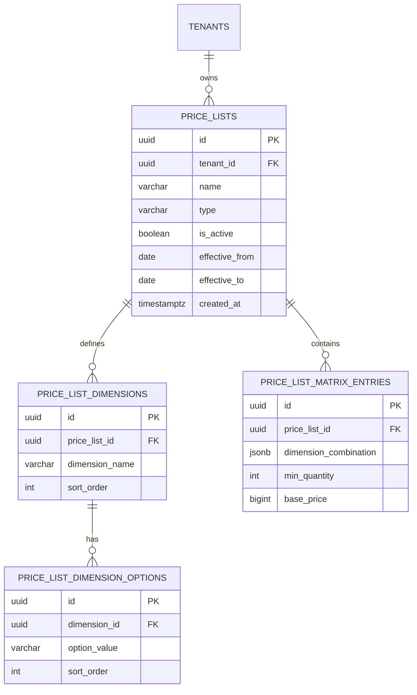

# Spesifikasi Sub-Modul: 011a - Master Daftar Harga Tipe Matrix Dimensi Seragam (Pricing)

Dokumen ini memuat spesifikasi fungsional, arsitektur data, dan kontrak API untuk **Master Price List Tipe Matrix**: konfigurasi $N$-Dimensi atribut seragam garmen majemuk (contoh: Baju Putih/Batik $\times$ Celana Rok/Panjang $\times$ Kerudung Ya/Tidak) serta pengisian matriks tarif kombinasi untuk SewERP.

---

## 1. Metadata & Tautan Referensi Terkait

- **Kode Modul**: `SPEC-011a`
- **Domain Bounded Context**: `oms` / `pricing`
- **Tautan Standar Acuan Global**:
  - 📋 [Standar Penulisan Requirement](../context/requirements_standard.md)
  - 🏛️ [Arsitektur Sistem & Presisi Finansial Zero Float](../context/architecture.md)
  - 📝 [Standar Formulir & Validasi Ketat](../context/forms.md)
  - 🗄️ [Standar Database PostgreSQL & Indexing](../context/dbadmin.md)
  - 🎨 [Standar UI Flat](../context/ui.md)
  - 📋 [Kebutuhan Bisnis Konveksi](../context/business_requirements.md)
- **Tautan Spesifikasi Fitur Terkait**:
  - 📋 [011b - Master Price List Non-Matrix](./011b-non-matrix-price-list.md)
  - 🔍 [011c - Resolusi Acuan Harga di Sales Order](./011c-order-price-resolution.md)
  - 📄 [003a - Inti Sales & Order (OMS)](./003a-sales-order-core.md)
  - 👥 [002a - Manajemen Master Pelanggan](./002a-customer-management.md)

---

## 2. Ringkasan Kebutuhan & Masalah Bisnis

### Masalah Lapangan
Pesanan paket seragam sekolah atau kantor sering kali melibatkan kombinasi atribut multi-variabel. Sebagai contoh, seragam siswa memiliki dimensi:
- **Baju**: `Putih`, `Batik`
- **Bawahan**: `Rok`, `Celana Panjang`
- **Kerudung**: `Tanpa Kerudung`, `Dengan Kerudung`

Kombinasi ini menghasilkan 8 variasi produk paket yang masing-masing memiliki harga modal dan harga jual berbeda. Tanpa price list berbasis matriks dimensi yang fleksibel, staf sales menghitung secara manual di kalkulator, rawan salah hitung, dan lambat menerbitkan penawaran.

### Solusi Fitur
1. **Konfigurasi N-Dimensi Dinamis**: Pengguna bebas membuat 1 hingga 5 dimensi atribut (misal Dimensi 1: Baju, Dimensi 2: Celana, Dimensi 3: Kerudung) dengan opsi nilai masing-masing.
2. **Kombinasi Cartesian Otomatis**: Sistem otomatis menghasilkan seluruh baris kombinasi dan menyediakan antarmuka tabel spreadsheet interaktif untuk menginput harga acuan (`base_price` dalam integer `BIGINT` Rupiah) dan kuantiti minimal.

---

## 3. User Stories

- **US-011a-01 [P1 - Owner / Sales Manager]**: Sebagai *Owner Konveksi*, saya ingin mendefinisikan dimensi atribut paket seragam dan mengisi tarif masing-masing kombinasinya, agar staf sales memiliki panduan harga paket seragam yang seragam dan rapi.
- **US-011a-02 [P1 - Admin Sales]**: Sebagai *Admin Sales*, saya ingin memilih opsi dimensi dari dropdown saat membuat penawaran harga, agar harga paket seragam langsung terisi otomatis sesuai matriks.

---

## 4. Kriteria Penerimaan (Acceptance Criteria - Gherkin)

### Skenario 1: Pembuatan Price List Matrix dan Kombinasinya
- **Given** Owner membuat price list "Paket Seragam SD 2026" tipe `matrix`.
- **And** Menambahkan Dimensi 1: "Baju" (opsi: Putih, Pramuka), Dimensi 2: "Bawahan" (opsi: Pendek, Panjang).
- **When** Menekan tombol "Generate Matriks Kombinasi".
- **Then** Sistem menghasilkan 4 kombinasi baris sel harga siap diisi.
- **And** Seluruh nominal harga disimpan dalam `BIGINT` Rupiah.

---

## 5. Skema Relasi Data Granular (Mermaid ERD)



---

## 6. Kontrak API RESTful

### Endpoint: `POST /api/v1/oms/price-lists/matrix`
- **Request Payload**:
```json
{
  "name": "Paket Seragam Siswa SD Nusantara",
  "effective_from": "2026-10-01",
  "effective_to": "2027-10-01",
  "dimensions": [
    { "name": "Baju", "options": ["Putih", "Batik"] },
    { "name": "Bawahan", "options": ["Rok", "Celana Panjang"] },
    { "name": "Kerudung", "options": ["No", "Yes"] }
  ],
  "entries": [
    {
      "combination": { "Baju": "Putih", "Bawahan": "Rok", "Kerudung": "No" },
      "min_quantity": 24,
      "base_price": 95000
    }
  ]
}
```

---

## 7. Kerangka Pemecahan Tugas (Task Breakdown)
- [ ] **Fase 1**: Goose migration tabel `price_lists`, `price_list_dimensions`, dan `price_list_matrix_entries`.
- [ ] **Fase 2**: Engine generator cartesian product kombinasi dimensi di Go.
- [ ] **Fase 3**: Handler route CRUD price list matrix dan kueri O(1) lookup.
- [ ] **Fase 4**: Antarmuka spreadsheet editor matriks dimensi di SolidJS.
