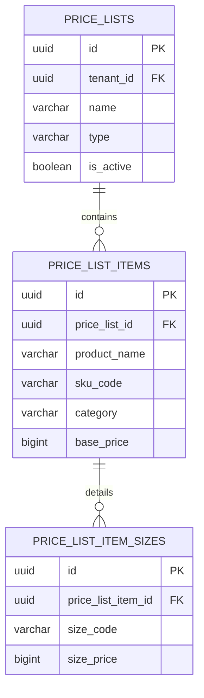

# Spesifikasi Sub-Modul: 011b - Master Daftar Harga Tipe Non-Matrix Produk Reguler (Pricing)

Dokumen ini memuat spesifikasi fungsional, arsitektur data, dan kontrak API untuk **Master Price List Tipe Non-Matrix**: penetapan daftar harga standar produk satuan pakaian (Kaos Polos, Kemeja PDL, Jaket Almamater, Rompi) beserta tarif per ukuran untuk SewERP.

---

## 1. Metadata & Tautan Referensi Terkait

- **Kode Modul**: `SPEC-011b`
- **Domain Bounded Context**: `oms` / `pricing`
- **Tautan Standar Acuan Global**:
  - 📋 [Standar Penulisan Requirement](../context/requirements_standard.md)
  - 🏛️ [Arsitektur Sistem & Presisi Finansial Zero Float](../context/architecture.md)
  - 📝 [Standar Formulir & Validasi Ketat](../context/forms.md)
  - 🗄️ [Standar Database PostgreSQL](../context/dbadmin.md)
  - 🎨 [Standar UI Flat](../context/ui.md)
- **Tautan Spesifikasi Fitur Terkait**:
  - 📋 [011a - Master Price List Matriks Dimensi](./011a-matrix-price-list.md)
  - 🔍 [011c - Resolusi Acuan Harga di Sales Order](./011c-order-price-resolution.md)
  - 📄 [003a - Inti Sales & Order (OMS)](./003a-sales-order-core.md)

---

## 2. Ringkasan Kebutuhan & Masalah Bisnis

### Masalah Lapangan
Selain melayani pesanan paket seragam kombinasi, konveksi juga sering memproduksi pesanan pakaian satuan reguler (*stand-alone standard garments*) seperti "Kaos Oblong Combed 30s", "Polo Shirt Lacoste", atau "Hoodie Fleece". Memaksa pengguna mendefinisikan dimensi matriks yang rumit untuk produk satuan biasa akan membebani alur kerja staf admin.

### Solusi Fitur
1. **Katalog Produk Non-Matrix**: Pengguna langsung mendefinisikan nama artikel, kategori garmen, kode SKU, dan harga satuan dasar.
2. **Breakdown Tarif per Ukuran**: Mendukung penentuan harga dasar per ukuran pakaian standar (S, M, L, XL, XXL).
3. **Pencarian Cepat di Order**: Admin sales dapat mengetik nama produk untuk langsung memilih item dan mengisi harga acuan secara instan.

---

## 3. User Stories

- **US-011b-01 [P1 - Manajer Penjualan]**: Sebagai *Manajer Penjualan*, saya ingin membuat daftar harga artikel pakaian reguler dengan harga dasar per ukuran, agar staf sales memiliki standar harga jual resmi.
- **US-011b-02 [P1 - Admin Sales]**: Sebagai *Admin Sales*, saya ingin mencari nama artikel pakaian di form SPK dan sistem otomatis mengisi harga dasarnya dari price list non-matrix, agar proses pembuatan penawaran cepat.

---

## 4. Kriteria Penerimaan (Acceptance Criteria - Gherkin)

### Skenario 1: Penambahan Produk Non-Matrix Baru
- **Given** Admin membuat price list reguler tipe `non_matrix`.
- **When** Menambahkan produk "Kaos Combed 30s Reguler" dengan base price Rp 48.000.
- **Then** Produk tersimpan dengan UUIDv7 baru dan nominal integer `BIGINT`.

---

## 5. Skema Relasi Data Granular (Mermaid ERD)



---

## 6. Kontrak API RESTful

### Endpoint: `POST /api/v1/oms/price-lists/non-matrix`
- **Request Payload**:
```json
{
  "name": "Katalog Standar Kaos & Polo 2026",
  "effective_from": "2026-10-01",
  "items": [
    {
      "product_name": "Kaos Combed 30s Polos",
      "sku_code": "TS-C30-REG",
      "category": "tshirt",
      "base_price": 48000,
      "size_prices": [
        { "size_code": "S", "size_price": 48000 },
        { "size_code": "M", "size_price": 48000 },
        { "size_code": "L", "size_price": 48000 },
        { "size_code": "XL", "size_price": 48000 },
        { "size_code": "XXL", "size_price": 53000 }
      ]
    }
  ]
}
```

---

## 7. Kerangka Pemecahan Tugas (Task Breakdown)
- [ ] **Fase 1**: Goose migration tabel `price_list_items` dan `price_list_item_sizes`.
- [ ] **Fase 2**: Domain Entity & Repo untuk katalog non-matrix.
- [ ] **Fase 3**: Handler route CRUD katalog non-matrix.
- [ ] **Fase 4**: Antarmuka katalog produk non-matrix di SolidJS.
