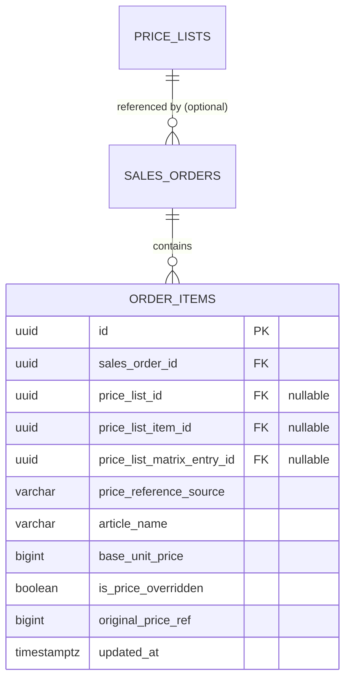

# Spesifikasi Sub-Modul: 011c - Resolusi Acuan Harga di Sales Order & Audit Override (Pricing)

Dokumen ini memuat spesifikasi integrasi acuan Price List opsional pada alur Sales Order (OMS), resolusi harga otomatis (Matrix & Non-Matrix), fleksibilitas penyesuaian (*Price Override*), serta pencatatan jejak audit integritas margin profit untuk SewERP.

---

## 1. Metadata & Tautan Referensi Terkait

- **Kode Modul**: `SPEC-011c`
- **Domain Bounded Context**: `oms` / `pricing`
- **Tautan Standar Acuan Global**:
  - 📋 [Standar Penulisan Requirement](../context/requirements_standard.md)
  - 🏛️ [Arsitektur Sistem & Presisi Finansial Zero Float](../context/architecture.md)
  - 🛡️ [Standar Keamanan & Audit Trail](../context/security.md)
  - 🗄️ [Standar Database PostgreSQL](../context/dbadmin.md)
  - 🧪 [Standar QA & Benchmark Testing](../context/qa.md)
- **Tautan Spesifikasi Fitur Terkait**:
  - 📋 [011a - Master Price List Matriks Dimensi](./011a-matrix-price-list.md)
  - 📋 [011b - Master Price List Non-Matrix](./011b-non-matrix-price-list.md)
  - 📄 [003a - Inti Sales & Order (OMS)](./003a-sales-order-core.md)
  - 📊 [001a - Dashboard Metrik Agregasi](./001a-dashboard-overview-metrics.md)

---

## 2. Ringkasan Kebutuhan & Masalah Bisnis

### Masalah Lapangan
Sistem ERP tradisional sering kali kaku mewajibkan pemilihan produk dari katalog master. Di industri konveksi, pesanan sering bersifat kustom bebas (*custom bespoke*) dari sampel pelanggan baru yang belum terdaftar di price list. Di sisi lain, bila price list tersedia, staf sales sering melakukan negosiasi harga khusus (*price override*) tanpa adanya catatan harga asli, sehingga menyulitkan audit saat terjadi penurunan margin keuntungan.

### Solusi Fitur
1. **Referensi Price List Bersifat Opsional**:
   - Jika `price_list_id = NULL`: Sales Order dibuat secara manual murni (*pure bespoke*).
   - Jika `price_list_id` dipilih: Sistem otomatis mengisi harga acuan dari Matrix atau Non-Matrix.
2. **Pelacakan Sumber Harga (`price_reference_source`)**: Mencatat apakah harga ditarik dari `'manual'`, `'price_list_matrix'`, atau `'price_list_item'`.
3. **Price Override dengan Jejak Audit**: Jika kasir/sales mengubah harga satuan dari acuan price list, sistem menandai `is_price_overridden = TRUE`, menyimpan nilai acuan asli di `original_price_ref`, dan mencatat riwayat perubahan untuk evaluasi manajemen.

---

## 3. User Stories

- **US-011c-01 [P1 - Admin Sales]**: Sebagai *Admin Sales*, saya ingin sistem otomatis menarik harga acuan saat saya memilih paket seragam dari price list, namun saya tetap dapat menyesuaikan harga jika ada diskon khusus negosiasi.
- **US-011c-02 [P1 - Owner Konveksi]**: Sebagai *Owner Konveksi*, saya ingin melihat laporan item pesanan yang mengalami *price override* beserta selisih harga aslinya, agar integritas margin profit pabrik dapat saya awasi.

---

## 4. Kriteria Penerimaan (Acceptance Criteria - Gherkin)

### Skenario 1: Penyesuaian Harga (Price Override) dengan Jejak Audit
- **Given** Price list menetapkan harga acuan Polo Shirt sebesar Rp 75.000 (`original_price_ref = 75000`).
- **When** Admin sales mengubah harga satuan menjadi Rp 72.000 karena pesanan berjumlah 500 pcs.
- **Then** Sistem menyimpan `base_unit_price = 72000`, `is_price_overridden = true`, dan `original_price_ref = 75000`.
- **And** Riwayat audit mencatat penurunan harga sebesar Rp 3.000 / pcs.

---

## 5. Skema Relasi Data Granular (Mermaid ERD)



---

## 6. Kontrak API RESTful

### Endpoint: `GET /api/v1/oms/price-lists/resolve?price_list_id={id}&type={type}&params={params}`
- **Query Params**: `price_list_id=...&combination={"Baju":"Putih","Bawahan":"Rok","Kerudung":"No"}&quantity=50`
- **Response Payload (HTTP 200 OK)**:
```json
{
  "status": "success",
  "data": {
    "price_list_id": "01925b6a-8451-7ef1-953e-51c045b0a333",
    "reference_source": "price_list_matrix",
    "entry_id": "01925b6a-8451-7ef1-953e-51c045b0a777",
    "suggested_unit_price": 95000,
    "min_quantity_met": true
  }
}
```

---

## 7. Kerangka Pemecahan Tugas (Task Breakdown)
- [ ] **Fase 1**: Goose migration kolom audit harga di tabel `order_items`.
- [ ] **Fase 2**: Service resolusi harga di Go domain layer.
- [ ] **Fase 3**: Handler route `GET /api/v1/oms/price-lists/resolve`.
- [ ] **Fase 4**: Indikator visual badge "Override" pada item baris order di SolidJS.
